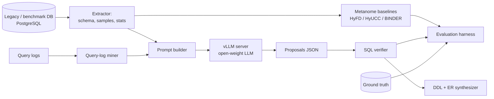

# LLM-Assisted Schema Reverse Engineering


A research project that asks whether large language models can recover the *implicit* structure of legacy databases: foreign keys (FKs), unique column combinations (UCCs), functional dependencies (FDs) and, from those, a normalized relational model. The LLM gets column names, sampled rows and query logs. Its proposals will be benchmarked against classic data-profiling algorithms from the [Metanome](https://hpi.de/naumann/projects/data-profiling-and-analytics/metanome-data-profiling.html) platform on public datasets whose ground-truth constraints are known. The project extends the author's master's thesis on reverse engineering existing databases into explicit relational models.

> **Status: research design phase.** This repository holds the research plan, feature specification and architecture. No experiments have been run and no code has been written. All features are **planned**, and no results are claimed.

## Research Question

> Can LLM semantic cues (names, values, query usage) beat purely statistical profiling at inferring keys and dependencies on noisy, undocumented schemas, and where do they hallucinate?

Full protocol: [docs/RESEARCH.md](docs/RESEARCH.md).

## Motivation

Many production databases have no declared FKs: constraints were dropped for performance, the schema came from an ORM, or the system grew over decades. Statistical profilers find *every* inclusion dependency or FD that holds in the data, including huge numbers of accidental ones, and they struggle with dirty data. Humans resolve this with semantics ("`cust_id` probably references `customer.id`"). LLMs encode that kind of semantics, but they also hallucinate. Measuring the trade-off carefully is an open, useful question for data engineering and database research.

## Key Features (planned)

- **Schema and sample extractor** for PostgreSQL: catalog metadata, stratified row samples, column statistics.
- **Query-log miner**: extracts join predicates from `pg_stat_statements` or SQL log files as evidence.
- **Ground-truth builder**: removes declared constraints from benchmark DBs and stores them as gold labels.
- **Noise injector**: renames columns, injects nulls, typos and orphan rows, and removes documentation to simulate legacy conditions.
- **LLM proposer**: open-weight models (e.g. Llama, Qwen) served by [vLLM](https://github.com/vllm-project/vllm) through its OpenAI-compatible API, returning schema-constrained JSON proposals with confidence scores and rationales.
- **Baseline runner**: Metanome algorithms (e.g. HyFD for FDs, HyUCC for UCCs, BINDER for INDs) as statistical baselines.
- **Hybrid verifier**: checks LLM proposals against the data with SQL (inclusion, uniqueness, FD violation rate).
- **Evaluation harness**: precision, recall and F1 for FK, UCC and FD discovery, a hallucination taxonomy, and reproducible run manifests.
- **Model synthesizer**: turns accepted constraints into a normalized DDL proposal plus an ER diagram (Mermaid).

Details: [docs/FEATURES.md](docs/FEATURES.md).

## Architecture Overview



See [docs/ARCHITECTURE.md](docs/ARCHITECTURE.md).

## Tech Stack (planned)

| Area | Choice |
|---|---|
| Language | Python 3.11+ |
| Database | PostgreSQL 16 (Docker) |
| LLM serving | vLLM (OpenAI-compatible server) |
| Models | Open-weight instruction models, e.g. Llama 3.x and Qwen 2.5 families (exact checkpoints fixed in the run manifest) |
| Baselines | Metanome (Java) with algorithm JARs from the HPI metanome-algorithms repository |
| Data handling | SQLAlchemy / psycopg, pandas |
| Validation | Pydantic schemas for LLM output |
| Experiment tracking | YAML configs, JSONL results, optional MLflow |
| Quality | pytest, ruff, GitHub Actions |

## Project Status

🔬 **Research design.** The research question, evaluation protocol and dataset shortlist are being drafted. There is no implementation and there are no results.

## Roadmap

| Milestone | Scope | Target |
|---|---|---|
| M0: Proposal | Research plan, literature review, dataset licences checked | Month 0 |
| M1: Infrastructure | Loaders for benchmark DBs, ground-truth extraction, noise injector | Month 1 |
| M2: Baselines | Metanome runs (FD/UCC/IND), FK heuristics on top of INDs | Month 1–2 |
| M3: LLM pipeline | Prompt builder, vLLM proposer, verifier, ablations (names, samples, logs) | Month 2–3 |
| M4: Evaluation | Full benchmark, hallucination analysis, write-up as a workshop paper or preprint | Month 3–4 |

Level: advanced. Estimated effort: 3 to 4 months.

## Getting Started (planned)

Prerequisites:
- Docker and Docker Compose
- Python 3.11+
- An NVIDIA GPU with enough VRAM for the chosen model, *or* a remote OpenAI-compatible endpoint
- Java (JRE) for Metanome

```bash
# planned, not yet available
docker compose up -d postgres
python -m srev.datasets load tpch --scale 1
python -m srev.run --config configs/experiment.yaml
```

## Configuration Overview (planned)

| Key | Example | Description |
|---|---|---|
| `llm.base_url` | `http://localhost:8000/v1` | vLLM OpenAI-compatible endpoint |
| `llm.model` | `Qwen/Qwen2.5-7B-Instruct` | Model ID (pinned per run) |
| `llm.temperature` | `0.0` | Decoding temperature |
| `evidence` | `[names, samples, logs]` | Evidence channels for the ablation |
| `sample.rows_per_table` | `50` | Rows shown to the LLM |
| `noise.profile` | `medium` | Noise-injection preset |
| `baselines` | `[hyfd, hyucc, binder]` | Metanome algorithms to run |
| `seed` | `42` | Global seed |

## Citation

A citation entry will be added once a preprint exists.

## Contributing

The project is in the design phase, so the most useful contributions right now are feedback on the docs. Open an issue to discuss a requirement, design decision or feature before you send a pull request. Planned conventions: feature branches, Conventional Commits, `ruff` + `pytest` in CI.

## License

Released under the [MIT License](LICENSE). Copyright (c) 2026 Mahmudul Islam.

## Author

**Mahmudul Islam** · M.Sc. Computer Science · [github.com/mahmudul-islam32](https://github.com/mahmudul-islam32)
