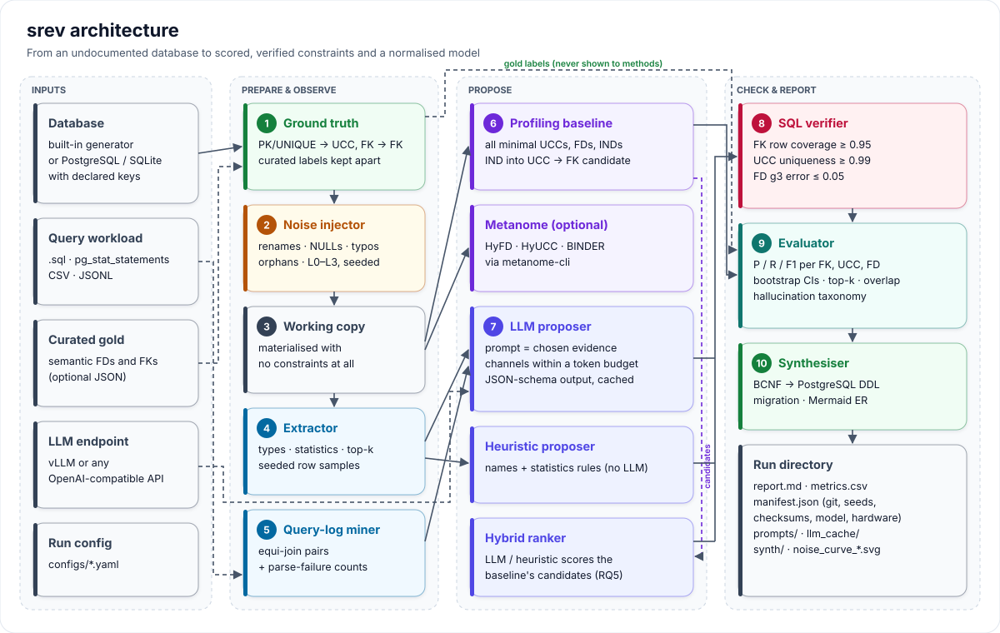
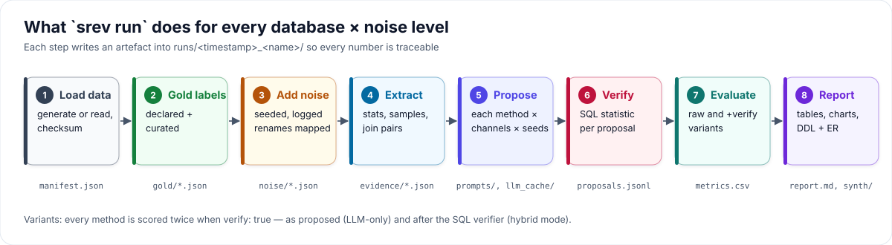
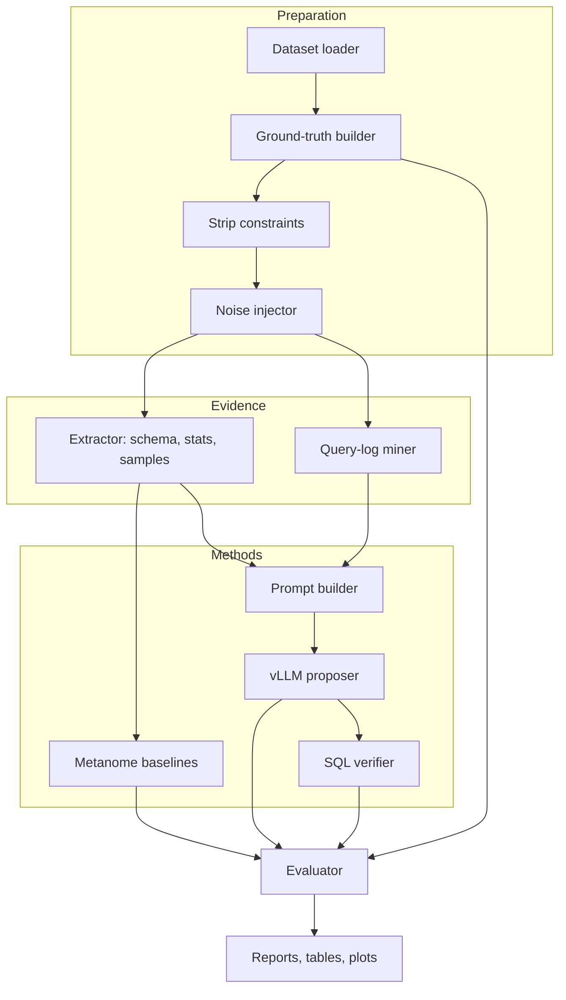
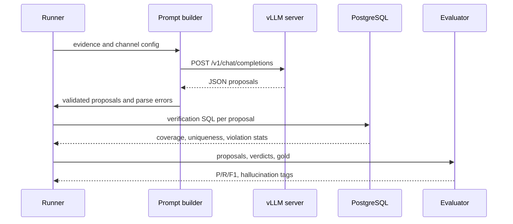

# Architecture: llm-schema-reverse-engineering

> Design document. Status: **implemented** (package `srev`); see the README for usage.

## 1. Pipeline





The same pipeline as a Mermaid flowchart:



## 2. Modules (package `srev`)
| Module | Responsibility |
|---|---|
| `srev.datasets` | Seeded generators (`tpch_mini`, `university`, `retail_legacy`) and the in-memory `Dataset` model with checksums |
| `srev.db` | PostgreSQL (psycopg) and SQLite connectors: catalog introspection, declared constraints, bulk load, `dataset_from_connector` |
| `srev.truth` | Gold labels from declared constraints and curated labels; constraint stripping (`CREATE TABLE … AS`) |
| `srev.noise` | Seeded perturbations and name probes (cryptic, abbreviated, misleading), rename map applied to gold labels and the workload |
| `srev.extract` | Catalog queries, column statistics, deterministic sampling → `Evidence` JSON |
| `srev.qlog`, `srev.sqlutil` | Workload loading and equi-join extraction with `sqlglot` |
| `srev.llm` | Prompt builder, OpenAI-compatible client with cache, strict output parsing, LLM / heuristic / hybrid proposers |
| `srev.baselines` | Exact and approximate Python profilers (UCC, FD with g3, partial IND → FK) and the Metanome CLI wrapper |
| `srev.learn` | Feature-based FK classifier (Rostin et al.), logistic regression, leave-one-dataset-out in the runner |
| `srev.datasets.spider` | Spider/BIRD-format loader: annotations from `tables.json`, gold SQL as workload |
| `srev.export` | booktabs LaTeX tables from stored aggregates |
| `srev.ingest`, `srev.api` | CSV/DataFrame ingestion with type inference; Python API for notebooks |
| `srev.discover` | One-shot discovery: approximate profiling + pre-trained FK classifier + guards + verification |
| `srev.dbt` | dbt project export (sources with tests, singular tests, staging models) |
| `srev.quality` | Data-quality checks of constraints, drift and schema-change detection |
| `srev.graph` | FK graph: table roles, components, hubs, star schemas, join-path SQL |
| `srev.htmlreport` | Self-contained HTML profiling report |
| `srev.verify` | SQL checks for FK coverage, uniqueness and FD g3 error |
| `srev.eval` | Metrics, bootstrap CIs, permutation test, hallucination taxonomy, Cohen's κ |
| `srev.synth` | BCNF decomposition, DDL, migration script and Mermaid ER generation |
| `srev.config`, `srev.runner` | YAML experiment config and the datasets × noise × methods loop |
| `srev.manifest`, `srev.report` | Run manifests and Markdown/SVG reports |
| `srev.cli` | `srev` command-line interface |

## 3. Common proposal format
```json
{"type": "FK", "lhs": ["orders.o_custkey"], "rhs": ["customer.c_custkey"],
 "confidence": 0.82, "source": "llm|baseline|hybrid", "rationale": "..."}
```

## 4. Sequence of one LLM run



## 5. Deployment
- `docker compose`: PostgreSQL 16, a vLLM container (profile `gpu`) and a runner container (profile `runner`).
- SQLite working copies (`database.backend: sqlite`) let the whole pipeline run without a server, for CI and pilots.
- Metanome runs as a separate Java process on CSV exports.
- All artifacts are written to `runs/<timestamp>_<name>/` with a manifest; LLM responses are cached by request hash.

## 6. Design decisions
- **Open-weight models only** for the main results, for reproducibility and to avoid data leaving the machine. Proprietary APIs are optional and reported separately.
- **Temperature 0 plus seeds**, with any remaining nondeterminism documented.
- **Verification is separate from proposal**, so LLM-only and hybrid performance can both be reported.
- **One proposal format for everything.** Gold labels, baselines, heuristics and LLM output are all `Proposal` objects with a canonical key, so evaluation is method-agnostic.
- **Evidence never contains declared constraints.** The extractor reads only names, types and comments from the catalog; working copies are created without constraints.
- **Gold-free model synthesis.** The variant fed into the DDL synthesiser is chosen by configuration or a fixed preference order, never by its score against gold.
- **Failures are counted, not hidden.** Unparseable workload statements, malformed LLM responses and items, trimmed prompts and skipped methods all appear in the stored tables.
