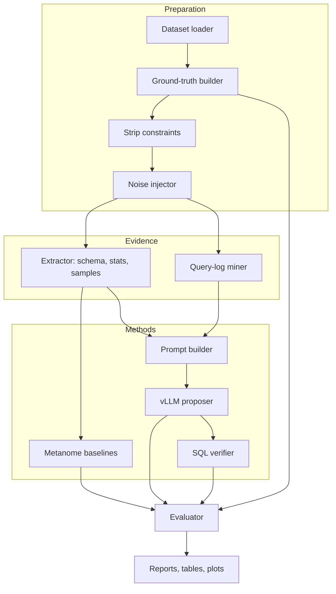
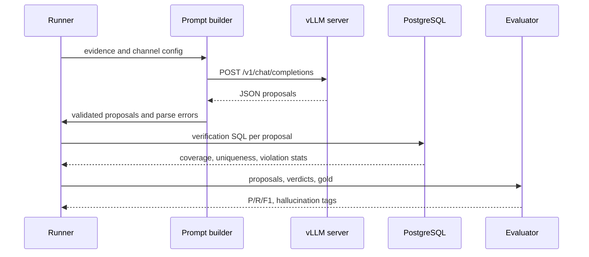

# Architecture: llm-schema-reverse-engineering

> Design document. Status: **draft, planned**.

## 1. Pipeline



## 2. Modules (planned package `srev`)
| Module | Responsibility |
|---|---|
| `srev.datasets` | Download and load benchmark databases into PostgreSQL. Record checksums and licences |
| `srev.truth` | Export declared constraints to gold JSON |
| `srev.noise` | Seeded perturbations |
| `srev.extract` | Catalog queries, statistics, sampling |
| `srev.qlog` | SQL parsing of workloads (e.g. with `sqlglot`) |
| `srev.llm` | Prompt templates, vLLM client, Pydantic output models |
| `srev.baselines` | Metanome CLI wrapper and result converters |
| `srev.verify` | SQL checks for IND coverage, uniqueness and FD violations |
| `srev.eval` | Metrics, bootstrap CIs, hallucination tagging |
| `srev.synth` | Normalization and DDL/ER generation |

## 3. Common proposal format
```json
{"type": "FK", "lhs": ["orders.o_custkey"], "rhs": ["customer.c_custkey"],
 "confidence": 0.82, "source": "llm|baseline|hybrid", "rationale": "..."}
```

## 4. Sequence of one LLM run



## 5. Deployment
- `docker compose`: PostgreSQL 16, a vLLM container (GPU), and a runner container.
- Metanome runs as a separate Java process on CSV exports.
- All artifacts are written to `runs/<timestamp>/` with a manifest.

## 6. Design decisions
- **Open-weight models only** for the main results, for reproducibility and to avoid data leaving the machine. Proprietary APIs are optional and reported separately.
- **Temperature 0 plus seeds**, with any remaining nondeterminism documented.
- **Verification is separate from proposal**, so LLM-only and hybrid performance can both be reported.
