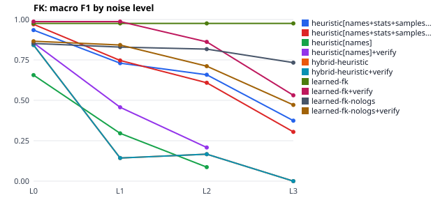
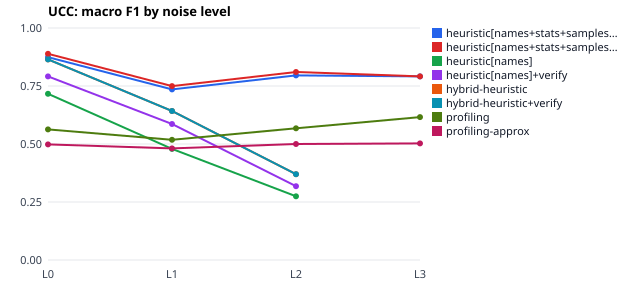
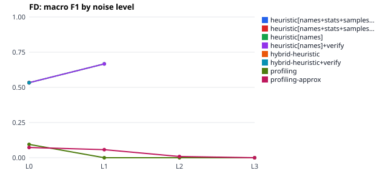

# Run report: 20261031T121424Z_benchmark-seed1

- srev 0.1.0, git `5b04b05c3c77` (dirty tree)
- started 2026-10-31T12:14:24.383288+00:00, finished 2026-10-31T12:15:27.605099+00:00
- config sha256 `58c04c5468bd7107`, seed 1
- hardware: Linux-6.18.44-fc-v185-x86_64-with-glibc2.39, 4 CPUs, 16.9 GB RAM, GPUs: none

Numbers below are produced by this run only; read them together with the threats to validity in docs/RESEARCH.md.

## Databases

| database | noise | tables | rows | gold | perturbations |
|---|---|---|---|---|---|
| tpch_mini_L0 | L0 | 8 | 4239 | FK 10, UCC 8, FD 0 | – |
| tpch_mini_L1 | L1 | 8 | 4239 | FK 10, UCC 8, FD 0 | orphans 141, nulls 915, typos 177, rename_columns 15 |
| tpch_mini_L2 | L2 | 8 | 4239 | FK 10, UCC 8, FD 0 | orphans 386, nulls 2252, typos 513, rename_columns 39, rename_tables 5 |
| tpch_mini_L3 | L3 | 8 | 4239 | FK 10, UCC 8, FD 0 | orphans 642, nulls 4493, typos 750, rename_columns 61, rename_tables 8 |
| tpch_mini_names-abbreviated | names-abbreviated | 8 | 4239 | FK 10, UCC 8, FD 0 | rename_columns 59, rename_tables 8 |
| tpch_mini_names-cryptic | names-cryptic | 8 | 4239 | FK 10, UCC 8, FD 0 | rename_columns 61, rename_tables 8 |
| tpch_mini_names-misleading | names-misleading | 8 | 4239 | FK 10, UCC 8, FD 0 | rename_columns 61, rename_tables 8 |
| university_L0 | L0 | 8 | 1846 | FK 11, UCC 11, FD 4 | – |
| university_L1 | L1 | 8 | 1846 | FK 11, UCC 11, FD 4 | orphans 40, nulls 69, typos 20, rename_columns 7 |
| university_L2 | L2 | 8 | 1846 | FK 11, UCC 11, FD 4 | orphans 116, nulls 182, typos 49, rename_columns 25, rename_tables 1 |
| university_L3 | L3 | 8 | 1846 | FK 11, UCC 11, FD 4 | orphans 187, nulls 378, typos 77, rename_columns 35, rename_tables 8 |
| university_names-abbreviated | names-abbreviated | 8 | 1846 | FK 11, UCC 11, FD 4 | rename_columns 34, rename_tables 8 |
| university_names-cryptic | names-cryptic | 8 | 1846 | FK 11, UCC 11, FD 4 | rename_columns 35, rename_tables 8 |
| university_names-misleading | names-misleading | 8 | 1846 | FK 11, UCC 11, FD 4 | rename_columns 35, rename_tables 8 |
| retail_legacy_L0 | L0 | 6 | 1778 | FK 6, UCC 7, FD 2 | – |
| retail_legacy_L1 | L1 | 6 | 1778 | FK 6, UCC 7, FD 2 | orphans 36, nulls 134, typos 26, rename_columns 6 |
| retail_legacy_L2 | L2 | 6 | 1778 | FK 6, UCC 7, FD 2 | orphans 108, nulls 281, typos 60, rename_columns 18 |
| retail_legacy_L3 | L3 | 6 | 1778 | FK 6, UCC 7, FD 2 | orphans 174, nulls 570, typos 114, rename_columns 26, rename_tables 6 |
| retail_legacy_names-abbreviated | names-abbreviated | 6 | 1778 | FK 6, UCC 7, FD 2 | rename_columns 20, rename_tables 5 |
| retail_legacy_names-cryptic | names-cryptic | 6 | 1778 | FK 6, UCC 7, FD 2 | rename_columns 26, rename_tables 6 |
| retail_legacy_names-misleading | names-misleading | 6 | 1778 | FK 6, UCC 7, FD 2 | rename_columns 26, rename_tables 6 |
| airline_L0 | L0 | 6 | 1757 | FK 7, UCC 8, FD 1 | – |
| airline_L1 | L1 | 6 | 1757 | FK 7, UCC 8, FD 1 | orphans 41, nulls 69, typos 17, rename_columns 6 |
| airline_L2 | L2 | 6 | 1757 | FK 7, UCC 8, FD 1 | orphans 117, nulls 154, typos 52, rename_columns 12, rename_tables 1 |
| airline_L3 | L3 | 6 | 1757 | FK 7, UCC 8, FD 1 | orphans 188, nulls 314, typos 72, rename_columns 24, rename_tables 6 |
| airline_names-abbreviated | names-abbreviated | 6 | 1757 | FK 7, UCC 8, FD 1 | rename_columns 24, rename_tables 6 |
| airline_names-cryptic | names-cryptic | 6 | 1757 | FK 7, UCC 8, FD 1 | rename_columns 24, rename_tables 6 |
| airline_names-misleading | names-misleading | 6 | 1757 | FK 7, UCC 8, FD 1 | rename_columns 24, rename_tables 6 |

## Aggregate results (across databases)

Micro = pooled counts; macro = mean per-database F1 with a bootstrap 95% CI; p = paired sign-flip test of per-database F1 against the reference baseline.

### FK · noise L0

| variant | P (micro) | R (micro) | F1 (micro) | F1 (macro) [CI] | p |
|---|---|---|---|---|---|
| profiling | 0.453 | 1.000 | 0.624 | 0.684 [0.55, 0.81] | – |
| profiling-approx | 0.415 | 1.000 | 0.586 | 0.665 [0.51, 0.81] | 0.500 |
| heuristic[names] | 0.587 | 0.794 | 0.675 | 0.656 [0.56, 0.75] | 0.875 |
| heuristic[names]+verify | 0.964 | 0.794 | 0.871 | 0.856 [0.73, 0.94] | 0.375 |
| heuristic[names+stats+samples+logs] | 0.917 | 0.971 | 0.943 | 0.934 [0.88, 0.97] | 0.125 |
| heuristic[names+stats+samples+logs]+verify | 0.971 | 0.971 | 0.971 | 0.970 [0.94, 1.00] | 0.125 |
| hybrid-heuristic | 0.833 | 0.882 | 0.857 | 0.842 [0.72, 0.92] | 0.375 |
| hybrid-heuristic+verify | 0.833 | 0.882 | 0.857 | 0.842 [0.72, 0.92] | 0.375 |
| learned-fk | 0.971 | 0.971 | 0.971 | 0.976 [0.95, 1.00] | 0.125 |
| learned-fk+verify | 1.000 | 0.971 | 0.985 | 0.987 [0.96, 1.00] | 0.125 |
| learned-fk-nologs | 0.789 | 0.882 | 0.833 | 0.852 [0.71, 0.96] | 0.125 |
| learned-fk-nologs+verify | 0.833 | 0.882 | 0.857 | 0.866 [0.75, 0.96] | 0.125 |

### UCC · noise L0

| variant | P (micro) | R (micro) | F1 (micro) | F1 (macro) [CI] | p |
|---|---|---|---|---|---|
| profiling | 0.213 | 0.971 | 0.349 | 0.563 [0.28, 0.72] | – |
| profiling-approx | 0.153 | 0.971 | 0.264 | 0.498 [0.22, 0.69] | 0.250 |
| heuristic[names] | 0.786 | 0.647 | 0.710 | 0.716 [0.67, 0.76] | 0.625 |
| heuristic[names]+verify | 1.000 | 0.647 | 0.786 | 0.791 [0.74, 0.85] | 0.125 |
| heuristic[names+stats+samples+logs] | 0.964 | 0.794 | 0.871 | 0.874 [0.85, 0.91] | 0.125 |
| heuristic[names+stats+samples+logs]+verify | 1.000 | 0.794 | 0.885 | 0.889 [0.85, 0.93] | 0.125 |
| hybrid-heuristic | 0.879 | 0.853 | 0.866 | 0.865 [0.82, 0.92] | 0.125 |
| hybrid-heuristic+verify | 0.879 | 0.853 | 0.866 | 0.865 [0.82, 0.92] | 0.125 |
| learned-fk | – | 0.000 | – | – | – |
| learned-fk+verify | – | 0.000 | – | – | – |
| learned-fk-nologs | – | 0.000 | – | – | – |
| learned-fk-nologs+verify | – | 0.000 | – | – | – |

### FD · noise L0

| variant | P (micro) | R (micro) | F1 (micro) | F1 (macro) [CI] | p |
|---|---|---|---|---|---|
| profiling | 0.014 | 1.000 | 0.028 | 0.095 [0.06, 0.14] | – |
| profiling-approx | 0.008 | 1.000 | 0.017 | 0.073 [0.05, 0.11] | 0.250 |
| heuristic[names] | 1.000 | 0.286 | 0.444 | 0.533 [0.40, 0.67] | 0.500 |
| heuristic[names]+verify | 1.000 | 0.286 | 0.444 | 0.533 [0.40, 0.67] | 0.500 |
| heuristic[names+stats+samples+logs] | 1.000 | 0.286 | 0.444 | 0.533 [0.40, 0.67] | 0.500 |
| heuristic[names+stats+samples+logs]+verify | 1.000 | 0.286 | 0.444 | 0.533 [0.40, 0.67] | 0.500 |
| hybrid-heuristic | 1.000 | 0.286 | 0.444 | 0.533 [0.40, 0.67] | 0.500 |
| hybrid-heuristic+verify | 1.000 | 0.286 | 0.444 | 0.533 [0.40, 0.67] | 0.500 |
| learned-fk | – | 0.000 | – | – | – |
| learned-fk+verify | – | 0.000 | – | – | – |
| learned-fk-nologs | – | 0.000 | – | – | – |
| learned-fk-nologs+verify | – | 0.000 | – | – | – |

### FK · noise L1

| variant | P (micro) | R (micro) | F1 (micro) | F1 (macro) [CI] | p |
|---|---|---|---|---|---|
| profiling | 0.151 | 0.147 | 0.149 | 0.137 [0.04, 0.20] | – |
| profiling-approx | 0.420 | 1.000 | 0.591 | 0.679 [0.51, 0.84] | 0.125 |
| heuristic[names] | 0.306 | 0.324 | 0.314 | 0.296 [0.21, 0.38] | 0.125 |
| heuristic[names]+verify | 0.917 | 0.324 | 0.478 | 0.457 [0.30, 0.55] | 0.125 |
| heuristic[names+stats+samples+logs] | 0.880 | 0.647 | 0.746 | 0.730 [0.64, 0.78] | 0.125 |
| heuristic[names+stats+samples+logs]+verify | 0.917 | 0.647 | 0.759 | 0.747 [0.69, 0.78] | 0.125 |
| hybrid-heuristic | 0.429 | 0.088 | 0.146 | 0.143 [0.00, 0.29] | 1.000 |
| hybrid-heuristic+verify | 0.429 | 0.088 | 0.146 | 0.143 [0.00, 0.29] | 1.000 |
| learned-fk | 0.971 | 0.971 | 0.971 | 0.976 [0.95, 1.00] | 0.125 |
| learned-fk+verify | 1.000 | 0.971 | 0.985 | 0.987 [0.96, 1.00] | 0.125 |
| learned-fk-nologs | 0.732 | 0.882 | 0.800 | 0.830 [0.68, 0.98] | 0.125 |
| learned-fk-nologs+verify | 0.769 | 0.882 | 0.822 | 0.842 [0.71, 0.98] | 0.125 |

### UCC · noise L1

| variant | P (micro) | R (micro) | F1 (micro) | F1 (macro) [CI] | p |
|---|---|---|---|---|---|
| profiling | 0.156 | 0.971 | 0.268 | 0.518 [0.23, 0.68] | – |
| profiling-approx | 0.133 | 0.971 | 0.233 | 0.481 [0.21, 0.66] | 0.250 |
| heuristic[names] | 0.560 | 0.412 | 0.475 | 0.479 [0.42, 0.54] | 0.750 |
| heuristic[names]+verify | 1.000 | 0.412 | 0.583 | 0.586 [0.54, 0.64] | 1.000 |
| heuristic[names+stats+samples+logs] | 0.913 | 0.618 | 0.737 | 0.735 [0.69, 0.78] | 0.125 |
| heuristic[names+stats+samples+logs]+verify | 0.955 | 0.618 | 0.750 | 0.750 [0.69, 0.82] | 0.125 |
| hybrid-heuristic | 1.000 | 0.471 | 0.640 | 0.642 [0.57, 0.74] | 0.750 |
| hybrid-heuristic+verify | 1.000 | 0.471 | 0.640 | 0.642 [0.57, 0.74] | 0.750 |
| learned-fk | – | 0.000 | – | – | – |
| learned-fk+verify | – | 0.000 | – | – | – |
| learned-fk-nologs | – | 0.000 | – | – | – |
| learned-fk-nologs+verify | – | 0.000 | – | – | – |

### FD · noise L1

| variant | P (micro) | R (micro) | F1 (micro) | F1 (macro) [CI] | p |
|---|---|---|---|---|---|
| profiling | 0.000 | 0.000 | 0.000 | 0.000 [0.00, 0.00] | – |
| profiling-approx | 0.007 | 0.857 | 0.015 | 0.057 [0.00, 0.11] | 0.500 |
| heuristic[names] | 1.000 | 0.143 | 0.250 | 0.667 | 1.000 |
| heuristic[names]+verify | 1.000 | 0.143 | 0.250 | 0.667 | 1.000 |
| heuristic[names+stats+samples+logs] | – | 0.000 | – | – | – |
| heuristic[names+stats+samples+logs]+verify | – | 0.000 | – | – | – |
| hybrid-heuristic | – | 0.000 | – | – | – |
| hybrid-heuristic+verify | – | 0.000 | – | – | – |
| learned-fk | – | 0.000 | – | – | – |
| learned-fk+verify | – | 0.000 | – | – | – |
| learned-fk-nologs | – | 0.000 | – | – | – |
| learned-fk-nologs+verify | – | 0.000 | – | – | – |

### FK · noise L2

| variant | P (micro) | R (micro) | F1 (micro) | F1 (macro) [CI] | p |
|---|---|---|---|---|---|
| profiling | 0.103 | 0.088 | 0.095 | 0.067 [0.00, 0.14] | – |
| profiling-approx | 0.423 | 0.971 | 0.589 | 0.675 [0.50, 0.84] | 0.125 |
| heuristic[names] | 0.222 | 0.059 | 0.093 | 0.087 [0.00, 0.17] | 1.000 |
| heuristic[names]+verify | 1.000 | 0.059 | 0.111 | 0.208 [0.17, 0.25] | 1.000 |
| heuristic[names+stats+samples+logs] | 1.000 | 0.500 | 0.667 | 0.658 [0.53, 0.75] | 0.125 |
| heuristic[names+stats+samples+logs]+verify | 1.000 | 0.441 | 0.612 | 0.609 [0.51, 0.69] | 0.125 |
| hybrid-heuristic | 1.000 | 0.029 | 0.057 | 0.167 | 1.000 |
| hybrid-heuristic+verify | 1.000 | 0.029 | 0.057 | 0.167 | 1.000 |
| learned-fk | 0.971 | 0.971 | 0.971 | 0.976 [0.95, 1.00] | 0.125 |
| learned-fk+verify | 1.000 | 0.765 | 0.867 | 0.862 [0.81, 0.91] | 0.125 |
| learned-fk-nologs | 0.725 | 0.853 | 0.784 | 0.817 [0.67, 0.91] | 0.125 |
| learned-fk-nologs+verify | 0.719 | 0.676 | 0.697 | 0.711 [0.59, 0.83] | 0.125 |

### UCC · noise L2

| variant | P (micro) | R (micro) | F1 (micro) | F1 (macro) [CI] | p |
|---|---|---|---|---|---|
| profiling | 0.203 | 0.971 | 0.335 | 0.568 [0.28, 0.75] | – |
| profiling-approx | 0.139 | 0.971 | 0.243 | 0.500 [0.21, 0.69] | 0.125 |
| heuristic[names] | 0.467 | 0.206 | 0.286 | 0.275 [0.19, 0.36] | 0.250 |
| heuristic[names]+verify | 0.875 | 0.206 | 0.333 | 0.318 [0.22, 0.41] | 0.250 |
| heuristic[names+stats+samples+logs] | 0.958 | 0.676 | 0.793 | 0.796 [0.74, 0.85] | 0.125 |
| heuristic[names+stats+samples+logs]+verify | 1.000 | 0.676 | 0.807 | 0.810 [0.74, 0.89] | 0.125 |
| hybrid-heuristic | 1.000 | 0.235 | 0.381 | 0.370 [0.29, 0.41] | 0.375 |
| hybrid-heuristic+verify | 1.000 | 0.235 | 0.381 | 0.370 [0.29, 0.41] | 0.375 |
| learned-fk | – | 0.000 | – | – | – |
| learned-fk+verify | – | 0.000 | – | – | – |
| learned-fk-nologs | – | 0.000 | – | – | – |
| learned-fk-nologs+verify | – | 0.000 | – | – | – |

### FD · noise L2

| variant | P (micro) | R (micro) | F1 (micro) | F1 (macro) [CI] | p |
|---|---|---|---|---|---|
| profiling | 0.000 | 0.000 | 0.000 | 0.000 [0.00, 0.00] | – |
| profiling-approx | 0.001 | 0.143 | 0.002 | 0.009 [0.00, 0.03] | 1.000 |
| heuristic[names] | – | 0.000 | – | – | – |
| heuristic[names]+verify | – | 0.000 | – | – | – |
| heuristic[names+stats+samples+logs] | – | 0.000 | – | – | – |
| heuristic[names+stats+samples+logs]+verify | – | 0.000 | – | – | – |
| hybrid-heuristic | – | 0.000 | – | – | – |
| hybrid-heuristic+verify | – | 0.000 | – | – | – |
| learned-fk | – | 0.000 | – | – | – |
| learned-fk+verify | – | 0.000 | – | – | – |
| learned-fk-nologs | – | 0.000 | – | – | – |
| learned-fk-nologs+verify | – | 0.000 | – | – | – |

### FK · noise L3

| variant | P (micro) | R (micro) | F1 (micro) | F1 (macro) [CI] | p |
|---|---|---|---|---|---|
| profiling | 0.038 | 0.029 | 0.033 | 0.019 [0.00, 0.06] | – |
| profiling-approx | 0.400 | 0.882 | 0.550 | 0.609 [0.46, 0.72] | 0.125 |
| heuristic[names] | – | 0.000 | – | – | – |
| heuristic[names]+verify | – | 0.000 | – | – | – |
| heuristic[names+stats+samples+logs] | 1.000 | 0.235 | 0.381 | 0.374 [0.23, 0.52] | 0.125 |
| heuristic[names+stats+samples+logs]+verify | 1.000 | 0.176 | 0.300 | 0.305 [0.21, 0.40] | 0.125 |
| hybrid-heuristic | 0.000 | 0.000 | 0.000 | 0.000 | 1.000 |
| hybrid-heuristic+verify | 0.000 | 0.000 | 0.000 | 0.000 | 1.000 |
| learned-fk | 0.971 | 0.971 | 0.971 | 0.976 [0.95, 1.00] | 0.125 |
| learned-fk+verify | 1.000 | 0.412 | 0.583 | 0.531 [0.36, 0.73] | 0.125 |
| learned-fk-nologs | 0.622 | 0.824 | 0.709 | 0.733 [0.65, 0.79] | 0.125 |
| learned-fk-nologs+verify | 0.545 | 0.353 | 0.429 | 0.471 [0.35, 0.60] | 0.250 |

### UCC · noise L3

| variant | P (micro) | R (micro) | F1 (micro) | F1 (macro) [CI] | p |
|---|---|---|---|---|---|
| profiling | 0.254 | 0.971 | 0.402 | 0.616 [0.31, 0.80] | – |
| profiling-approx | 0.103 | 0.971 | 0.186 | 0.502 [0.20, 0.69] | 0.125 |
| heuristic[names] | – | 0.000 | – | – | – |
| heuristic[names]+verify | – | 0.000 | – | – | – |
| heuristic[names+stats+samples+logs] | 1.000 | 0.647 | 0.786 | 0.791 [0.74, 0.85] | 0.375 |
| heuristic[names+stats+samples+logs]+verify | 1.000 | 0.647 | 0.786 | 0.791 [0.74, 0.85] | 0.375 |
| hybrid-heuristic | – | 0.000 | – | – | – |
| hybrid-heuristic+verify | – | 0.000 | – | – | – |
| learned-fk | – | 0.000 | – | – | – |
| learned-fk+verify | – | 0.000 | – | – | – |
| learned-fk-nologs | – | 0.000 | – | – | – |
| learned-fk-nologs+verify | – | 0.000 | – | – | – |

### FD · noise L3

| variant | P (micro) | R (micro) | F1 (micro) | F1 (macro) [CI] | p |
|---|---|---|---|---|---|
| profiling | 0.000 | 0.000 | 0.000 | 0.000 [0.00, 0.00] | – |
| profiling-approx | 0.000 | 0.000 | 0.000 | 0.000 [0.00, 0.00] | 1.000 |
| heuristic[names] | – | 0.000 | – | – | – |
| heuristic[names]+verify | – | 0.000 | – | – | – |
| heuristic[names+stats+samples+logs] | – | 0.000 | – | – | – |
| heuristic[names+stats+samples+logs]+verify | – | 0.000 | – | – | – |
| hybrid-heuristic | – | 0.000 | – | – | – |
| hybrid-heuristic+verify | – | 0.000 | – | – | – |
| learned-fk | – | 0.000 | – | – | – |
| learned-fk+verify | – | 0.000 | – | – | – |
| learned-fk-nologs | – | 0.000 | – | – | – |
| learned-fk-nologs+verify | – | 0.000 | – | – | – |

### FK · noise names-abbreviated

| variant | P (micro) | R (micro) | F1 (micro) | F1 (macro) [CI] | p |
|---|---|---|---|---|---|
| profiling | 0.453 | 1.000 | 0.624 | 0.684 [0.55, 0.81] | – |
| profiling-approx | 0.415 | 1.000 | 0.586 | 0.665 [0.51, 0.81] | 0.500 |
| heuristic[names] | 0.532 | 0.735 | 0.617 | 0.604 [0.50, 0.72] | 0.625 |
| heuristic[names]+verify | 0.962 | 0.735 | 0.833 | 0.825 [0.71, 0.90] | 0.375 |
| heuristic[names+stats+samples+logs] | 0.868 | 0.971 | 0.917 | 0.909 [0.87, 0.95] | 0.125 |
| heuristic[names+stats+samples+logs]+verify | 0.971 | 0.971 | 0.971 | 0.970 [0.94, 1.00] | 0.125 |
| hybrid-heuristic | 0.879 | 0.853 | 0.866 | 0.852 [0.73, 0.94] | 0.375 |
| hybrid-heuristic+verify | 0.879 | 0.853 | 0.866 | 0.852 [0.73, 0.94] | 0.375 |
| learned-fk | 0.971 | 0.971 | 0.971 | 0.976 [0.95, 1.00] | 0.125 |
| learned-fk+verify | 1.000 | 0.971 | 0.985 | 0.987 [0.96, 1.00] | 0.125 |
| learned-fk-nologs | 0.769 | 0.882 | 0.822 | 0.837 [0.71, 0.95] | 0.250 |
| learned-fk-nologs+verify | 0.811 | 0.882 | 0.845 | 0.851 [0.75, 0.95] | 0.250 |

### UCC · noise names-abbreviated

| variant | P (micro) | R (micro) | F1 (micro) | F1 (macro) [CI] | p |
|---|---|---|---|---|---|
| profiling | 0.213 | 0.971 | 0.349 | 0.563 [0.28, 0.72] | – |
| profiling-approx | 0.153 | 0.971 | 0.264 | 0.498 [0.22, 0.69] | 0.250 |
| heuristic[names] | 0.846 | 0.647 | 0.733 | 0.743 [0.67, 0.82] | 0.625 |
| heuristic[names]+verify | 1.000 | 0.647 | 0.786 | 0.791 [0.74, 0.85] | 0.125 |
| heuristic[names+stats+samples+logs] | 1.000 | 0.765 | 0.867 | 0.870 [0.85, 0.91] | 0.125 |
| heuristic[names+stats+samples+logs]+verify | 1.000 | 0.765 | 0.867 | 0.870 [0.85, 0.91] | 0.125 |
| hybrid-heuristic | 0.875 | 0.618 | 0.724 | 0.839 [0.80, 0.88] | 0.250 |
| hybrid-heuristic+verify | 0.875 | 0.618 | 0.724 | 0.839 [0.80, 0.88] | 0.250 |
| learned-fk | – | 0.000 | – | – | – |
| learned-fk+verify | – | 0.000 | – | – | – |
| learned-fk-nologs | – | 0.000 | – | – | – |
| learned-fk-nologs+verify | – | 0.000 | – | – | – |

### FD · noise names-abbreviated

| variant | P (micro) | R (micro) | F1 (micro) | F1 (macro) [CI] | p |
|---|---|---|---|---|---|
| profiling | 0.014 | 1.000 | 0.028 | 0.095 [0.06, 0.14] | – |
| profiling-approx | 0.008 | 1.000 | 0.017 | 0.073 [0.05, 0.11] | 0.250 |
| heuristic[names] | 1.000 | 0.286 | 0.444 | 0.533 [0.40, 0.67] | 0.500 |
| heuristic[names]+verify | 1.000 | 0.286 | 0.444 | 0.533 [0.40, 0.67] | 0.500 |
| heuristic[names+stats+samples+logs] | 1.000 | 0.286 | 0.444 | 0.533 [0.40, 0.67] | 0.500 |
| heuristic[names+stats+samples+logs]+verify | 1.000 | 0.286 | 0.444 | 0.533 [0.40, 0.67] | 0.500 |
| hybrid-heuristic | 1.000 | 0.286 | 0.444 | 0.533 [0.40, 0.67] | 0.500 |
| hybrid-heuristic+verify | 1.000 | 0.286 | 0.444 | 0.533 [0.40, 0.67] | 0.500 |
| learned-fk | – | 0.000 | – | – | – |
| learned-fk+verify | – | 0.000 | – | – | – |
| learned-fk-nologs | – | 0.000 | – | – | – |
| learned-fk-nologs+verify | – | 0.000 | – | – | – |

### FK · noise names-cryptic

| variant | P (micro) | R (micro) | F1 (micro) | F1 (macro) [CI] | p |
|---|---|---|---|---|---|
| profiling | 0.453 | 1.000 | 0.624 | 0.684 [0.55, 0.81] | – |
| profiling-approx | 0.415 | 1.000 | 0.586 | 0.665 [0.51, 0.81] | 0.500 |
| heuristic[names] | – | 0.000 | – | – | – |
| heuristic[names]+verify | – | 0.000 | – | – | – |
| heuristic[names+stats+samples+logs] | 1.000 | 0.941 | 0.970 | 0.975 [0.95, 1.00] | 0.125 |
| heuristic[names+stats+samples+logs]+verify | 1.000 | 0.941 | 0.970 | 0.975 [0.95, 1.00] | 0.125 |
| hybrid-heuristic | 0.375 | 0.088 | 0.143 | 0.173 [0.14, 0.22] | 0.250 |
| hybrid-heuristic+verify | 0.375 | 0.088 | 0.143 | 0.173 [0.14, 0.22] | 0.250 |
| learned-fk | 0.971 | 0.971 | 0.971 | 0.976 [0.95, 1.00] | 0.125 |
| learned-fk+verify | 1.000 | 0.971 | 0.985 | 0.987 [0.96, 1.00] | 0.125 |
| learned-fk-nologs | 0.784 | 0.853 | 0.817 | 0.832 [0.73, 0.93] | 0.250 |
| learned-fk-nologs+verify | 0.829 | 0.853 | 0.841 | 0.847 [0.76, 0.93] | 0.250 |

### UCC · noise names-cryptic

| variant | P (micro) | R (micro) | F1 (micro) | F1 (macro) [CI] | p |
|---|---|---|---|---|---|
| profiling | 0.213 | 0.971 | 0.349 | 0.563 [0.28, 0.72] | – |
| profiling-approx | 0.153 | 0.971 | 0.264 | 0.498 [0.22, 0.69] | 0.250 |
| heuristic[names] | – | 0.000 | – | – | – |
| heuristic[names]+verify | – | 0.000 | – | – | – |
| heuristic[names+stats+samples+logs] | 1.000 | 0.647 | 0.786 | 0.791 [0.74, 0.85] | 0.125 |
| heuristic[names+stats+samples+logs]+verify | 1.000 | 0.647 | 0.786 | 0.791 [0.74, 0.85] | 0.125 |
| hybrid-heuristic | – | 0.000 | – | – | – |
| hybrid-heuristic+verify | – | 0.000 | – | – | – |
| learned-fk | – | 0.000 | – | – | – |
| learned-fk+verify | – | 0.000 | – | – | – |
| learned-fk-nologs | – | 0.000 | – | – | – |
| learned-fk-nologs+verify | – | 0.000 | – | – | – |

### FD · noise names-cryptic

| variant | P (micro) | R (micro) | F1 (micro) | F1 (macro) [CI] | p |
|---|---|---|---|---|---|
| profiling | 0.014 | 1.000 | 0.028 | 0.095 [0.06, 0.14] | – |
| profiling-approx | 0.008 | 1.000 | 0.017 | 0.073 [0.05, 0.11] | 0.250 |
| heuristic[names] | – | 0.000 | – | – | – |
| heuristic[names]+verify | – | 0.000 | – | – | – |
| heuristic[names+stats+samples+logs] | – | 0.000 | – | – | – |
| heuristic[names+stats+samples+logs]+verify | – | 0.000 | – | – | – |
| hybrid-heuristic | – | 0.000 | – | – | – |
| hybrid-heuristic+verify | – | 0.000 | – | – | – |
| learned-fk | – | 0.000 | – | – | – |
| learned-fk+verify | – | 0.000 | – | – | – |
| learned-fk-nologs | – | 0.000 | – | – | – |
| learned-fk-nologs+verify | – | 0.000 | – | – | – |

### FK · noise names-misleading

| variant | P (micro) | R (micro) | F1 (micro) | F1 (macro) [CI] | p |
|---|---|---|---|---|---|
| profiling | 0.453 | 1.000 | 0.624 | 0.684 [0.55, 0.81] | – |
| profiling-approx | 0.415 | 1.000 | 0.586 | 0.665 [0.51, 0.81] | 0.500 |
| heuristic[names] | 0.018 | 0.029 | 0.022 | 0.023 [0.00, 0.07] | 0.125 |
| heuristic[names]+verify | 1.000 | 0.029 | 0.057 | 0.286 | 1.000 |
| heuristic[names+stats+samples+logs] | 0.588 | 0.588 | 0.588 | 0.605 [0.49, 0.79] | 0.500 |
| heuristic[names+stats+samples+logs]+verify | 1.000 | 0.588 | 0.741 | 0.754 [0.65, 0.86] | 0.500 |
| hybrid-heuristic | 0.667 | 0.176 | 0.279 | 0.303 [0.08, 0.52] | 0.125 |
| hybrid-heuristic+verify | 0.667 | 0.176 | 0.279 | 0.303 [0.08, 0.52] | 0.125 |
| learned-fk | 0.971 | 0.971 | 0.971 | 0.976 [0.95, 1.00] | 0.125 |
| learned-fk+verify | 1.000 | 0.971 | 0.985 | 0.987 [0.96, 1.00] | 0.125 |
| learned-fk-nologs | 0.763 | 0.853 | 0.806 | 0.821 [0.73, 0.91] | 0.250 |
| learned-fk-nologs+verify | 0.806 | 0.853 | 0.829 | 0.836 [0.76, 0.91] | 0.250 |

### UCC · noise names-misleading

| variant | P (micro) | R (micro) | F1 (micro) | F1 (macro) [CI] | p |
|---|---|---|---|---|---|
| profiling | 0.213 | 0.971 | 0.349 | 0.563 [0.28, 0.72] | – |
| profiling-approx | 0.153 | 0.971 | 0.264 | 0.498 [0.22, 0.69] | 0.250 |
| heuristic[names] | 0.286 | 0.235 | 0.258 | 0.261 [0.13, 0.39] | 0.125 |
| heuristic[names]+verify | 0.500 | 0.235 | 0.320 | 0.314 [0.18, 0.45] | 0.250 |
| heuristic[names+stats+samples+logs] | 0.607 | 0.500 | 0.548 | 0.548 [0.44, 0.62] | 0.875 |
| heuristic[names+stats+samples+logs]+verify | 0.680 | 0.500 | 0.576 | 0.574 [0.45, 0.65] | 1.000 |
| hybrid-heuristic | 0.414 | 0.353 | 0.381 | 0.359 [0.15, 0.57] | 0.125 |
| hybrid-heuristic+verify | 0.414 | 0.353 | 0.381 | 0.359 [0.15, 0.57] | 0.125 |
| learned-fk | – | 0.000 | – | – | – |
| learned-fk+verify | – | 0.000 | – | – | – |
| learned-fk-nologs | – | 0.000 | – | – | – |
| learned-fk-nologs+verify | – | 0.000 | – | – | – |

### FD · noise names-misleading

| variant | P (micro) | R (micro) | F1 (micro) | F1 (macro) [CI] | p |
|---|---|---|---|---|---|
| profiling | 0.014 | 1.000 | 0.028 | 0.095 [0.06, 0.14] | – |
| profiling-approx | 0.008 | 1.000 | 0.017 | 0.073 [0.05, 0.11] | 0.250 |
| heuristic[names] | 0.000 | 0.000 | 0.000 | 0.000 [0.00, 0.00] | 0.500 |
| heuristic[names]+verify | – | 0.000 | – | – | – |
| heuristic[names+stats+samples+logs] | – | 0.000 | – | – | – |
| heuristic[names+stats+samples+logs]+verify | – | 0.000 | – | – | – |
| hybrid-heuristic | – | 0.000 | – | – | – |
| hybrid-heuristic+verify | – | 0.000 | – | – | – |
| learned-fk | – | 0.000 | – | – | – |
| learned-fk+verify | – | 0.000 | – | – | – |
| learned-fk-nologs | – | 0.000 | – | – | – |
| learned-fk-nologs+verify | – | 0.000 | – | – | – |

## Per-database results

Exact match; CI = item-level bootstrap. Top-k cuts each type at ceil(factor × |gold|) proposals by confidence. Overlap = column-set Jaccard ≥ 0.5.

### tpch_mini_L0

| variant | type | proposed | gold | TP/FP/FN | precision | recall | F1 | top-k F1 | overlap F1 |
|---|---|---|---|---|---|---|---|---|---|
| profiling | FK | 33 | 10 | 10/23/0 | 0.303 [0.15, 0.45] | 1.000 [1.00, 1.00] | 0.465 [0.26, 0.62] | 1.000 | 0.465 |
| profiling | UCC | 110 | 8 | 8/102/0 | 0.073 [0.03, 0.13] | 1.000 [1.00, 1.00] | 0.136 [0.05, 0.23] | 1.000 | 0.136 |
| profiling | FD | 373 | 0 | 0/373/0 | 0.000 [0.00, 0.00] | – | – | – | – |
| profiling-approx | FK | 39 | 10 | 10/29/0 | 0.256 [0.13, 0.41] | 1.000 [1.00, 1.00] | 0.408 [0.23, 0.58] | 1.000 | 0.408 |
| profiling-approx | UCC | 162 | 8 | 8/154/0 | 0.049 [0.02, 0.09] | 1.000 [1.00, 1.00] | 0.094 [0.04, 0.16] | 1.000 | 0.094 |
| profiling-approx | FD | 660 | 0 | 0/660/0 | 0.000 [0.00, 0.00] | – | – | – | – |
| heuristic[names] | FK | 15 | 10 | 9/6/1 | 0.600 [0.33, 0.81] | 0.900 [0.70, 1.00] | 0.720 [0.48, 0.90] | 0.700 | 0.720 |
| heuristic[names] | UCC | 8 | 8 | 6/2/2 | 0.750 [0.43, 1.00] | 0.750 [0.44, 1.00] | 0.750 [0.46, 0.95] | 0.750 | 1.000 |
| heuristic[names] | FD | 0 | 0 | 0/0/0 | – | – | – | – | – |
| heuristic[names]+verify | FK | 9 | 10 | 9/0/1 | 1.000 [1.00, 1.00] | 0.900 [0.70, 1.00] | 0.947 [0.82, 1.00] | 0.947 | 0.947 |
| heuristic[names]+verify | UCC | 6 | 8 | 6/0/2 | 1.000 [1.00, 1.00] | 0.750 [0.38, 1.00] | 0.857 [0.55, 1.00] | 0.857 | 0.857 |
| heuristic[names]+verify | FD | 0 | 0 | 0/0/0 | – | – | – | – | – |
| heuristic[names+stats+samples+logs] | FK | 9 | 10 | 9/0/1 | 1.000 [1.00, 1.00] | 0.900 [0.70, 1.00] | 0.947 [0.82, 1.00] | 0.947 | 0.947 |
| heuristic[names+stats+samples+logs] | UCC | 8 | 8 | 7/1/1 | 0.875 [0.60, 1.00] | 0.875 [0.62, 1.00] | 0.875 [0.62, 1.00] | 0.875 | 0.875 |
| heuristic[names+stats+samples+logs] | FD | 0 | 0 | 0/0/0 | – | – | – | – | – |
| heuristic[names+stats+samples+logs]+verify | FK | 9 | 10 | 9/0/1 | 1.000 [1.00, 1.00] | 0.900 [0.70, 1.00] | 0.947 [0.82, 1.00] | 0.947 | 0.947 |
| heuristic[names+stats+samples+logs]+verify | UCC | 7 | 8 | 7/0/1 | 1.000 [1.00, 1.00] | 0.875 [0.62, 1.00] | 0.933 [0.77, 1.00] | 0.933 | 0.933 |
| heuristic[names+stats+samples+logs]+verify | FD | 0 | 0 | 0/0/0 | – | – | – | – | – |
| hybrid-heuristic | FK | 13 | 10 | 10/3/0 | 0.769 [0.54, 1.00] | 1.000 [1.00, 1.00] | 0.870 [0.70, 1.00] | 1.000 | 0.870 |
| hybrid-heuristic | UCC | 9 | 8 | 8/1/0 | 0.889 [0.67, 1.00] | 1.000 [1.00, 1.00] | 0.941 [0.80, 1.00] | 1.000 | 0.941 |
| hybrid-heuristic | FD | 0 | 0 | 0/0/0 | – | – | – | – | – |
| hybrid-heuristic+verify | FK | 13 | 10 | 10/3/0 | 0.769 [0.54, 1.00] | 1.000 [1.00, 1.00] | 0.870 [0.70, 1.00] | 1.000 | 0.870 |
| hybrid-heuristic+verify | UCC | 9 | 8 | 8/1/0 | 0.889 [0.67, 1.00] | 1.000 [1.00, 1.00] | 0.941 [0.80, 1.00] | 1.000 | 0.941 |
| hybrid-heuristic+verify | FD | 0 | 0 | 0/0/0 | – | – | – | – | – |
| learned-fk | FK | 9 | 10 | 9/0/1 | 1.000 [1.00, 1.00] | 0.900 [0.70, 1.00] | 0.947 [0.82, 1.00] | 0.947 | 0.947 |
| learned-fk | UCC | 0 | 8 | 0/0/8 | – | 0.000 [0.00, 0.00] | – | – | – |
| learned-fk | FD | 0 | 0 | 0/0/0 | – | – | – | – | – |
| learned-fk+verify | FK | 9 | 10 | 9/0/1 | 1.000 [1.00, 1.00] | 0.900 [0.70, 1.00] | 0.947 [0.82, 1.00] | 0.947 | 0.947 |
| learned-fk+verify | UCC | 0 | 8 | 0/0/8 | – | 0.000 [0.00, 0.00] | – | – | – |
| learned-fk+verify | FD | 0 | 0 | 0/0/0 | – | – | – | – | – |
| learned-fk-nologs | FK | 15 | 10 | 8/7/2 | 0.533 [0.29, 0.79] | 0.800 [0.50, 1.00] | 0.640 [0.38, 0.83] | 0.800 | 0.640 |
| learned-fk-nologs | UCC | 0 | 8 | 0/0/8 | – | 0.000 [0.00, 0.00] | – | – | – |
| learned-fk-nologs | FD | 0 | 0 | 0/0/0 | – | – | – | – | – |
| learned-fk-nologs+verify | FK | 13 | 10 | 8/5/2 | 0.615 [0.33, 0.86] | 0.800 [0.50, 1.00] | 0.696 [0.42, 0.89] | 0.800 | 0.696 |
| learned-fk-nologs+verify | UCC | 0 | 8 | 0/0/8 | – | 0.000 [0.00, 0.00] | – | – | – |
| learned-fk-nologs+verify | FD | 0 | 0 | 0/0/0 | – | – | – | – | – |

### tpch_mini_L1

| variant | type | proposed | gold | TP/FP/FN | precision | recall | F1 | top-k F1 | overlap F1 |
|---|---|---|---|---|---|---|---|---|---|
| profiling | FK | 18 | 10 | 2/16/8 | 0.111 [0.00, 0.29] | 0.200 [0.00, 0.50] | 0.143 [0.00, 0.32] | 0.200 | 0.143 |
| profiling | UCC | 162 | 8 | 8/154/0 | 0.049 [0.02, 0.09] | 1.000 [1.00, 1.00] | 0.094 [0.04, 0.16] | 0.750 | 0.094 |
| profiling | FD | 336 | 0 | 0/336/0 | 0.000 [0.00, 0.00] | – | – | – | – |
| profiling-approx | FK | 39 | 10 | 10/29/0 | 0.256 [0.13, 0.41] | 1.000 [1.00, 1.00] | 0.408 [0.23, 0.58] | 0.800 | 0.408 |
| profiling-approx | UCC | 193 | 8 | 8/185/0 | 0.042 [0.02, 0.07] | 1.000 [1.00, 1.00] | 0.080 [0.03, 0.14] | 0.750 | 0.080 |
| profiling-approx | FD | 631 | 0 | 0/631/0 | 0.000 [0.00, 0.00] | – | – | – | – |
| heuristic[names] | FK | 11 | 10 | 4/7/6 | 0.364 [0.09, 0.67] | 0.400 [0.11, 0.73] | 0.381 [0.11, 0.64] | 0.400 | 0.381 |
| heuristic[names] | UCC | 7 | 8 | 3/4/5 | 0.429 [0.00, 0.83] | 0.375 [0.00, 0.75] | 0.400 [0.00, 0.67] | 0.400 | 0.667 |
| heuristic[names] | FD | 0 | 0 | 0/0/0 | – | – | – | – | – |
| heuristic[names]+verify | FK | 4 | 10 | 4/0/6 | 1.000 [1.00, 1.00] | 0.400 [0.10, 0.70] | 0.571 [0.18, 0.82] | 0.571 | 0.571 |
| heuristic[names]+verify | UCC | 3 | 8 | 3/0/5 | 1.000 [1.00, 1.00] | 0.375 [0.12, 0.75] | 0.545 [0.22, 0.86] | 0.545 | 0.545 |
| heuristic[names]+verify | FD | 0 | 0 | 0/0/0 | – | – | – | – | – |
| heuristic[names+stats+samples+logs] | FK | 6 | 10 | 6/0/4 | 1.000 [1.00, 1.00] | 0.600 [0.30, 0.90] | 0.750 [0.46, 0.95] | 0.750 | 0.750 |
| heuristic[names+stats+samples+logs] | UCC | 7 | 8 | 6/1/2 | 0.857 [0.57, 1.00] | 0.750 [0.43, 1.00] | 0.800 [0.50, 1.00] | 0.800 | 0.800 |
| heuristic[names+stats+samples+logs] | FD | 0 | 0 | 0/0/0 | – | – | – | – | – |
| heuristic[names+stats+samples+logs]+verify | FK | 6 | 10 | 6/0/4 | 1.000 [1.00, 1.00] | 0.600 [0.30, 0.90] | 0.750 [0.46, 0.95] | 0.750 | 0.750 |
| heuristic[names+stats+samples+logs]+verify | UCC | 6 | 8 | 6/0/2 | 1.000 [1.00, 1.00] | 0.750 [0.38, 1.00] | 0.857 [0.55, 1.00] | 0.857 | 0.857 |
| heuristic[names+stats+samples+logs]+verify | FD | 0 | 0 | 0/0/0 | – | – | – | – | – |
| hybrid-heuristic | FK | 4 | 10 | 2/2/8 | 0.500 [0.00, 1.00] | 0.200 [0.00, 0.50] | 0.286 [0.00, 0.59] | 0.286 | 0.286 |
| hybrid-heuristic | UCC | 4 | 8 | 4/0/4 | 1.000 [1.00, 1.00] | 0.500 [0.12, 0.88] | 0.667 [0.22, 0.93] | 0.667 | 0.667 |
| hybrid-heuristic | FD | 0 | 0 | 0/0/0 | – | – | – | – | – |
| hybrid-heuristic+verify | FK | 4 | 10 | 2/2/8 | 0.500 [0.00, 1.00] | 0.200 [0.00, 0.50] | 0.286 [0.00, 0.59] | 0.286 | 0.286 |
| hybrid-heuristic+verify | UCC | 4 | 8 | 4/0/4 | 1.000 [1.00, 1.00] | 0.500 [0.12, 0.88] | 0.667 [0.22, 0.93] | 0.667 | 0.667 |
| hybrid-heuristic+verify | FD | 0 | 0 | 0/0/0 | – | – | – | – | – |
| learned-fk | FK | 9 | 10 | 9/0/1 | 1.000 [1.00, 1.00] | 0.900 [0.70, 1.00] | 0.947 [0.82, 1.00] | 0.947 | 0.947 |
| learned-fk | UCC | 0 | 8 | 0/0/8 | – | 0.000 [0.00, 0.00] | – | – | – |
| learned-fk | FD | 0 | 0 | 0/0/0 | – | – | – | – | – |
| learned-fk+verify | FK | 9 | 10 | 9/0/1 | 1.000 [1.00, 1.00] | 0.900 [0.70, 1.00] | 0.947 [0.82, 1.00] | 0.947 | 0.947 |
| learned-fk+verify | UCC | 0 | 8 | 0/0/8 | – | 0.000 [0.00, 0.00] | – | – | – |
| learned-fk+verify | FD | 0 | 0 | 0/0/0 | – | – | – | – | – |
| learned-fk-nologs | FK | 16 | 10 | 8/8/2 | 0.500 [0.25, 0.75] | 0.800 [0.50, 1.00] | 0.615 [0.36, 0.80] | 0.800 | 0.615 |
| learned-fk-nologs | UCC | 0 | 8 | 0/0/8 | – | 0.000 [0.00, 0.00] | – | – | – |
| learned-fk-nologs | FD | 0 | 0 | 0/0/0 | – | – | – | – | – |
| learned-fk-nologs+verify | FK | 14 | 10 | 8/6/2 | 0.571 [0.31, 0.81] | 0.800 [0.56, 1.00] | 0.667 [0.40, 0.86] | 0.800 | 0.667 |
| learned-fk-nologs+verify | UCC | 0 | 8 | 0/0/8 | – | 0.000 [0.00, 0.00] | – | – | – |
| learned-fk-nologs+verify | FD | 0 | 0 | 0/0/0 | – | – | – | – | – |

### tpch_mini_L2

| variant | type | proposed | gold | TP/FP/FN | precision | recall | F1 | top-k F1 | overlap F1 |
|---|---|---|---|---|---|---|---|---|---|
| profiling | FK | 16 | 10 | 1/15/9 | 0.062 [0.00, 0.21] | 0.100 [0.00, 0.33] | 0.077 [0.00, 0.21] | 0.100 | 0.077 |
| profiling | UCC | 118 | 8 | 8/110/0 | 0.068 [0.03, 0.12] | 1.000 [1.00, 1.00] | 0.127 [0.05, 0.21] | 0.750 | 0.127 |
| profiling | FD | 215 | 0 | 0/215/0 | 0.000 [0.00, 0.00] | – | – | – | – |
| profiling-approx | FK | 36 | 10 | 9/27/1 | 0.250 [0.11, 0.41] | 0.900 [0.67, 1.00] | 0.391 [0.20, 0.58] | 0.700 | 0.391 |
| profiling-approx | UCC | 184 | 8 | 8/176/0 | 0.043 [0.02, 0.07] | 1.000 [1.00, 1.00] | 0.083 [0.03, 0.13] | 0.750 | 0.083 |
| profiling-approx | FD | 735 | 0 | 0/735/0 | 0.000 [0.00, 0.00] | – | – | – | – |
| heuristic[names] | FK | 1 | 10 | 0/1/10 | 0.000 [0.00, 0.00] | 0.000 [0.00, 0.00] | 0.000 [0.00, 0.00] | 0.000 | 0.182 |
| heuristic[names] | UCC | 3 | 8 | 1/2/7 | 0.333 [0.00, 1.00] | 0.125 [0.00, 0.43] | 0.182 [0.00, 0.46] | 0.182 | 0.545 |
| heuristic[names] | FD | 0 | 0 | 0/0/0 | – | – | – | – | – |
| heuristic[names]+verify | FK | 0 | 10 | 0/0/10 | – | 0.000 [0.00, 0.00] | – | – | – |
| heuristic[names]+verify | UCC | 1 | 8 | 1/0/7 | 1.000 [1.00, 1.00] | 0.125 [0.00, 0.38] | 0.222 [0.22, 0.55] | 0.222 | 0.222 |
| heuristic[names]+verify | FD | 0 | 0 | 0/0/0 | – | – | – | – | – |
| heuristic[names+stats+samples+logs] | FK | 3 | 10 | 3/0/7 | 1.000 [1.00, 1.00] | 0.300 [0.00, 0.60] | 0.462 [0.18, 0.75] | 0.462 | 0.462 |
| heuristic[names+stats+samples+logs] | UCC | 8 | 8 | 7/1/1 | 0.875 [0.60, 1.00] | 0.875 [0.62, 1.00] | 0.875 [0.62, 1.00] | 0.875 | 0.875 |
| heuristic[names+stats+samples+logs] | FD | 0 | 0 | 0/0/0 | – | – | – | – | – |
| heuristic[names+stats+samples+logs]+verify | FK | 3 | 10 | 3/0/7 | 1.000 [1.00, 1.00] | 0.300 [0.00, 0.60] | 0.462 [0.18, 0.75] | 0.462 | 0.462 |
| heuristic[names+stats+samples+logs]+verify | UCC | 7 | 8 | 7/0/1 | 1.000 [1.00, 1.00] | 0.875 [0.62, 1.00] | 0.933 [0.77, 1.00] | 0.933 | 0.933 |
| heuristic[names+stats+samples+logs]+verify | FD | 0 | 0 | 0/0/0 | – | – | – | – | – |
| hybrid-heuristic | FK | 0 | 10 | 0/0/10 | – | 0.000 [0.00, 0.00] | – | – | – |
| hybrid-heuristic | UCC | 2 | 8 | 2/0/6 | 1.000 [1.00, 1.00] | 0.250 [0.00, 0.62] | 0.400 [0.22, 0.77] | 0.400 | 0.400 |
| hybrid-heuristic | FD | 0 | 0 | 0/0/0 | – | – | – | – | – |
| hybrid-heuristic+verify | FK | 0 | 10 | 0/0/10 | – | 0.000 [0.00, 0.00] | – | – | – |
| hybrid-heuristic+verify | UCC | 2 | 8 | 2/0/6 | 1.000 [1.00, 1.00] | 0.250 [0.00, 0.62] | 0.400 [0.22, 0.77] | 0.400 | 0.400 |
| hybrid-heuristic+verify | FD | 0 | 0 | 0/0/0 | – | – | – | – | – |
| learned-fk | FK | 9 | 10 | 9/0/1 | 1.000 [1.00, 1.00] | 0.900 [0.70, 1.00] | 0.947 [0.82, 1.00] | 0.947 | 0.947 |
| learned-fk | UCC | 0 | 8 | 0/0/8 | – | 0.000 [0.00, 0.00] | – | – | – |
| learned-fk | FD | 0 | 0 | 0/0/0 | – | – | – | – | – |
| learned-fk+verify | FK | 7 | 10 | 7/0/3 | 1.000 [1.00, 1.00] | 0.700 [0.40, 0.90] | 0.824 [0.57, 0.95] | 0.824 | 0.824 |
| learned-fk+verify | UCC | 0 | 8 | 0/0/8 | – | 0.000 [0.00, 0.00] | – | – | – |
| learned-fk+verify | FD | 0 | 0 | 0/0/0 | – | – | – | – | – |
| learned-fk-nologs | FK | 17 | 10 | 8/9/2 | 0.471 [0.24, 0.71] | 0.800 [0.55, 1.00] | 0.593 [0.35, 0.77] | 0.800 | 0.593 |
| learned-fk-nologs | UCC | 0 | 8 | 0/0/8 | – | 0.000 [0.00, 0.00] | – | – | – |
| learned-fk-nologs | FD | 0 | 0 | 0/0/0 | – | – | – | – | – |
| learned-fk-nologs+verify | FK | 13 | 10 | 6/7/4 | 0.462 [0.20, 0.73] | 0.600 [0.29, 0.91] | 0.522 [0.21, 0.74] | 0.600 | 0.522 |
| learned-fk-nologs+verify | UCC | 0 | 8 | 0/0/8 | – | 0.000 [0.00, 0.00] | – | – | – |
| learned-fk-nologs+verify | FD | 0 | 0 | 0/0/0 | – | – | – | – | – |

### tpch_mini_L3

| variant | type | proposed | gold | TP/FP/FN | precision | recall | F1 | top-k F1 | overlap F1 |
|---|---|---|---|---|---|---|---|---|---|
| profiling | FK | 16 | 10 | 1/15/9 | 0.062 [0.00, 0.21] | 0.100 [0.00, 0.33] | 0.077 [0.00, 0.21] | 0.100 | 0.077 |
| profiling | UCC | 90 | 8 | 8/82/0 | 0.089 [0.03, 0.16] | 1.000 [1.00, 1.00] | 0.163 [0.06, 0.27] | 0.750 | 0.163 |
| profiling | FD | 162 | 0 | 0/162/0 | 0.000 [0.00, 0.00] | – | – | – | – |
| profiling-approx | FK | 36 | 10 | 9/27/1 | 0.250 [0.11, 0.41] | 0.900 [0.67, 1.00] | 0.391 [0.20, 0.58] | 0.800 | 0.391 |
| profiling-approx | UCC | 268 | 8 | 8/260/0 | 0.030 [0.01, 0.05] | 1.000 [1.00, 1.00] | 0.058 [0.02, 0.10] | 0.750 | 0.058 |
| profiling-approx | FD | 662 | 0 | 0/662/0 | 0.000 [0.00, 0.00] | – | – | – | – |
| heuristic[names] | FK | 0 | 10 | 0/0/10 | – | 0.000 [0.00, 0.00] | – | – | – |
| heuristic[names] | UCC | 0 | 8 | 0/0/8 | – | 0.000 [0.00, 0.00] | – | – | – |
| heuristic[names] | FD | 0 | 0 | 0/0/0 | – | – | – | – | – |
| heuristic[names]+verify | FK | 0 | 10 | 0/0/10 | – | 0.000 [0.00, 0.00] | – | – | – |
| heuristic[names]+verify | UCC | 0 | 8 | 0/0/8 | – | 0.000 [0.00, 0.00] | – | – | – |
| heuristic[names]+verify | FD | 0 | 0 | 0/0/0 | – | – | – | – | – |
| heuristic[names+stats+samples+logs] | FK | 1 | 10 | 1/0/9 | 1.000 [1.00, 1.00] | 0.100 [0.00, 0.30] | 0.182 [0.18, 0.57] | 0.182 | 0.182 |
| heuristic[names+stats+samples+logs] | UCC | 6 | 8 | 6/0/2 | 1.000 [1.00, 1.00] | 0.750 [0.38, 1.00] | 0.857 [0.55, 1.00] | 0.857 | 0.857 |
| heuristic[names+stats+samples+logs] | FD | 0 | 0 | 0/0/0 | – | – | – | – | – |
| heuristic[names+stats+samples+logs]+verify | FK | 1 | 10 | 1/0/9 | 1.000 [1.00, 1.00] | 0.100 [0.00, 0.30] | 0.182 [0.18, 0.57] | 0.182 | 0.182 |
| heuristic[names+stats+samples+logs]+verify | UCC | 6 | 8 | 6/0/2 | 1.000 [1.00, 1.00] | 0.750 [0.38, 1.00] | 0.857 [0.55, 1.00] | 0.857 | 0.857 |
| heuristic[names+stats+samples+logs]+verify | FD | 0 | 0 | 0/0/0 | – | – | – | – | – |
| hybrid-heuristic | FK | 0 | 10 | 0/0/10 | – | 0.000 [0.00, 0.00] | – | – | – |
| hybrid-heuristic | UCC | 0 | 8 | 0/0/8 | – | 0.000 [0.00, 0.00] | – | – | – |
| hybrid-heuristic | FD | 0 | 0 | 0/0/0 | – | – | – | – | – |
| hybrid-heuristic+verify | FK | 0 | 10 | 0/0/10 | – | 0.000 [0.00, 0.00] | – | – | – |
| hybrid-heuristic+verify | UCC | 0 | 8 | 0/0/8 | – | 0.000 [0.00, 0.00] | – | – | – |
| hybrid-heuristic+verify | FD | 0 | 0 | 0/0/0 | – | – | – | – | – |
| learned-fk | FK | 9 | 10 | 9/0/1 | 1.000 [1.00, 1.00] | 0.900 [0.70, 1.00] | 0.947 [0.82, 1.00] | 0.947 | 0.947 |
| learned-fk | UCC | 0 | 8 | 0/0/8 | – | 0.000 [0.00, 0.00] | – | – | – |
| learned-fk | FD | 0 | 0 | 0/0/0 | – | – | – | – | – |
| learned-fk+verify | FK | 3 | 10 | 3/0/7 | 1.000 [1.00, 1.00] | 0.300 [0.00, 0.60] | 0.462 [0.18, 0.75] | 0.462 | 0.462 |
| learned-fk+verify | UCC | 0 | 8 | 0/0/8 | – | 0.000 [0.00, 0.00] | – | – | – |
| learned-fk+verify | FD | 0 | 0 | 0/0/0 | – | – | – | – | – |
| learned-fk-nologs | FK | 20 | 10 | 9/11/1 | 0.450 [0.25, 0.67] | 0.900 [0.67, 1.00] | 0.600 [0.38, 0.76] | 0.600 | 0.600 |
| learned-fk-nologs | UCC | 0 | 8 | 0/0/8 | – | 0.000 [0.00, 0.00] | – | – | – |
| learned-fk-nologs | FD | 0 | 0 | 0/0/0 | – | – | – | – | – |
| learned-fk-nologs+verify | FK | 7 | 10 | 3/4/7 | 0.429 [0.00, 0.80] | 0.300 [0.00, 0.60] | 0.353 [0.00, 0.60] | 0.353 | 0.353 |
| learned-fk-nologs+verify | UCC | 0 | 8 | 0/0/8 | – | 0.000 [0.00, 0.00] | – | – | – |
| learned-fk-nologs+verify | FD | 0 | 0 | 0/0/0 | – | – | – | – | – |

### tpch_mini_names-abbreviated

| variant | type | proposed | gold | TP/FP/FN | precision | recall | F1 | top-k F1 | overlap F1 |
|---|---|---|---|---|---|---|---|---|---|
| profiling | FK | 33 | 10 | 10/23/0 | 0.303 [0.15, 0.45] | 1.000 [1.00, 1.00] | 0.465 [0.26, 0.62] | 1.000 | 0.465 |
| profiling | UCC | 110 | 8 | 8/102/0 | 0.073 [0.03, 0.13] | 1.000 [1.00, 1.00] | 0.136 [0.05, 0.23] | 0.250 | 0.136 |
| profiling | FD | 373 | 0 | 0/373/0 | 0.000 [0.00, 0.00] | – | – | – | – |
| profiling-approx | FK | 39 | 10 | 10/29/0 | 0.256 [0.13, 0.41] | 1.000 [1.00, 1.00] | 0.408 [0.23, 0.58] | 1.000 | 0.408 |
| profiling-approx | UCC | 162 | 8 | 8/154/0 | 0.049 [0.02, 0.09] | 1.000 [1.00, 1.00] | 0.094 [0.04, 0.16] | 0.125 | 0.094 |
| profiling-approx | FD | 660 | 0 | 0/660/0 | 0.000 [0.00, 0.00] | – | – | – | – |
| heuristic[names] | FK | 12 | 10 | 7/5/3 | 0.583 [0.30, 0.85] | 0.700 [0.40, 1.00] | 0.636 [0.33, 0.85] | 0.700 | 0.636 |
| heuristic[names] | UCC | 6 | 8 | 6/0/2 | 1.000 [1.00, 1.00] | 0.750 [0.38, 1.00] | 0.857 [0.55, 1.00] | 0.857 | 0.857 |
| heuristic[names] | FD | 0 | 0 | 0/0/0 | – | – | – | – | – |
| heuristic[names]+verify | FK | 7 | 10 | 7/0/3 | 1.000 [1.00, 1.00] | 0.700 [0.40, 0.90] | 0.824 [0.57, 0.95] | 0.824 | 0.824 |
| heuristic[names]+verify | UCC | 6 | 8 | 6/0/2 | 1.000 [1.00, 1.00] | 0.750 [0.38, 1.00] | 0.857 [0.55, 1.00] | 0.857 | 0.857 |
| heuristic[names]+verify | FD | 0 | 0 | 0/0/0 | – | – | – | – | – |
| heuristic[names+stats+samples+logs] | FK | 9 | 10 | 9/0/1 | 1.000 [1.00, 1.00] | 0.900 [0.70, 1.00] | 0.947 [0.82, 1.00] | 0.947 | 0.947 |
| heuristic[names+stats+samples+logs] | UCC | 6 | 8 | 6/0/2 | 1.000 [1.00, 1.00] | 0.750 [0.38, 1.00] | 0.857 [0.55, 1.00] | 0.857 | 0.857 |
| heuristic[names+stats+samples+logs] | FD | 0 | 0 | 0/0/0 | – | – | – | – | – |
| heuristic[names+stats+samples+logs]+verify | FK | 9 | 10 | 9/0/1 | 1.000 [1.00, 1.00] | 0.900 [0.70, 1.00] | 0.947 [0.82, 1.00] | 0.947 | 0.947 |
| heuristic[names+stats+samples+logs]+verify | UCC | 6 | 8 | 6/0/2 | 1.000 [1.00, 1.00] | 0.750 [0.38, 1.00] | 0.857 [0.55, 1.00] | 0.857 | 0.857 |
| heuristic[names+stats+samples+logs]+verify | FD | 0 | 0 | 0/0/0 | – | – | – | – | – |
| hybrid-heuristic | FK | 9 | 10 | 9/0/1 | 1.000 [1.00, 1.00] | 0.900 [0.70, 1.00] | 0.947 [0.82, 1.00] | 0.947 | 0.947 |
| hybrid-heuristic | UCC | 0 | 8 | 0/0/8 | – | 0.000 [0.00, 0.00] | – | – | – |
| hybrid-heuristic | FD | 0 | 0 | 0/0/0 | – | – | – | – | – |
| hybrid-heuristic+verify | FK | 9 | 10 | 9/0/1 | 1.000 [1.00, 1.00] | 0.900 [0.70, 1.00] | 0.947 [0.82, 1.00] | 0.947 | 0.947 |
| hybrid-heuristic+verify | UCC | 0 | 8 | 0/0/8 | – | 0.000 [0.00, 0.00] | – | – | – |
| hybrid-heuristic+verify | FD | 0 | 0 | 0/0/0 | – | – | – | – | – |
| learned-fk | FK | 9 | 10 | 9/0/1 | 1.000 [1.00, 1.00] | 0.900 [0.70, 1.00] | 0.947 [0.82, 1.00] | 0.947 | 0.947 |
| learned-fk | UCC | 0 | 8 | 0/0/8 | – | 0.000 [0.00, 0.00] | – | – | – |
| learned-fk | FD | 0 | 0 | 0/0/0 | – | – | – | – | – |
| learned-fk+verify | FK | 9 | 10 | 9/0/1 | 1.000 [1.00, 1.00] | 0.900 [0.70, 1.00] | 0.947 [0.82, 1.00] | 0.947 | 0.947 |
| learned-fk+verify | UCC | 0 | 8 | 0/0/8 | – | 0.000 [0.00, 0.00] | – | – | – |
| learned-fk+verify | FD | 0 | 0 | 0/0/0 | – | – | – | – | – |
| learned-fk-nologs | FK | 15 | 10 | 8/7/2 | 0.533 [0.29, 0.79] | 0.800 [0.50, 1.00] | 0.640 [0.38, 0.83] | 0.800 | 0.640 |
| learned-fk-nologs | UCC | 0 | 8 | 0/0/8 | – | 0.000 [0.00, 0.00] | – | – | – |
| learned-fk-nologs | FD | 0 | 0 | 0/0/0 | – | – | – | – | – |
| learned-fk-nologs+verify | FK | 13 | 10 | 8/5/2 | 0.615 [0.33, 0.86] | 0.800 [0.50, 1.00] | 0.696 [0.42, 0.89] | 0.800 | 0.696 |
| learned-fk-nologs+verify | UCC | 0 | 8 | 0/0/8 | – | 0.000 [0.00, 0.00] | – | – | – |
| learned-fk-nologs+verify | FD | 0 | 0 | 0/0/0 | – | – | – | – | – |

### tpch_mini_names-cryptic

| variant | type | proposed | gold | TP/FP/FN | precision | recall | F1 | top-k F1 | overlap F1 |
|---|---|---|---|---|---|---|---|---|---|
| profiling | FK | 33 | 10 | 10/23/0 | 0.303 [0.15, 0.45] | 1.000 [1.00, 1.00] | 0.465 [0.26, 0.62] | 0.800 | 0.465 |
| profiling | UCC | 110 | 8 | 8/102/0 | 0.073 [0.03, 0.13] | 1.000 [1.00, 1.00] | 0.136 [0.05, 0.23] | 0.375 | 0.136 |
| profiling | FD | 373 | 0 | 0/373/0 | 0.000 [0.00, 0.00] | – | – | – | – |
| profiling-approx | FK | 39 | 10 | 10/29/0 | 0.256 [0.13, 0.41] | 1.000 [1.00, 1.00] | 0.408 [0.23, 0.58] | 0.800 | 0.408 |
| profiling-approx | UCC | 162 | 8 | 8/154/0 | 0.049 [0.02, 0.09] | 1.000 [1.00, 1.00] | 0.094 [0.04, 0.16] | 0.375 | 0.094 |
| profiling-approx | FD | 660 | 0 | 0/660/0 | 0.000 [0.00, 0.00] | – | – | – | – |
| heuristic[names] | FK | 0 | 10 | 0/0/10 | – | 0.000 [0.00, 0.00] | – | – | – |
| heuristic[names] | UCC | 0 | 8 | 0/0/8 | – | 0.000 [0.00, 0.00] | – | – | – |
| heuristic[names] | FD | 0 | 0 | 0/0/0 | – | – | – | – | – |
| heuristic[names]+verify | FK | 0 | 10 | 0/0/10 | – | 0.000 [0.00, 0.00] | – | – | – |
| heuristic[names]+verify | UCC | 0 | 8 | 0/0/8 | – | 0.000 [0.00, 0.00] | – | – | – |
| heuristic[names]+verify | FD | 0 | 0 | 0/0/0 | – | – | – | – | – |
| heuristic[names+stats+samples+logs] | FK | 9 | 10 | 9/0/1 | 1.000 [1.00, 1.00] | 0.900 [0.70, 1.00] | 0.947 [0.82, 1.00] | 0.947 | 0.947 |
| heuristic[names+stats+samples+logs] | UCC | 6 | 8 | 6/0/2 | 1.000 [1.00, 1.00] | 0.750 [0.38, 1.00] | 0.857 [0.55, 1.00] | 0.857 | 0.857 |
| heuristic[names+stats+samples+logs] | FD | 0 | 0 | 0/0/0 | – | – | – | – | – |
| heuristic[names+stats+samples+logs]+verify | FK | 9 | 10 | 9/0/1 | 1.000 [1.00, 1.00] | 0.900 [0.70, 1.00] | 0.947 [0.82, 1.00] | 0.947 | 0.947 |
| heuristic[names+stats+samples+logs]+verify | UCC | 6 | 8 | 6/0/2 | 1.000 [1.00, 1.00] | 0.750 [0.38, 1.00] | 0.857 [0.55, 1.00] | 0.857 | 0.857 |
| heuristic[names+stats+samples+logs]+verify | FD | 0 | 0 | 0/0/0 | – | – | – | – | – |
| hybrid-heuristic | FK | 4 | 10 | 1/3/9 | 0.250 [0.00, 0.86] | 0.100 [0.00, 0.33] | 0.143 [0.00, 0.38] | 0.143 | 0.143 |
| hybrid-heuristic | UCC | 0 | 8 | 0/0/8 | – | 0.000 [0.00, 0.00] | – | – | – |
| hybrid-heuristic | FD | 0 | 0 | 0/0/0 | – | – | – | – | – |
| hybrid-heuristic+verify | FK | 4 | 10 | 1/3/9 | 0.250 [0.00, 0.86] | 0.100 [0.00, 0.33] | 0.143 [0.00, 0.38] | 0.143 | 0.143 |
| hybrid-heuristic+verify | UCC | 0 | 8 | 0/0/8 | – | 0.000 [0.00, 0.00] | – | – | – |
| hybrid-heuristic+verify | FD | 0 | 0 | 0/0/0 | – | – | – | – | – |
| learned-fk | FK | 9 | 10 | 9/0/1 | 1.000 [1.00, 1.00] | 0.900 [0.70, 1.00] | 0.947 [0.82, 1.00] | 0.947 | 0.947 |
| learned-fk | UCC | 0 | 8 | 0/0/8 | – | 0.000 [0.00, 0.00] | – | – | – |
| learned-fk | FD | 0 | 0 | 0/0/0 | – | – | – | – | – |
| learned-fk+verify | FK | 9 | 10 | 9/0/1 | 1.000 [1.00, 1.00] | 0.900 [0.70, 1.00] | 0.947 [0.82, 1.00] | 0.947 | 0.947 |
| learned-fk+verify | UCC | 0 | 8 | 0/0/8 | – | 0.000 [0.00, 0.00] | – | – | – |
| learned-fk+verify | FD | 0 | 0 | 0/0/0 | – | – | – | – | – |
| learned-fk-nologs | FK | 14 | 10 | 8/6/2 | 0.571 [0.31, 0.81] | 0.800 [0.56, 1.00] | 0.667 [0.40, 0.86] | 0.800 | 0.667 |
| learned-fk-nologs | UCC | 0 | 8 | 0/0/8 | – | 0.000 [0.00, 0.00] | – | – | – |
| learned-fk-nologs | FD | 0 | 0 | 0/0/0 | – | – | – | – | – |
| learned-fk-nologs+verify | FK | 12 | 10 | 8/4/2 | 0.667 [0.40, 0.92] | 0.800 [0.50, 1.00] | 0.727 [0.44, 0.88] | 0.800 | 0.727 |
| learned-fk-nologs+verify | UCC | 0 | 8 | 0/0/8 | – | 0.000 [0.00, 0.00] | – | – | – |
| learned-fk-nologs+verify | FD | 0 | 0 | 0/0/0 | – | – | – | – | – |

### tpch_mini_names-misleading

| variant | type | proposed | gold | TP/FP/FN | precision | recall | F1 | top-k F1 | overlap F1 |
|---|---|---|---|---|---|---|---|---|---|
| profiling | FK | 33 | 10 | 10/23/0 | 0.303 [0.15, 0.45] | 1.000 [1.00, 1.00] | 0.465 [0.26, 0.62] | 0.800 | 0.465 |
| profiling | UCC | 110 | 8 | 8/102/0 | 0.073 [0.03, 0.13] | 1.000 [1.00, 1.00] | 0.136 [0.05, 0.23] | 0.125 | 0.136 |
| profiling | FD | 373 | 0 | 0/373/0 | 0.000 [0.00, 0.00] | – | – | – | – |
| profiling-approx | FK | 39 | 10 | 10/29/0 | 0.256 [0.13, 0.41] | 1.000 [1.00, 1.00] | 0.408 [0.23, 0.58] | 0.800 | 0.408 |
| profiling-approx | UCC | 162 | 8 | 8/154/0 | 0.049 [0.02, 0.09] | 1.000 [1.00, 1.00] | 0.094 [0.04, 0.16] | 0.125 | 0.094 |
| profiling-approx | FD | 660 | 0 | 0/660/0 | 0.000 [0.00, 0.00] | – | – | – | – |
| heuristic[names] | FK | 15 | 10 | 0/15/10 | 0.000 [0.00, 0.00] | 0.000 [0.00, 0.00] | 0.000 [0.00, 0.00] | 0.000 | 0.000 |
| heuristic[names] | UCC | 8 | 8 | 1/7/7 | 0.125 [0.00, 0.43] | 0.125 [0.00, 0.40] | 0.125 [0.00, 0.33] | 0.125 | 0.375 |
| heuristic[names] | FD | 0 | 0 | 0/0/0 | – | – | – | – | – |
| heuristic[names]+verify | FK | 0 | 10 | 0/0/10 | – | 0.000 [0.00, 0.00] | – | – | – |
| heuristic[names]+verify | UCC | 5 | 8 | 1/4/7 | 0.200 [0.00, 0.67] | 0.125 [0.00, 0.40] | 0.154 [0.00, 0.40] | 0.154 | 0.154 |
| heuristic[names]+verify | FD | 0 | 0 | 0/0/0 | – | – | – | – | – |
| heuristic[names+stats+samples+logs] | FK | 7 | 10 | 5/2/5 | 0.714 [0.33, 1.00] | 0.500 [0.17, 0.82] | 0.588 [0.29, 0.80] | 0.588 | 0.588 |
| heuristic[names+stats+samples+logs] | UCC | 8 | 8 | 3/5/5 | 0.375 [0.00, 0.75] | 0.375 [0.00, 0.73] | 0.375 [0.00, 0.63] | 0.375 | 0.375 |
| heuristic[names+stats+samples+logs] | FD | 0 | 0 | 0/0/0 | – | – | – | – | – |
| heuristic[names+stats+samples+logs]+verify | FK | 5 | 10 | 5/0/5 | 1.000 [1.00, 1.00] | 0.500 [0.20, 0.80] | 0.667 [0.33, 0.89] | 0.667 | 0.667 |
| heuristic[names+stats+samples+logs]+verify | UCC | 7 | 8 | 3/4/5 | 0.429 [0.00, 0.83] | 0.375 [0.00, 0.75] | 0.400 [0.00, 0.67] | 0.400 | 0.400 |
| heuristic[names+stats+samples+logs]+verify | FD | 0 | 0 | 0/0/0 | – | – | – | – | – |
| hybrid-heuristic | FK | 2 | 10 | 1/1/9 | 0.500 [0.00, 1.00] | 0.100 [0.00, 0.33] | 0.167 [0.00, 0.43] | 0.167 | 0.167 |
| hybrid-heuristic | UCC | 8 | 8 | 1/7/7 | 0.125 [0.00, 0.43] | 0.125 [0.00, 0.40] | 0.125 [0.00, 0.33] | 0.125 | 0.125 |
| hybrid-heuristic | FD | 0 | 0 | 0/0/0 | – | – | – | – | – |
| hybrid-heuristic+verify | FK | 2 | 10 | 1/1/9 | 0.500 [0.00, 1.00] | 0.100 [0.00, 0.33] | 0.167 [0.00, 0.43] | 0.167 | 0.167 |
| hybrid-heuristic+verify | UCC | 8 | 8 | 1/7/7 | 0.125 [0.00, 0.43] | 0.125 [0.00, 0.40] | 0.125 [0.00, 0.33] | 0.125 | 0.125 |
| hybrid-heuristic+verify | FD | 0 | 0 | 0/0/0 | – | – | – | – | – |
| learned-fk | FK | 9 | 10 | 9/0/1 | 1.000 [1.00, 1.00] | 0.900 [0.70, 1.00] | 0.947 [0.82, 1.00] | 0.947 | 0.947 |
| learned-fk | UCC | 0 | 8 | 0/0/8 | – | 0.000 [0.00, 0.00] | – | – | – |
| learned-fk | FD | 0 | 0 | 0/0/0 | – | – | – | – | – |
| learned-fk+verify | FK | 9 | 10 | 9/0/1 | 1.000 [1.00, 1.00] | 0.900 [0.70, 1.00] | 0.947 [0.82, 1.00] | 0.947 | 0.947 |
| learned-fk+verify | UCC | 0 | 8 | 0/0/8 | – | 0.000 [0.00, 0.00] | – | – | – |
| learned-fk+verify | FD | 0 | 0 | 0/0/0 | – | – | – | – | – |
| learned-fk-nologs | FK | 14 | 10 | 8/6/2 | 0.571 [0.31, 0.81] | 0.800 [0.56, 1.00] | 0.667 [0.40, 0.86] | 0.800 | 0.667 |
| learned-fk-nologs | UCC | 0 | 8 | 0/0/8 | – | 0.000 [0.00, 0.00] | – | – | – |
| learned-fk-nologs | FD | 0 | 0 | 0/0/0 | – | – | – | – | – |
| learned-fk-nologs+verify | FK | 12 | 10 | 8/4/2 | 0.667 [0.40, 0.92] | 0.800 [0.50, 1.00] | 0.727 [0.44, 0.88] | 0.800 | 0.727 |
| learned-fk-nologs+verify | UCC | 0 | 8 | 0/0/8 | – | 0.000 [0.00, 0.00] | – | – | – |
| learned-fk-nologs+verify | FD | 0 | 0 | 0/0/0 | – | – | – | – | – |

### university_L0

| variant | type | proposed | gold | TP/FP/FN | precision | recall | F1 | top-k F1 | overlap F1 |
|---|---|---|---|---|---|---|---|---|---|
| profiling | FK | 23 | 11 | 11/12/0 | 0.478 [0.26, 0.65] | 1.000 [1.00, 1.00] | 0.647 [0.41, 0.79] | 0.909 | 0.647 |
| profiling | UCC | 18 | 11 | 10/8/1 | 0.556 [0.32, 0.79] | 0.909 [0.70, 1.00] | 0.690 [0.48, 0.85] | 0.818 | 0.690 |
| profiling | FD | 55 | 4 | 4/51/0 | 0.073 [0.02, 0.15] | 1.000 [1.00, 1.00] | 0.136 [0.04, 0.25] | 0.750 | 0.136 |
| profiling-approx | FK | 24 | 11 | 11/13/0 | 0.458 [0.25, 0.67] | 1.000 [1.00, 1.00] | 0.629 [0.40, 0.80] | 0.909 | 0.629 |
| profiling-approx | UCC | 23 | 11 | 10/13/1 | 0.435 [0.23, 0.64] | 0.909 [0.70, 1.00] | 0.588 [0.34, 0.77] | 0.818 | 0.588 |
| profiling-approx | FD | 72 | 4 | 4/68/0 | 0.056 [0.01, 0.11] | 1.000 [1.00, 1.00] | 0.105 [0.03, 0.20] | 0.750 | 0.105 |
| heuristic[names] | FK | 12 | 11 | 9/3/2 | 0.750 [0.46, 1.00] | 0.818 [0.57, 1.00] | 0.783 [0.53, 0.92] | 0.818 | 0.783 |
| heuristic[names] | UCC | 8 | 11 | 6/2/5 | 0.750 [0.43, 1.00] | 0.545 [0.25, 0.83] | 0.632 [0.38, 0.87] | 0.632 | 0.842 |
| heuristic[names] | FD | 1 | 4 | 1/0/3 | 1.000 [1.00, 1.00] | 0.250 [0.00, 0.75] | 0.400 [0.40, 0.86] | 0.400 | 0.400 |
| heuristic[names]+verify | FK | 9 | 11 | 9/0/2 | 1.000 [1.00, 1.00] | 0.818 [0.55, 1.00] | 0.900 [0.71, 1.00] | 0.900 | 0.900 |
| heuristic[names]+verify | UCC | 6 | 11 | 6/0/5 | 1.000 [1.00, 1.00] | 0.545 [0.27, 0.82] | 0.706 [0.43, 0.90] | 0.706 | 0.706 |
| heuristic[names]+verify | FD | 1 | 4 | 1/0/3 | 1.000 [1.00, 1.00] | 0.250 [0.00, 0.75] | 0.400 [0.40, 0.86] | 0.400 | 0.400 |
| heuristic[names+stats+samples+logs] | FK | 11 | 11 | 11/0/0 | 1.000 [1.00, 1.00] | 1.000 [1.00, 1.00] | 1.000 [1.00, 1.00] | 1.000 | 1.000 |
| heuristic[names+stats+samples+logs] | UCC | 8 | 11 | 8/0/3 | 1.000 [1.00, 1.00] | 0.727 [0.45, 0.91] | 0.842 [0.62, 0.95] | 0.842 | 0.842 |
| heuristic[names+stats+samples+logs] | FD | 1 | 4 | 1/0/3 | 1.000 [1.00, 1.00] | 0.250 [0.00, 0.75] | 0.400 [0.40, 0.86] | 0.400 | 0.400 |
| heuristic[names+stats+samples+logs]+verify | FK | 11 | 11 | 11/0/0 | 1.000 [1.00, 1.00] | 1.000 [1.00, 1.00] | 1.000 [1.00, 1.00] | 1.000 | 1.000 |
| heuristic[names+stats+samples+logs]+verify | UCC | 8 | 11 | 8/0/3 | 1.000 [1.00, 1.00] | 0.727 [0.45, 0.91] | 0.842 [0.62, 0.95] | 0.842 | 0.842 |
| heuristic[names+stats+samples+logs]+verify | FD | 1 | 4 | 1/0/3 | 1.000 [1.00, 1.00] | 0.250 [0.00, 0.75] | 0.400 [0.40, 0.86] | 0.400 | 0.400 |
| hybrid-heuristic | FK | 11 | 11 | 10/1/1 | 0.909 [0.70, 1.00] | 0.909 [0.73, 1.00] | 0.909 [0.74, 1.00] | 0.909 | 0.909 |
| hybrid-heuristic | UCC | 8 | 11 | 8/0/3 | 1.000 [1.00, 1.00] | 0.727 [0.45, 0.91] | 0.842 [0.62, 0.95] | 0.842 | 0.842 |
| hybrid-heuristic | FD | 1 | 4 | 1/0/3 | 1.000 [1.00, 1.00] | 0.250 [0.00, 0.75] | 0.400 [0.40, 0.86] | 0.400 | 0.400 |
| hybrid-heuristic+verify | FK | 11 | 11 | 10/1/1 | 0.909 [0.70, 1.00] | 0.909 [0.73, 1.00] | 0.909 [0.74, 1.00] | 0.909 | 0.909 |
| hybrid-heuristic+verify | UCC | 8 | 11 | 8/0/3 | 1.000 [1.00, 1.00] | 0.727 [0.45, 0.91] | 0.842 [0.62, 0.95] | 0.842 | 0.842 |
| hybrid-heuristic+verify | FD | 1 | 4 | 1/0/3 | 1.000 [1.00, 1.00] | 0.250 [0.00, 0.75] | 0.400 [0.40, 0.86] | 0.400 | 0.400 |
| learned-fk | FK | 12 | 11 | 11/1/0 | 0.917 [0.75, 1.00] | 1.000 [1.00, 1.00] | 0.957 [0.86, 1.00] | 1.000 | 0.957 |
| learned-fk | UCC | 0 | 11 | 0/0/11 | – | 0.000 [0.00, 0.00] | – | – | – |
| learned-fk | FD | 0 | 4 | 0/0/4 | – | 0.000 [0.00, 0.00] | – | – | – |
| learned-fk+verify | FK | 11 | 11 | 11/0/0 | 1.000 [1.00, 1.00] | 1.000 [1.00, 1.00] | 1.000 [1.00, 1.00] | 1.000 | 1.000 |
| learned-fk+verify | UCC | 0 | 11 | 0/0/11 | – | 0.000 [0.00, 0.00] | – | – | – |
| learned-fk+verify | FD | 0 | 4 | 0/0/4 | – | 0.000 [0.00, 0.00] | – | – | – |
| learned-fk-nologs | FK | 11 | 11 | 11/0/0 | 1.000 [1.00, 1.00] | 1.000 [1.00, 1.00] | 1.000 [1.00, 1.00] | 1.000 | 1.000 |
| learned-fk-nologs | UCC | 0 | 11 | 0/0/11 | – | 0.000 [0.00, 0.00] | – | – | – |
| learned-fk-nologs | FD | 0 | 4 | 0/0/4 | – | 0.000 [0.00, 0.00] | – | – | – |
| learned-fk-nologs+verify | FK | 11 | 11 | 11/0/0 | 1.000 [1.00, 1.00] | 1.000 [1.00, 1.00] | 1.000 [1.00, 1.00] | 1.000 | 1.000 |
| learned-fk-nologs+verify | UCC | 0 | 11 | 0/0/11 | – | 0.000 [0.00, 0.00] | – | – | – |
| learned-fk-nologs+verify | FD | 0 | 4 | 0/0/4 | – | 0.000 [0.00, 0.00] | – | – | – |

### university_L1

| variant | type | proposed | gold | TP/FP/FN | precision | recall | F1 | top-k F1 | overlap F1 |
|---|---|---|---|---|---|---|---|---|---|
| profiling | FK | 11 | 11 | 2/9/9 | 0.182 [0.00, 0.44] | 0.182 [0.00, 0.44] | 0.182 [0.00, 0.40] | 0.182 | 0.182 |
| profiling | UCC | 20 | 11 | 10/10/1 | 0.500 [0.29, 0.70] | 0.909 [0.70, 1.00] | 0.645 [0.44, 0.80] | 0.909 | 0.645 |
| profiling | FD | 48 | 4 | 0/48/4 | 0.000 [0.00, 0.00] | 0.000 [0.00, 0.00] | 0.000 [0.00, 0.00] | 0.000 | 0.038 |
| profiling-approx | FK | 24 | 11 | 11/13/0 | 0.458 [0.25, 0.67] | 1.000 [1.00, 1.00] | 0.629 [0.40, 0.80] | 0.909 | 0.629 |
| profiling-approx | UCC | 23 | 11 | 10/13/1 | 0.435 [0.23, 0.64] | 0.909 [0.70, 1.00] | 0.588 [0.34, 0.77] | 0.909 | 0.588 |
| profiling-approx | FD | 72 | 4 | 4/68/0 | 0.056 [0.01, 0.11] | 1.000 [1.00, 1.00] | 0.105 [0.03, 0.20] | 0.750 | 0.105 |
| heuristic[names] | FK | 10 | 11 | 4/6/7 | 0.400 [0.10, 0.73] | 0.364 [0.10, 0.67] | 0.381 [0.11, 0.64] | 0.381 | 0.381 |
| heuristic[names] | UCC | 7 | 11 | 4/3/7 | 0.571 [0.20, 0.90] | 0.364 [0.09, 0.67] | 0.444 [0.13, 0.67] | 0.444 | 0.667 |
| heuristic[names] | FD | 0 | 4 | 0/0/4 | – | 0.000 [0.00, 0.00] | – | – | – |
| heuristic[names]+verify | FK | 4 | 11 | 4/0/7 | 1.000 [1.00, 1.00] | 0.364 [0.09, 0.64] | 0.533 [0.17, 0.78] | 0.533 | 0.533 |
| heuristic[names]+verify | UCC | 4 | 11 | 4/0/7 | 1.000 [1.00, 1.00] | 0.364 [0.09, 0.64] | 0.533 [0.17, 0.78] | 0.533 | 0.533 |
| heuristic[names]+verify | FD | 0 | 4 | 0/0/4 | – | 0.000 [0.00, 0.00] | – | – | – |
| heuristic[names+stats+samples+logs] | FK | 9 | 11 | 8/1/3 | 0.889 [0.67, 1.00] | 0.727 [0.44, 1.00] | 0.800 [0.59, 0.96] | 0.800 | 0.800 |
| heuristic[names+stats+samples+logs] | UCC | 6 | 11 | 6/0/5 | 1.000 [1.00, 1.00] | 0.545 [0.27, 0.82] | 0.706 [0.43, 0.90] | 0.706 | 0.706 |
| heuristic[names+stats+samples+logs] | FD | 0 | 4 | 0/0/4 | – | 0.000 [0.00, 0.00] | – | – | – |
| heuristic[names+stats+samples+logs]+verify | FK | 9 | 11 | 8/1/3 | 0.889 [0.67, 1.00] | 0.727 [0.44, 1.00] | 0.800 [0.59, 0.96] | 0.800 | 0.800 |
| heuristic[names+stats+samples+logs]+verify | UCC | 6 | 11 | 6/0/5 | 1.000 [1.00, 1.00] | 0.545 [0.27, 0.82] | 0.706 [0.43, 0.90] | 0.706 | 0.706 |
| heuristic[names+stats+samples+logs]+verify | FD | 0 | 4 | 0/0/4 | – | 0.000 [0.00, 0.00] | – | – | – |
| hybrid-heuristic | FK | 1 | 11 | 0/1/11 | 0.000 [0.00, 0.00] | 0.000 [0.00, 0.00] | 0.000 [0.00, 0.00] | 0.000 | 0.000 |
| hybrid-heuristic | UCC | 4 | 11 | 4/0/7 | 1.000 [1.00, 1.00] | 0.364 [0.09, 0.64] | 0.533 [0.17, 0.78] | 0.533 | 0.533 |
| hybrid-heuristic | FD | 0 | 4 | 0/0/4 | – | 0.000 [0.00, 0.00] | – | – | – |
| hybrid-heuristic+verify | FK | 1 | 11 | 0/1/11 | 0.000 [0.00, 0.00] | 0.000 [0.00, 0.00] | 0.000 [0.00, 0.00] | 0.000 | 0.000 |
| hybrid-heuristic+verify | UCC | 4 | 11 | 4/0/7 | 1.000 [1.00, 1.00] | 0.364 [0.09, 0.64] | 0.533 [0.17, 0.78] | 0.533 | 0.533 |
| hybrid-heuristic+verify | FD | 0 | 4 | 0/0/4 | – | 0.000 [0.00, 0.00] | – | – | – |
| learned-fk | FK | 12 | 11 | 11/1/0 | 0.917 [0.75, 1.00] | 1.000 [1.00, 1.00] | 0.957 [0.86, 1.00] | 1.000 | 0.957 |
| learned-fk | UCC | 0 | 11 | 0/0/11 | – | 0.000 [0.00, 0.00] | – | – | – |
| learned-fk | FD | 0 | 4 | 0/0/4 | – | 0.000 [0.00, 0.00] | – | – | – |
| learned-fk+verify | FK | 11 | 11 | 11/0/0 | 1.000 [1.00, 1.00] | 1.000 [1.00, 1.00] | 1.000 [1.00, 1.00] | 1.000 | 1.000 |
| learned-fk+verify | UCC | 0 | 11 | 0/0/11 | – | 0.000 [0.00, 0.00] | – | – | – |
| learned-fk+verify | FD | 0 | 4 | 0/0/4 | – | 0.000 [0.00, 0.00] | – | – | – |
| learned-fk-nologs | FK | 10 | 11 | 10/0/1 | 1.000 [1.00, 1.00] | 0.909 [0.73, 1.00] | 0.952 [0.84, 1.00] | 0.952 | 0.952 |
| learned-fk-nologs | UCC | 0 | 11 | 0/0/11 | – | 0.000 [0.00, 0.00] | – | – | – |
| learned-fk-nologs | FD | 0 | 4 | 0/0/4 | – | 0.000 [0.00, 0.00] | – | – | – |
| learned-fk-nologs+verify | FK | 10 | 11 | 10/0/1 | 1.000 [1.00, 1.00] | 0.909 [0.73, 1.00] | 0.952 [0.84, 1.00] | 0.952 | 0.952 |
| learned-fk-nologs+verify | UCC | 0 | 11 | 0/0/11 | – | 0.000 [0.00, 0.00] | – | – | – |
| learned-fk-nologs+verify | FD | 0 | 4 | 0/0/4 | – | 0.000 [0.00, 0.00] | – | – | – |

### university_L2

| variant | type | proposed | gold | TP/FP/FN | precision | recall | F1 | top-k F1 | overlap F1 |
|---|---|---|---|---|---|---|---|---|---|
| profiling | FK | 10 | 11 | 2/8/9 | 0.200 [0.00, 0.50] | 0.182 [0.00, 0.44] | 0.191 [0.00, 0.42] | 0.191 | 0.191 |
| profiling | UCC | 20 | 11 | 10/10/1 | 0.500 [0.29, 0.70] | 0.909 [0.70, 1.00] | 0.645 [0.44, 0.80] | 0.909 | 0.645 |
| profiling | FD | 62 | 4 | 0/62/4 | 0.000 [0.00, 0.00] | 0.000 [0.00, 0.00] | 0.000 [0.00, 0.00] | 0.000 | 0.091 |
| profiling-approx | FK | 24 | 11 | 11/13/0 | 0.458 [0.25, 0.67] | 1.000 [1.00, 1.00] | 0.629 [0.40, 0.80] | 0.909 | 0.629 |
| profiling-approx | UCC | 22 | 11 | 10/12/1 | 0.455 [0.25, 0.67] | 0.909 [0.70, 1.00] | 0.606 [0.36, 0.79] | 0.909 | 0.606 |
| profiling-approx | FD | 73 | 4 | 1/72/3 | 0.014 [0.00, 0.04] | 0.250 [0.00, 0.80] | 0.026 [0.00, 0.08] | 0.250 | 0.102 |
| heuristic[names] | FK | 5 | 11 | 1/4/10 | 0.200 [0.00, 0.67] | 0.091 [0.00, 0.30] | 0.125 [0.00, 0.33] | 0.125 | 0.125 |
| heuristic[names] | UCC | 6 | 11 | 3/3/8 | 0.500 [0.00, 1.00] | 0.273 [0.00, 0.55] | 0.353 [0.00, 0.60] | 0.353 | 0.471 |
| heuristic[names] | FD | 0 | 4 | 0/0/4 | – | 0.000 [0.00, 0.00] | – | – | – |
| heuristic[names]+verify | FK | 1 | 11 | 1/0/10 | 1.000 [1.00, 1.00] | 0.091 [0.00, 0.27] | 0.167 [0.17, 0.53] | 0.167 | 0.167 |
| heuristic[names]+verify | UCC | 3 | 11 | 3/0/8 | 1.000 [1.00, 1.00] | 0.273 [0.00, 0.55] | 0.429 [0.17, 0.71] | 0.429 | 0.429 |
| heuristic[names]+verify | FD | 0 | 4 | 0/0/4 | – | 0.000 [0.00, 0.00] | – | – | – |
| heuristic[names+stats+samples+logs] | FK | 7 | 11 | 7/0/4 | 1.000 [1.00, 1.00] | 0.636 [0.36, 0.91] | 0.778 [0.53, 0.95] | 0.778 | 0.778 |
| heuristic[names+stats+samples+logs] | UCC | 6 | 11 | 6/0/5 | 1.000 [1.00, 1.00] | 0.545 [0.27, 0.82] | 0.706 [0.43, 0.90] | 0.706 | 0.706 |
| heuristic[names+stats+samples+logs] | FD | 0 | 4 | 0/0/4 | – | 0.000 [0.00, 0.00] | – | – | – |
| heuristic[names+stats+samples+logs]+verify | FK | 6 | 11 | 6/0/5 | 1.000 [1.00, 1.00] | 0.545 [0.27, 0.82] | 0.706 [0.43, 0.90] | 0.706 | 0.706 |
| heuristic[names+stats+samples+logs]+verify | UCC | 6 | 11 | 6/0/5 | 1.000 [1.00, 1.00] | 0.545 [0.27, 0.82] | 0.706 [0.43, 0.90] | 0.706 | 0.706 |
| heuristic[names+stats+samples+logs]+verify | FD | 0 | 4 | 0/0/4 | – | 0.000 [0.00, 0.00] | – | – | – |
| hybrid-heuristic | FK | 1 | 11 | 1/0/10 | 1.000 [1.00, 1.00] | 0.091 [0.00, 0.27] | 0.167 [0.17, 0.53] | 0.167 | 0.167 |
| hybrid-heuristic | UCC | 3 | 11 | 3/0/8 | 1.000 [1.00, 1.00] | 0.273 [0.00, 0.55] | 0.429 [0.17, 0.71] | 0.429 | 0.429 |
| hybrid-heuristic | FD | 0 | 4 | 0/0/4 | – | 0.000 [0.00, 0.00] | – | – | – |
| hybrid-heuristic+verify | FK | 1 | 11 | 1/0/10 | 1.000 [1.00, 1.00] | 0.091 [0.00, 0.27] | 0.167 [0.17, 0.53] | 0.167 | 0.167 |
| hybrid-heuristic+verify | UCC | 3 | 11 | 3/0/8 | 1.000 [1.00, 1.00] | 0.273 [0.00, 0.55] | 0.429 [0.17, 0.71] | 0.429 | 0.429 |
| hybrid-heuristic+verify | FD | 0 | 4 | 0/0/4 | – | 0.000 [0.00, 0.00] | – | – | – |
| learned-fk | FK | 12 | 11 | 11/1/0 | 0.917 [0.75, 1.00] | 1.000 [1.00, 1.00] | 0.957 [0.86, 1.00] | 1.000 | 0.957 |
| learned-fk | UCC | 0 | 11 | 0/0/11 | – | 0.000 [0.00, 0.00] | – | – | – |
| learned-fk | FD | 0 | 4 | 0/0/4 | – | 0.000 [0.00, 0.00] | – | – | – |
| learned-fk+verify | FK | 9 | 11 | 9/0/2 | 1.000 [1.00, 1.00] | 0.818 [0.55, 1.00] | 0.900 [0.71, 1.00] | 0.900 | 0.900 |
| learned-fk+verify | UCC | 0 | 11 | 0/0/11 | – | 0.000 [0.00, 0.00] | – | – | – |
| learned-fk+verify | FD | 0 | 4 | 0/0/4 | – | 0.000 [0.00, 0.00] | – | – | – |
| learned-fk-nologs | FK | 11 | 11 | 10/1/1 | 0.909 [0.70, 1.00] | 0.909 [0.73, 1.00] | 0.909 [0.74, 1.00] | 0.909 | 0.909 |
| learned-fk-nologs | UCC | 0 | 11 | 0/0/11 | – | 0.000 [0.00, 0.00] | – | – | – |
| learned-fk-nologs | FD | 0 | 4 | 0/0/4 | – | 0.000 [0.00, 0.00] | – | – | – |
| learned-fk-nologs+verify | FK | 9 | 11 | 8/1/3 | 0.889 [0.67, 1.00] | 0.727 [0.44, 1.00] | 0.800 [0.59, 0.96] | 0.800 | 0.800 |
| learned-fk-nologs+verify | UCC | 0 | 11 | 0/0/11 | – | 0.000 [0.00, 0.00] | – | – | – |
| learned-fk-nologs+verify | FD | 0 | 4 | 0/0/4 | – | 0.000 [0.00, 0.00] | – | – | – |

### university_L3

| variant | type | proposed | gold | TP/FP/FN | precision | recall | F1 | top-k F1 | overlap F1 |
|---|---|---|---|---|---|---|---|---|---|
| profiling | FK | 7 | 11 | 0/7/11 | 0.000 [0.00, 0.00] | 0.000 [0.00, 0.00] | 0.000 [0.00, 0.00] | 0.000 | 0.000 |
| profiling | UCC | 17 | 11 | 10/7/1 | 0.588 [0.33, 0.82] | 0.909 [0.70, 1.00] | 0.714 [0.50, 0.88] | 0.909 | 0.714 |
| profiling | FD | 44 | 4 | 0/44/4 | 0.000 [0.00, 0.00] | 0.000 [0.00, 0.00] | 0.000 [0.00, 0.00] | 0.000 | 0.083 |
| profiling-approx | FK | 24 | 11 | 11/13/0 | 0.458 [0.25, 0.67] | 1.000 [1.00, 1.00] | 0.629 [0.40, 0.80] | 0.909 | 0.629 |
| profiling-approx | UCC | 23 | 11 | 10/13/1 | 0.435 [0.23, 0.64] | 0.909 [0.70, 1.00] | 0.588 [0.34, 0.77] | 0.909 | 0.588 |
| profiling-approx | FD | 72 | 4 | 0/72/4 | 0.000 [0.00, 0.00] | 0.000 [0.00, 0.00] | 0.000 [0.00, 0.00] | 0.000 | 0.050 |
| heuristic[names] | FK | 0 | 11 | 0/0/11 | – | 0.000 [0.00, 0.00] | – | – | – |
| heuristic[names] | UCC | 0 | 11 | 0/0/11 | – | 0.000 [0.00, 0.00] | – | – | – |
| heuristic[names] | FD | 0 | 4 | 0/0/4 | – | 0.000 [0.00, 0.00] | – | – | – |
| heuristic[names]+verify | FK | 0 | 11 | 0/0/11 | – | 0.000 [0.00, 0.00] | – | – | – |
| heuristic[names]+verify | UCC | 0 | 11 | 0/0/11 | – | 0.000 [0.00, 0.00] | – | – | – |
| heuristic[names]+verify | FD | 0 | 4 | 0/0/4 | – | 0.000 [0.00, 0.00] | – | – | – |
| heuristic[names+stats+samples+logs] | FK | 3 | 11 | 3/0/8 | 1.000 [1.00, 1.00] | 0.273 [0.00, 0.55] | 0.429 [0.17, 0.71] | 0.429 | 0.429 |
| heuristic[names+stats+samples+logs] | UCC | 6 | 11 | 6/0/5 | 1.000 [1.00, 1.00] | 0.545 [0.27, 0.82] | 0.706 [0.43, 0.90] | 0.706 | 0.706 |
| heuristic[names+stats+samples+logs] | FD | 0 | 4 | 0/0/4 | – | 0.000 [0.00, 0.00] | – | – | – |
| heuristic[names+stats+samples+logs]+verify | FK | 2 | 11 | 2/0/9 | 1.000 [1.00, 1.00] | 0.182 [0.00, 0.45] | 0.308 [0.17, 0.62] | 0.308 | 0.308 |
| heuristic[names+stats+samples+logs]+verify | UCC | 6 | 11 | 6/0/5 | 1.000 [1.00, 1.00] | 0.545 [0.27, 0.82] | 0.706 [0.43, 0.90] | 0.706 | 0.706 |
| heuristic[names+stats+samples+logs]+verify | FD | 0 | 4 | 0/0/4 | – | 0.000 [0.00, 0.00] | – | – | – |
| hybrid-heuristic | FK | 0 | 11 | 0/0/11 | – | 0.000 [0.00, 0.00] | – | – | – |
| hybrid-heuristic | UCC | 0 | 11 | 0/0/11 | – | 0.000 [0.00, 0.00] | – | – | – |
| hybrid-heuristic | FD | 0 | 4 | 0/0/4 | – | 0.000 [0.00, 0.00] | – | – | – |
| hybrid-heuristic+verify | FK | 0 | 11 | 0/0/11 | – | 0.000 [0.00, 0.00] | – | – | – |
| hybrid-heuristic+verify | UCC | 0 | 11 | 0/0/11 | – | 0.000 [0.00, 0.00] | – | – | – |
| hybrid-heuristic+verify | FD | 0 | 4 | 0/0/4 | – | 0.000 [0.00, 0.00] | – | – | – |
| learned-fk | FK | 12 | 11 | 11/1/0 | 0.917 [0.75, 1.00] | 1.000 [1.00, 1.00] | 0.957 [0.86, 1.00] | 1.000 | 0.957 |
| learned-fk | UCC | 0 | 11 | 0/0/11 | – | 0.000 [0.00, 0.00] | – | – | – |
| learned-fk | FD | 0 | 4 | 0/0/4 | – | 0.000 [0.00, 0.00] | – | – | – |
| learned-fk+verify | FK | 7 | 11 | 7/0/4 | 1.000 [1.00, 1.00] | 0.636 [0.36, 0.91] | 0.778 [0.53, 0.95] | 0.778 | 0.778 |
| learned-fk+verify | UCC | 0 | 11 | 0/0/11 | – | 0.000 [0.00, 0.00] | – | – | – |
| learned-fk+verify | FD | 0 | 4 | 0/0/4 | – | 0.000 [0.00, 0.00] | – | – | – |
| learned-fk-nologs | FK | 12 | 11 | 9/3/2 | 0.750 [0.46, 1.00] | 0.818 [0.57, 1.00] | 0.783 [0.53, 0.92] | 0.727 | 0.783 |
| learned-fk-nologs | UCC | 0 | 11 | 0/0/11 | – | 0.000 [0.00, 0.00] | – | – | – |
| learned-fk-nologs | FD | 0 | 4 | 0/0/4 | – | 0.000 [0.00, 0.00] | – | – | – |
| learned-fk-nologs+verify | FK | 9 | 11 | 6/3/5 | 0.667 [0.33, 1.00] | 0.545 [0.25, 0.83] | 0.600 [0.35, 0.83] | 0.600 | 0.600 |
| learned-fk-nologs+verify | UCC | 0 | 11 | 0/0/11 | – | 0.000 [0.00, 0.00] | – | – | – |
| learned-fk-nologs+verify | FD | 0 | 4 | 0/0/4 | – | 0.000 [0.00, 0.00] | – | – | – |

### university_names-abbreviated

| variant | type | proposed | gold | TP/FP/FN | precision | recall | F1 | top-k F1 | overlap F1 |
|---|---|---|---|---|---|---|---|---|---|
| profiling | FK | 23 | 11 | 11/12/0 | 0.478 [0.26, 0.65] | 1.000 [1.00, 1.00] | 0.647 [0.41, 0.79] | 0.909 | 0.647 |
| profiling | UCC | 18 | 11 | 10/8/1 | 0.556 [0.32, 0.79] | 0.909 [0.70, 1.00] | 0.690 [0.48, 0.85] | 0.818 | 0.690 |
| profiling | FD | 55 | 4 | 4/51/0 | 0.073 [0.02, 0.15] | 1.000 [1.00, 1.00] | 0.136 [0.04, 0.25] | 0.750 | 0.136 |
| profiling-approx | FK | 24 | 11 | 11/13/0 | 0.458 [0.25, 0.67] | 1.000 [1.00, 1.00] | 0.629 [0.40, 0.80] | 0.909 | 0.629 |
| profiling-approx | UCC | 23 | 11 | 10/13/1 | 0.435 [0.23, 0.64] | 0.909 [0.70, 1.00] | 0.588 [0.34, 0.77] | 0.818 | 0.588 |
| profiling-approx | FD | 72 | 4 | 4/68/0 | 0.056 [0.01, 0.11] | 1.000 [1.00, 1.00] | 0.105 [0.03, 0.20] | 0.750 | 0.105 |
| heuristic[names] | FK | 12 | 11 | 9/3/2 | 0.750 [0.46, 1.00] | 0.818 [0.57, 1.00] | 0.783 [0.53, 0.92] | 0.818 | 0.783 |
| heuristic[names] | UCC | 8 | 11 | 6/2/5 | 0.750 [0.43, 1.00] | 0.545 [0.25, 0.83] | 0.632 [0.38, 0.87] | 0.632 | 0.842 |
| heuristic[names] | FD | 1 | 4 | 1/0/3 | 1.000 [1.00, 1.00] | 0.250 [0.00, 0.75] | 0.400 [0.40, 0.86] | 0.400 | 0.400 |
| heuristic[names]+verify | FK | 9 | 11 | 9/0/2 | 1.000 [1.00, 1.00] | 0.818 [0.55, 1.00] | 0.900 [0.71, 1.00] | 0.900 | 0.900 |
| heuristic[names]+verify | UCC | 6 | 11 | 6/0/5 | 1.000 [1.00, 1.00] | 0.545 [0.27, 0.82] | 0.706 [0.43, 0.90] | 0.706 | 0.706 |
| heuristic[names]+verify | FD | 1 | 4 | 1/0/3 | 1.000 [1.00, 1.00] | 0.250 [0.00, 0.75] | 0.400 [0.40, 0.86] | 0.400 | 0.400 |
| heuristic[names+stats+samples+logs] | FK | 12 | 11 | 11/1/0 | 0.917 [0.75, 1.00] | 1.000 [1.00, 1.00] | 0.957 [0.86, 1.00] | 1.000 | 0.957 |
| heuristic[names+stats+samples+logs] | UCC | 8 | 11 | 8/0/3 | 1.000 [1.00, 1.00] | 0.727 [0.45, 0.91] | 0.842 [0.62, 0.95] | 0.842 | 0.842 |
| heuristic[names+stats+samples+logs] | FD | 1 | 4 | 1/0/3 | 1.000 [1.00, 1.00] | 0.250 [0.00, 0.75] | 0.400 [0.40, 0.86] | 0.400 | 0.400 |
| heuristic[names+stats+samples+logs]+verify | FK | 11 | 11 | 11/0/0 | 1.000 [1.00, 1.00] | 1.000 [1.00, 1.00] | 1.000 [1.00, 1.00] | 1.000 | 1.000 |
| heuristic[names+stats+samples+logs]+verify | UCC | 8 | 11 | 8/0/3 | 1.000 [1.00, 1.00] | 0.727 [0.45, 0.91] | 0.842 [0.62, 0.95] | 0.842 | 0.842 |
| heuristic[names+stats+samples+logs]+verify | FD | 1 | 4 | 1/0/3 | 1.000 [1.00, 1.00] | 0.250 [0.00, 0.75] | 0.400 [0.40, 0.86] | 0.400 | 0.400 |
| hybrid-heuristic | FK | 12 | 11 | 10/2/1 | 0.833 [0.58, 1.00] | 0.909 [0.70, 1.00] | 0.870 [0.70, 1.00] | 0.909 | 0.870 |
| hybrid-heuristic | UCC | 8 | 11 | 8/0/3 | 1.000 [1.00, 1.00] | 0.727 [0.45, 0.91] | 0.842 [0.62, 0.95] | 0.842 | 0.842 |
| hybrid-heuristic | FD | 1 | 4 | 1/0/3 | 1.000 [1.00, 1.00] | 0.250 [0.00, 0.75] | 0.400 [0.40, 0.86] | 0.400 | 0.400 |
| hybrid-heuristic+verify | FK | 12 | 11 | 10/2/1 | 0.833 [0.58, 1.00] | 0.909 [0.70, 1.00] | 0.870 [0.70, 1.00] | 0.909 | 0.870 |
| hybrid-heuristic+verify | UCC | 8 | 11 | 8/0/3 | 1.000 [1.00, 1.00] | 0.727 [0.45, 0.91] | 0.842 [0.62, 0.95] | 0.842 | 0.842 |
| hybrid-heuristic+verify | FD | 1 | 4 | 1/0/3 | 1.000 [1.00, 1.00] | 0.250 [0.00, 0.75] | 0.400 [0.40, 0.86] | 0.400 | 0.400 |
| learned-fk | FK | 12 | 11 | 11/1/0 | 0.917 [0.75, 1.00] | 1.000 [1.00, 1.00] | 0.957 [0.86, 1.00] | 1.000 | 0.957 |
| learned-fk | UCC | 0 | 11 | 0/0/11 | – | 0.000 [0.00, 0.00] | – | – | – |
| learned-fk | FD | 0 | 4 | 0/0/4 | – | 0.000 [0.00, 0.00] | – | – | – |
| learned-fk+verify | FK | 11 | 11 | 11/0/0 | 1.000 [1.00, 1.00] | 1.000 [1.00, 1.00] | 1.000 [1.00, 1.00] | 1.000 | 1.000 |
| learned-fk+verify | UCC | 0 | 11 | 0/0/11 | – | 0.000 [0.00, 0.00] | – | – | – |
| learned-fk+verify | FD | 0 | 4 | 0/0/4 | – | 0.000 [0.00, 0.00] | – | – | – |
| learned-fk-nologs | FK | 11 | 11 | 11/0/0 | 1.000 [1.00, 1.00] | 1.000 [1.00, 1.00] | 1.000 [1.00, 1.00] | 1.000 | 1.000 |
| learned-fk-nologs | UCC | 0 | 11 | 0/0/11 | – | 0.000 [0.00, 0.00] | – | – | – |
| learned-fk-nologs | FD | 0 | 4 | 0/0/4 | – | 0.000 [0.00, 0.00] | – | – | – |
| learned-fk-nologs+verify | FK | 11 | 11 | 11/0/0 | 1.000 [1.00, 1.00] | 1.000 [1.00, 1.00] | 1.000 [1.00, 1.00] | 1.000 | 1.000 |
| learned-fk-nologs+verify | UCC | 0 | 11 | 0/0/11 | – | 0.000 [0.00, 0.00] | – | – | – |
| learned-fk-nologs+verify | FD | 0 | 4 | 0/0/4 | – | 0.000 [0.00, 0.00] | – | – | – |

### university_names-cryptic

| variant | type | proposed | gold | TP/FP/FN | precision | recall | F1 | top-k F1 | overlap F1 |
|---|---|---|---|---|---|---|---|---|---|
| profiling | FK | 23 | 11 | 11/12/0 | 0.478 [0.26, 0.65] | 1.000 [1.00, 1.00] | 0.647 [0.41, 0.79] | 0.909 | 0.647 |
| profiling | UCC | 18 | 11 | 10/8/1 | 0.556 [0.32, 0.79] | 0.909 [0.70, 1.00] | 0.690 [0.48, 0.85] | 0.727 | 0.690 |
| profiling | FD | 55 | 4 | 4/51/0 | 0.073 [0.02, 0.15] | 1.000 [1.00, 1.00] | 0.136 [0.04, 0.25] | 0.500 | 0.136 |
| profiling-approx | FK | 24 | 11 | 11/13/0 | 0.458 [0.25, 0.67] | 1.000 [1.00, 1.00] | 0.629 [0.40, 0.80] | 0.909 | 0.629 |
| profiling-approx | UCC | 23 | 11 | 10/13/1 | 0.435 [0.23, 0.64] | 0.909 [0.70, 1.00] | 0.588 [0.34, 0.77] | 0.727 | 0.588 |
| profiling-approx | FD | 72 | 4 | 4/68/0 | 0.056 [0.01, 0.11] | 1.000 [1.00, 1.00] | 0.105 [0.03, 0.20] | 0.500 | 0.105 |
| heuristic[names] | FK | 0 | 11 | 0/0/11 | – | 0.000 [0.00, 0.00] | – | – | – |
| heuristic[names] | UCC | 0 | 11 | 0/0/11 | – | 0.000 [0.00, 0.00] | – | – | – |
| heuristic[names] | FD | 0 | 4 | 0/0/4 | – | 0.000 [0.00, 0.00] | – | – | – |
| heuristic[names]+verify | FK | 0 | 11 | 0/0/11 | – | 0.000 [0.00, 0.00] | – | – | – |
| heuristic[names]+verify | UCC | 0 | 11 | 0/0/11 | – | 0.000 [0.00, 0.00] | – | – | – |
| heuristic[names]+verify | FD | 0 | 4 | 0/0/4 | – | 0.000 [0.00, 0.00] | – | – | – |
| heuristic[names+stats+samples+logs] | FK | 10 | 11 | 10/0/1 | 1.000 [1.00, 1.00] | 0.909 [0.73, 1.00] | 0.952 [0.84, 1.00] | 0.952 | 0.952 |
| heuristic[names+stats+samples+logs] | UCC | 6 | 11 | 6/0/5 | 1.000 [1.00, 1.00] | 0.545 [0.27, 0.82] | 0.706 [0.43, 0.90] | 0.706 | 0.706 |
| heuristic[names+stats+samples+logs] | FD | 0 | 4 | 0/0/4 | – | 0.000 [0.00, 0.00] | – | – | – |
| heuristic[names+stats+samples+logs]+verify | FK | 10 | 11 | 10/0/1 | 1.000 [1.00, 1.00] | 0.909 [0.73, 1.00] | 0.952 [0.84, 1.00] | 0.952 | 0.952 |
| heuristic[names+stats+samples+logs]+verify | UCC | 6 | 11 | 6/0/5 | 1.000 [1.00, 1.00] | 0.545 [0.27, 0.82] | 0.706 [0.43, 0.90] | 0.706 | 0.706 |
| heuristic[names+stats+samples+logs]+verify | FD | 0 | 4 | 0/0/4 | – | 0.000 [0.00, 0.00] | – | – | – |
| hybrid-heuristic | FK | 2 | 11 | 1/1/10 | 0.500 [0.00, 1.00] | 0.091 [0.00, 0.30] | 0.154 [0.00, 0.40] | 0.154 | 0.154 |
| hybrid-heuristic | UCC | 0 | 11 | 0/0/11 | – | 0.000 [0.00, 0.00] | – | – | – |
| hybrid-heuristic | FD | 0 | 4 | 0/0/4 | – | 0.000 [0.00, 0.00] | – | – | – |
| hybrid-heuristic+verify | FK | 2 | 11 | 1/1/10 | 0.500 [0.00, 1.00] | 0.091 [0.00, 0.30] | 0.154 [0.00, 0.40] | 0.154 | 0.154 |
| hybrid-heuristic+verify | UCC | 0 | 11 | 0/0/11 | – | 0.000 [0.00, 0.00] | – | – | – |
| hybrid-heuristic+verify | FD | 0 | 4 | 0/0/4 | – | 0.000 [0.00, 0.00] | – | – | – |
| learned-fk | FK | 12 | 11 | 11/1/0 | 0.917 [0.75, 1.00] | 1.000 [1.00, 1.00] | 0.957 [0.86, 1.00] | 1.000 | 0.957 |
| learned-fk | UCC | 0 | 11 | 0/0/11 | – | 0.000 [0.00, 0.00] | – | – | – |
| learned-fk | FD | 0 | 4 | 0/0/4 | – | 0.000 [0.00, 0.00] | – | – | – |
| learned-fk+verify | FK | 11 | 11 | 11/0/0 | 1.000 [1.00, 1.00] | 1.000 [1.00, 1.00] | 1.000 [1.00, 1.00] | 1.000 | 1.000 |
| learned-fk+verify | UCC | 0 | 11 | 0/0/11 | – | 0.000 [0.00, 0.00] | – | – | – |
| learned-fk+verify | FD | 0 | 4 | 0/0/4 | – | 0.000 [0.00, 0.00] | – | – | – |
| learned-fk-nologs | FK | 10 | 11 | 10/0/1 | 1.000 [1.00, 1.00] | 0.909 [0.73, 1.00] | 0.952 [0.84, 1.00] | 0.952 | 0.952 |
| learned-fk-nologs | UCC | 0 | 11 | 0/0/11 | – | 0.000 [0.00, 0.00] | – | – | – |
| learned-fk-nologs | FD | 0 | 4 | 0/0/4 | – | 0.000 [0.00, 0.00] | – | – | – |
| learned-fk-nologs+verify | FK | 10 | 11 | 10/0/1 | 1.000 [1.00, 1.00] | 0.909 [0.73, 1.00] | 0.952 [0.84, 1.00] | 0.952 | 0.952 |
| learned-fk-nologs+verify | UCC | 0 | 11 | 0/0/11 | – | 0.000 [0.00, 0.00] | – | – | – |
| learned-fk-nologs+verify | FD | 0 | 4 | 0/0/4 | – | 0.000 [0.00, 0.00] | – | – | – |

### university_names-misleading

| variant | type | proposed | gold | TP/FP/FN | precision | recall | F1 | top-k F1 | overlap F1 |
|---|---|---|---|---|---|---|---|---|---|
| profiling | FK | 23 | 11 | 11/12/0 | 0.478 [0.26, 0.65] | 1.000 [1.00, 1.00] | 0.647 [0.41, 0.79] | 0.818 | 0.647 |
| profiling | UCC | 18 | 11 | 10/8/1 | 0.556 [0.32, 0.79] | 0.909 [0.70, 1.00] | 0.690 [0.48, 0.85] | 0.818 | 0.690 |
| profiling | FD | 55 | 4 | 4/51/0 | 0.073 [0.02, 0.15] | 1.000 [1.00, 1.00] | 0.136 [0.04, 0.25] | 0.500 | 0.136 |
| profiling-approx | FK | 24 | 11 | 11/13/0 | 0.458 [0.25, 0.67] | 1.000 [1.00, 1.00] | 0.629 [0.40, 0.80] | 0.818 | 0.629 |
| profiling-approx | UCC | 23 | 11 | 10/13/1 | 0.435 [0.23, 0.64] | 0.909 [0.70, 1.00] | 0.588 [0.34, 0.77] | 0.727 | 0.588 |
| profiling-approx | FD | 72 | 4 | 4/68/0 | 0.056 [0.01, 0.11] | 1.000 [1.00, 1.00] | 0.105 [0.03, 0.20] | 0.500 | 0.105 |
| heuristic[names] | FK | 16 | 11 | 0/16/11 | 0.000 [0.00, 0.00] | 0.000 [0.00, 0.00] | 0.000 [0.00, 0.00] | 0.000 | 0.000 |
| heuristic[names] | UCC | 8 | 11 | 3/5/8 | 0.375 [0.00, 0.75] | 0.273 [0.00, 0.55] | 0.316 [0.00, 0.55] | 0.316 | 0.526 |
| heuristic[names] | FD | 0 | 4 | 0/0/4 | – | 0.000 [0.00, 0.00] | – | – | – |
| heuristic[names]+verify | FK | 0 | 11 | 0/0/11 | – | 0.000 [0.00, 0.00] | – | – | – |
| heuristic[names]+verify | UCC | 4 | 11 | 3/1/8 | 0.750 [0.25, 1.00] | 0.273 [0.00, 0.55] | 0.400 [0.15, 0.67] | 0.400 | 0.400 |
| heuristic[names]+verify | FD | 0 | 4 | 0/0/4 | – | 0.000 [0.00, 0.00] | – | – | – |
| heuristic[names+stats+samples+logs] | FK | 10 | 11 | 5/5/6 | 0.500 [0.20, 0.82] | 0.455 [0.17, 0.75] | 0.476 [0.22, 0.72] | 0.476 | 0.476 |
| heuristic[names+stats+samples+logs] | UCC | 8 | 11 | 6/2/5 | 0.750 [0.43, 1.00] | 0.545 [0.25, 0.83] | 0.632 [0.38, 0.87] | 0.632 | 0.632 |
| heuristic[names+stats+samples+logs] | FD | 0 | 4 | 0/0/4 | – | 0.000 [0.00, 0.00] | – | – | – |
| heuristic[names+stats+samples+logs]+verify | FK | 5 | 11 | 5/0/6 | 1.000 [1.00, 1.00] | 0.455 [0.18, 0.73] | 0.625 [0.31, 0.84] | 0.625 | 0.625 |
| heuristic[names+stats+samples+logs]+verify | UCC | 7 | 11 | 6/1/5 | 0.857 [0.50, 1.00] | 0.545 [0.25, 0.83] | 0.667 [0.40, 0.86] | 0.667 | 0.667 |
| heuristic[names+stats+samples+logs]+verify | FD | 0 | 4 | 0/0/4 | – | 0.000 [0.00, 0.00] | – | – | – |
| hybrid-heuristic | FK | 1 | 11 | 0/1/11 | 0.000 [0.00, 0.00] | 0.000 [0.00, 0.00] | 0.000 [0.00, 0.00] | 0.000 | 0.000 |
| hybrid-heuristic | UCC | 10 | 11 | 6/4/5 | 0.600 [0.27, 0.89] | 0.545 [0.23, 0.83] | 0.571 [0.24, 0.80] | 0.571 | 0.571 |
| hybrid-heuristic | FD | 0 | 4 | 0/0/4 | – | 0.000 [0.00, 0.00] | – | – | – |
| hybrid-heuristic+verify | FK | 1 | 11 | 0/1/11 | 0.000 [0.00, 0.00] | 0.000 [0.00, 0.00] | 0.000 [0.00, 0.00] | 0.000 | 0.000 |
| hybrid-heuristic+verify | UCC | 10 | 11 | 6/4/5 | 0.600 [0.27, 0.89] | 0.545 [0.23, 0.83] | 0.571 [0.24, 0.80] | 0.571 | 0.571 |
| hybrid-heuristic+verify | FD | 0 | 4 | 0/0/4 | – | 0.000 [0.00, 0.00] | – | – | – |
| learned-fk | FK | 12 | 11 | 11/1/0 | 0.917 [0.75, 1.00] | 1.000 [1.00, 1.00] | 0.957 [0.86, 1.00] | 1.000 | 0.957 |
| learned-fk | UCC | 0 | 11 | 0/0/11 | – | 0.000 [0.00, 0.00] | – | – | – |
| learned-fk | FD | 0 | 4 | 0/0/4 | – | 0.000 [0.00, 0.00] | – | – | – |
| learned-fk+verify | FK | 11 | 11 | 11/0/0 | 1.000 [1.00, 1.00] | 1.000 [1.00, 1.00] | 1.000 [1.00, 1.00] | 1.000 | 1.000 |
| learned-fk+verify | UCC | 0 | 11 | 0/0/11 | – | 0.000 [0.00, 0.00] | – | – | – |
| learned-fk+verify | FD | 0 | 4 | 0/0/4 | – | 0.000 [0.00, 0.00] | – | – | – |
| learned-fk-nologs | FK | 11 | 11 | 10/1/1 | 0.909 [0.70, 1.00] | 0.909 [0.73, 1.00] | 0.909 [0.74, 1.00] | 0.909 | 0.909 |
| learned-fk-nologs | UCC | 0 | 11 | 0/0/11 | – | 0.000 [0.00, 0.00] | – | – | – |
| learned-fk-nologs | FD | 0 | 4 | 0/0/4 | – | 0.000 [0.00, 0.00] | – | – | – |
| learned-fk-nologs+verify | FK | 11 | 11 | 10/1/1 | 0.909 [0.70, 1.00] | 0.909 [0.73, 1.00] | 0.909 [0.74, 1.00] | 0.909 | 0.909 |
| learned-fk-nologs+verify | UCC | 0 | 11 | 0/0/11 | – | 0.000 [0.00, 0.00] | – | – | – |
| learned-fk-nologs+verify | FD | 0 | 4 | 0/0/4 | – | 0.000 [0.00, 0.00] | – | – | – |

### retail_legacy_L0

| variant | type | proposed | gold | TP/FP/FN | precision | recall | F1 | top-k F1 | overlap F1 |
|---|---|---|---|---|---|---|---|---|---|
| profiling | FK | 9 | 6 | 6/3/0 | 0.667 [0.33, 1.00] | 1.000 [1.00, 1.00] | 0.800 [0.50, 1.00] | 0.833 | 0.800 |
| profiling | UCC | 13 | 7 | 7/6/0 | 0.538 [0.23, 0.77] | 1.000 [1.00, 1.00] | 0.700 [0.38, 0.87] | 0.714 | 0.700 |
| profiling | FD | 44 | 2 | 2/42/0 | 0.045 [0.00, 0.11] | 1.000 [1.00, 1.00] | 0.087 [0.04, 0.20] | 1.000 | 0.087 |
| profiling-approx | FK | 9 | 6 | 6/3/0 | 0.667 [0.33, 1.00] | 1.000 [1.00, 1.00] | 0.800 [0.50, 1.00] | 0.833 | 0.800 |
| profiling-approx | UCC | 17 | 7 | 7/10/0 | 0.412 [0.18, 0.65] | 1.000 [1.00, 1.00] | 0.583 [0.30, 0.79] | 0.714 | 0.583 |
| profiling-approx | FD | 58 | 2 | 2/56/0 | 0.035 [0.00, 0.09] | 1.000 [1.00, 1.00] | 0.067 [0.03, 0.16] | 1.000 | 0.067 |
| heuristic[names] | FK | 11 | 6 | 5/6/1 | 0.455 [0.17, 0.75] | 0.833 [0.50, 1.00] | 0.588 [0.29, 0.80] | 0.667 | 0.588 |
| heuristic[names] | UCC | 6 | 7 | 5/1/2 | 0.833 [0.50, 1.00] | 0.714 [0.33, 1.00] | 0.769 [0.40, 1.00] | 0.769 | 0.923 |
| heuristic[names] | FD | 1 | 2 | 1/0/1 | 1.000 [1.00, 1.00] | 0.500 [0.00, 1.00] | 0.667 [0.67, 1.00] | 0.667 | 0.667 |
| heuristic[names]+verify | FK | 5 | 6 | 5/0/1 | 1.000 [1.00, 1.00] | 0.833 [0.50, 1.00] | 0.909 [0.67, 1.00] | 0.909 | 0.909 |
| heuristic[names]+verify | UCC | 5 | 7 | 5/0/2 | 1.000 [1.00, 1.00] | 0.714 [0.29, 1.00] | 0.833 [0.44, 1.00] | 0.833 | 0.833 |
| heuristic[names]+verify | FD | 1 | 2 | 1/0/1 | 1.000 [1.00, 1.00] | 0.500 [0.00, 1.00] | 0.667 [0.67, 1.00] | 0.667 | 0.667 |
| heuristic[names+stats+samples+logs] | FK | 8 | 6 | 6/2/0 | 0.750 [0.38, 1.00] | 1.000 [1.00, 1.00] | 0.857 [0.55, 1.00] | 0.833 | 0.857 |
| heuristic[names+stats+samples+logs] | UCC | 6 | 7 | 6/0/1 | 1.000 [1.00, 1.00] | 0.857 [0.57, 1.00] | 0.923 [0.73, 1.00] | 0.923 | 0.923 |
| heuristic[names+stats+samples+logs] | FD | 1 | 2 | 1/0/1 | 1.000 [1.00, 1.00] | 0.500 [0.00, 1.00] | 0.667 [0.67, 1.00] | 0.667 | 0.667 |
| heuristic[names+stats+samples+logs]+verify | FK | 6 | 6 | 6/0/0 | 1.000 [1.00, 1.00] | 1.000 [1.00, 1.00] | 1.000 [1.00, 1.00] | 1.000 | 1.000 |
| heuristic[names+stats+samples+logs]+verify | UCC | 6 | 7 | 6/0/1 | 1.000 [1.00, 1.00] | 0.857 [0.57, 1.00] | 0.923 [0.73, 1.00] | 0.923 | 0.923 |
| heuristic[names+stats+samples+logs]+verify | FD | 1 | 2 | 1/0/1 | 1.000 [1.00, 1.00] | 0.500 [0.00, 1.00] | 0.667 [0.67, 1.00] | 0.667 | 0.667 |
| hybrid-heuristic | FK | 7 | 6 | 6/1/0 | 0.857 [0.57, 1.00] | 1.000 [1.00, 1.00] | 0.923 [0.73, 1.00] | 1.000 | 0.923 |
| hybrid-heuristic | UCC | 8 | 7 | 6/2/1 | 0.750 [0.43, 1.00] | 0.857 [0.57, 1.00] | 0.800 [0.50, 1.00] | 0.857 | 0.800 |
| hybrid-heuristic | FD | 1 | 2 | 1/0/1 | 1.000 [1.00, 1.00] | 0.500 [0.00, 1.00] | 0.667 [0.67, 1.00] | 0.667 | 0.667 |
| hybrid-heuristic+verify | FK | 7 | 6 | 6/1/0 | 0.857 [0.57, 1.00] | 1.000 [1.00, 1.00] | 0.923 [0.73, 1.00] | 1.000 | 0.923 |
| hybrid-heuristic+verify | UCC | 8 | 7 | 6/2/1 | 0.750 [0.43, 1.00] | 0.857 [0.57, 1.00] | 0.800 [0.50, 1.00] | 0.857 | 0.800 |
| hybrid-heuristic+verify | FD | 1 | 2 | 1/0/1 | 1.000 [1.00, 1.00] | 0.500 [0.00, 1.00] | 0.667 [0.67, 1.00] | 0.667 | 0.667 |
| learned-fk | FK | 6 | 6 | 6/0/0 | 1.000 [1.00, 1.00] | 1.000 [1.00, 1.00] | 1.000 [1.00, 1.00] | 1.000 | 1.000 |
| learned-fk | UCC | 0 | 7 | 0/0/7 | – | 0.000 [0.00, 0.00] | – | – | – |
| learned-fk | FD | 0 | 2 | 0/0/2 | – | 0.000 [0.00, 0.00] | – | – | – |
| learned-fk+verify | FK | 6 | 6 | 6/0/0 | 1.000 [1.00, 1.00] | 1.000 [1.00, 1.00] | 1.000 [1.00, 1.00] | 1.000 | 1.000 |
| learned-fk+verify | UCC | 0 | 7 | 0/0/7 | – | 0.000 [0.00, 0.00] | – | – | – |
| learned-fk+verify | FD | 0 | 2 | 0/0/2 | – | 0.000 [0.00, 0.00] | – | – | – |
| learned-fk-nologs | FK | 5 | 6 | 5/0/1 | 1.000 [1.00, 1.00] | 0.833 [0.50, 1.00] | 0.909 [0.67, 1.00] | 0.909 | 0.909 |
| learned-fk-nologs | UCC | 0 | 7 | 0/0/7 | – | 0.000 [0.00, 0.00] | – | – | – |
| learned-fk-nologs | FD | 0 | 2 | 0/0/2 | – | 0.000 [0.00, 0.00] | – | – | – |
| learned-fk-nologs+verify | FK | 5 | 6 | 5/0/1 | 1.000 [1.00, 1.00] | 0.833 [0.50, 1.00] | 0.909 [0.67, 1.00] | 0.909 | 0.909 |
| learned-fk-nologs+verify | UCC | 0 | 7 | 0/0/7 | – | 0.000 [0.00, 0.00] | – | – | – |
| learned-fk-nologs+verify | FD | 0 | 2 | 0/0/2 | – | 0.000 [0.00, 0.00] | – | – | – |

### retail_legacy_L1

| variant | type | proposed | gold | TP/FP/FN | precision | recall | F1 | top-k F1 | overlap F1 |
|---|---|---|---|---|---|---|---|---|---|
| profiling | FK | 3 | 6 | 1/2/5 | 0.333 [0.00, 1.00] | 0.167 [0.00, 0.50] | 0.222 [0.00, 0.55] | 0.222 | 0.222 |
| profiling | UCC | 15 | 7 | 7/8/0 | 0.467 [0.20, 0.73] | 1.000 [1.00, 1.00] | 0.636 [0.33, 0.85] | 0.857 | 0.636 |
| profiling | FD | 45 | 2 | 0/45/2 | 0.000 [0.00, 0.00] | 0.000 [0.00, 0.00] | 0.000 [0.00, 0.00] | 0.000 | 0.163 |
| profiling-approx | FK | 8 | 6 | 6/2/0 | 0.750 [0.38, 1.00] | 1.000 [1.00, 1.00] | 0.857 [0.55, 1.00] | 1.000 | 0.857 |
| profiling-approx | UCC | 18 | 7 | 7/11/0 | 0.389 [0.17, 0.61] | 1.000 [1.00, 1.00] | 0.560 [0.29, 0.76] | 0.857 | 0.560 |
| profiling-approx | FD | 58 | 2 | 2/56/0 | 0.035 [0.00, 0.09] | 1.000 [1.00, 1.00] | 0.067 [0.03, 0.16] | 0.500 | 0.067 |
| heuristic[names] | FK | 9 | 6 | 2/7/4 | 0.222 [0.00, 0.56] | 0.333 [0.00, 0.75] | 0.267 [0.00, 0.56] | 0.333 | 0.267 |
| heuristic[names] | UCC | 5 | 7 | 3/2/4 | 0.600 [0.00, 1.00] | 0.429 [0.00, 0.83] | 0.500 [0.00, 0.80] | 0.500 | 0.500 |
| heuristic[names] | FD | 1 | 2 | 1/0/1 | 1.000 [1.00, 1.00] | 0.500 [0.00, 1.00] | 0.667 [0.67, 1.00] | 0.667 | 0.667 |
| heuristic[names]+verify | FK | 2 | 6 | 2/0/4 | 1.000 [1.00, 1.00] | 0.333 [0.00, 0.67] | 0.500 [0.29, 0.80] | 0.500 | 0.500 |
| heuristic[names]+verify | UCC | 3 | 7 | 3/0/4 | 1.000 [1.00, 1.00] | 0.429 [0.14, 0.86] | 0.600 [0.25, 0.92] | 0.600 | 0.600 |
| heuristic[names]+verify | FD | 1 | 2 | 1/0/1 | 1.000 [1.00, 1.00] | 0.500 [0.00, 1.00] | 0.667 [0.67, 1.00] | 0.667 | 0.667 |
| heuristic[names+stats+samples+logs] | FK | 4 | 6 | 3/1/3 | 0.750 [0.20, 1.00] | 0.500 [0.14, 0.86] | 0.600 [0.25, 0.92] | 0.600 | 0.600 |
| heuristic[names+stats+samples+logs] | UCC | 5 | 7 | 4/1/3 | 0.800 [0.40, 1.00] | 0.571 [0.20, 1.00] | 0.667 [0.22, 0.93] | 0.667 | 0.667 |
| heuristic[names+stats+samples+logs] | FD | 0 | 2 | 0/0/2 | – | 0.000 [0.00, 0.00] | – | – | – |
| heuristic[names+stats+samples+logs]+verify | FK | 3 | 6 | 3/0/3 | 1.000 [1.00, 1.00] | 0.500 [0.17, 0.83] | 0.667 [0.29, 0.91] | 0.667 | 0.667 |
| heuristic[names+stats+samples+logs]+verify | UCC | 5 | 7 | 4/1/3 | 0.800 [0.40, 1.00] | 0.571 [0.20, 1.00] | 0.667 [0.22, 0.93] | 0.667 | 0.667 |
| heuristic[names+stats+samples+logs]+verify | FD | 0 | 2 | 0/0/2 | – | 0.000 [0.00, 0.00] | – | – | – |
| hybrid-heuristic | FK | 1 | 6 | 1/0/5 | 1.000 [1.00, 1.00] | 0.167 [0.00, 0.50] | 0.286 [0.29, 0.67] | 0.286 | 0.286 |
| hybrid-heuristic | UCC | 3 | 7 | 3/0/4 | 1.000 [1.00, 1.00] | 0.429 [0.14, 0.86] | 0.600 [0.25, 0.92] | 0.600 | 0.600 |
| hybrid-heuristic | FD | 0 | 2 | 0/0/2 | – | 0.000 [0.00, 0.00] | – | – | – |
| hybrid-heuristic+verify | FK | 1 | 6 | 1/0/5 | 1.000 [1.00, 1.00] | 0.167 [0.00, 0.50] | 0.286 [0.29, 0.67] | 0.286 | 0.286 |
| hybrid-heuristic+verify | UCC | 3 | 7 | 3/0/4 | 1.000 [1.00, 1.00] | 0.429 [0.14, 0.86] | 0.600 [0.25, 0.92] | 0.600 | 0.600 |
| hybrid-heuristic+verify | FD | 0 | 2 | 0/0/2 | – | 0.000 [0.00, 0.00] | – | – | – |
| learned-fk | FK | 6 | 6 | 6/0/0 | 1.000 [1.00, 1.00] | 1.000 [1.00, 1.00] | 1.000 [1.00, 1.00] | 1.000 | 1.000 |
| learned-fk | UCC | 0 | 7 | 0/0/7 | – | 0.000 [0.00, 0.00] | – | – | – |
| learned-fk | FD | 0 | 2 | 0/0/2 | – | 0.000 [0.00, 0.00] | – | – | – |
| learned-fk+verify | FK | 6 | 6 | 6/0/0 | 1.000 [1.00, 1.00] | 1.000 [1.00, 1.00] | 1.000 [1.00, 1.00] | 1.000 | 1.000 |
| learned-fk+verify | UCC | 0 | 7 | 0/0/7 | – | 0.000 [0.00, 0.00] | – | – | – |
| learned-fk+verify | FD | 0 | 2 | 0/0/2 | – | 0.000 [0.00, 0.00] | – | – | – |
| learned-fk-nologs | FK | 6 | 6 | 6/0/0 | 1.000 [1.00, 1.00] | 1.000 [1.00, 1.00] | 1.000 [1.00, 1.00] | 1.000 | 1.000 |
| learned-fk-nologs | UCC | 0 | 7 | 0/0/7 | – | 0.000 [0.00, 0.00] | – | – | – |
| learned-fk-nologs | FD | 0 | 2 | 0/0/2 | – | 0.000 [0.00, 0.00] | – | – | – |
| learned-fk-nologs+verify | FK | 6 | 6 | 6/0/0 | 1.000 [1.00, 1.00] | 1.000 [1.00, 1.00] | 1.000 [1.00, 1.00] | 1.000 | 1.000 |
| learned-fk-nologs+verify | UCC | 0 | 7 | 0/0/7 | – | 0.000 [0.00, 0.00] | – | – | – |
| learned-fk-nologs+verify | FD | 0 | 2 | 0/0/2 | – | 0.000 [0.00, 0.00] | – | – | – |

### retail_legacy_L2

| variant | type | proposed | gold | TP/FP/FN | precision | recall | F1 | top-k F1 | overlap F1 |
|---|---|---|---|---|---|---|---|---|---|
| profiling | FK | 2 | 6 | 0/2/6 | 0.000 [0.00, 0.00] | 0.000 [0.00, 0.00] | 0.000 [0.00, 0.00] | 0.000 | 0.000 |
| profiling | UCC | 12 | 7 | 7/5/0 | 0.583 [0.33, 0.83] | 1.000 [1.00, 1.00] | 0.737 [0.50, 0.91] | 0.857 | 0.737 |
| profiling | FD | 37 | 2 | 0/37/2 | 0.000 [0.00, 0.00] | 0.000 [0.00, 0.00] | 0.000 [0.00, 0.00] | 0.000 | 0.103 |
| profiling-approx | FK | 8 | 6 | 6/2/0 | 0.750 [0.38, 1.00] | 1.000 [1.00, 1.00] | 0.857 [0.55, 1.00] | 1.000 | 0.857 |
| profiling-approx | UCC | 17 | 7 | 7/10/0 | 0.412 [0.18, 0.65] | 1.000 [1.00, 1.00] | 0.583 [0.30, 0.79] | 0.857 | 0.583 |
| profiling-approx | FD | 60 | 2 | 0/60/2 | 0.000 [0.00, 0.00] | 0.000 [0.00, 0.00] | 0.000 [0.00, 0.00] | 0.000 | 0.065 |
| heuristic[names] | FK | 1 | 6 | 0/1/6 | 0.000 [0.00, 0.00] | 0.000 [0.00, 0.00] | 0.000 [0.00, 0.00] | 0.000 | 0.000 |
| heuristic[names] | UCC | 3 | 7 | 1/2/6 | 0.333 [0.00, 1.00] | 0.143 [0.00, 0.43] | 0.200 [0.00, 0.50] | 0.200 | 0.200 |
| heuristic[names] | FD | 0 | 2 | 0/0/2 | – | 0.000 [0.00, 0.00] | – | – | – |
| heuristic[names]+verify | FK | 0 | 6 | 0/0/6 | – | 0.000 [0.00, 0.00] | – | – | – |
| heuristic[names]+verify | UCC | 2 | 7 | 1/1/6 | 0.500 [0.00, 1.00] | 0.143 [0.00, 0.43] | 0.222 [0.00, 0.55] | 0.222 | 0.222 |
| heuristic[names]+verify | FD | 0 | 2 | 0/0/2 | – | 0.000 [0.00, 0.00] | – | – | – |
| heuristic[names+stats+samples+logs] | FK | 3 | 6 | 3/0/3 | 1.000 [1.00, 1.00] | 0.500 [0.17, 0.83] | 0.667 [0.29, 0.91] | 0.667 | 0.667 |
| heuristic[names+stats+samples+logs] | UCC | 5 | 7 | 5/0/2 | 1.000 [1.00, 1.00] | 0.714 [0.29, 1.00] | 0.833 [0.44, 1.00] | 0.833 | 0.833 |
| heuristic[names+stats+samples+logs] | FD | 0 | 2 | 0/0/2 | – | 0.000 [0.00, 0.00] | – | – | – |
| heuristic[names+stats+samples+logs]+verify | FK | 3 | 6 | 3/0/3 | 1.000 [1.00, 1.00] | 0.500 [0.17, 0.83] | 0.667 [0.29, 0.91] | 0.667 | 0.667 |
| heuristic[names+stats+samples+logs]+verify | UCC | 5 | 7 | 5/0/2 | 1.000 [1.00, 1.00] | 0.714 [0.29, 1.00] | 0.833 [0.44, 1.00] | 0.833 | 0.833 |
| heuristic[names+stats+samples+logs]+verify | FD | 0 | 2 | 0/0/2 | – | 0.000 [0.00, 0.00] | – | – | – |
| hybrid-heuristic | FK | 0 | 6 | 0/0/6 | – | 0.000 [0.00, 0.00] | – | – | – |
| hybrid-heuristic | UCC | 1 | 7 | 1/0/6 | 1.000 [1.00, 1.00] | 0.143 [0.00, 0.43] | 0.250 [0.25, 0.60] | 0.250 | 0.250 |
| hybrid-heuristic | FD | 0 | 2 | 0/0/2 | – | 0.000 [0.00, 0.00] | – | – | – |
| hybrid-heuristic+verify | FK | 0 | 6 | 0/0/6 | – | 0.000 [0.00, 0.00] | – | – | – |
| hybrid-heuristic+verify | UCC | 1 | 7 | 1/0/6 | 1.000 [1.00, 1.00] | 0.143 [0.00, 0.43] | 0.250 [0.25, 0.60] | 0.250 | 0.250 |
| hybrid-heuristic+verify | FD | 0 | 2 | 0/0/2 | – | 0.000 [0.00, 0.00] | – | – | – |
| learned-fk | FK | 6 | 6 | 6/0/0 | 1.000 [1.00, 1.00] | 1.000 [1.00, 1.00] | 1.000 [1.00, 1.00] | 1.000 | 1.000 |
| learned-fk | UCC | 0 | 7 | 0/0/7 | – | 0.000 [0.00, 0.00] | – | – | – |
| learned-fk | FD | 0 | 2 | 0/0/2 | – | 0.000 [0.00, 0.00] | – | – | – |
| learned-fk+verify | FK | 4 | 6 | 4/0/2 | 1.000 [1.00, 1.00] | 0.667 [0.33, 1.00] | 0.800 [0.50, 1.00] | 0.800 | 0.800 |
| learned-fk+verify | UCC | 0 | 7 | 0/0/7 | – | 0.000 [0.00, 0.00] | – | – | – |
| learned-fk+verify | FD | 0 | 2 | 0/0/2 | – | 0.000 [0.00, 0.00] | – | – | – |
| learned-fk-nologs | FK | 5 | 6 | 5/0/1 | 1.000 [1.00, 1.00] | 0.833 [0.50, 1.00] | 0.909 [0.67, 1.00] | 0.909 | 0.909 |
| learned-fk-nologs | UCC | 0 | 7 | 0/0/7 | – | 0.000 [0.00, 0.00] | – | – | – |
| learned-fk-nologs | FD | 0 | 2 | 0/0/2 | – | 0.000 [0.00, 0.00] | – | – | – |
| learned-fk-nologs+verify | FK | 3 | 6 | 3/0/3 | 1.000 [1.00, 1.00] | 0.500 [0.17, 0.83] | 0.667 [0.29, 0.91] | 0.667 | 0.667 |
| learned-fk-nologs+verify | UCC | 0 | 7 | 0/0/7 | – | 0.000 [0.00, 0.00] | – | – | – |
| learned-fk-nologs+verify | FD | 0 | 2 | 0/0/2 | – | 0.000 [0.00, 0.00] | – | – | – |

### retail_legacy_L3

| variant | type | proposed | gold | TP/FP/FN | precision | recall | F1 | top-k F1 | overlap F1 |
|---|---|---|---|---|---|---|---|---|---|
| profiling | FK | 2 | 6 | 0/2/6 | 0.000 [0.00, 0.00] | 0.000 [0.00, 0.00] | 0.000 [0.00, 0.00] | 0.000 | 0.000 |
| profiling | UCC | 10 | 7 | 7/3/0 | 0.700 [0.40, 0.90] | 1.000 [1.00, 1.00] | 0.824 [0.57, 0.95] | 1.000 | 0.824 |
| profiling | FD | 28 | 2 | 0/28/2 | 0.000 [0.00, 0.00] | 0.000 [0.00, 0.00] | 0.000 [0.00, 0.00] | 0.000 | 0.000 |
| profiling-approx | FK | 6 | 6 | 4/2/2 | 0.667 [0.29, 1.00] | 0.667 [0.29, 1.00] | 0.667 [0.22, 0.93] | 0.667 | 0.667 |
| profiling-approx | UCC | 15 | 7 | 7/8/0 | 0.467 [0.20, 0.73] | 1.000 [1.00, 1.00] | 0.636 [0.33, 0.85] | 1.000 | 0.636 |
| profiling-approx | FD | 49 | 2 | 0/49/2 | 0.000 [0.00, 0.00] | 0.000 [0.00, 0.00] | 0.000 [0.00, 0.00] | 0.000 | 0.078 |
| heuristic[names] | FK | 0 | 6 | 0/0/6 | – | 0.000 [0.00, 0.00] | – | – | – |
| heuristic[names] | UCC | 0 | 7 | 0/0/7 | – | 0.000 [0.00, 0.00] | – | – | – |
| heuristic[names] | FD | 0 | 2 | 0/0/2 | – | 0.000 [0.00, 0.00] | – | – | – |
| heuristic[names]+verify | FK | 0 | 6 | 0/0/6 | – | 0.000 [0.00, 0.00] | – | – | – |
| heuristic[names]+verify | UCC | 0 | 7 | 0/0/7 | – | 0.000 [0.00, 0.00] | – | – | – |
| heuristic[names]+verify | FD | 0 | 2 | 0/0/2 | – | 0.000 [0.00, 0.00] | – | – | – |
| heuristic[names+stats+samples+logs] | FK | 1 | 6 | 1/0/5 | 1.000 [1.00, 1.00] | 0.167 [0.00, 0.50] | 0.286 [0.29, 0.67] | 0.286 | 0.286 |
| heuristic[names+stats+samples+logs] | UCC | 5 | 7 | 5/0/2 | 1.000 [1.00, 1.00] | 0.714 [0.29, 1.00] | 0.833 [0.44, 1.00] | 0.833 | 0.833 |
| heuristic[names+stats+samples+logs] | FD | 0 | 2 | 0/0/2 | – | 0.000 [0.00, 0.00] | – | – | – |
| heuristic[names+stats+samples+logs]+verify | FK | 1 | 6 | 1/0/5 | 1.000 [1.00, 1.00] | 0.167 [0.00, 0.50] | 0.286 [0.29, 0.67] | 0.286 | 0.286 |
| heuristic[names+stats+samples+logs]+verify | UCC | 5 | 7 | 5/0/2 | 1.000 [1.00, 1.00] | 0.714 [0.29, 1.00] | 0.833 [0.44, 1.00] | 0.833 | 0.833 |
| heuristic[names+stats+samples+logs]+verify | FD | 0 | 2 | 0/0/2 | – | 0.000 [0.00, 0.00] | – | – | – |
| hybrid-heuristic | FK | 0 | 6 | 0/0/6 | – | 0.000 [0.00, 0.00] | – | – | – |
| hybrid-heuristic | UCC | 0 | 7 | 0/0/7 | – | 0.000 [0.00, 0.00] | – | – | – |
| hybrid-heuristic | FD | 0 | 2 | 0/0/2 | – | 0.000 [0.00, 0.00] | – | – | – |
| hybrid-heuristic+verify | FK | 0 | 6 | 0/0/6 | – | 0.000 [0.00, 0.00] | – | – | – |
| hybrid-heuristic+verify | UCC | 0 | 7 | 0/0/7 | – | 0.000 [0.00, 0.00] | – | – | – |
| hybrid-heuristic+verify | FD | 0 | 2 | 0/0/2 | – | 0.000 [0.00, 0.00] | – | – | – |
| learned-fk | FK | 6 | 6 | 6/0/0 | 1.000 [1.00, 1.00] | 1.000 [1.00, 1.00] | 1.000 [1.00, 1.00] | 1.000 | 1.000 |
| learned-fk | UCC | 0 | 7 | 0/0/7 | – | 0.000 [0.00, 0.00] | – | – | – |
| learned-fk | FD | 0 | 2 | 0/0/2 | – | 0.000 [0.00, 0.00] | – | – | – |
| learned-fk+verify | FK | 1 | 6 | 1/0/5 | 1.000 [1.00, 1.00] | 0.167 [0.00, 0.50] | 0.286 [0.29, 0.67] | 0.286 | 0.286 |
| learned-fk+verify | UCC | 0 | 7 | 0/0/7 | – | 0.000 [0.00, 0.00] | – | – | – |
| learned-fk+verify | FD | 0 | 2 | 0/0/2 | – | 0.000 [0.00, 0.00] | – | – | – |
| learned-fk-nologs | FK | 4 | 6 | 4/0/2 | 1.000 [1.00, 1.00] | 0.667 [0.33, 1.00] | 0.800 [0.50, 1.00] | 0.800 | 0.800 |
| learned-fk-nologs | UCC | 0 | 7 | 0/0/7 | – | 0.000 [0.00, 0.00] | – | – | – |
| learned-fk-nologs | FD | 0 | 2 | 0/0/2 | – | 0.000 [0.00, 0.00] | – | – | – |
| learned-fk-nologs+verify | FK | 0 | 6 | 0/0/6 | – | 0.000 [0.00, 0.00] | – | – | – |
| learned-fk-nologs+verify | UCC | 0 | 7 | 0/0/7 | – | 0.000 [0.00, 0.00] | – | – | – |
| learned-fk-nologs+verify | FD | 0 | 2 | 0/0/2 | – | 0.000 [0.00, 0.00] | – | – | – |

### retail_legacy_names-abbreviated

| variant | type | proposed | gold | TP/FP/FN | precision | recall | F1 | top-k F1 | overlap F1 |
|---|---|---|---|---|---|---|---|---|---|
| profiling | FK | 9 | 6 | 6/3/0 | 0.667 [0.33, 1.00] | 1.000 [1.00, 1.00] | 0.800 [0.50, 1.00] | 0.833 | 0.800 |
| profiling | UCC | 13 | 7 | 7/6/0 | 0.538 [0.23, 0.77] | 1.000 [1.00, 1.00] | 0.700 [0.38, 0.87] | 0.714 | 0.700 |
| profiling | FD | 44 | 2 | 2/42/0 | 0.045 [0.00, 0.11] | 1.000 [1.00, 1.00] | 0.087 [0.04, 0.20] | 1.000 | 0.087 |
| profiling-approx | FK | 9 | 6 | 6/3/0 | 0.667 [0.33, 1.00] | 1.000 [1.00, 1.00] | 0.800 [0.50, 1.00] | 0.833 | 0.800 |
| profiling-approx | UCC | 17 | 7 | 7/10/0 | 0.412 [0.18, 0.65] | 1.000 [1.00, 1.00] | 0.583 [0.30, 0.79] | 0.714 | 0.583 |
| profiling-approx | FD | 58 | 2 | 2/56/0 | 0.035 [0.00, 0.09] | 1.000 [1.00, 1.00] | 0.067 [0.03, 0.16] | 1.000 | 0.067 |
| heuristic[names] | FK | 13 | 6 | 5/8/1 | 0.385 [0.14, 0.64] | 0.833 [0.50, 1.00] | 0.526 [0.25, 0.73] | 0.667 | 0.526 |
| heuristic[names] | UCC | 6 | 7 | 5/1/2 | 0.833 [0.50, 1.00] | 0.714 [0.33, 1.00] | 0.769 [0.40, 1.00] | 0.769 | 0.923 |
| heuristic[names] | FD | 1 | 2 | 1/0/1 | 1.000 [1.00, 1.00] | 0.500 [0.00, 1.00] | 0.667 [0.67, 1.00] | 0.667 | 0.667 |
| heuristic[names]+verify | FK | 5 | 6 | 5/0/1 | 1.000 [1.00, 1.00] | 0.833 [0.50, 1.00] | 0.909 [0.67, 1.00] | 0.909 | 0.909 |
| heuristic[names]+verify | UCC | 5 | 7 | 5/0/2 | 1.000 [1.00, 1.00] | 0.714 [0.29, 1.00] | 0.833 [0.44, 1.00] | 0.833 | 0.833 |
| heuristic[names]+verify | FD | 1 | 2 | 1/0/1 | 1.000 [1.00, 1.00] | 0.500 [0.00, 1.00] | 0.667 [0.67, 1.00] | 0.667 | 0.667 |
| heuristic[names+stats+samples+logs] | FK | 8 | 6 | 6/2/0 | 0.750 [0.38, 1.00] | 1.000 [1.00, 1.00] | 0.857 [0.55, 1.00] | 0.833 | 0.857 |
| heuristic[names+stats+samples+logs] | UCC | 6 | 7 | 6/0/1 | 1.000 [1.00, 1.00] | 0.857 [0.57, 1.00] | 0.923 [0.73, 1.00] | 0.923 | 0.923 |
| heuristic[names+stats+samples+logs] | FD | 1 | 2 | 1/0/1 | 1.000 [1.00, 1.00] | 0.500 [0.00, 1.00] | 0.667 [0.67, 1.00] | 0.667 | 0.667 |
| heuristic[names+stats+samples+logs]+verify | FK | 6 | 6 | 6/0/0 | 1.000 [1.00, 1.00] | 1.000 [1.00, 1.00] | 1.000 [1.00, 1.00] | 1.000 | 1.000 |
| heuristic[names+stats+samples+logs]+verify | UCC | 6 | 7 | 6/0/1 | 1.000 [1.00, 1.00] | 0.857 [0.57, 1.00] | 0.923 [0.73, 1.00] | 0.923 | 0.923 |
| heuristic[names+stats+samples+logs]+verify | FD | 1 | 2 | 1/0/1 | 1.000 [1.00, 1.00] | 0.500 [0.00, 1.00] | 0.667 [0.67, 1.00] | 0.667 | 0.667 |
| hybrid-heuristic | FK | 7 | 6 | 6/1/0 | 0.857 [0.57, 1.00] | 1.000 [1.00, 1.00] | 0.923 [0.73, 1.00] | 1.000 | 0.923 |
| hybrid-heuristic | UCC | 8 | 7 | 6/2/1 | 0.750 [0.43, 1.00] | 0.857 [0.57, 1.00] | 0.800 [0.50, 1.00] | 0.857 | 0.800 |
| hybrid-heuristic | FD | 1 | 2 | 1/0/1 | 1.000 [1.00, 1.00] | 0.500 [0.00, 1.00] | 0.667 [0.67, 1.00] | 0.667 | 0.667 |
| hybrid-heuristic+verify | FK | 7 | 6 | 6/1/0 | 0.857 [0.57, 1.00] | 1.000 [1.00, 1.00] | 0.923 [0.73, 1.00] | 1.000 | 0.923 |
| hybrid-heuristic+verify | UCC | 8 | 7 | 6/2/1 | 0.750 [0.43, 1.00] | 0.857 [0.57, 1.00] | 0.800 [0.50, 1.00] | 0.857 | 0.800 |
| hybrid-heuristic+verify | FD | 1 | 2 | 1/0/1 | 1.000 [1.00, 1.00] | 0.500 [0.00, 1.00] | 0.667 [0.67, 1.00] | 0.667 | 0.667 |
| learned-fk | FK | 6 | 6 | 6/0/0 | 1.000 [1.00, 1.00] | 1.000 [1.00, 1.00] | 1.000 [1.00, 1.00] | 1.000 | 1.000 |
| learned-fk | UCC | 0 | 7 | 0/0/7 | – | 0.000 [0.00, 0.00] | – | – | – |
| learned-fk | FD | 0 | 2 | 0/0/2 | – | 0.000 [0.00, 0.00] | – | – | – |
| learned-fk+verify | FK | 6 | 6 | 6/0/0 | 1.000 [1.00, 1.00] | 1.000 [1.00, 1.00] | 1.000 [1.00, 1.00] | 1.000 | 1.000 |
| learned-fk+verify | UCC | 0 | 7 | 0/0/7 | – | 0.000 [0.00, 0.00] | – | – | – |
| learned-fk+verify | FD | 0 | 2 | 0/0/2 | – | 0.000 [0.00, 0.00] | – | – | – |
| learned-fk-nologs | FK | 5 | 6 | 5/0/1 | 1.000 [1.00, 1.00] | 0.833 [0.50, 1.00] | 0.909 [0.67, 1.00] | 0.909 | 0.909 |
| learned-fk-nologs | UCC | 0 | 7 | 0/0/7 | – | 0.000 [0.00, 0.00] | – | – | – |
| learned-fk-nologs | FD | 0 | 2 | 0/0/2 | – | 0.000 [0.00, 0.00] | – | – | – |
| learned-fk-nologs+verify | FK | 5 | 6 | 5/0/1 | 1.000 [1.00, 1.00] | 0.833 [0.50, 1.00] | 0.909 [0.67, 1.00] | 0.909 | 0.909 |
| learned-fk-nologs+verify | UCC | 0 | 7 | 0/0/7 | – | 0.000 [0.00, 0.00] | – | – | – |
| learned-fk-nologs+verify | FD | 0 | 2 | 0/0/2 | – | 0.000 [0.00, 0.00] | – | – | – |

### retail_legacy_names-cryptic

| variant | type | proposed | gold | TP/FP/FN | precision | recall | F1 | top-k F1 | overlap F1 |
|---|---|---|---|---|---|---|---|---|---|
| profiling | FK | 9 | 6 | 6/3/0 | 0.667 [0.33, 1.00] | 1.000 [1.00, 1.00] | 0.800 [0.50, 1.00] | 0.833 | 0.800 |
| profiling | UCC | 13 | 7 | 7/6/0 | 0.538 [0.23, 0.77] | 1.000 [1.00, 1.00] | 0.700 [0.38, 0.87] | 0.714 | 0.700 |
| profiling | FD | 44 | 2 | 2/42/0 | 0.045 [0.00, 0.11] | 1.000 [1.00, 1.00] | 0.087 [0.04, 0.20] | 1.000 | 0.087 |
| profiling-approx | FK | 9 | 6 | 6/3/0 | 0.667 [0.33, 1.00] | 1.000 [1.00, 1.00] | 0.800 [0.50, 1.00] | 0.833 | 0.800 |
| profiling-approx | UCC | 17 | 7 | 7/10/0 | 0.412 [0.18, 0.65] | 1.000 [1.00, 1.00] | 0.583 [0.30, 0.79] | 0.714 | 0.583 |
| profiling-approx | FD | 58 | 2 | 2/56/0 | 0.035 [0.00, 0.09] | 1.000 [1.00, 1.00] | 0.067 [0.03, 0.16] | 1.000 | 0.067 |
| heuristic[names] | FK | 0 | 6 | 0/0/6 | – | 0.000 [0.00, 0.00] | – | – | – |
| heuristic[names] | UCC | 0 | 7 | 0/0/7 | – | 0.000 [0.00, 0.00] | – | – | – |
| heuristic[names] | FD | 0 | 2 | 0/0/2 | – | 0.000 [0.00, 0.00] | – | – | – |
| heuristic[names]+verify | FK | 0 | 6 | 0/0/6 | – | 0.000 [0.00, 0.00] | – | – | – |
| heuristic[names]+verify | UCC | 0 | 7 | 0/0/7 | – | 0.000 [0.00, 0.00] | – | – | – |
| heuristic[names]+verify | FD | 0 | 2 | 0/0/2 | – | 0.000 [0.00, 0.00] | – | – | – |
| heuristic[names+stats+samples+logs] | FK | 6 | 6 | 6/0/0 | 1.000 [1.00, 1.00] | 1.000 [1.00, 1.00] | 1.000 [1.00, 1.00] | 1.000 | 1.000 |
| heuristic[names+stats+samples+logs] | UCC | 5 | 7 | 5/0/2 | 1.000 [1.00, 1.00] | 0.714 [0.29, 1.00] | 0.833 [0.44, 1.00] | 0.833 | 0.833 |
| heuristic[names+stats+samples+logs] | FD | 0 | 2 | 0/0/2 | – | 0.000 [0.00, 0.00] | – | – | – |
| heuristic[names+stats+samples+logs]+verify | FK | 6 | 6 | 6/0/0 | 1.000 [1.00, 1.00] | 1.000 [1.00, 1.00] | 1.000 [1.00, 1.00] | 1.000 | 1.000 |
| heuristic[names+stats+samples+logs]+verify | UCC | 5 | 7 | 5/0/2 | 1.000 [1.00, 1.00] | 0.714 [0.29, 1.00] | 0.833 [0.44, 1.00] | 0.833 | 0.833 |
| heuristic[names+stats+samples+logs]+verify | FD | 0 | 2 | 0/0/2 | – | 0.000 [0.00, 0.00] | – | – | – |
| hybrid-heuristic | FK | 0 | 6 | 0/0/6 | – | 0.000 [0.00, 0.00] | – | – | – |
| hybrid-heuristic | UCC | 0 | 7 | 0/0/7 | – | 0.000 [0.00, 0.00] | – | – | – |
| hybrid-heuristic | FD | 0 | 2 | 0/0/2 | – | 0.000 [0.00, 0.00] | – | – | – |
| hybrid-heuristic+verify | FK | 0 | 6 | 0/0/6 | – | 0.000 [0.00, 0.00] | – | – | – |
| hybrid-heuristic+verify | UCC | 0 | 7 | 0/0/7 | – | 0.000 [0.00, 0.00] | – | – | – |
| hybrid-heuristic+verify | FD | 0 | 2 | 0/0/2 | – | 0.000 [0.00, 0.00] | – | – | – |
| learned-fk | FK | 6 | 6 | 6/0/0 | 1.000 [1.00, 1.00] | 1.000 [1.00, 1.00] | 1.000 [1.00, 1.00] | 1.000 | 1.000 |
| learned-fk | UCC | 0 | 7 | 0/0/7 | – | 0.000 [0.00, 0.00] | – | – | – |
| learned-fk | FD | 0 | 2 | 0/0/2 | – | 0.000 [0.00, 0.00] | – | – | – |
| learned-fk+verify | FK | 6 | 6 | 6/0/0 | 1.000 [1.00, 1.00] | 1.000 [1.00, 1.00] | 1.000 [1.00, 1.00] | 1.000 | 1.000 |
| learned-fk+verify | UCC | 0 | 7 | 0/0/7 | – | 0.000 [0.00, 0.00] | – | – | – |
| learned-fk+verify | FD | 0 | 2 | 0/0/2 | – | 0.000 [0.00, 0.00] | – | – | – |
| learned-fk-nologs | FK | 5 | 6 | 5/0/1 | 1.000 [1.00, 1.00] | 0.833 [0.50, 1.00] | 0.909 [0.67, 1.00] | 0.909 | 0.909 |
| learned-fk-nologs | UCC | 0 | 7 | 0/0/7 | – | 0.000 [0.00, 0.00] | – | – | – |
| learned-fk-nologs | FD | 0 | 2 | 0/0/2 | – | 0.000 [0.00, 0.00] | – | – | – |
| learned-fk-nologs+verify | FK | 5 | 6 | 5/0/1 | 1.000 [1.00, 1.00] | 0.833 [0.50, 1.00] | 0.909 [0.67, 1.00] | 0.909 | 0.909 |
| learned-fk-nologs+verify | UCC | 0 | 7 | 0/0/7 | – | 0.000 [0.00, 0.00] | – | – | – |
| learned-fk-nologs+verify | FD | 0 | 2 | 0/0/2 | – | 0.000 [0.00, 0.00] | – | – | – |

### retail_legacy_names-misleading

| variant | type | proposed | gold | TP/FP/FN | precision | recall | F1 | top-k F1 | overlap F1 |
|---|---|---|---|---|---|---|---|---|---|
| profiling | FK | 9 | 6 | 6/3/0 | 0.667 [0.33, 1.00] | 1.000 [1.00, 1.00] | 0.800 [0.50, 1.00] | 0.833 | 0.800 |
| profiling | UCC | 13 | 7 | 7/6/0 | 0.538 [0.23, 0.77] | 1.000 [1.00, 1.00] | 0.700 [0.38, 0.87] | 0.571 | 0.700 |
| profiling | FD | 44 | 2 | 2/42/0 | 0.045 [0.00, 0.11] | 1.000 [1.00, 1.00] | 0.087 [0.04, 0.20] | 1.000 | 0.087 |
| profiling-approx | FK | 9 | 6 | 6/3/0 | 0.667 [0.33, 1.00] | 1.000 [1.00, 1.00] | 0.800 [0.50, 1.00] | 0.833 | 0.800 |
| profiling-approx | UCC | 17 | 7 | 7/10/0 | 0.412 [0.18, 0.65] | 1.000 [1.00, 1.00] | 0.583 [0.30, 0.79] | 0.571 | 0.583 |
| profiling-approx | FD | 58 | 2 | 2/56/0 | 0.035 [0.00, 0.09] | 1.000 [1.00, 1.00] | 0.067 [0.03, 0.16] | 1.000 | 0.067 |
| heuristic[names] | FK | 16 | 6 | 1/15/5 | 0.062 [0.00, 0.21] | 0.167 [0.00, 0.56] | 0.091 [0.00, 0.25] | 0.000 | 0.091 |
| heuristic[names] | UCC | 6 | 7 | 3/3/4 | 0.500 [0.00, 0.89] | 0.429 [0.00, 0.80] | 0.462 [0.00, 0.75] | 0.462 | 0.615 |
| heuristic[names] | FD | 3 | 2 | 0/3/2 | 0.000 [0.00, 0.00] | 0.000 [0.00, 0.00] | 0.000 [0.00, 0.00] | 0.000 | 0.000 |
| heuristic[names]+verify | FK | 1 | 6 | 1/0/5 | 1.000 [1.00, 1.00] | 0.167 [0.00, 0.50] | 0.286 [0.29, 0.67] | 0.286 | 0.286 |
| heuristic[names]+verify | UCC | 5 | 7 | 3/2/4 | 0.600 [0.00, 1.00] | 0.429 [0.00, 0.83] | 0.500 [0.00, 0.80] | 0.500 | 0.500 |
| heuristic[names]+verify | FD | 0 | 2 | 0/0/2 | – | 0.000 [0.00, 0.00] | – | – | – |
| heuristic[names+stats+samples+logs] | FK | 10 | 6 | 4/6/2 | 0.400 [0.11, 0.70] | 0.667 [0.25, 1.00] | 0.500 [0.15, 0.74] | 0.500 | 0.500 |
| heuristic[names+stats+samples+logs] | UCC | 6 | 7 | 4/2/3 | 0.667 [0.25, 1.00] | 0.571 [0.20, 1.00] | 0.615 [0.20, 0.88] | 0.615 | 0.615 |
| heuristic[names+stats+samples+logs] | FD | 0 | 2 | 0/0/2 | – | 0.000 [0.00, 0.00] | – | – | – |
| heuristic[names+stats+samples+logs]+verify | FK | 4 | 6 | 4/0/2 | 1.000 [1.00, 1.00] | 0.667 [0.33, 1.00] | 0.800 [0.50, 1.00] | 0.800 | 0.800 |
| heuristic[names+stats+samples+logs]+verify | UCC | 6 | 7 | 4/2/3 | 0.667 [0.25, 1.00] | 0.571 [0.20, 1.00] | 0.615 [0.20, 0.88] | 0.615 | 0.615 |
| heuristic[names+stats+samples+logs]+verify | FD | 0 | 2 | 0/0/2 | – | 0.000 [0.00, 0.00] | – | – | – |
| hybrid-heuristic | FK | 3 | 6 | 2/1/4 | 0.667 [0.00, 1.00] | 0.333 [0.00, 0.75] | 0.444 [0.00, 0.73] | 0.444 | 0.444 |
| hybrid-heuristic | UCC | 7 | 7 | 4/3/3 | 0.571 [0.14, 1.00] | 0.571 [0.17, 0.89] | 0.571 [0.18, 0.82] | 0.571 | 0.571 |
| hybrid-heuristic | FD | 0 | 2 | 0/0/2 | – | 0.000 [0.00, 0.00] | – | – | – |
| hybrid-heuristic+verify | FK | 3 | 6 | 2/1/4 | 0.667 [0.00, 1.00] | 0.333 [0.00, 0.75] | 0.444 [0.00, 0.73] | 0.444 | 0.444 |
| hybrid-heuristic+verify | UCC | 7 | 7 | 4/3/3 | 0.571 [0.14, 1.00] | 0.571 [0.17, 0.89] | 0.571 [0.18, 0.82] | 0.571 | 0.571 |
| hybrid-heuristic+verify | FD | 0 | 2 | 0/0/2 | – | 0.000 [0.00, 0.00] | – | – | – |
| learned-fk | FK | 6 | 6 | 6/0/0 | 1.000 [1.00, 1.00] | 1.000 [1.00, 1.00] | 1.000 [1.00, 1.00] | 1.000 | 1.000 |
| learned-fk | UCC | 0 | 7 | 0/0/7 | – | 0.000 [0.00, 0.00] | – | – | – |
| learned-fk | FD | 0 | 2 | 0/0/2 | – | 0.000 [0.00, 0.00] | – | – | – |
| learned-fk+verify | FK | 6 | 6 | 6/0/0 | 1.000 [1.00, 1.00] | 1.000 [1.00, 1.00] | 1.000 [1.00, 1.00] | 1.000 | 1.000 |
| learned-fk+verify | UCC | 0 | 7 | 0/0/7 | – | 0.000 [0.00, 0.00] | – | – | – |
| learned-fk+verify | FD | 0 | 2 | 0/0/2 | – | 0.000 [0.00, 0.00] | – | – | – |
| learned-fk-nologs | FK | 5 | 6 | 5/0/1 | 1.000 [1.00, 1.00] | 0.833 [0.50, 1.00] | 0.909 [0.67, 1.00] | 0.909 | 0.909 |
| learned-fk-nologs | UCC | 0 | 7 | 0/0/7 | – | 0.000 [0.00, 0.00] | – | – | – |
| learned-fk-nologs | FD | 0 | 2 | 0/0/2 | – | 0.000 [0.00, 0.00] | – | – | – |
| learned-fk-nologs+verify | FK | 5 | 6 | 5/0/1 | 1.000 [1.00, 1.00] | 0.833 [0.50, 1.00] | 0.909 [0.67, 1.00] | 0.909 | 0.909 |
| learned-fk-nologs+verify | UCC | 0 | 7 | 0/0/7 | – | 0.000 [0.00, 0.00] | – | – | – |
| learned-fk-nologs+verify | FD | 0 | 2 | 0/0/2 | – | 0.000 [0.00, 0.00] | – | – | – |

### airline_L0

| variant | type | proposed | gold | TP/FP/FN | precision | recall | F1 | top-k F1 | overlap F1 |
|---|---|---|---|---|---|---|---|---|---|
| profiling | FK | 10 | 7 | 7/3/0 | 0.700 [0.40, 0.90] | 1.000 [1.00, 1.00] | 0.824 [0.57, 0.95] | 0.857 | 0.824 |
| profiling | UCC | 14 | 8 | 8/6/0 | 0.571 [0.29, 0.79] | 1.000 [1.00, 1.00] | 0.727 [0.44, 0.88] | 0.875 | 0.727 |
| profiling | FD | 31 | 1 | 1/30/0 | 0.032 [0.00, 0.10] | 1.000 [1.00, 1.00] | 0.062 [0.06, 0.23] | 0.000 | 0.062 |
| profiling-approx | FK | 10 | 7 | 7/3/0 | 0.700 [0.40, 0.90] | 1.000 [1.00, 1.00] | 0.824 [0.57, 0.95] | 0.857 | 0.824 |
| profiling-approx | UCC | 14 | 8 | 8/6/0 | 0.571 [0.29, 0.79] | 1.000 [1.00, 1.00] | 0.727 [0.44, 0.88] | 0.875 | 0.727 |
| profiling-approx | FD | 42 | 1 | 1/41/0 | 0.024 [0.00, 0.10] | 1.000 [1.00, 1.00] | 0.046 [0.05, 0.17] | 0.000 | 0.046 |
| heuristic[names] | FK | 8 | 7 | 4/4/3 | 0.500 [0.14, 0.88] | 0.571 [0.17, 0.89] | 0.533 [0.17, 0.78] | 0.571 | 0.533 |
| heuristic[names] | UCC | 6 | 8 | 5/1/3 | 0.833 [0.50, 1.00] | 0.625 [0.25, 1.00] | 0.714 [0.36, 0.94] | 0.714 | 0.857 |
| heuristic[names] | FD | 0 | 1 | 0/0/1 | – | 0.000 [0.00, 0.00] | – | – | – |
| heuristic[names]+verify | FK | 5 | 7 | 4/1/3 | 0.800 [0.40, 1.00] | 0.571 [0.20, 1.00] | 0.667 [0.22, 0.93] | 0.667 | 0.667 |
| heuristic[names]+verify | UCC | 5 | 8 | 5/0/3 | 1.000 [1.00, 1.00] | 0.625 [0.25, 1.00] | 0.769 [0.40, 1.00] | 0.769 | 0.769 |
| heuristic[names]+verify | FD | 0 | 1 | 0/0/1 | – | 0.000 [0.00, 0.00] | – | – | – |
| heuristic[names+stats+samples+logs] | FK | 8 | 7 | 7/1/0 | 0.875 [0.62, 1.00] | 1.000 [1.00, 1.00] | 0.933 [0.77, 1.00] | 1.000 | 0.933 |
| heuristic[names+stats+samples+logs] | UCC | 6 | 8 | 6/0/2 | 1.000 [1.00, 1.00] | 0.750 [0.38, 1.00] | 0.857 [0.55, 1.00] | 0.857 | 0.857 |
| heuristic[names+stats+samples+logs] | FD | 0 | 1 | 0/0/1 | – | 0.000 [0.00, 0.00] | – | – | – |
| heuristic[names+stats+samples+logs]+verify | FK | 8 | 7 | 7/1/0 | 0.875 [0.62, 1.00] | 1.000 [1.00, 1.00] | 0.933 [0.77, 1.00] | 1.000 | 0.933 |
| heuristic[names+stats+samples+logs]+verify | UCC | 6 | 8 | 6/0/2 | 1.000 [1.00, 1.00] | 0.750 [0.38, 1.00] | 0.857 [0.55, 1.00] | 0.857 | 0.857 |
| heuristic[names+stats+samples+logs]+verify | FD | 0 | 1 | 0/0/1 | – | 0.000 [0.00, 0.00] | – | – | – |
| hybrid-heuristic | FK | 5 | 7 | 4/1/3 | 0.800 [0.40, 1.00] | 0.571 [0.20, 1.00] | 0.667 [0.22, 0.93] | 0.667 | 0.667 |
| hybrid-heuristic | UCC | 8 | 8 | 7/1/1 | 0.875 [0.60, 1.00] | 0.875 [0.62, 1.00] | 0.875 [0.62, 1.00] | 0.875 | 0.875 |
| hybrid-heuristic | FD | 0 | 1 | 0/0/1 | – | 0.000 [0.00, 0.00] | – | – | – |
| hybrid-heuristic+verify | FK | 5 | 7 | 4/1/3 | 0.800 [0.40, 1.00] | 0.571 [0.20, 1.00] | 0.667 [0.22, 0.93] | 0.667 | 0.667 |
| hybrid-heuristic+verify | UCC | 8 | 8 | 7/1/1 | 0.875 [0.60, 1.00] | 0.875 [0.62, 1.00] | 0.875 [0.62, 1.00] | 0.875 | 0.875 |
| hybrid-heuristic+verify | FD | 0 | 1 | 0/0/1 | – | 0.000 [0.00, 0.00] | – | – | – |
| learned-fk | FK | 7 | 7 | 7/0/0 | 1.000 [1.00, 1.00] | 1.000 [1.00, 1.00] | 1.000 [1.00, 1.00] | 1.000 | 1.000 |
| learned-fk | UCC | 0 | 8 | 0/0/8 | – | 0.000 [0.00, 0.00] | – | – | – |
| learned-fk | FD | 0 | 1 | 0/0/1 | – | 0.000 [0.00, 0.00] | – | – | – |
| learned-fk+verify | FK | 7 | 7 | 7/0/0 | 1.000 [1.00, 1.00] | 1.000 [1.00, 1.00] | 1.000 [1.00, 1.00] | 1.000 | 1.000 |
| learned-fk+verify | UCC | 0 | 8 | 0/0/8 | – | 0.000 [0.00, 0.00] | – | – | – |
| learned-fk+verify | FD | 0 | 1 | 0/0/1 | – | 0.000 [0.00, 0.00] | – | – | – |
| learned-fk-nologs | FK | 7 | 7 | 6/1/1 | 0.857 [0.57, 1.00] | 0.857 [0.57, 1.00] | 0.857 [0.55, 1.00] | 0.857 | 0.857 |
| learned-fk-nologs | UCC | 0 | 8 | 0/0/8 | – | 0.000 [0.00, 0.00] | – | – | – |
| learned-fk-nologs | FD | 0 | 1 | 0/0/1 | – | 0.000 [0.00, 0.00] | – | – | – |
| learned-fk-nologs+verify | FK | 7 | 7 | 6/1/1 | 0.857 [0.57, 1.00] | 0.857 [0.57, 1.00] | 0.857 [0.55, 1.00] | 0.857 | 0.857 |
| learned-fk-nologs+verify | UCC | 0 | 8 | 0/0/8 | – | 0.000 [0.00, 0.00] | – | – | – |
| learned-fk-nologs+verify | FD | 0 | 1 | 0/0/1 | – | 0.000 [0.00, 0.00] | – | – | – |

### airline_L1

| variant | type | proposed | gold | TP/FP/FN | precision | recall | F1 | top-k F1 | overlap F1 |
|---|---|---|---|---|---|---|---|---|---|
| profiling | FK | 1 | 7 | 0/1/7 | 0.000 [0.00, 0.00] | 0.000 [0.00, 0.00] | 0.000 [0.00, 0.00] | 0.000 | 0.000 |
| profiling | UCC | 15 | 8 | 8/7/0 | 0.533 [0.27, 0.80] | 1.000 [1.00, 1.00] | 0.696 [0.42, 0.89] | 0.875 | 0.696 |
| profiling | FD | 29 | 1 | 0/29/1 | 0.000 [0.00, 0.00] | 0.000 [0.00, 0.00] | 0.000 [0.00, 0.00] | 0.000 | 0.000 |
| profiling-approx | FK | 10 | 7 | 7/3/0 | 0.700 [0.40, 0.90] | 1.000 [1.00, 1.00] | 0.824 [0.57, 0.95] | 0.857 | 0.824 |
| profiling-approx | UCC | 15 | 8 | 8/7/0 | 0.533 [0.27, 0.80] | 1.000 [1.00, 1.00] | 0.696 [0.42, 0.89] | 0.875 | 0.696 |
| profiling-approx | FD | 42 | 1 | 0/42/1 | 0.000 [0.00, 0.00] | 0.000 [0.00, 0.00] | 0.000 [0.00, 0.00] | 0.000 | 0.000 |
| heuristic[names] | FK | 6 | 7 | 1/5/6 | 0.167 [0.00, 0.50] | 0.143 [0.00, 0.50] | 0.154 [0.00, 0.40] | 0.154 | 0.154 |
| heuristic[names] | UCC | 6 | 8 | 4/2/4 | 0.667 [0.20, 1.00] | 0.500 [0.14, 0.86] | 0.571 [0.18, 0.82] | 0.571 | 0.714 |
| heuristic[names] | FD | 0 | 1 | 0/0/1 | – | 0.000 [0.00, 0.00] | – | – | – |
| heuristic[names]+verify | FK | 2 | 7 | 1/1/6 | 0.500 [0.00, 1.00] | 0.143 [0.00, 0.43] | 0.222 [0.00, 0.55] | 0.222 | 0.222 |
| heuristic[names]+verify | UCC | 4 | 8 | 4/0/4 | 1.000 [1.00, 1.00] | 0.500 [0.12, 0.88] | 0.667 [0.22, 0.93] | 0.667 | 0.667 |
| heuristic[names]+verify | FD | 0 | 1 | 0/0/1 | – | 0.000 [0.00, 0.00] | – | – | – |
| heuristic[names+stats+samples+logs] | FK | 6 | 7 | 5/1/2 | 0.833 [0.50, 1.00] | 0.714 [0.33, 1.00] | 0.769 [0.40, 1.00] | 0.769 | 0.769 |
| heuristic[names+stats+samples+logs] | UCC | 5 | 8 | 5/0/3 | 1.000 [1.00, 1.00] | 0.625 [0.25, 1.00] | 0.769 [0.40, 1.00] | 0.769 | 0.769 |
| heuristic[names+stats+samples+logs] | FD | 0 | 1 | 0/0/1 | – | 0.000 [0.00, 0.00] | – | – | – |
| heuristic[names+stats+samples+logs]+verify | FK | 6 | 7 | 5/1/2 | 0.833 [0.50, 1.00] | 0.714 [0.33, 1.00] | 0.769 [0.40, 1.00] | 0.769 | 0.769 |
| heuristic[names+stats+samples+logs]+verify | UCC | 5 | 8 | 5/0/3 | 1.000 [1.00, 1.00] | 0.625 [0.25, 1.00] | 0.769 [0.40, 1.00] | 0.769 | 0.769 |
| heuristic[names+stats+samples+logs]+verify | FD | 0 | 1 | 0/0/1 | – | 0.000 [0.00, 0.00] | – | – | – |
| hybrid-heuristic | FK | 1 | 7 | 0/1/7 | 0.000 [0.00, 0.00] | 0.000 [0.00, 0.00] | 0.000 [0.00, 0.00] | 0.000 | 0.000 |
| hybrid-heuristic | UCC | 5 | 8 | 5/0/3 | 1.000 [1.00, 1.00] | 0.625 [0.25, 1.00] | 0.769 [0.40, 1.00] | 0.769 | 0.769 |
| hybrid-heuristic | FD | 0 | 1 | 0/0/1 | – | 0.000 [0.00, 0.00] | – | – | – |
| hybrid-heuristic+verify | FK | 1 | 7 | 0/1/7 | 0.000 [0.00, 0.00] | 0.000 [0.00, 0.00] | 0.000 [0.00, 0.00] | 0.000 | 0.000 |
| hybrid-heuristic+verify | UCC | 5 | 8 | 5/0/3 | 1.000 [1.00, 1.00] | 0.625 [0.25, 1.00] | 0.769 [0.40, 1.00] | 0.769 | 0.769 |
| hybrid-heuristic+verify | FD | 0 | 1 | 0/0/1 | – | 0.000 [0.00, 0.00] | – | – | – |
| learned-fk | FK | 7 | 7 | 7/0/0 | 1.000 [1.00, 1.00] | 1.000 [1.00, 1.00] | 1.000 [1.00, 1.00] | 1.000 | 1.000 |
| learned-fk | UCC | 0 | 8 | 0/0/8 | – | 0.000 [0.00, 0.00] | – | – | – |
| learned-fk | FD | 0 | 1 | 0/0/1 | – | 0.000 [0.00, 0.00] | – | – | – |
| learned-fk+verify | FK | 7 | 7 | 7/0/0 | 1.000 [1.00, 1.00] | 1.000 [1.00, 1.00] | 1.000 [1.00, 1.00] | 1.000 | 1.000 |
| learned-fk+verify | UCC | 0 | 8 | 0/0/8 | – | 0.000 [0.00, 0.00] | – | – | – |
| learned-fk+verify | FD | 0 | 1 | 0/0/1 | – | 0.000 [0.00, 0.00] | – | – | – |
| learned-fk-nologs | FK | 9 | 7 | 6/3/1 | 0.667 [0.38, 1.00] | 0.857 [0.57, 1.00] | 0.750 [0.46, 0.95] | 0.857 | 0.750 |
| learned-fk-nologs | UCC | 0 | 8 | 0/0/8 | – | 0.000 [0.00, 0.00] | – | – | – |
| learned-fk-nologs | FD | 0 | 1 | 0/0/1 | – | 0.000 [0.00, 0.00] | – | – | – |
| learned-fk-nologs+verify | FK | 9 | 7 | 6/3/1 | 0.667 [0.38, 1.00] | 0.857 [0.57, 1.00] | 0.750 [0.46, 0.95] | 0.857 | 0.750 |
| learned-fk-nologs+verify | UCC | 0 | 8 | 0/0/8 | – | 0.000 [0.00, 0.00] | – | – | – |
| learned-fk-nologs+verify | FD | 0 | 1 | 0/0/1 | – | 0.000 [0.00, 0.00] | – | – | – |

### airline_L2

| variant | type | proposed | gold | TP/FP/FN | precision | recall | F1 | top-k F1 | overlap F1 |
|---|---|---|---|---|---|---|---|---|---|
| profiling | FK | 1 | 7 | 0/1/7 | 0.000 [0.00, 0.00] | 0.000 [0.00, 0.00] | 0.000 [0.00, 0.00] | 0.000 | 0.000 |
| profiling | UCC | 13 | 8 | 8/5/0 | 0.615 [0.31, 0.85] | 1.000 [1.00, 1.00] | 0.762 [0.47, 0.92] | 0.875 | 0.762 |
| profiling | FD | 28 | 1 | 0/28/1 | 0.000 [0.00, 0.00] | 0.000 [0.00, 0.00] | 0.000 [0.00, 0.00] | 0.000 | 0.000 |
| profiling-approx | FK | 10 | 7 | 7/3/0 | 0.700 [0.40, 0.90] | 1.000 [1.00, 1.00] | 0.824 [0.57, 0.95] | 0.857 | 0.824 |
| profiling-approx | UCC | 14 | 8 | 8/6/0 | 0.571 [0.29, 0.79] | 1.000 [1.00, 1.00] | 0.727 [0.44, 0.88] | 0.875 | 0.727 |
| profiling-approx | FD | 41 | 1 | 0/41/1 | 0.000 [0.00, 0.00] | 0.000 [0.00, 0.00] | 0.000 [0.00, 0.00] | 0.000 | 0.000 |
| heuristic[names] | FK | 2 | 7 | 1/1/6 | 0.500 [0.00, 1.00] | 0.143 [0.00, 0.43] | 0.222 [0.00, 0.55] | 0.222 | 0.222 |
| heuristic[names] | UCC | 3 | 8 | 2/1/6 | 0.667 [0.00, 1.00] | 0.250 [0.00, 0.57] | 0.364 [0.00, 0.71] | 0.364 | 0.545 |
| heuristic[names] | FD | 0 | 1 | 0/0/1 | – | 0.000 [0.00, 0.00] | – | – | – |
| heuristic[names]+verify | FK | 1 | 7 | 1/0/6 | 1.000 [1.00, 1.00] | 0.143 [0.00, 0.43] | 0.250 [0.25, 0.60] | 0.250 | 0.250 |
| heuristic[names]+verify | UCC | 2 | 8 | 2/0/6 | 1.000 [1.00, 1.00] | 0.250 [0.00, 0.62] | 0.400 [0.22, 0.77] | 0.400 | 0.400 |
| heuristic[names]+verify | FD | 0 | 1 | 0/0/1 | – | 0.000 [0.00, 0.00] | – | – | – |
| heuristic[names+stats+samples+logs] | FK | 4 | 7 | 4/0/3 | 1.000 [1.00, 1.00] | 0.571 [0.29, 0.86] | 0.727 [0.44, 1.00] | 0.727 | 0.727 |
| heuristic[names+stats+samples+logs] | UCC | 5 | 8 | 5/0/3 | 1.000 [1.00, 1.00] | 0.625 [0.25, 1.00] | 0.769 [0.40, 1.00] | 0.769 | 0.769 |
| heuristic[names+stats+samples+logs] | FD | 0 | 1 | 0/0/1 | – | 0.000 [0.00, 0.00] | – | – | – |
| heuristic[names+stats+samples+logs]+verify | FK | 3 | 7 | 3/0/4 | 1.000 [1.00, 1.00] | 0.429 [0.14, 0.86] | 0.600 [0.25, 0.92] | 0.600 | 0.600 |
| heuristic[names+stats+samples+logs]+verify | UCC | 5 | 8 | 5/0/3 | 1.000 [1.00, 1.00] | 0.625 [0.25, 1.00] | 0.769 [0.40, 1.00] | 0.769 | 0.769 |
| heuristic[names+stats+samples+logs]+verify | FD | 0 | 1 | 0/0/1 | – | 0.000 [0.00, 0.00] | – | – | – |
| hybrid-heuristic | FK | 0 | 7 | 0/0/7 | – | 0.000 [0.00, 0.00] | – | – | – |
| hybrid-heuristic | UCC | 2 | 8 | 2/0/6 | 1.000 [1.00, 1.00] | 0.250 [0.00, 0.62] | 0.400 [0.22, 0.77] | 0.400 | 0.400 |
| hybrid-heuristic | FD | 0 | 1 | 0/0/1 | – | 0.000 [0.00, 0.00] | – | – | – |
| hybrid-heuristic+verify | FK | 0 | 7 | 0/0/7 | – | 0.000 [0.00, 0.00] | – | – | – |
| hybrid-heuristic+verify | UCC | 2 | 8 | 2/0/6 | 1.000 [1.00, 1.00] | 0.250 [0.00, 0.62] | 0.400 [0.22, 0.77] | 0.400 | 0.400 |
| hybrid-heuristic+verify | FD | 0 | 1 | 0/0/1 | – | 0.000 [0.00, 0.00] | – | – | – |
| learned-fk | FK | 7 | 7 | 7/0/0 | 1.000 [1.00, 1.00] | 1.000 [1.00, 1.00] | 1.000 [1.00, 1.00] | 1.000 | 1.000 |
| learned-fk | UCC | 0 | 8 | 0/0/8 | – | 0.000 [0.00, 0.00] | – | – | – |
| learned-fk | FD | 0 | 1 | 0/0/1 | – | 0.000 [0.00, 0.00] | – | – | – |
| learned-fk+verify | FK | 6 | 7 | 6/0/1 | 1.000 [1.00, 1.00] | 0.857 [0.57, 1.00] | 0.923 [0.73, 1.00] | 0.923 | 0.923 |
| learned-fk+verify | UCC | 0 | 8 | 0/0/8 | – | 0.000 [0.00, 0.00] | – | – | – |
| learned-fk+verify | FD | 0 | 1 | 0/0/1 | – | 0.000 [0.00, 0.00] | – | – | – |
| learned-fk-nologs | FK | 7 | 7 | 6/1/1 | 0.857 [0.57, 1.00] | 0.857 [0.57, 1.00] | 0.857 [0.55, 1.00] | 0.857 | 0.857 |
| learned-fk-nologs | UCC | 0 | 8 | 0/0/8 | – | 0.000 [0.00, 0.00] | – | – | – |
| learned-fk-nologs | FD | 0 | 1 | 0/0/1 | – | 0.000 [0.00, 0.00] | – | – | – |
| learned-fk-nologs+verify | FK | 7 | 7 | 6/1/1 | 0.857 [0.57, 1.00] | 0.857 [0.57, 1.00] | 0.857 [0.55, 1.00] | 0.857 | 0.857 |
| learned-fk-nologs+verify | UCC | 0 | 8 | 0/0/8 | – | 0.000 [0.00, 0.00] | – | – | – |
| learned-fk-nologs+verify | FD | 0 | 1 | 0/0/1 | – | 0.000 [0.00, 0.00] | – | – | – |

### airline_L3

| variant | type | proposed | gold | TP/FP/FN | precision | recall | F1 | top-k F1 | overlap F1 |
|---|---|---|---|---|---|---|---|---|---|
| profiling | FK | 1 | 7 | 0/1/7 | 0.000 [0.00, 0.00] | 0.000 [0.00, 0.00] | 0.000 [0.00, 0.00] | 0.000 | 0.000 |
| profiling | UCC | 13 | 8 | 8/5/0 | 0.615 [0.31, 0.85] | 1.000 [1.00, 1.00] | 0.762 [0.47, 0.92] | 1.000 | 0.762 |
| profiling | FD | 25 | 1 | 0/25/1 | 0.000 [0.00, 0.00] | 0.000 [0.00, 0.00] | 0.000 [0.00, 0.00] | 0.000 | 0.000 |
| profiling-approx | FK | 9 | 7 | 6/3/1 | 0.667 [0.38, 1.00] | 0.857 [0.57, 1.00] | 0.750 [0.46, 0.95] | 0.857 | 0.750 |
| profiling-approx | UCC | 14 | 8 | 8/6/0 | 0.571 [0.29, 0.79] | 1.000 [1.00, 1.00] | 0.727 [0.44, 0.88] | 1.000 | 0.727 |
| profiling-approx | FD | 37 | 1 | 0/37/1 | 0.000 [0.00, 0.00] | 0.000 [0.00, 0.00] | 0.000 [0.00, 0.00] | 0.000 | 0.000 |
| heuristic[names] | FK | 0 | 7 | 0/0/7 | – | 0.000 [0.00, 0.00] | – | – | – |
| heuristic[names] | UCC | 0 | 8 | 0/0/8 | – | 0.000 [0.00, 0.00] | – | – | – |
| heuristic[names] | FD | 0 | 1 | 0/0/1 | – | 0.000 [0.00, 0.00] | – | – | – |
| heuristic[names]+verify | FK | 0 | 7 | 0/0/7 | – | 0.000 [0.00, 0.00] | – | – | – |
| heuristic[names]+verify | UCC | 0 | 8 | 0/0/8 | – | 0.000 [0.00, 0.00] | – | – | – |
| heuristic[names]+verify | FD | 0 | 1 | 0/0/1 | – | 0.000 [0.00, 0.00] | – | – | – |
| heuristic[names+stats+samples+logs] | FK | 3 | 7 | 3/0/4 | 1.000 [1.00, 1.00] | 0.429 [0.14, 0.86] | 0.600 [0.25, 0.92] | 0.600 | 0.600 |
| heuristic[names+stats+samples+logs] | UCC | 5 | 8 | 5/0/3 | 1.000 [1.00, 1.00] | 0.625 [0.25, 1.00] | 0.769 [0.40, 1.00] | 0.769 | 0.769 |
| heuristic[names+stats+samples+logs] | FD | 0 | 1 | 0/0/1 | – | 0.000 [0.00, 0.00] | – | – | – |
| heuristic[names+stats+samples+logs]+verify | FK | 2 | 7 | 2/0/5 | 1.000 [1.00, 1.00] | 0.286 [0.00, 0.57] | 0.444 [0.25, 0.83] | 0.444 | 0.444 |
| heuristic[names+stats+samples+logs]+verify | UCC | 5 | 8 | 5/0/3 | 1.000 [1.00, 1.00] | 0.625 [0.25, 1.00] | 0.769 [0.40, 1.00] | 0.769 | 0.769 |
| heuristic[names+stats+samples+logs]+verify | FD | 0 | 1 | 0/0/1 | – | 0.000 [0.00, 0.00] | – | – | – |
| hybrid-heuristic | FK | 1 | 7 | 0/1/7 | 0.000 [0.00, 0.00] | 0.000 [0.00, 0.00] | 0.000 [0.00, 0.00] | 0.000 | 0.000 |
| hybrid-heuristic | UCC | 0 | 8 | 0/0/8 | – | 0.000 [0.00, 0.00] | – | – | – |
| hybrid-heuristic | FD | 0 | 1 | 0/0/1 | – | 0.000 [0.00, 0.00] | – | – | – |
| hybrid-heuristic+verify | FK | 1 | 7 | 0/1/7 | 0.000 [0.00, 0.00] | 0.000 [0.00, 0.00] | 0.000 [0.00, 0.00] | 0.000 | 0.000 |
| hybrid-heuristic+verify | UCC | 0 | 8 | 0/0/8 | – | 0.000 [0.00, 0.00] | – | – | – |
| hybrid-heuristic+verify | FD | 0 | 1 | 0/0/1 | – | 0.000 [0.00, 0.00] | – | – | – |
| learned-fk | FK | 7 | 7 | 7/0/0 | 1.000 [1.00, 1.00] | 1.000 [1.00, 1.00] | 1.000 [1.00, 1.00] | 1.000 | 1.000 |
| learned-fk | UCC | 0 | 8 | 0/0/8 | – | 0.000 [0.00, 0.00] | – | – | – |
| learned-fk | FD | 0 | 1 | 0/0/1 | – | 0.000 [0.00, 0.00] | – | – | – |
| learned-fk+verify | FK | 3 | 7 | 3/0/4 | 1.000 [1.00, 1.00] | 0.429 [0.14, 0.86] | 0.600 [0.25, 0.92] | 0.600 | 0.600 |
| learned-fk+verify | UCC | 0 | 8 | 0/0/8 | – | 0.000 [0.00, 0.00] | – | – | – |
| learned-fk+verify | FD | 0 | 1 | 0/0/1 | – | 0.000 [0.00, 0.00] | – | – | – |
| learned-fk-nologs | FK | 9 | 7 | 6/3/1 | 0.667 [0.38, 1.00] | 0.857 [0.57, 1.00] | 0.750 [0.46, 0.95] | 0.857 | 0.750 |
| learned-fk-nologs | UCC | 0 | 8 | 0/0/8 | – | 0.000 [0.00, 0.00] | – | – | – |
| learned-fk-nologs | FD | 0 | 1 | 0/0/1 | – | 0.000 [0.00, 0.00] | – | – | – |
| learned-fk-nologs+verify | FK | 6 | 7 | 3/3/4 | 0.500 [0.00, 0.89] | 0.429 [0.00, 0.80] | 0.462 [0.00, 0.75] | 0.462 | 0.462 |
| learned-fk-nologs+verify | UCC | 0 | 8 | 0/0/8 | – | 0.000 [0.00, 0.00] | – | – | – |
| learned-fk-nologs+verify | FD | 0 | 1 | 0/0/1 | – | 0.000 [0.00, 0.00] | – | – | – |

### airline_names-abbreviated

| variant | type | proposed | gold | TP/FP/FN | precision | recall | F1 | top-k F1 | overlap F1 |
|---|---|---|---|---|---|---|---|---|---|
| profiling | FK | 10 | 7 | 7/3/0 | 0.700 [0.40, 0.90] | 1.000 [1.00, 1.00] | 0.824 [0.57, 0.95] | 0.857 | 0.824 |
| profiling | UCC | 14 | 8 | 8/6/0 | 0.571 [0.29, 0.79] | 1.000 [1.00, 1.00] | 0.727 [0.44, 0.88] | 0.875 | 0.727 |
| profiling | FD | 31 | 1 | 1/30/0 | 0.032 [0.00, 0.10] | 1.000 [1.00, 1.00] | 0.062 [0.06, 0.23] | 0.000 | 0.062 |
| profiling-approx | FK | 10 | 7 | 7/3/0 | 0.700 [0.40, 0.90] | 1.000 [1.00, 1.00] | 0.824 [0.57, 0.95] | 0.857 | 0.824 |
| profiling-approx | UCC | 14 | 8 | 8/6/0 | 0.571 [0.29, 0.79] | 1.000 [1.00, 1.00] | 0.727 [0.44, 0.88] | 0.875 | 0.727 |
| profiling-approx | FD | 42 | 1 | 1/41/0 | 0.024 [0.00, 0.10] | 1.000 [1.00, 1.00] | 0.046 [0.05, 0.17] | 0.000 | 0.046 |
| heuristic[names] | FK | 10 | 7 | 4/6/3 | 0.400 [0.10, 0.73] | 0.571 [0.17, 1.00] | 0.471 [0.14, 0.76] | 0.571 | 0.471 |
| heuristic[names] | UCC | 6 | 8 | 5/1/3 | 0.833 [0.50, 1.00] | 0.625 [0.25, 1.00] | 0.714 [0.36, 0.94] | 0.714 | 0.857 |
| heuristic[names] | FD | 0 | 1 | 0/0/1 | – | 0.000 [0.00, 0.00] | – | – | – |
| heuristic[names]+verify | FK | 5 | 7 | 4/1/3 | 0.800 [0.40, 1.00] | 0.571 [0.20, 1.00] | 0.667 [0.22, 0.93] | 0.667 | 0.667 |
| heuristic[names]+verify | UCC | 5 | 8 | 5/0/3 | 1.000 [1.00, 1.00] | 0.625 [0.25, 1.00] | 0.769 [0.40, 1.00] | 0.769 | 0.769 |
| heuristic[names]+verify | FD | 0 | 1 | 0/0/1 | – | 0.000 [0.00, 0.00] | – | – | – |
| heuristic[names+stats+samples+logs] | FK | 9 | 7 | 7/2/0 | 0.778 [0.44, 1.00] | 1.000 [1.00, 1.00] | 0.875 [0.62, 1.00] | 1.000 | 0.875 |
| heuristic[names+stats+samples+logs] | UCC | 6 | 8 | 6/0/2 | 1.000 [1.00, 1.00] | 0.750 [0.38, 1.00] | 0.857 [0.55, 1.00] | 0.857 | 0.857 |
| heuristic[names+stats+samples+logs] | FD | 0 | 1 | 0/0/1 | – | 0.000 [0.00, 0.00] | – | – | – |
| heuristic[names+stats+samples+logs]+verify | FK | 8 | 7 | 7/1/0 | 0.875 [0.62, 1.00] | 1.000 [1.00, 1.00] | 0.933 [0.77, 1.00] | 1.000 | 0.933 |
| heuristic[names+stats+samples+logs]+verify | UCC | 6 | 8 | 6/0/2 | 1.000 [1.00, 1.00] | 0.750 [0.38, 1.00] | 0.857 [0.55, 1.00] | 0.857 | 0.857 |
| heuristic[names+stats+samples+logs]+verify | FD | 0 | 1 | 0/0/1 | – | 0.000 [0.00, 0.00] | – | – | – |
| hybrid-heuristic | FK | 5 | 7 | 4/1/3 | 0.800 [0.40, 1.00] | 0.571 [0.20, 1.00] | 0.667 [0.22, 0.93] | 0.667 | 0.667 |
| hybrid-heuristic | UCC | 8 | 8 | 7/1/1 | 0.875 [0.60, 1.00] | 0.875 [0.62, 1.00] | 0.875 [0.62, 1.00] | 0.875 | 0.875 |
| hybrid-heuristic | FD | 0 | 1 | 0/0/1 | – | 0.000 [0.00, 0.00] | – | – | – |
| hybrid-heuristic+verify | FK | 5 | 7 | 4/1/3 | 0.800 [0.40, 1.00] | 0.571 [0.20, 1.00] | 0.667 [0.22, 0.93] | 0.667 | 0.667 |
| hybrid-heuristic+verify | UCC | 8 | 8 | 7/1/1 | 0.875 [0.60, 1.00] | 0.875 [0.62, 1.00] | 0.875 [0.62, 1.00] | 0.875 | 0.875 |
| hybrid-heuristic+verify | FD | 0 | 1 | 0/0/1 | – | 0.000 [0.00, 0.00] | – | – | – |
| learned-fk | FK | 7 | 7 | 7/0/0 | 1.000 [1.00, 1.00] | 1.000 [1.00, 1.00] | 1.000 [1.00, 1.00] | 1.000 | 1.000 |
| learned-fk | UCC | 0 | 8 | 0/0/8 | – | 0.000 [0.00, 0.00] | – | – | – |
| learned-fk | FD | 0 | 1 | 0/0/1 | – | 0.000 [0.00, 0.00] | – | – | – |
| learned-fk+verify | FK | 7 | 7 | 7/0/0 | 1.000 [1.00, 1.00] | 1.000 [1.00, 1.00] | 1.000 [1.00, 1.00] | 1.000 | 1.000 |
| learned-fk+verify | UCC | 0 | 8 | 0/0/8 | – | 0.000 [0.00, 0.00] | – | – | – |
| learned-fk+verify | FD | 0 | 1 | 0/0/1 | – | 0.000 [0.00, 0.00] | – | – | – |
| learned-fk-nologs | FK | 8 | 7 | 6/2/1 | 0.750 [0.43, 1.00] | 0.857 [0.57, 1.00] | 0.800 [0.50, 1.00] | 0.857 | 0.800 |
| learned-fk-nologs | UCC | 0 | 8 | 0/0/8 | – | 0.000 [0.00, 0.00] | – | – | – |
| learned-fk-nologs | FD | 0 | 1 | 0/0/1 | – | 0.000 [0.00, 0.00] | – | – | – |
| learned-fk-nologs+verify | FK | 8 | 7 | 6/2/1 | 0.750 [0.43, 1.00] | 0.857 [0.57, 1.00] | 0.800 [0.50, 1.00] | 0.857 | 0.800 |
| learned-fk-nologs+verify | UCC | 0 | 8 | 0/0/8 | – | 0.000 [0.00, 0.00] | – | – | – |
| learned-fk-nologs+verify | FD | 0 | 1 | 0/0/1 | – | 0.000 [0.00, 0.00] | – | – | – |

### airline_names-cryptic

| variant | type | proposed | gold | TP/FP/FN | precision | recall | F1 | top-k F1 | overlap F1 |
|---|---|---|---|---|---|---|---|---|---|
| profiling | FK | 10 | 7 | 7/3/0 | 0.700 [0.40, 0.90] | 1.000 [1.00, 1.00] | 0.824 [0.57, 0.95] | 0.857 | 0.824 |
| profiling | UCC | 14 | 8 | 8/6/0 | 0.571 [0.29, 0.79] | 1.000 [1.00, 1.00] | 0.727 [0.44, 0.88] | 0.750 | 0.727 |
| profiling | FD | 31 | 1 | 1/30/0 | 0.032 [0.00, 0.10] | 1.000 [1.00, 1.00] | 0.062 [0.06, 0.23] | 0.000 | 0.062 |
| profiling-approx | FK | 10 | 7 | 7/3/0 | 0.700 [0.40, 0.90] | 1.000 [1.00, 1.00] | 0.824 [0.57, 0.95] | 0.857 | 0.824 |
| profiling-approx | UCC | 14 | 8 | 8/6/0 | 0.571 [0.29, 0.79] | 1.000 [1.00, 1.00] | 0.727 [0.44, 0.88] | 0.750 | 0.727 |
| profiling-approx | FD | 42 | 1 | 1/41/0 | 0.024 [0.00, 0.10] | 1.000 [1.00, 1.00] | 0.046 [0.05, 0.17] | 0.000 | 0.046 |
| heuristic[names] | FK | 0 | 7 | 0/0/7 | – | 0.000 [0.00, 0.00] | – | – | – |
| heuristic[names] | UCC | 0 | 8 | 0/0/8 | – | 0.000 [0.00, 0.00] | – | – | – |
| heuristic[names] | FD | 0 | 1 | 0/0/1 | – | 0.000 [0.00, 0.00] | – | – | – |
| heuristic[names]+verify | FK | 0 | 7 | 0/0/7 | – | 0.000 [0.00, 0.00] | – | – | – |
| heuristic[names]+verify | UCC | 0 | 8 | 0/0/8 | – | 0.000 [0.00, 0.00] | – | – | – |
| heuristic[names]+verify | FD | 0 | 1 | 0/0/1 | – | 0.000 [0.00, 0.00] | – | – | – |
| heuristic[names+stats+samples+logs] | FK | 7 | 7 | 7/0/0 | 1.000 [1.00, 1.00] | 1.000 [1.00, 1.00] | 1.000 [1.00, 1.00] | 1.000 | 1.000 |
| heuristic[names+stats+samples+logs] | UCC | 5 | 8 | 5/0/3 | 1.000 [1.00, 1.00] | 0.625 [0.25, 1.00] | 0.769 [0.40, 1.00] | 0.769 | 0.769 |
| heuristic[names+stats+samples+logs] | FD | 0 | 1 | 0/0/1 | – | 0.000 [0.00, 0.00] | – | – | – |
| heuristic[names+stats+samples+logs]+verify | FK | 7 | 7 | 7/0/0 | 1.000 [1.00, 1.00] | 1.000 [1.00, 1.00] | 1.000 [1.00, 1.00] | 1.000 | 1.000 |
| heuristic[names+stats+samples+logs]+verify | UCC | 5 | 8 | 5/0/3 | 1.000 [1.00, 1.00] | 0.625 [0.25, 1.00] | 0.769 [0.40, 1.00] | 0.769 | 0.769 |
| heuristic[names+stats+samples+logs]+verify | FD | 0 | 1 | 0/0/1 | – | 0.000 [0.00, 0.00] | – | – | – |
| hybrid-heuristic | FK | 2 | 7 | 1/1/6 | 0.500 [0.00, 1.00] | 0.143 [0.00, 0.43] | 0.222 [0.00, 0.55] | 0.222 | 0.222 |
| hybrid-heuristic | UCC | 0 | 8 | 0/0/8 | – | 0.000 [0.00, 0.00] | – | – | – |
| hybrid-heuristic | FD | 0 | 1 | 0/0/1 | – | 0.000 [0.00, 0.00] | – | – | – |
| hybrid-heuristic+verify | FK | 2 | 7 | 1/1/6 | 0.500 [0.00, 1.00] | 0.143 [0.00, 0.43] | 0.222 [0.00, 0.55] | 0.222 | 0.222 |
| hybrid-heuristic+verify | UCC | 0 | 8 | 0/0/8 | – | 0.000 [0.00, 0.00] | – | – | – |
| hybrid-heuristic+verify | FD | 0 | 1 | 0/0/1 | – | 0.000 [0.00, 0.00] | – | – | – |
| learned-fk | FK | 7 | 7 | 7/0/0 | 1.000 [1.00, 1.00] | 1.000 [1.00, 1.00] | 1.000 [1.00, 1.00] | 1.000 | 1.000 |
| learned-fk | UCC | 0 | 8 | 0/0/8 | – | 0.000 [0.00, 0.00] | – | – | – |
| learned-fk | FD | 0 | 1 | 0/0/1 | – | 0.000 [0.00, 0.00] | – | – | – |
| learned-fk+verify | FK | 7 | 7 | 7/0/0 | 1.000 [1.00, 1.00] | 1.000 [1.00, 1.00] | 1.000 [1.00, 1.00] | 1.000 | 1.000 |
| learned-fk+verify | UCC | 0 | 8 | 0/0/8 | – | 0.000 [0.00, 0.00] | – | – | – |
| learned-fk+verify | FD | 0 | 1 | 0/0/1 | – | 0.000 [0.00, 0.00] | – | – | – |
| learned-fk-nologs | FK | 8 | 7 | 6/2/1 | 0.750 [0.43, 1.00] | 0.857 [0.57, 1.00] | 0.800 [0.50, 1.00] | 0.857 | 0.800 |
| learned-fk-nologs | UCC | 0 | 8 | 0/0/8 | – | 0.000 [0.00, 0.00] | – | – | – |
| learned-fk-nologs | FD | 0 | 1 | 0/0/1 | – | 0.000 [0.00, 0.00] | – | – | – |
| learned-fk-nologs+verify | FK | 8 | 7 | 6/2/1 | 0.750 [0.43, 1.00] | 0.857 [0.57, 1.00] | 0.800 [0.50, 1.00] | 0.857 | 0.800 |
| learned-fk-nologs+verify | UCC | 0 | 8 | 0/0/8 | – | 0.000 [0.00, 0.00] | – | – | – |
| learned-fk-nologs+verify | FD | 0 | 1 | 0/0/1 | – | 0.000 [0.00, 0.00] | – | – | – |

### airline_names-misleading

| variant | type | proposed | gold | TP/FP/FN | precision | recall | F1 | top-k F1 | overlap F1 |
|---|---|---|---|---|---|---|---|---|---|
| profiling | FK | 10 | 7 | 7/3/0 | 0.700 [0.40, 0.90] | 1.000 [1.00, 1.00] | 0.824 [0.57, 0.95] | 0.857 | 0.824 |
| profiling | UCC | 14 | 8 | 8/6/0 | 0.571 [0.29, 0.79] | 1.000 [1.00, 1.00] | 0.727 [0.44, 0.88] | 0.750 | 0.727 |
| profiling | FD | 31 | 1 | 1/30/0 | 0.032 [0.00, 0.10] | 1.000 [1.00, 1.00] | 0.062 [0.06, 0.23] | 0.000 | 0.062 |
| profiling-approx | FK | 10 | 7 | 7/3/0 | 0.700 [0.40, 0.90] | 1.000 [1.00, 1.00] | 0.824 [0.57, 0.95] | 0.857 | 0.824 |
| profiling-approx | UCC | 14 | 8 | 8/6/0 | 0.571 [0.29, 0.79] | 1.000 [1.00, 1.00] | 0.727 [0.44, 0.88] | 0.625 | 0.727 |
| profiling-approx | FD | 42 | 1 | 1/41/0 | 0.024 [0.00, 0.10] | 1.000 [1.00, 1.00] | 0.046 [0.05, 0.17] | 0.000 | 0.046 |
| heuristic[names] | FK | 10 | 7 | 0/10/7 | 0.000 [0.00, 0.00] | 0.000 [0.00, 0.00] | 0.000 [0.00, 0.00] | 0.000 | 0.000 |
| heuristic[names] | UCC | 6 | 8 | 1/5/7 | 0.167 [0.00, 0.50] | 0.125 [0.00, 0.40] | 0.143 [0.00, 0.38] | 0.143 | 0.286 |
| heuristic[names] | FD | 1 | 1 | 0/1/1 | 0.000 [0.00, 0.00] | 0.000 [0.00, 0.00] | 0.000 [0.00, 0.00] | 0.000 | 0.000 |
| heuristic[names]+verify | FK | 0 | 7 | 0/0/7 | – | 0.000 [0.00, 0.00] | – | – | – |
| heuristic[names]+verify | UCC | 2 | 8 | 1/1/7 | 0.500 [0.00, 1.00] | 0.125 [0.00, 0.38] | 0.200 [0.00, 0.50] | 0.200 | 0.200 |
| heuristic[names]+verify | FD | 0 | 1 | 0/0/1 | – | 0.000 [0.00, 0.00] | – | – | – |
| heuristic[names+stats+samples+logs] | FK | 7 | 7 | 6/1/1 | 0.857 [0.57, 1.00] | 0.857 [0.57, 1.00] | 0.857 [0.55, 1.00] | 0.857 | 0.857 |
| heuristic[names+stats+samples+logs] | UCC | 6 | 8 | 4/2/4 | 0.667 [0.20, 1.00] | 0.500 [0.14, 0.86] | 0.571 [0.18, 0.82] | 0.571 | 0.571 |
| heuristic[names+stats+samples+logs] | FD | 0 | 1 | 0/0/1 | – | 0.000 [0.00, 0.00] | – | – | – |
| heuristic[names+stats+samples+logs]+verify | FK | 6 | 7 | 6/0/1 | 1.000 [1.00, 1.00] | 0.857 [0.57, 1.00] | 0.923 [0.73, 1.00] | 0.923 | 0.923 |
| heuristic[names+stats+samples+logs]+verify | UCC | 5 | 8 | 4/1/4 | 0.800 [0.33, 1.00] | 0.500 [0.14, 0.88] | 0.615 [0.20, 0.88] | 0.615 | 0.615 |
| heuristic[names+stats+samples+logs]+verify | FD | 0 | 1 | 0/0/1 | – | 0.000 [0.00, 0.00] | – | – | – |
| hybrid-heuristic | FK | 3 | 7 | 3/0/4 | 1.000 [1.00, 1.00] | 0.429 [0.14, 0.86] | 0.600 [0.25, 0.92] | 0.600 | 0.600 |
| hybrid-heuristic | UCC | 4 | 8 | 1/3/7 | 0.250 [0.00, 1.00] | 0.125 [0.00, 0.43] | 0.167 [0.00, 0.43] | 0.167 | 0.167 |
| hybrid-heuristic | FD | 0 | 1 | 0/0/1 | – | 0.000 [0.00, 0.00] | – | – | – |
| hybrid-heuristic+verify | FK | 3 | 7 | 3/0/4 | 1.000 [1.00, 1.00] | 0.429 [0.14, 0.86] | 0.600 [0.25, 0.92] | 0.600 | 0.600 |
| hybrid-heuristic+verify | UCC | 4 | 8 | 1/3/7 | 0.250 [0.00, 1.00] | 0.125 [0.00, 0.43] | 0.167 [0.00, 0.43] | 0.167 | 0.167 |
| hybrid-heuristic+verify | FD | 0 | 1 | 0/0/1 | – | 0.000 [0.00, 0.00] | – | – | – |
| learned-fk | FK | 7 | 7 | 7/0/0 | 1.000 [1.00, 1.00] | 1.000 [1.00, 1.00] | 1.000 [1.00, 1.00] | 1.000 | 1.000 |
| learned-fk | UCC | 0 | 8 | 0/0/8 | – | 0.000 [0.00, 0.00] | – | – | – |
| learned-fk | FD | 0 | 1 | 0/0/1 | – | 0.000 [0.00, 0.00] | – | – | – |
| learned-fk+verify | FK | 7 | 7 | 7/0/0 | 1.000 [1.00, 1.00] | 1.000 [1.00, 1.00] | 1.000 [1.00, 1.00] | 1.000 | 1.000 |
| learned-fk+verify | UCC | 0 | 8 | 0/0/8 | – | 0.000 [0.00, 0.00] | – | – | – |
| learned-fk+verify | FD | 0 | 1 | 0/0/1 | – | 0.000 [0.00, 0.00] | – | – | – |
| learned-fk-nologs | FK | 8 | 7 | 6/2/1 | 0.750 [0.43, 1.00] | 0.857 [0.57, 1.00] | 0.800 [0.50, 1.00] | 0.857 | 0.800 |
| learned-fk-nologs | UCC | 0 | 8 | 0/0/8 | – | 0.000 [0.00, 0.00] | – | – | – |
| learned-fk-nologs | FD | 0 | 1 | 0/0/1 | – | 0.000 [0.00, 0.00] | – | – | – |
| learned-fk-nologs+verify | FK | 8 | 7 | 6/2/1 | 0.750 [0.43, 1.00] | 0.857 [0.57, 1.00] | 0.800 [0.50, 1.00] | 0.857 | 0.800 |
| learned-fk-nologs+verify | UCC | 0 | 8 | 0/0/8 | – | 0.000 [0.00, 0.00] | – | – | – |
| learned-fk-nologs+verify | FD | 0 | 1 | 0/0/1 | – | 0.000 [0.00, 0.00] | – | – | – |

## Hallucinations and false positives

Rate = proposals with non-existent columns or contradicted by data ÷ all proposals. Each false positive has exactly one category.

| database | variant | proposals | rate | non_existent_column | wrong_direction | wrong_arity | contradicted_by_data | plausible_not_in_gold |
|---|---|---|---|---|---|---|---|---|
| tpch_mini_L0 | profiling | 516 | 0.000 | 0 | 0 | 13 | 0 | 485 |
| tpch_mini_L0 | profiling-approx | 861 | 0.000 | 0 | 0 | 52 | 0 | 791 |
| tpch_mini_L0 | heuristic[names] | 23 | 0.348 | 0 | 1 | 2 | 5 | 0 |
| tpch_mini_L0 | heuristic[names]+verify | 15 | 0.000 | 0 | 0 | 0 | 0 | 0 |
| tpch_mini_L0 | heuristic[names+stats+samples+logs] | 17 | 0.059 | 0 | 0 | 0 | 1 | 0 |
| tpch_mini_L0 | heuristic[names+stats+samples+logs]+verify | 16 | 0.000 | 0 | 0 | 0 | 0 | 0 |
| tpch_mini_L0 | hybrid-heuristic | 22 | 0.000 | 0 | 0 | 1 | 0 | 3 |
| tpch_mini_L0 | hybrid-heuristic+verify | 22 | 0.000 | 0 | 0 | 1 | 0 | 3 |
| tpch_mini_L1 | profiling | 516 | 0.000 | 0 | 0 | 30 | 0 | 476 |
| tpch_mini_L1 | profiling-approx | 863 | 0.005 | 0 | 0 | 51 | 2 | 792 |
| tpch_mini_L1 | heuristic[names] | 18 | 0.611 | 0 | 2 | 2 | 7 | 0 |
| tpch_mini_L1 | heuristic[names]+verify | 7 | 0.000 | 0 | 0 | 0 | 0 | 0 |
| tpch_mini_L1 | heuristic[names+stats+samples+logs] | 13 | 0.077 | 0 | 0 | 0 | 1 | 0 |
| tpch_mini_L1 | heuristic[names+stats+samples+logs]+verify | 12 | 0.000 | 0 | 0 | 0 | 0 | 0 |
| tpch_mini_L1 | hybrid-heuristic | 8 | 0.000 | 0 | 0 | 0 | 0 | 2 |
| tpch_mini_L1 | hybrid-heuristic+verify | 8 | 0.000 | 0 | 0 | 0 | 0 | 2 |
| tpch_mini_L2 | profiling | 349 | 0.000 | 0 | 0 | 21 | 0 | 319 |
| tpch_mini_L2 | profiling-approx | 955 | 0.005 | 0 | 0 | 44 | 3 | 891 |
| tpch_mini_L2 | heuristic[names] | 4 | 0.750 | 0 | 0 | 3 | 0 | 0 |
| tpch_mini_L2 | heuristic[names]+verify | 1 | 0.000 | 0 | 0 | 0 | 0 | 0 |
| tpch_mini_L2 | heuristic[names+stats+samples+logs] | 11 | 0.091 | 0 | 0 | 0 | 1 | 0 |
| tpch_mini_L2 | heuristic[names+stats+samples+logs]+verify | 10 | 0.000 | 0 | 0 | 0 | 0 | 0 |
| tpch_mini_L2 | hybrid-heuristic | 2 | 0.000 | 0 | 0 | 0 | 0 | 0 |
| tpch_mini_L2 | hybrid-heuristic+verify | 2 | 0.000 | 0 | 0 | 0 | 0 | 0 |
| tpch_mini_L3 | profiling | 268 | 0.000 | 0 | 0 | 11 | 0 | 248 |
| tpch_mini_L3 | profiling-approx | 966 | 0.013 | 0 | 0 | 74 | 7 | 868 |
| tpch_mini_L3 | heuristic[names] | 0 | – | 0 | 0 | 0 | 0 | 0 |
| tpch_mini_L3 | heuristic[names]+verify | 0 | – | 0 | 0 | 0 | 0 | 0 |
| tpch_mini_L3 | heuristic[names+stats+samples+logs] | 7 | 0.000 | 0 | 0 | 0 | 0 | 0 |
| tpch_mini_L3 | heuristic[names+stats+samples+logs]+verify | 7 | 0.000 | 0 | 0 | 0 | 0 | 0 |
| tpch_mini_L3 | hybrid-heuristic | 0 | – | 0 | 0 | 0 | 0 | 0 |
| tpch_mini_L3 | hybrid-heuristic+verify | 0 | – | 0 | 0 | 0 | 0 | 0 |
| tpch_mini_names-abbreviated | profiling | 516 | 0.000 | 0 | 0 | 13 | 0 | 485 |
| tpch_mini_names-abbreviated | profiling-approx | 861 | 0.000 | 0 | 0 | 52 | 0 | 791 |
| tpch_mini_names-abbreviated | heuristic[names] | 18 | 0.278 | 0 | 0 | 0 | 5 | 0 |
| tpch_mini_names-abbreviated | heuristic[names]+verify | 13 | 0.000 | 0 | 0 | 0 | 0 | 0 |
| tpch_mini_names-abbreviated | heuristic[names+stats+samples+logs] | 15 | 0.000 | 0 | 0 | 0 | 0 | 0 |
| tpch_mini_names-abbreviated | heuristic[names+stats+samples+logs]+verify | 15 | 0.000 | 0 | 0 | 0 | 0 | 0 |
| tpch_mini_names-abbreviated | hybrid-heuristic | 9 | 0.000 | 0 | 0 | 0 | 0 | 0 |
| tpch_mini_names-abbreviated | hybrid-heuristic+verify | 9 | 0.000 | 0 | 0 | 0 | 0 | 0 |
| tpch_mini_names-cryptic | profiling | 516 | 0.000 | 0 | 0 | 13 | 0 | 485 |
| tpch_mini_names-cryptic | profiling-approx | 861 | 0.000 | 0 | 0 | 52 | 0 | 791 |
| tpch_mini_names-cryptic | heuristic[names] | 0 | – | 0 | 0 | 0 | 0 | 0 |
| tpch_mini_names-cryptic | heuristic[names]+verify | 0 | – | 0 | 0 | 0 | 0 | 0 |
| tpch_mini_names-cryptic | heuristic[names+stats+samples+logs] | 15 | 0.000 | 0 | 0 | 0 | 0 | 0 |
| tpch_mini_names-cryptic | heuristic[names+stats+samples+logs]+verify | 15 | 0.000 | 0 | 0 | 0 | 0 | 0 |
| tpch_mini_names-cryptic | hybrid-heuristic | 4 | 0.000 | 0 | 0 | 0 | 0 | 3 |
| tpch_mini_names-cryptic | hybrid-heuristic+verify | 4 | 0.000 | 0 | 0 | 0 | 0 | 3 |
| tpch_mini_names-misleading | profiling | 516 | 0.000 | 0 | 0 | 13 | 0 | 485 |
| tpch_mini_names-misleading | profiling-approx | 861 | 0.000 | 0 | 0 | 52 | 0 | 791 |
| tpch_mini_names-misleading | heuristic[names] | 23 | 0.783 | 0 | 0 | 2 | 16 | 4 |
| tpch_mini_names-misleading | heuristic[names]+verify | 5 | 0.000 | 0 | 0 | 0 | 0 | 4 |
| tpch_mini_names-misleading | heuristic[names+stats+samples+logs] | 15 | 0.200 | 0 | 0 | 0 | 3 | 4 |
| tpch_mini_names-misleading | heuristic[names+stats+samples+logs]+verify | 12 | 0.000 | 0 | 0 | 0 | 0 | 4 |
| tpch_mini_names-misleading | hybrid-heuristic | 10 | 0.000 | 0 | 0 | 0 | 0 | 8 |
| tpch_mini_names-misleading | hybrid-heuristic+verify | 10 | 0.000 | 0 | 0 | 0 | 0 | 8 |
| university_L0 | profiling | 96 | 0.000 | 0 | 0 | 3 | 0 | 68 |
| university_L0 | profiling-approx | 119 | 0.000 | 0 | 0 | 4 | 0 | 90 |
| university_L0 | heuristic[names] | 21 | 0.238 | 0 | 2 | 2 | 1 | 0 |
| university_L0 | heuristic[names]+verify | 16 | 0.000 | 0 | 0 | 0 | 0 | 0 |
| university_L0 | heuristic[names+stats+samples+logs] | 20 | 0.000 | 0 | 0 | 0 | 0 | 0 |
| university_L0 | heuristic[names+stats+samples+logs]+verify | 20 | 0.000 | 0 | 0 | 0 | 0 | 0 |
| university_L0 | hybrid-heuristic | 20 | 0.000 | 0 | 0 | 0 | 0 | 1 |
| university_L0 | hybrid-heuristic+verify | 20 | 0.000 | 0 | 0 | 0 | 0 | 1 |
| university_L1 | profiling | 79 | 0.000 | 0 | 0 | 4 | 0 | 63 |
| university_L1 | profiling-approx | 119 | 0.017 | 0 | 0 | 4 | 2 | 88 |
| university_L1 | heuristic[names] | 17 | 0.529 | 0 | 2 | 2 | 5 | 0 |
| university_L1 | heuristic[names]+verify | 8 | 0.000 | 0 | 0 | 0 | 0 | 0 |
| university_L1 | heuristic[names+stats+samples+logs] | 15 | 0.000 | 0 | 0 | 0 | 0 | 1 |
| university_L1 | heuristic[names+stats+samples+logs]+verify | 15 | 0.000 | 0 | 0 | 0 | 0 | 1 |
| university_L1 | hybrid-heuristic | 5 | 0.000 | 0 | 0 | 0 | 0 | 1 |
| university_L1 | hybrid-heuristic+verify | 5 | 0.000 | 0 | 0 | 0 | 0 | 1 |
| university_L2 | profiling | 92 | 0.000 | 0 | 0 | 4 | 0 | 76 |
| university_L2 | profiling-approx | 119 | 0.025 | 0 | 0 | 4 | 1 | 92 |
| university_L2 | heuristic[names] | 11 | 0.636 | 0 | 1 | 1 | 5 | 0 |
| university_L2 | heuristic[names]+verify | 4 | 0.000 | 0 | 0 | 0 | 0 | 0 |
| university_L2 | heuristic[names+stats+samples+logs] | 13 | 0.077 | 0 | 0 | 0 | 0 | 0 |
| university_L2 | heuristic[names+stats+samples+logs]+verify | 12 | 0.000 | 0 | 0 | 0 | 0 | 0 |
| university_L2 | hybrid-heuristic | 4 | 0.000 | 0 | 0 | 0 | 0 | 0 |
| university_L2 | hybrid-heuristic+verify | 4 | 0.000 | 0 | 0 | 0 | 0 | 0 |
| university_L3 | profiling | 68 | 0.000 | 0 | 0 | 3 | 0 | 55 |
| university_L3 | profiling-approx | 119 | 0.042 | 0 | 0 | 6 | 1 | 91 |
| university_L3 | heuristic[names] | 0 | – | 0 | 0 | 0 | 0 | 0 |
| university_L3 | heuristic[names]+verify | 0 | – | 0 | 0 | 0 | 0 | 0 |
| university_L3 | heuristic[names+stats+samples+logs] | 9 | 0.111 | 0 | 0 | 0 | 0 | 0 |
| university_L3 | heuristic[names+stats+samples+logs]+verify | 8 | 0.000 | 0 | 0 | 0 | 0 | 0 |
| university_L3 | hybrid-heuristic | 0 | – | 0 | 0 | 0 | 0 | 0 |
| university_L3 | hybrid-heuristic+verify | 0 | – | 0 | 0 | 0 | 0 | 0 |
| university_names-abbreviated | profiling | 96 | 0.000 | 0 | 0 | 3 | 0 | 68 |
| university_names-abbreviated | profiling-approx | 119 | 0.000 | 0 | 0 | 4 | 0 | 90 |
| university_names-abbreviated | heuristic[names] | 21 | 0.238 | 0 | 1 | 2 | 2 | 0 |
| university_names-abbreviated | heuristic[names]+verify | 16 | 0.000 | 0 | 0 | 0 | 0 | 0 |
| university_names-abbreviated | heuristic[names+stats+samples+logs] | 21 | 0.048 | 0 | 0 | 0 | 1 | 0 |
| university_names-abbreviated | heuristic[names+stats+samples+logs]+verify | 20 | 0.000 | 0 | 0 | 0 | 0 | 0 |
| university_names-abbreviated | hybrid-heuristic | 21 | 0.000 | 0 | 0 | 0 | 0 | 2 |
| university_names-abbreviated | hybrid-heuristic+verify | 21 | 0.000 | 0 | 0 | 0 | 0 | 2 |
| university_names-cryptic | profiling | 96 | 0.000 | 0 | 0 | 3 | 0 | 68 |
| university_names-cryptic | profiling-approx | 119 | 0.000 | 0 | 0 | 4 | 0 | 90 |
| university_names-cryptic | heuristic[names] | 0 | – | 0 | 0 | 0 | 0 | 0 |
| university_names-cryptic | heuristic[names]+verify | 0 | – | 0 | 0 | 0 | 0 | 0 |
| university_names-cryptic | heuristic[names+stats+samples+logs] | 16 | 0.000 | 0 | 0 | 0 | 0 | 0 |
| university_names-cryptic | heuristic[names+stats+samples+logs]+verify | 16 | 0.000 | 0 | 0 | 0 | 0 | 0 |
| university_names-cryptic | hybrid-heuristic | 2 | 0.000 | 0 | 0 | 0 | 0 | 1 |
| university_names-cryptic | hybrid-heuristic+verify | 2 | 0.000 | 0 | 0 | 0 | 0 | 1 |
| university_names-misleading | profiling | 96 | 0.000 | 0 | 0 | 3 | 0 | 68 |
| university_names-misleading | profiling-approx | 119 | 0.000 | 0 | 0 | 4 | 0 | 90 |
| university_names-misleading | heuristic[names] | 24 | 0.833 | 0 | 0 | 2 | 18 | 1 |
| university_names-misleading | heuristic[names]+verify | 4 | 0.000 | 0 | 0 | 0 | 0 | 1 |
| university_names-misleading | heuristic[names+stats+samples+logs] | 18 | 0.333 | 0 | 0 | 0 | 6 | 1 |
| university_names-misleading | heuristic[names+stats+samples+logs]+verify | 12 | 0.000 | 0 | 0 | 0 | 0 | 1 |
| university_names-misleading | hybrid-heuristic | 11 | 0.000 | 0 | 0 | 3 | 0 | 2 |
| university_names-misleading | hybrid-heuristic+verify | 11 | 0.000 | 0 | 0 | 3 | 0 | 2 |
| retail_legacy_L0 | profiling | 66 | 0.000 | 0 | 0 | 0 | 0 | 51 |
| retail_legacy_L0 | profiling-approx | 84 | 0.000 | 0 | 0 | 2 | 0 | 67 |
| retail_legacy_L0 | heuristic[names] | 18 | 0.389 | 0 | 0 | 1 | 6 | 0 |
| retail_legacy_L0 | heuristic[names]+verify | 11 | 0.000 | 0 | 0 | 0 | 0 | 0 |
| retail_legacy_L0 | heuristic[names+stats+samples+logs] | 15 | 0.133 | 0 | 0 | 0 | 2 | 0 |
| retail_legacy_L0 | heuristic[names+stats+samples+logs]+verify | 13 | 0.000 | 0 | 0 | 0 | 0 | 0 |
| retail_legacy_L0 | hybrid-heuristic | 16 | 0.000 | 0 | 0 | 0 | 0 | 3 |
| retail_legacy_L0 | hybrid-heuristic+verify | 16 | 0.000 | 0 | 0 | 0 | 0 | 3 |
| retail_legacy_L1 | profiling | 63 | 0.000 | 0 | 0 | 4 | 0 | 51 |
| retail_legacy_L1 | profiling-approx | 84 | 0.000 | 0 | 0 | 1 | 0 | 68 |
| retail_legacy_L1 | heuristic[names] | 15 | 0.600 | 0 | 1 | 0 | 8 | 0 |
| retail_legacy_L1 | heuristic[names]+verify | 6 | 0.000 | 0 | 0 | 0 | 0 | 0 |
| retail_legacy_L1 | heuristic[names+stats+samples+logs] | 9 | 0.111 | 0 | 0 | 0 | 1 | 1 |
| retail_legacy_L1 | heuristic[names+stats+samples+logs]+verify | 8 | 0.000 | 0 | 0 | 0 | 0 | 1 |
| retail_legacy_L1 | hybrid-heuristic | 4 | 0.000 | 0 | 0 | 0 | 0 | 0 |
| retail_legacy_L1 | hybrid-heuristic+verify | 4 | 0.000 | 0 | 0 | 0 | 0 | 0 |
| retail_legacy_L2 | profiling | 51 | 0.000 | 0 | 0 | 2 | 0 | 42 |
| retail_legacy_L2 | profiling-approx | 85 | 0.024 | 0 | 0 | 3 | 0 | 69 |
| retail_legacy_L2 | heuristic[names] | 4 | 0.500 | 0 | 0 | 0 | 2 | 1 |
| retail_legacy_L2 | heuristic[names]+verify | 2 | 0.000 | 0 | 0 | 0 | 0 | 1 |
| retail_legacy_L2 | heuristic[names+stats+samples+logs] | 8 | 0.000 | 0 | 0 | 0 | 0 | 0 |
| retail_legacy_L2 | heuristic[names+stats+samples+logs]+verify | 8 | 0.000 | 0 | 0 | 0 | 0 | 0 |
| retail_legacy_L2 | hybrid-heuristic | 1 | 0.000 | 0 | 0 | 0 | 0 | 0 |
| retail_legacy_L2 | hybrid-heuristic+verify | 1 | 0.000 | 0 | 0 | 0 | 0 | 0 |
| retail_legacy_L3 | profiling | 40 | 0.000 | 0 | 0 | 0 | 0 | 33 |
| retail_legacy_L3 | profiling-approx | 70 | 0.043 | 0 | 0 | 5 | 0 | 54 |
| retail_legacy_L3 | heuristic[names] | 0 | – | 0 | 0 | 0 | 0 | 0 |
| retail_legacy_L3 | heuristic[names]+verify | 0 | – | 0 | 0 | 0 | 0 | 0 |
| retail_legacy_L3 | heuristic[names+stats+samples+logs] | 6 | 0.000 | 0 | 0 | 0 | 0 | 0 |
| retail_legacy_L3 | heuristic[names+stats+samples+logs]+verify | 6 | 0.000 | 0 | 0 | 0 | 0 | 0 |
| retail_legacy_L3 | hybrid-heuristic | 0 | – | 0 | 0 | 0 | 0 | 0 |
| retail_legacy_L3 | hybrid-heuristic+verify | 0 | – | 0 | 0 | 0 | 0 | 0 |
| retail_legacy_names-abbreviated | profiling | 66 | 0.000 | 0 | 0 | 0 | 0 | 51 |
| retail_legacy_names-abbreviated | profiling-approx | 84 | 0.000 | 0 | 0 | 2 | 0 | 67 |
| retail_legacy_names-abbreviated | heuristic[names] | 20 | 0.450 | 0 | 1 | 1 | 7 | 0 |
| retail_legacy_names-abbreviated | heuristic[names]+verify | 11 | 0.000 | 0 | 0 | 0 | 0 | 0 |
| retail_legacy_names-abbreviated | heuristic[names+stats+samples+logs] | 15 | 0.133 | 0 | 0 | 0 | 2 | 0 |
| retail_legacy_names-abbreviated | heuristic[names+stats+samples+logs]+verify | 13 | 0.000 | 0 | 0 | 0 | 0 | 0 |
| retail_legacy_names-abbreviated | hybrid-heuristic | 16 | 0.000 | 0 | 0 | 0 | 0 | 3 |
| retail_legacy_names-abbreviated | hybrid-heuristic+verify | 16 | 0.000 | 0 | 0 | 0 | 0 | 3 |
| retail_legacy_names-cryptic | profiling | 66 | 0.000 | 0 | 0 | 0 | 0 | 51 |
| retail_legacy_names-cryptic | profiling-approx | 84 | 0.000 | 0 | 0 | 2 | 0 | 67 |
| retail_legacy_names-cryptic | heuristic[names] | 0 | – | 0 | 0 | 0 | 0 | 0 |
| retail_legacy_names-cryptic | heuristic[names]+verify | 0 | – | 0 | 0 | 0 | 0 | 0 |
| retail_legacy_names-cryptic | heuristic[names+stats+samples+logs] | 11 | 0.000 | 0 | 0 | 0 | 0 | 0 |
| retail_legacy_names-cryptic | heuristic[names+stats+samples+logs]+verify | 11 | 0.000 | 0 | 0 | 0 | 0 | 0 |
| retail_legacy_names-cryptic | hybrid-heuristic | 0 | – | 0 | 0 | 0 | 0 | 0 |
| retail_legacy_names-cryptic | hybrid-heuristic+verify | 0 | – | 0 | 0 | 0 | 0 | 0 |
| retail_legacy_names-misleading | profiling | 66 | 0.000 | 0 | 0 | 0 | 0 | 51 |
| retail_legacy_names-misleading | profiling-approx | 84 | 0.000 | 0 | 0 | 2 | 0 | 67 |
| retail_legacy_names-misleading | heuristic[names] | 25 | 0.760 | 0 | 0 | 1 | 18 | 2 |
| retail_legacy_names-misleading | heuristic[names]+verify | 6 | 0.000 | 0 | 0 | 0 | 0 | 2 |
| retail_legacy_names-misleading | heuristic[names+stats+samples+logs] | 16 | 0.375 | 0 | 0 | 0 | 6 | 2 |
| retail_legacy_names-misleading | heuristic[names+stats+samples+logs]+verify | 10 | 0.000 | 0 | 0 | 0 | 0 | 2 |
| retail_legacy_names-misleading | hybrid-heuristic | 10 | 0.000 | 0 | 0 | 0 | 0 | 4 |
| retail_legacy_names-misleading | hybrid-heuristic+verify | 10 | 0.000 | 0 | 0 | 0 | 0 | 4 |
| airline_L0 | profiling | 55 | 0.000 | 0 | 0 | 0 | 0 | 39 |
| airline_L0 | profiling-approx | 66 | 0.000 | 0 | 0 | 0 | 0 | 50 |
| airline_L0 | heuristic[names] | 14 | 0.286 | 0 | 1 | 1 | 2 | 1 |
| airline_L0 | heuristic[names]+verify | 10 | 0.000 | 0 | 0 | 0 | 0 | 1 |
| airline_L0 | heuristic[names+stats+samples+logs] | 14 | 0.000 | 0 | 0 | 0 | 0 | 1 |
| airline_L0 | heuristic[names+stats+samples+logs]+verify | 14 | 0.000 | 0 | 0 | 0 | 0 | 1 |
| airline_L0 | hybrid-heuristic | 13 | 0.000 | 0 | 0 | 0 | 0 | 2 |
| airline_L0 | hybrid-heuristic+verify | 13 | 0.000 | 0 | 0 | 0 | 0 | 2 |
| airline_L1 | profiling | 45 | 0.000 | 0 | 0 | 0 | 0 | 37 |
| airline_L1 | profiling-approx | 67 | 0.000 | 0 | 0 | 0 | 0 | 52 |
| airline_L1 | heuristic[names] | 12 | 0.500 | 0 | 1 | 1 | 4 | 1 |
| airline_L1 | heuristic[names]+verify | 6 | 0.000 | 0 | 0 | 0 | 0 | 1 |
| airline_L1 | heuristic[names+stats+samples+logs] | 11 | 0.000 | 0 | 0 | 0 | 0 | 1 |
| airline_L1 | heuristic[names+stats+samples+logs]+verify | 11 | 0.000 | 0 | 0 | 0 | 0 | 1 |
| airline_L1 | hybrid-heuristic | 6 | 0.000 | 0 | 0 | 0 | 0 | 1 |
| airline_L1 | hybrid-heuristic+verify | 6 | 0.000 | 0 | 0 | 0 | 0 | 1 |
| airline_L2 | profiling | 42 | 0.000 | 0 | 0 | 0 | 0 | 34 |
| airline_L2 | profiling-approx | 65 | 0.015 | 0 | 0 | 0 | 0 | 50 |
| airline_L2 | heuristic[names] | 5 | 0.400 | 0 | 1 | 1 | 0 | 0 |
| airline_L2 | heuristic[names]+verify | 3 | 0.000 | 0 | 0 | 0 | 0 | 0 |
| airline_L2 | heuristic[names+stats+samples+logs] | 9 | 0.111 | 0 | 0 | 0 | 0 | 0 |
| airline_L2 | heuristic[names+stats+samples+logs]+verify | 8 | 0.000 | 0 | 0 | 0 | 0 | 0 |
| airline_L2 | hybrid-heuristic | 2 | 0.000 | 0 | 0 | 0 | 0 | 0 |
| airline_L2 | hybrid-heuristic+verify | 2 | 0.000 | 0 | 0 | 0 | 0 | 0 |
| airline_L3 | profiling | 39 | 0.000 | 0 | 0 | 0 | 0 | 31 |
| airline_L3 | profiling-approx | 60 | 0.050 | 0 | 0 | 0 | 0 | 46 |
| airline_L3 | heuristic[names] | 0 | – | 0 | 0 | 0 | 0 | 0 |
| airline_L3 | heuristic[names]+verify | 0 | – | 0 | 0 | 0 | 0 | 0 |
| airline_L3 | heuristic[names+stats+samples+logs] | 8 | 0.125 | 0 | 0 | 0 | 0 | 0 |
| airline_L3 | heuristic[names+stats+samples+logs]+verify | 7 | 0.000 | 0 | 0 | 0 | 0 | 0 |
| airline_L3 | hybrid-heuristic | 1 | 0.000 | 0 | 0 | 0 | 0 | 1 |
| airline_L3 | hybrid-heuristic+verify | 1 | 0.000 | 0 | 0 | 0 | 0 | 1 |
| airline_names-abbreviated | profiling | 55 | 0.000 | 0 | 0 | 0 | 0 | 39 |
| airline_names-abbreviated | profiling-approx | 66 | 0.000 | 0 | 0 | 0 | 0 | 50 |
| airline_names-abbreviated | heuristic[names] | 16 | 0.375 | 0 | 1 | 1 | 4 | 1 |
| airline_names-abbreviated | heuristic[names]+verify | 10 | 0.000 | 0 | 0 | 0 | 0 | 1 |
| airline_names-abbreviated | heuristic[names+stats+samples+logs] | 15 | 0.067 | 0 | 0 | 0 | 1 | 1 |
| airline_names-abbreviated | heuristic[names+stats+samples+logs]+verify | 14 | 0.000 | 0 | 0 | 0 | 0 | 1 |
| airline_names-abbreviated | hybrid-heuristic | 13 | 0.000 | 0 | 0 | 0 | 0 | 2 |
| airline_names-abbreviated | hybrid-heuristic+verify | 13 | 0.000 | 0 | 0 | 0 | 0 | 2 |
| airline_names-cryptic | profiling | 55 | 0.000 | 0 | 0 | 0 | 0 | 39 |
| airline_names-cryptic | profiling-approx | 66 | 0.000 | 0 | 0 | 0 | 0 | 50 |
| airline_names-cryptic | heuristic[names] | 0 | – | 0 | 0 | 0 | 0 | 0 |
| airline_names-cryptic | heuristic[names]+verify | 0 | – | 0 | 0 | 0 | 0 | 0 |
| airline_names-cryptic | heuristic[names+stats+samples+logs] | 12 | 0.000 | 0 | 0 | 0 | 0 | 0 |
| airline_names-cryptic | heuristic[names+stats+samples+logs]+verify | 12 | 0.000 | 0 | 0 | 0 | 0 | 0 |
| airline_names-cryptic | hybrid-heuristic | 2 | 0.000 | 0 | 0 | 0 | 0 | 1 |
| airline_names-cryptic | hybrid-heuristic+verify | 2 | 0.000 | 0 | 0 | 0 | 0 | 1 |
| airline_names-misleading | profiling | 55 | 0.000 | 0 | 0 | 0 | 0 | 39 |
| airline_names-misleading | profiling-approx | 66 | 0.000 | 0 | 0 | 0 | 0 | 50 |
| airline_names-misleading | heuristic[names] | 17 | 0.882 | 0 | 0 | 1 | 14 | 1 |
| airline_names-misleading | heuristic[names]+verify | 2 | 0.000 | 0 | 0 | 0 | 0 | 1 |
| airline_names-misleading | heuristic[names+stats+samples+logs] | 13 | 0.154 | 0 | 0 | 0 | 2 | 1 |
| airline_names-misleading | heuristic[names+stats+samples+logs]+verify | 11 | 0.000 | 0 | 0 | 0 | 0 | 1 |
| airline_names-misleading | hybrid-heuristic | 7 | 0.000 | 0 | 0 | 0 | 0 | 3 |
| airline_names-misleading | hybrid-heuristic+verify | 7 | 0.000 | 0 | 0 | 0 | 0 | 3 |
| airline_L0 | learned-fk | 7 | 0.000 | 0 | 0 | 0 | 0 | 0 |
| airline_L0 | learned-fk+verify | 7 | 0.000 | 0 | 0 | 0 | 0 | 0 |
| airline_L1 | learned-fk | 7 | 0.000 | 0 | 0 | 0 | 0 | 0 |
| airline_L1 | learned-fk+verify | 7 | 0.000 | 0 | 0 | 0 | 0 | 0 |
| airline_L2 | learned-fk | 7 | 0.143 | 0 | 0 | 0 | 0 | 0 |
| airline_L2 | learned-fk+verify | 6 | 0.000 | 0 | 0 | 0 | 0 | 0 |
| airline_L3 | learned-fk | 7 | 0.571 | 0 | 0 | 0 | 0 | 0 |
| airline_L3 | learned-fk+verify | 3 | 0.000 | 0 | 0 | 0 | 0 | 0 |
| airline_names-abbreviated | learned-fk | 7 | 0.000 | 0 | 0 | 0 | 0 | 0 |
| airline_names-abbreviated | learned-fk+verify | 7 | 0.000 | 0 | 0 | 0 | 0 | 0 |
| airline_names-cryptic | learned-fk | 7 | 0.000 | 0 | 0 | 0 | 0 | 0 |
| airline_names-cryptic | learned-fk+verify | 7 | 0.000 | 0 | 0 | 0 | 0 | 0 |
| airline_names-misleading | learned-fk | 7 | 0.000 | 0 | 0 | 0 | 0 | 0 |
| airline_names-misleading | learned-fk+verify | 7 | 0.000 | 0 | 0 | 0 | 0 | 0 |
| retail_legacy_L0 | learned-fk | 6 | 0.000 | 0 | 0 | 0 | 0 | 0 |
| retail_legacy_L0 | learned-fk+verify | 6 | 0.000 | 0 | 0 | 0 | 0 | 0 |
| retail_legacy_L1 | learned-fk | 6 | 0.000 | 0 | 0 | 0 | 0 | 0 |
| retail_legacy_L1 | learned-fk+verify | 6 | 0.000 | 0 | 0 | 0 | 0 | 0 |
| retail_legacy_L2 | learned-fk | 6 | 0.333 | 0 | 0 | 0 | 0 | 0 |
| retail_legacy_L2 | learned-fk+verify | 4 | 0.000 | 0 | 0 | 0 | 0 | 0 |
| retail_legacy_L3 | learned-fk | 6 | 0.833 | 0 | 0 | 0 | 0 | 0 |
| retail_legacy_L3 | learned-fk+verify | 1 | 0.000 | 0 | 0 | 0 | 0 | 0 |
| retail_legacy_names-abbreviated | learned-fk | 6 | 0.000 | 0 | 0 | 0 | 0 | 0 |
| retail_legacy_names-abbreviated | learned-fk+verify | 6 | 0.000 | 0 | 0 | 0 | 0 | 0 |
| retail_legacy_names-cryptic | learned-fk | 6 | 0.000 | 0 | 0 | 0 | 0 | 0 |
| retail_legacy_names-cryptic | learned-fk+verify | 6 | 0.000 | 0 | 0 | 0 | 0 | 0 |
| retail_legacy_names-misleading | learned-fk | 6 | 0.000 | 0 | 0 | 0 | 0 | 0 |
| retail_legacy_names-misleading | learned-fk+verify | 6 | 0.000 | 0 | 0 | 0 | 0 | 0 |
| tpch_mini_L0 | learned-fk | 9 | 0.000 | 0 | 0 | 0 | 0 | 0 |
| tpch_mini_L0 | learned-fk+verify | 9 | 0.000 | 0 | 0 | 0 | 0 | 0 |
| tpch_mini_L1 | learned-fk | 9 | 0.000 | 0 | 0 | 0 | 0 | 0 |
| tpch_mini_L1 | learned-fk+verify | 9 | 0.000 | 0 | 0 | 0 | 0 | 0 |
| tpch_mini_L2 | learned-fk | 9 | 0.222 | 0 | 0 | 0 | 0 | 0 |
| tpch_mini_L2 | learned-fk+verify | 7 | 0.000 | 0 | 0 | 0 | 0 | 0 |
| tpch_mini_L3 | learned-fk | 9 | 0.667 | 0 | 0 | 0 | 0 | 0 |
| tpch_mini_L3 | learned-fk+verify | 3 | 0.000 | 0 | 0 | 0 | 0 | 0 |
| tpch_mini_names-abbreviated | learned-fk | 9 | 0.000 | 0 | 0 | 0 | 0 | 0 |
| tpch_mini_names-abbreviated | learned-fk+verify | 9 | 0.000 | 0 | 0 | 0 | 0 | 0 |
| tpch_mini_names-cryptic | learned-fk | 9 | 0.000 | 0 | 0 | 0 | 0 | 0 |
| tpch_mini_names-cryptic | learned-fk+verify | 9 | 0.000 | 0 | 0 | 0 | 0 | 0 |
| tpch_mini_names-misleading | learned-fk | 9 | 0.000 | 0 | 0 | 0 | 0 | 0 |
| tpch_mini_names-misleading | learned-fk+verify | 9 | 0.000 | 0 | 0 | 0 | 0 | 0 |
| university_L0 | learned-fk | 12 | 0.083 | 0 | 1 | 0 | 0 | 0 |
| university_L0 | learned-fk+verify | 11 | 0.000 | 0 | 0 | 0 | 0 | 0 |
| university_L1 | learned-fk | 12 | 0.083 | 0 | 1 | 0 | 0 | 0 |
| university_L1 | learned-fk+verify | 11 | 0.000 | 0 | 0 | 0 | 0 | 0 |
| university_L2 | learned-fk | 12 | 0.250 | 0 | 1 | 0 | 0 | 0 |
| university_L2 | learned-fk+verify | 9 | 0.000 | 0 | 0 | 0 | 0 | 0 |
| university_L3 | learned-fk | 12 | 0.417 | 0 | 1 | 0 | 0 | 0 |
| university_L3 | learned-fk+verify | 7 | 0.000 | 0 | 0 | 0 | 0 | 0 |
| university_names-abbreviated | learned-fk | 12 | 0.083 | 0 | 1 | 0 | 0 | 0 |
| university_names-abbreviated | learned-fk+verify | 11 | 0.000 | 0 | 0 | 0 | 0 | 0 |
| university_names-cryptic | learned-fk | 12 | 0.083 | 0 | 1 | 0 | 0 | 0 |
| university_names-cryptic | learned-fk+verify | 11 | 0.000 | 0 | 0 | 0 | 0 | 0 |
| university_names-misleading | learned-fk | 12 | 0.083 | 0 | 1 | 0 | 0 | 0 |
| university_names-misleading | learned-fk+verify | 11 | 0.000 | 0 | 0 | 0 | 0 | 0 |
| airline_L0 | learned-fk-nologs | 7 | 0.000 | 0 | 0 | 0 | 0 | 1 |
| airline_L0 | learned-fk-nologs+verify | 7 | 0.000 | 0 | 0 | 0 | 0 | 1 |
| airline_L1 | learned-fk-nologs | 9 | 0.000 | 0 | 0 | 0 | 0 | 3 |
| airline_L1 | learned-fk-nologs+verify | 9 | 0.000 | 0 | 0 | 0 | 0 | 3 |
| airline_L2 | learned-fk-nologs | 7 | 0.000 | 0 | 0 | 0 | 0 | 1 |
| airline_L2 | learned-fk-nologs+verify | 7 | 0.000 | 0 | 0 | 0 | 0 | 1 |
| airline_L3 | learned-fk-nologs | 9 | 0.333 | 0 | 0 | 0 | 0 | 3 |
| airline_L3 | learned-fk-nologs+verify | 6 | 0.000 | 0 | 0 | 0 | 0 | 3 |
| airline_names-abbreviated | learned-fk-nologs | 8 | 0.000 | 0 | 0 | 0 | 0 | 2 |
| airline_names-abbreviated | learned-fk-nologs+verify | 8 | 0.000 | 0 | 0 | 0 | 0 | 2 |
| airline_names-cryptic | learned-fk-nologs | 8 | 0.000 | 0 | 0 | 0 | 0 | 2 |
| airline_names-cryptic | learned-fk-nologs+verify | 8 | 0.000 | 0 | 0 | 0 | 0 | 2 |
| airline_names-misleading | learned-fk-nologs | 8 | 0.000 | 0 | 0 | 0 | 0 | 2 |
| airline_names-misleading | learned-fk-nologs+verify | 8 | 0.000 | 0 | 0 | 0 | 0 | 2 |
| retail_legacy_L0 | learned-fk-nologs | 5 | 0.000 | 0 | 0 | 0 | 0 | 0 |
| retail_legacy_L0 | learned-fk-nologs+verify | 5 | 0.000 | 0 | 0 | 0 | 0 | 0 |
| retail_legacy_L1 | learned-fk-nologs | 6 | 0.000 | 0 | 0 | 0 | 0 | 0 |
| retail_legacy_L1 | learned-fk-nologs+verify | 6 | 0.000 | 0 | 0 | 0 | 0 | 0 |
| retail_legacy_L2 | learned-fk-nologs | 5 | 0.400 | 0 | 0 | 0 | 0 | 0 |
| retail_legacy_L2 | learned-fk-nologs+verify | 3 | 0.000 | 0 | 0 | 0 | 0 | 0 |
| retail_legacy_L3 | learned-fk-nologs | 4 | 1.000 | 0 | 0 | 0 | 0 | 0 |
| retail_legacy_L3 | learned-fk-nologs+verify | 0 | – | 0 | 0 | 0 | 0 | 0 |
| retail_legacy_names-abbreviated | learned-fk-nologs | 5 | 0.000 | 0 | 0 | 0 | 0 | 0 |
| retail_legacy_names-abbreviated | learned-fk-nologs+verify | 5 | 0.000 | 0 | 0 | 0 | 0 | 0 |
| retail_legacy_names-cryptic | learned-fk-nologs | 5 | 0.000 | 0 | 0 | 0 | 0 | 0 |
| retail_legacy_names-cryptic | learned-fk-nologs+verify | 5 | 0.000 | 0 | 0 | 0 | 0 | 0 |
| retail_legacy_names-misleading | learned-fk-nologs | 5 | 0.000 | 0 | 0 | 0 | 0 | 0 |
| retail_legacy_names-misleading | learned-fk-nologs+verify | 5 | 0.000 | 0 | 0 | 0 | 0 | 0 |
| tpch_mini_L0 | learned-fk-nologs | 15 | 0.133 | 0 | 0 | 0 | 2 | 5 |
| tpch_mini_L0 | learned-fk-nologs+verify | 13 | 0.000 | 0 | 0 | 0 | 0 | 5 |
| tpch_mini_L1 | learned-fk-nologs | 16 | 0.125 | 0 | 0 | 0 | 2 | 6 |
| tpch_mini_L1 | learned-fk-nologs+verify | 14 | 0.000 | 0 | 0 | 0 | 0 | 6 |
| tpch_mini_L2 | learned-fk-nologs | 17 | 0.235 | 0 | 0 | 0 | 2 | 7 |
| tpch_mini_L2 | learned-fk-nologs+verify | 13 | 0.000 | 0 | 0 | 0 | 0 | 7 |
| tpch_mini_L3 | learned-fk-nologs | 20 | 0.650 | 0 | 0 | 0 | 7 | 4 |
| tpch_mini_L3 | learned-fk-nologs+verify | 7 | 0.000 | 0 | 0 | 0 | 0 | 4 |
| tpch_mini_names-abbreviated | learned-fk-nologs | 15 | 0.133 | 0 | 0 | 0 | 2 | 5 |
| tpch_mini_names-abbreviated | learned-fk-nologs+verify | 13 | 0.000 | 0 | 0 | 0 | 0 | 5 |
| tpch_mini_names-cryptic | learned-fk-nologs | 14 | 0.143 | 0 | 0 | 0 | 2 | 4 |
| tpch_mini_names-cryptic | learned-fk-nologs+verify | 12 | 0.000 | 0 | 0 | 0 | 0 | 4 |
| tpch_mini_names-misleading | learned-fk-nologs | 14 | 0.143 | 0 | 0 | 0 | 2 | 4 |
| tpch_mini_names-misleading | learned-fk-nologs+verify | 12 | 0.000 | 0 | 0 | 0 | 0 | 4 |
| university_L0 | learned-fk-nologs | 11 | 0.000 | 0 | 0 | 0 | 0 | 0 |
| university_L0 | learned-fk-nologs+verify | 11 | 0.000 | 0 | 0 | 0 | 0 | 0 |
| university_L1 | learned-fk-nologs | 10 | 0.000 | 0 | 0 | 0 | 0 | 0 |
| university_L1 | learned-fk-nologs+verify | 10 | 0.000 | 0 | 0 | 0 | 0 | 0 |
| university_L2 | learned-fk-nologs | 11 | 0.182 | 0 | 0 | 0 | 0 | 1 |
| university_L2 | learned-fk-nologs+verify | 9 | 0.000 | 0 | 0 | 0 | 0 | 1 |
| university_L3 | learned-fk-nologs | 12 | 0.250 | 0 | 0 | 0 | 0 | 3 |
| university_L3 | learned-fk-nologs+verify | 9 | 0.000 | 0 | 0 | 0 | 0 | 3 |
| university_names-abbreviated | learned-fk-nologs | 11 | 0.000 | 0 | 0 | 0 | 0 | 0 |
| university_names-abbreviated | learned-fk-nologs+verify | 11 | 0.000 | 0 | 0 | 0 | 0 | 0 |
| university_names-cryptic | learned-fk-nologs | 10 | 0.000 | 0 | 0 | 0 | 0 | 0 |
| university_names-cryptic | learned-fk-nologs+verify | 10 | 0.000 | 0 | 0 | 0 | 0 | 0 |
| university_names-misleading | learned-fk-nologs | 11 | 0.000 | 0 | 0 | 0 | 0 | 1 |
| university_names-misleading | learned-fk-nologs+verify | 11 | 0.000 | 0 | 0 | 0 | 0 | 1 |

## Cost and structured-output quality

| database | variant | seconds | tokens | bad responses | bad items | fences stripped | prompt trimming |
|---|---|---|---|---|---|---|---|
| tpch_mini_L0 | profiling | 0.561 | 0 | 0/0 | 0/0 | 0 |  |
| tpch_mini_L0 | profiling-approx | 0.921 | 0 | 0/0 | 0/0 | 0 |  |
| tpch_mini_L0 | heuristic[names] | 0.019 | 0 | 0/0 | 0/0 | 0 |  |
| tpch_mini_L0 | heuristic[names]+verify | 0.461 | 0 | 0/0 | 0/0 | 0 |  |
| tpch_mini_L0 | heuristic[names+stats+samples+logs] | 0.014 | 0 | 0/0 | 0/0 | 0 |  |
| tpch_mini_L0 | heuristic[names+stats+samples+logs]+verify | 0.015 | 0 | 0/0 | 0/0 | 0 |  |
| tpch_mini_L0 | hybrid-heuristic | 0.565 | 0 | 0/0 | 0/0 | 0 |  |
| tpch_mini_L0 | hybrid-heuristic+verify | 0.565 | 0 | 0/0 | 0/0 | 0 |  |
| tpch_mini_L1 | profiling | 0.293 | 0 | 0/0 | 0/0 | 0 |  |
| tpch_mini_L1 | profiling-approx | 1.102 | 0 | 0/0 | 0/0 | 0 |  |
| tpch_mini_L1 | heuristic[names] | 0.023 | 0 | 0/0 | 0/0 | 0 |  |
| tpch_mini_L1 | heuristic[names]+verify | 0.519 | 0 | 0/0 | 0/0 | 0 |  |
| tpch_mini_L1 | heuristic[names+stats+samples+logs] | 0.018 | 0 | 0/0 | 0/0 | 0 |  |
| tpch_mini_L1 | heuristic[names+stats+samples+logs]+verify | 0.020 | 0 | 0/0 | 0/0 | 0 |  |
| tpch_mini_L1 | hybrid-heuristic | 0.299 | 0 | 0/0 | 0/0 | 0 |  |
| tpch_mini_L1 | hybrid-heuristic+verify | 0.299 | 0 | 0/0 | 0/0 | 0 |  |
| tpch_mini_L2 | profiling | 0.300 | 0 | 0/0 | 0/0 | 0 |  |
| tpch_mini_L2 | profiling-approx | 1.517 | 0 | 0/0 | 0/0 | 0 |  |
| tpch_mini_L2 | heuristic[names] | 0.008 | 0 | 0/0 | 0/0 | 0 |  |
| tpch_mini_L2 | heuristic[names]+verify | 0.069 | 0 | 0/0 | 0/0 | 0 |  |
| tpch_mini_L2 | heuristic[names+stats+samples+logs] | 0.012 | 0 | 0/0 | 0/0 | 0 |  |
| tpch_mini_L2 | heuristic[names+stats+samples+logs]+verify | 0.013 | 0 | 0/0 | 0/0 | 0 |  |
| tpch_mini_L2 | hybrid-heuristic | 0.303 | 0 | 0/0 | 0/0 | 0 |  |
| tpch_mini_L2 | hybrid-heuristic+verify | 0.303 | 0 | 0/0 | 0/0 | 0 |  |
| tpch_mini_L3 | profiling | 0.248 | 0 | 0/0 | 0/0 | 0 |  |
| tpch_mini_L3 | profiling-approx | 1.615 | 0 | 0/0 | 0/0 | 0 |  |
| tpch_mini_L3 | heuristic[names] | 0.001 | 0 | 0/0 | 0/0 | 0 |  |
| tpch_mini_L3 | heuristic[names]+verify | 0.001 | 0 | 0/0 | 0/0 | 0 |  |
| tpch_mini_L3 | heuristic[names+stats+samples+logs] | 0.010 | 0 | 0/0 | 0/0 | 0 |  |
| tpch_mini_L3 | heuristic[names+stats+samples+logs]+verify | 0.010 | 0 | 0/0 | 0/0 | 0 |  |
| tpch_mini_L3 | hybrid-heuristic | 0.251 | 0 | 0/0 | 0/0 | 0 |  |
| tpch_mini_L3 | hybrid-heuristic+verify | 0.251 | 0 | 0/0 | 0/0 | 0 |  |
| tpch_mini_names-abbreviated | profiling | 0.303 | 0 | 0/0 | 0/0 | 0 |  |
| tpch_mini_names-abbreviated | profiling-approx | 1.255 | 0 | 0/0 | 0/0 | 0 |  |
| tpch_mini_names-abbreviated | heuristic[names] | 0.012 | 0 | 0/0 | 0/0 | 0 |  |
| tpch_mini_names-abbreviated | heuristic[names]+verify | 0.122 | 0 | 0/0 | 0/0 | 0 |  |
| tpch_mini_names-abbreviated | heuristic[names+stats+samples+logs] | 0.011 | 0 | 0/0 | 0/0 | 0 |  |
| tpch_mini_names-abbreviated | heuristic[names+stats+samples+logs]+verify | 0.011 | 0 | 0/0 | 0/0 | 0 |  |
| tpch_mini_names-abbreviated | hybrid-heuristic | 0.307 | 0 | 0/0 | 0/0 | 0 |  |
| tpch_mini_names-abbreviated | hybrid-heuristic+verify | 0.307 | 0 | 0/0 | 0/0 | 0 |  |
| tpch_mini_names-cryptic | profiling | 0.289 | 0 | 0/0 | 0/0 | 0 |  |
| tpch_mini_names-cryptic | profiling-approx | 1.127 | 0 | 0/0 | 0/0 | 0 |  |
| tpch_mini_names-cryptic | heuristic[names] | 0.002 | 0 | 0/0 | 0/0 | 0 |  |
| tpch_mini_names-cryptic | heuristic[names]+verify | 0.002 | 0 | 0/0 | 0/0 | 0 |  |
| tpch_mini_names-cryptic | heuristic[names+stats+samples+logs] | 0.012 | 0 | 0/0 | 0/0 | 0 |  |
| tpch_mini_names-cryptic | heuristic[names+stats+samples+logs]+verify | 0.012 | 0 | 0/0 | 0/0 | 0 |  |
| tpch_mini_names-cryptic | hybrid-heuristic | 0.294 | 0 | 0/0 | 0/0 | 0 |  |
| tpch_mini_names-cryptic | hybrid-heuristic+verify | 0.294 | 0 | 0/0 | 0/0 | 0 |  |
| tpch_mini_names-misleading | profiling | 0.284 | 0 | 0/0 | 0/0 | 0 |  |
| tpch_mini_names-misleading | profiling-approx | 1.050 | 0 | 0/0 | 0/0 | 0 |  |
| tpch_mini_names-misleading | heuristic[names] | 0.021 | 0 | 0/0 | 0/0 | 0 |  |
| tpch_mini_names-misleading | heuristic[names]+verify | 0.319 | 0 | 0/0 | 0/0 | 0 |  |
| tpch_mini_names-misleading | heuristic[names+stats+samples+logs] | 0.015 | 0 | 0/0 | 0/0 | 0 |  |
| tpch_mini_names-misleading | heuristic[names+stats+samples+logs]+verify | 0.016 | 0 | 0/0 | 0/0 | 0 |  |
| tpch_mini_names-misleading | hybrid-heuristic | 0.289 | 0 | 0/0 | 0/0 | 0 |  |
| tpch_mini_names-misleading | hybrid-heuristic+verify | 0.289 | 0 | 0/0 | 0/0 | 0 |  |
| university_L0 | profiling | 0.014 | 0 | 0/0 | 0/0 | 0 |  |
| university_L0 | profiling-approx | 0.021 | 0 | 0/0 | 0/0 | 0 |  |
| university_L0 | heuristic[names] | 0.009 | 0 | 0/0 | 0/0 | 0 |  |
| university_L0 | heuristic[names]+verify | 0.010 | 0 | 0/0 | 0/0 | 0 |  |
| university_L0 | heuristic[names+stats+samples+logs] | 0.007 | 0 | 0/0 | 0/0 | 0 |  |
| university_L0 | heuristic[names+stats+samples+logs]+verify | 0.007 | 0 | 0/0 | 0/0 | 0 |  |
| university_L0 | hybrid-heuristic | 0.016 | 0 | 0/0 | 0/0 | 0 |  |
| university_L0 | hybrid-heuristic+verify | 0.016 | 0 | 0/0 | 0/0 | 0 |  |
| university_L1 | profiling | 0.009 | 0 | 0/0 | 0/0 | 0 |  |
| university_L1 | profiling-approx | 0.021 | 0 | 0/0 | 0/0 | 0 |  |
| university_L1 | heuristic[names] | 0.008 | 0 | 0/0 | 0/0 | 0 |  |
| university_L1 | heuristic[names]+verify | 0.016 | 0 | 0/0 | 0/0 | 0 |  |
| university_L1 | heuristic[names+stats+samples+logs] | 0.006 | 0 | 0/0 | 0/0 | 0 |  |
| university_L1 | heuristic[names+stats+samples+logs]+verify | 0.006 | 0 | 0/0 | 0/0 | 0 |  |
| university_L1 | hybrid-heuristic | 0.010 | 0 | 0/0 | 0/0 | 0 |  |
| university_L1 | hybrid-heuristic+verify | 0.010 | 0 | 0/0 | 0/0 | 0 |  |
| university_L2 | profiling | 0.010 | 0 | 0/0 | 0/0 | 0 |  |
| university_L2 | profiling-approx | 0.033 | 0 | 0/0 | 0/0 | 0 |  |
| university_L2 | heuristic[names] | 0.006 | 0 | 0/0 | 0/0 | 0 |  |
| university_L2 | heuristic[names]+verify | 0.012 | 0 | 0/0 | 0/0 | 0 |  |
| university_L2 | heuristic[names+stats+samples+logs] | 0.006 | 0 | 0/0 | 0/0 | 0 |  |
| university_L2 | heuristic[names+stats+samples+logs]+verify | 0.006 | 0 | 0/0 | 0/0 | 0 |  |
| university_L2 | hybrid-heuristic | 0.011 | 0 | 0/0 | 0/0 | 0 |  |
| university_L2 | hybrid-heuristic+verify | 0.011 | 0 | 0/0 | 0/0 | 0 |  |
| university_L3 | profiling | 0.008 | 0 | 0/0 | 0/0 | 0 |  |
| university_L3 | profiling-approx | 0.022 | 0 | 0/0 | 0/0 | 0 |  |
| university_L3 | heuristic[names] | 0.001 | 0 | 0/0 | 0/0 | 0 |  |
| university_L3 | heuristic[names]+verify | 0.001 | 0 | 0/0 | 0/0 | 0 |  |
| university_L3 | heuristic[names+stats+samples+logs] | 0.006 | 0 | 0/0 | 0/0 | 0 |  |
| university_L3 | heuristic[names+stats+samples+logs]+verify | 0.006 | 0 | 0/0 | 0/0 | 0 |  |
| university_L3 | hybrid-heuristic | 0.009 | 0 | 0/0 | 0/0 | 0 |  |
| university_L3 | hybrid-heuristic+verify | 0.009 | 0 | 0/0 | 0/0 | 0 |  |
| university_names-abbreviated | profiling | 0.011 | 0 | 0/0 | 0/0 | 0 |  |
| university_names-abbreviated | profiling-approx | 0.034 | 0 | 0/0 | 0/0 | 0 |  |
| university_names-abbreviated | heuristic[names] | 0.006 | 0 | 0/0 | 0/0 | 0 |  |
| university_names-abbreviated | heuristic[names]+verify | 0.010 | 0 | 0/0 | 0/0 | 0 |  |
| university_names-abbreviated | heuristic[names+stats+samples+logs] | 0.006 | 0 | 0/0 | 0/0 | 0 |  |
| university_names-abbreviated | heuristic[names+stats+samples+logs]+verify | 0.011 | 0 | 0/0 | 0/0 | 0 |  |
| university_names-abbreviated | hybrid-heuristic | 0.012 | 0 | 0/0 | 0/0 | 0 |  |
| university_names-abbreviated | hybrid-heuristic+verify | 0.012 | 0 | 0/0 | 0/0 | 0 |  |
| university_names-cryptic | profiling | 0.016 | 0 | 0/0 | 0/0 | 0 |  |
| university_names-cryptic | profiling-approx | 0.018 | 0 | 0/0 | 0/0 | 0 |  |
| university_names-cryptic | heuristic[names] | 0.001 | 0 | 0/0 | 0/0 | 0 |  |
| university_names-cryptic | heuristic[names]+verify | 0.001 | 0 | 0/0 | 0/0 | 0 |  |
| university_names-cryptic | heuristic[names+stats+samples+logs] | 0.005 | 0 | 0/0 | 0/0 | 0 |  |
| university_names-cryptic | heuristic[names+stats+samples+logs]+verify | 0.005 | 0 | 0/0 | 0/0 | 0 |  |
| university_names-cryptic | hybrid-heuristic | 0.017 | 0 | 0/0 | 0/0 | 0 |  |
| university_names-cryptic | hybrid-heuristic+verify | 0.017 | 0 | 0/0 | 0/0 | 0 |  |
| university_names-misleading | profiling | 0.018 | 0 | 0/0 | 0/0 | 0 |  |
| university_names-misleading | profiling-approx | 0.032 | 0 | 0/0 | 0/0 | 0 |  |
| university_names-misleading | heuristic[names] | 0.011 | 0 | 0/0 | 0/0 | 0 |  |
| university_names-misleading | heuristic[names]+verify | 0.042 | 0 | 0/0 | 0/0 | 0 |  |
| university_names-misleading | heuristic[names+stats+samples+logs] | 0.006 | 0 | 0/0 | 0/0 | 0 |  |
| university_names-misleading | heuristic[names+stats+samples+logs]+verify | 0.011 | 0 | 0/0 | 0/0 | 0 |  |
| university_names-misleading | hybrid-heuristic | 0.019 | 0 | 0/0 | 0/0 | 0 |  |
| university_names-misleading | hybrid-heuristic+verify | 0.019 | 0 | 0/0 | 0/0 | 0 |  |
| retail_legacy_L0 | profiling | 0.011 | 0 | 0/0 | 0/0 | 0 |  |
| retail_legacy_L0 | profiling-approx | 0.023 | 0 | 0/0 | 0/0 | 0 |  |
| retail_legacy_L0 | heuristic[names] | 0.004 | 0 | 0/0 | 0/0 | 0 |  |
| retail_legacy_L0 | heuristic[names]+verify | 0.041 | 0 | 0/0 | 0/0 | 0 |  |
| retail_legacy_L0 | heuristic[names+stats+samples+logs] | 0.003 | 0 | 0/0 | 0/0 | 0 |  |
| retail_legacy_L0 | heuristic[names+stats+samples+logs]+verify | 0.003 | 0 | 0/0 | 0/0 | 0 |  |
| retail_legacy_L0 | hybrid-heuristic | 0.012 | 0 | 0/0 | 0/0 | 0 |  |
| retail_legacy_L0 | hybrid-heuristic+verify | 0.012 | 0 | 0/0 | 0/0 | 0 |  |
| retail_legacy_L1 | profiling | 0.008 | 0 | 0/0 | 0/0 | 0 |  |
| retail_legacy_L1 | profiling-approx | 0.020 | 0 | 0/0 | 0/0 | 0 |  |
| retail_legacy_L1 | heuristic[names] | 0.004 | 0 | 0/0 | 0/0 | 0 |  |
| retail_legacy_L1 | heuristic[names]+verify | 0.087 | 0 | 0/0 | 0/0 | 0 |  |
| retail_legacy_L1 | heuristic[names+stats+samples+logs] | 0.004 | 0 | 0/0 | 0/0 | 0 |  |
| retail_legacy_L1 | heuristic[names+stats+samples+logs]+verify | 0.004 | 0 | 0/0 | 0/0 | 0 |  |
| retail_legacy_L1 | hybrid-heuristic | 0.009 | 0 | 0/0 | 0/0 | 0 |  |
| retail_legacy_L1 | hybrid-heuristic+verify | 0.009 | 0 | 0/0 | 0/0 | 0 |  |
| retail_legacy_L2 | profiling | 0.014 | 0 | 0/0 | 0/0 | 0 |  |
| retail_legacy_L2 | profiling-approx | 0.036 | 0 | 0/0 | 0/0 | 0 |  |
| retail_legacy_L2 | heuristic[names] | 0.003 | 0 | 0/0 | 0/0 | 0 |  |
| retail_legacy_L2 | heuristic[names]+verify | 0.037 | 0 | 0/0 | 0/0 | 0 |  |
| retail_legacy_L2 | heuristic[names+stats+samples+logs] | 0.004 | 0 | 0/0 | 0/0 | 0 |  |
| retail_legacy_L2 | heuristic[names+stats+samples+logs]+verify | 0.004 | 0 | 0/0 | 0/0 | 0 |  |
| retail_legacy_L2 | hybrid-heuristic | 0.015 | 0 | 0/0 | 0/0 | 0 |  |
| retail_legacy_L2 | hybrid-heuristic+verify | 0.015 | 0 | 0/0 | 0/0 | 0 |  |
| retail_legacy_L3 | profiling | 0.012 | 0 | 0/0 | 0/0 | 0 |  |
| retail_legacy_L3 | profiling-approx | 0.029 | 0 | 0/0 | 0/0 | 0 |  |
| retail_legacy_L3 | heuristic[names] | 0.001 | 0 | 0/0 | 0/0 | 0 |  |
| retail_legacy_L3 | heuristic[names]+verify | 0.001 | 0 | 0/0 | 0/0 | 0 |  |
| retail_legacy_L3 | heuristic[names+stats+samples+logs] | 0.003 | 0 | 0/0 | 0/0 | 0 |  |
| retail_legacy_L3 | heuristic[names+stats+samples+logs]+verify | 0.003 | 0 | 0/0 | 0/0 | 0 |  |
| retail_legacy_L3 | hybrid-heuristic | 0.012 | 0 | 0/0 | 0/0 | 0 |  |
| retail_legacy_L3 | hybrid-heuristic+verify | 0.012 | 0 | 0/0 | 0/0 | 0 |  |
| retail_legacy_names-abbreviated | profiling | 0.012 | 0 | 0/0 | 0/0 | 0 |  |
| retail_legacy_names-abbreviated | profiling-approx | 0.018 | 0 | 0/0 | 0/0 | 0 |  |
| retail_legacy_names-abbreviated | heuristic[names] | 0.005 | 0 | 0/0 | 0/0 | 0 |  |
| retail_legacy_names-abbreviated | heuristic[names]+verify | 0.041 | 0 | 0/0 | 0/0 | 0 |  |
| retail_legacy_names-abbreviated | heuristic[names+stats+samples+logs] | 0.004 | 0 | 0/0 | 0/0 | 0 |  |
| retail_legacy_names-abbreviated | heuristic[names+stats+samples+logs]+verify | 0.004 | 0 | 0/0 | 0/0 | 0 |  |
| retail_legacy_names-abbreviated | hybrid-heuristic | 0.013 | 0 | 0/0 | 0/0 | 0 |  |
| retail_legacy_names-abbreviated | hybrid-heuristic+verify | 0.013 | 0 | 0/0 | 0/0 | 0 |  |
| retail_legacy_names-cryptic | profiling | 0.009 | 0 | 0/0 | 0/0 | 0 |  |
| retail_legacy_names-cryptic | profiling-approx | 0.020 | 0 | 0/0 | 0/0 | 0 |  |
| retail_legacy_names-cryptic | heuristic[names] | 0.000 | 0 | 0/0 | 0/0 | 0 |  |
| retail_legacy_names-cryptic | heuristic[names]+verify | 0.000 | 0 | 0/0 | 0/0 | 0 |  |
| retail_legacy_names-cryptic | heuristic[names+stats+samples+logs] | 0.003 | 0 | 0/0 | 0/0 | 0 |  |
| retail_legacy_names-cryptic | heuristic[names+stats+samples+logs]+verify | 0.003 | 0 | 0/0 | 0/0 | 0 |  |
| retail_legacy_names-cryptic | hybrid-heuristic | 0.010 | 0 | 0/0 | 0/0 | 0 |  |
| retail_legacy_names-cryptic | hybrid-heuristic+verify | 0.010 | 0 | 0/0 | 0/0 | 0 |  |
| retail_legacy_names-misleading | profiling | 0.009 | 0 | 0/0 | 0/0 | 0 |  |
| retail_legacy_names-misleading | profiling-approx | 0.019 | 0 | 0/0 | 0/0 | 0 |  |
| retail_legacy_names-misleading | heuristic[names] | 0.005 | 0 | 0/0 | 0/0 | 0 |  |
| retail_legacy_names-misleading | heuristic[names]+verify | 0.108 | 0 | 0/0 | 0/0 | 0 |  |
| retail_legacy_names-misleading | heuristic[names+stats+samples+logs] | 0.004 | 0 | 0/0 | 0/0 | 0 |  |
| retail_legacy_names-misleading | heuristic[names+stats+samples+logs]+verify | 0.007 | 0 | 0/0 | 0/0 | 0 |  |
| retail_legacy_names-misleading | hybrid-heuristic | 0.010 | 0 | 0/0 | 0/0 | 0 |  |
| retail_legacy_names-misleading | hybrid-heuristic+verify | 0.010 | 0 | 0/0 | 0/0 | 0 |  |
| airline_L0 | profiling | 0.006 | 0 | 0/0 | 0/0 | 0 |  |
| airline_L0 | profiling-approx | 0.011 | 0 | 0/0 | 0/0 | 0 |  |
| airline_L0 | heuristic[names] | 0.006 | 0 | 0/0 | 0/0 | 0 |  |
| airline_L0 | heuristic[names]+verify | 0.056 | 0 | 0/0 | 0/0 | 0 |  |
| airline_L0 | heuristic[names+stats+samples+logs] | 0.005 | 0 | 0/0 | 0/0 | 0 |  |
| airline_L0 | heuristic[names+stats+samples+logs]+verify | 0.005 | 0 | 0/0 | 0/0 | 0 |  |
| airline_L0 | hybrid-heuristic | 0.007 | 0 | 0/0 | 0/0 | 0 |  |
| airline_L0 | hybrid-heuristic+verify | 0.007 | 0 | 0/0 | 0/0 | 0 |  |
| airline_L1 | profiling | 0.006 | 0 | 0/0 | 0/0 | 0 |  |
| airline_L1 | profiling-approx | 0.012 | 0 | 0/0 | 0/0 | 0 |  |
| airline_L1 | heuristic[names] | 0.005 | 0 | 0/0 | 0/0 | 0 |  |
| airline_L1 | heuristic[names]+verify | 0.044 | 0 | 0/0 | 0/0 | 0 |  |
| airline_L1 | heuristic[names+stats+samples+logs] | 0.004 | 0 | 0/0 | 0/0 | 0 |  |
| airline_L1 | heuristic[names+stats+samples+logs]+verify | 0.004 | 0 | 0/0 | 0/0 | 0 |  |
| airline_L1 | hybrid-heuristic | 0.007 | 0 | 0/0 | 0/0 | 0 |  |
| airline_L1 | hybrid-heuristic+verify | 0.007 | 0 | 0/0 | 0/0 | 0 |  |
| airline_L2 | profiling | 0.005 | 0 | 0/0 | 0/0 | 0 |  |
| airline_L2 | profiling-approx | 0.011 | 0 | 0/0 | 0/0 | 0 |  |
| airline_L2 | heuristic[names] | 0.003 | 0 | 0/0 | 0/0 | 0 |  |
| airline_L2 | heuristic[names]+verify | 0.017 | 0 | 0/0 | 0/0 | 0 |  |
| airline_L2 | heuristic[names+stats+samples+logs] | 0.003 | 0 | 0/0 | 0/0 | 0 |  |
| airline_L2 | heuristic[names+stats+samples+logs]+verify | 0.003 | 0 | 0/0 | 0/0 | 0 |  |
| airline_L2 | hybrid-heuristic | 0.006 | 0 | 0/0 | 0/0 | 0 |  |
| airline_L2 | hybrid-heuristic+verify | 0.006 | 0 | 0/0 | 0/0 | 0 |  |
| airline_L3 | profiling | 0.005 | 0 | 0/0 | 0/0 | 0 |  |
| airline_L3 | profiling-approx | 0.015 | 0 | 0/0 | 0/0 | 0 |  |
| airline_L3 | heuristic[names] | 0.001 | 0 | 0/0 | 0/0 | 0 |  |
| airline_L3 | heuristic[names]+verify | 0.001 | 0 | 0/0 | 0/0 | 0 |  |
| airline_L3 | heuristic[names+stats+samples+logs] | 0.003 | 0 | 0/0 | 0/0 | 0 |  |
| airline_L3 | heuristic[names+stats+samples+logs]+verify | 0.003 | 0 | 0/0 | 0/0 | 0 |  |
| airline_L3 | hybrid-heuristic | 0.006 | 0 | 0/0 | 0/0 | 0 |  |
| airline_L3 | hybrid-heuristic+verify | 0.006 | 0 | 0/0 | 0/0 | 0 |  |
| airline_names-abbreviated | profiling | 0.006 | 0 | 0/0 | 0/0 | 0 |  |
| airline_names-abbreviated | profiling-approx | 0.013 | 0 | 0/0 | 0/0 | 0 |  |
| airline_names-abbreviated | heuristic[names] | 0.004 | 0 | 0/0 | 0/0 | 0 |  |
| airline_names-abbreviated | heuristic[names]+verify | 0.035 | 0 | 0/0 | 0/0 | 0 |  |
| airline_names-abbreviated | heuristic[names+stats+samples+logs] | 0.003 | 0 | 0/0 | 0/0 | 0 |  |
| airline_names-abbreviated | heuristic[names+stats+samples+logs]+verify | 0.003 | 0 | 0/0 | 0/0 | 0 |  |
| airline_names-abbreviated | hybrid-heuristic | 0.007 | 0 | 0/0 | 0/0 | 0 |  |
| airline_names-abbreviated | hybrid-heuristic+verify | 0.007 | 0 | 0/0 | 0/0 | 0 |  |
| airline_names-cryptic | profiling | 0.009 | 0 | 0/0 | 0/0 | 0 |  |
| airline_names-cryptic | profiling-approx | 0.019 | 0 | 0/0 | 0/0 | 0 |  |
| airline_names-cryptic | heuristic[names] | 0.001 | 0 | 0/0 | 0/0 | 0 |  |
| airline_names-cryptic | heuristic[names]+verify | 0.001 | 0 | 0/0 | 0/0 | 0 |  |
| airline_names-cryptic | heuristic[names+stats+samples+logs] | 0.003 | 0 | 0/0 | 0/0 | 0 |  |
| airline_names-cryptic | heuristic[names+stats+samples+logs]+verify | 0.003 | 0 | 0/0 | 0/0 | 0 |  |
| airline_names-cryptic | hybrid-heuristic | 0.010 | 0 | 0/0 | 0/0 | 0 |  |
| airline_names-cryptic | hybrid-heuristic+verify | 0.010 | 0 | 0/0 | 0/0 | 0 |  |
| airline_names-misleading | profiling | 0.005 | 0 | 0/0 | 0/0 | 0 |  |
| airline_names-misleading | profiling-approx | 0.008 | 0 | 0/0 | 0/0 | 0 |  |
| airline_names-misleading | heuristic[names] | 0.004 | 0 | 0/0 | 0/0 | 0 |  |
| airline_names-misleading | heuristic[names]+verify | 0.072 | 0 | 0/0 | 0/0 | 0 |  |
| airline_names-misleading | heuristic[names+stats+samples+logs] | 0.003 | 0 | 0/0 | 0/0 | 0 |  |
| airline_names-misleading | heuristic[names+stats+samples+logs]+verify | 0.003 | 0 | 0/0 | 0/0 | 0 |  |
| airline_names-misleading | hybrid-heuristic | 0.006 | 0 | 0/0 | 0/0 | 0 |  |
| airline_names-misleading | hybrid-heuristic+verify | 0.006 | 0 | 0/0 | 0/0 | 0 |  |
| airline_L0 | learned-fk | 0.527 | 0 | 0/0 | 0/0 | 0 |  |
| airline_L0 | learned-fk+verify | 0.527 | 0 | 0/0 | 0/0 | 0 |  |
| airline_L1 | learned-fk | 0.564 | 0 | 0/0 | 0/0 | 0 |  |
| airline_L1 | learned-fk+verify | 0.564 | 0 | 0/0 | 0/0 | 0 |  |
| airline_L2 | learned-fk | 0.587 | 0 | 0/0 | 0/0 | 0 |  |
| airline_L2 | learned-fk+verify | 0.587 | 0 | 0/0 | 0/0 | 0 |  |
| airline_L3 | learned-fk | 0.557 | 0 | 0/0 | 0/0 | 0 |  |
| airline_L3 | learned-fk+verify | 0.557 | 0 | 0/0 | 0/0 | 0 |  |
| airline_names-abbreviated | learned-fk | 0.712 | 0 | 0/0 | 0/0 | 0 |  |
| airline_names-abbreviated | learned-fk+verify | 0.712 | 0 | 0/0 | 0/0 | 0 |  |
| airline_names-cryptic | learned-fk | 0.649 | 0 | 0/0 | 0/0 | 0 |  |
| airline_names-cryptic | learned-fk+verify | 0.649 | 0 | 0/0 | 0/0 | 0 |  |
| airline_names-misleading | learned-fk | 0.487 | 0 | 0/0 | 0/0 | 0 |  |
| airline_names-misleading | learned-fk+verify | 0.487 | 0 | 0/0 | 0/0 | 0 |  |
| retail_legacy_L0 | learned-fk | 0.451 | 0 | 0/0 | 0/0 | 0 |  |
| retail_legacy_L0 | learned-fk+verify | 0.451 | 0 | 0/0 | 0/0 | 0 |  |
| retail_legacy_L1 | learned-fk | 0.543 | 0 | 0/0 | 0/0 | 0 |  |
| retail_legacy_L1 | learned-fk+verify | 0.543 | 0 | 0/0 | 0/0 | 0 |  |
| retail_legacy_L2 | learned-fk | 0.733 | 0 | 0/0 | 0/0 | 0 |  |
| retail_legacy_L2 | learned-fk+verify | 0.733 | 0 | 0/0 | 0/0 | 0 |  |
| retail_legacy_L3 | learned-fk | 0.611 | 0 | 0/0 | 0/0 | 0 |  |
| retail_legacy_L3 | learned-fk+verify | 0.611 | 0 | 0/0 | 0/0 | 0 |  |
| retail_legacy_names-abbreviated | learned-fk | 0.418 | 0 | 0/0 | 0/0 | 0 |  |
| retail_legacy_names-abbreviated | learned-fk+verify | 0.418 | 0 | 0/0 | 0/0 | 0 |  |
| retail_legacy_names-cryptic | learned-fk | 0.502 | 0 | 0/0 | 0/0 | 0 |  |
| retail_legacy_names-cryptic | learned-fk+verify | 0.502 | 0 | 0/0 | 0/0 | 0 |  |
| retail_legacy_names-misleading | learned-fk | 0.527 | 0 | 0/0 | 0/0 | 0 |  |
| retail_legacy_names-misleading | learned-fk+verify | 0.527 | 0 | 0/0 | 0/0 | 0 |  |
| tpch_mini_L0 | learned-fk | 0.330 | 0 | 0/0 | 0/0 | 0 |  |
| tpch_mini_L0 | learned-fk+verify | 0.330 | 0 | 0/0 | 0/0 | 0 |  |
| tpch_mini_L1 | learned-fk | 0.330 | 0 | 0/0 | 0/0 | 0 |  |
| tpch_mini_L1 | learned-fk+verify | 0.330 | 0 | 0/0 | 0/0 | 0 |  |
| tpch_mini_L2 | learned-fk | 0.489 | 0 | 0/0 | 0/0 | 0 |  |
| tpch_mini_L2 | learned-fk+verify | 0.489 | 0 | 0/0 | 0/0 | 0 |  |
| tpch_mini_L3 | learned-fk | 0.327 | 0 | 0/0 | 0/0 | 0 |  |
| tpch_mini_L3 | learned-fk+verify | 0.327 | 0 | 0/0 | 0/0 | 0 |  |
| tpch_mini_names-abbreviated | learned-fk | 0.432 | 0 | 0/0 | 0/0 | 0 |  |
| tpch_mini_names-abbreviated | learned-fk+verify | 0.432 | 0 | 0/0 | 0/0 | 0 |  |
| tpch_mini_names-cryptic | learned-fk | 0.523 | 0 | 0/0 | 0/0 | 0 |  |
| tpch_mini_names-cryptic | learned-fk+verify | 0.523 | 0 | 0/0 | 0/0 | 0 |  |
| tpch_mini_names-misleading | learned-fk | 0.352 | 0 | 0/0 | 0/0 | 0 |  |
| tpch_mini_names-misleading | learned-fk+verify | 0.352 | 0 | 0/0 | 0/0 | 0 |  |
| university_L0 | learned-fk | 0.503 | 0 | 0/0 | 0/0 | 0 |  |
| university_L0 | learned-fk+verify | 0.503 | 0 | 0/0 | 0/0 | 0 |  |
| university_L1 | learned-fk | 0.534 | 0 | 0/0 | 0/0 | 0 |  |
| university_L1 | learned-fk+verify | 0.534 | 0 | 0/0 | 0/0 | 0 |  |
| university_L2 | learned-fk | 0.502 | 0 | 0/0 | 0/0 | 0 |  |
| university_L2 | learned-fk+verify | 0.502 | 0 | 0/0 | 0/0 | 0 |  |
| university_L3 | learned-fk | 0.552 | 0 | 0/0 | 0/0 | 0 |  |
| university_L3 | learned-fk+verify | 0.552 | 0 | 0/0 | 0/0 | 0 |  |
| university_names-abbreviated | learned-fk | 0.538 | 0 | 0/0 | 0/0 | 0 |  |
| university_names-abbreviated | learned-fk+verify | 0.538 | 0 | 0/0 | 0/0 | 0 |  |
| university_names-cryptic | learned-fk | 0.519 | 0 | 0/0 | 0/0 | 0 |  |
| university_names-cryptic | learned-fk+verify | 0.519 | 0 | 0/0 | 0/0 | 0 |  |
| university_names-misleading | learned-fk | 0.463 | 0 | 0/0 | 0/0 | 0 |  |
| university_names-misleading | learned-fk+verify | 0.463 | 0 | 0/0 | 0/0 | 0 |  |
| airline_L0 | learned-fk-nologs | 0.561 | 0 | 0/0 | 0/0 | 0 |  |
| airline_L0 | learned-fk-nologs+verify | 0.561 | 0 | 0/0 | 0/0 | 0 |  |
| airline_L1 | learned-fk-nologs | 0.593 | 0 | 0/0 | 0/0 | 0 |  |
| airline_L1 | learned-fk-nologs+verify | 0.593 | 0 | 0/0 | 0/0 | 0 |  |
| airline_L2 | learned-fk-nologs | 0.534 | 0 | 0/0 | 0/0 | 0 |  |
| airline_L2 | learned-fk-nologs+verify | 0.534 | 0 | 0/0 | 0/0 | 0 |  |
| airline_L3 | learned-fk-nologs | 0.542 | 0 | 0/0 | 0/0 | 0 |  |
| airline_L3 | learned-fk-nologs+verify | 0.542 | 0 | 0/0 | 0/0 | 0 |  |
| airline_names-abbreviated | learned-fk-nologs | 0.565 | 0 | 0/0 | 0/0 | 0 |  |
| airline_names-abbreviated | learned-fk-nologs+verify | 0.565 | 0 | 0/0 | 0/0 | 0 |  |
| airline_names-cryptic | learned-fk-nologs | 0.650 | 0 | 0/0 | 0/0 | 0 |  |
| airline_names-cryptic | learned-fk-nologs+verify | 0.650 | 0 | 0/0 | 0/0 | 0 |  |
| airline_names-misleading | learned-fk-nologs | 0.494 | 0 | 0/0 | 0/0 | 0 |  |
| airline_names-misleading | learned-fk-nologs+verify | 0.494 | 0 | 0/0 | 0/0 | 0 |  |
| retail_legacy_L0 | learned-fk-nologs | 0.560 | 0 | 0/0 | 0/0 | 0 |  |
| retail_legacy_L0 | learned-fk-nologs+verify | 0.560 | 0 | 0/0 | 0/0 | 0 |  |
| retail_legacy_L1 | learned-fk-nologs | 0.620 | 0 | 0/0 | 0/0 | 0 |  |
| retail_legacy_L1 | learned-fk-nologs+verify | 0.620 | 0 | 0/0 | 0/0 | 0 |  |
| retail_legacy_L2 | learned-fk-nologs | 0.563 | 0 | 0/0 | 0/0 | 0 |  |
| retail_legacy_L2 | learned-fk-nologs+verify | 0.563 | 0 | 0/0 | 0/0 | 0 |  |
| retail_legacy_L3 | learned-fk-nologs | 0.580 | 0 | 0/0 | 0/0 | 0 |  |
| retail_legacy_L3 | learned-fk-nologs+verify | 0.580 | 0 | 0/0 | 0/0 | 0 |  |
| retail_legacy_names-abbreviated | learned-fk-nologs | 0.521 | 0 | 0/0 | 0/0 | 0 |  |
| retail_legacy_names-abbreviated | learned-fk-nologs+verify | 0.521 | 0 | 0/0 | 0/0 | 0 |  |
| retail_legacy_names-cryptic | learned-fk-nologs | 0.524 | 0 | 0/0 | 0/0 | 0 |  |
| retail_legacy_names-cryptic | learned-fk-nologs+verify | 0.524 | 0 | 0/0 | 0/0 | 0 |  |
| retail_legacy_names-misleading | learned-fk-nologs | 0.603 | 0 | 0/0 | 0/0 | 0 |  |
| retail_legacy_names-misleading | learned-fk-nologs+verify | 0.603 | 0 | 0/0 | 0/0 | 0 |  |
| tpch_mini_L0 | learned-fk-nologs | 0.298 | 0 | 0/0 | 0/0 | 0 |  |
| tpch_mini_L0 | learned-fk-nologs+verify | 0.298 | 0 | 0/0 | 0/0 | 0 |  |
| tpch_mini_L1 | learned-fk-nologs | 0.304 | 0 | 0/0 | 0/0 | 0 |  |
| tpch_mini_L1 | learned-fk-nologs+verify | 0.304 | 0 | 0/0 | 0/0 | 0 |  |
| tpch_mini_L2 | learned-fk-nologs | 0.321 | 0 | 0/0 | 0/0 | 0 |  |
| tpch_mini_L2 | learned-fk-nologs+verify | 0.321 | 0 | 0/0 | 0/0 | 0 |  |
| tpch_mini_L3 | learned-fk-nologs | 0.265 | 0 | 0/0 | 0/0 | 0 |  |
| tpch_mini_L3 | learned-fk-nologs+verify | 0.265 | 0 | 0/0 | 0/0 | 0 |  |
| tpch_mini_names-abbreviated | learned-fk-nologs | 0.310 | 0 | 0/0 | 0/0 | 0 |  |
| tpch_mini_names-abbreviated | learned-fk-nologs+verify | 0.310 | 0 | 0/0 | 0/0 | 0 |  |
| tpch_mini_names-cryptic | learned-fk-nologs | 0.297 | 0 | 0/0 | 0/0 | 0 |  |
| tpch_mini_names-cryptic | learned-fk-nologs+verify | 0.297 | 0 | 0/0 | 0/0 | 0 |  |
| tpch_mini_names-misleading | learned-fk-nologs | 0.293 | 0 | 0/0 | 0/0 | 0 |  |
| tpch_mini_names-misleading | learned-fk-nologs+verify | 0.293 | 0 | 0/0 | 0/0 | 0 |  |
| university_L0 | learned-fk-nologs | 0.499 | 0 | 0/0 | 0/0 | 0 |  |
| university_L0 | learned-fk-nologs+verify | 0.499 | 0 | 0/0 | 0/0 | 0 |  |
| university_L1 | learned-fk-nologs | 0.394 | 0 | 0/0 | 0/0 | 0 |  |
| university_L1 | learned-fk-nologs+verify | 0.394 | 0 | 0/0 | 0/0 | 0 |  |
| university_L2 | learned-fk-nologs | 0.378 | 0 | 0/0 | 0/0 | 0 |  |
| university_L2 | learned-fk-nologs+verify | 0.378 | 0 | 0/0 | 0/0 | 0 |  |
| university_L3 | learned-fk-nologs | 0.437 | 0 | 0/0 | 0/0 | 0 |  |
| university_L3 | learned-fk-nologs+verify | 0.437 | 0 | 0/0 | 0/0 | 0 |  |
| university_names-abbreviated | learned-fk-nologs | 0.519 | 0 | 0/0 | 0/0 | 0 |  |
| university_names-abbreviated | learned-fk-nologs+verify | 0.519 | 0 | 0/0 | 0/0 | 0 |  |
| university_names-cryptic | learned-fk-nologs | 0.533 | 0 | 0/0 | 0/0 | 0 |  |
| university_names-cryptic | learned-fk-nologs+verify | 0.533 | 0 | 0/0 | 0/0 | 0 |  |
| university_names-misleading | learned-fk-nologs | 0.458 | 0 | 0/0 | 0/0 | 0 |  |
| university_names-misleading | learned-fk-nologs+verify | 0.458 | 0 | 0/0 | 0/0 | 0 |  |

## Name-reliance probes

Same data, only names changed (abbreviated, cryptic, or permuted so they mislead). Macro F1 per variant; a large drop from the clean column means the method leans on names or on a memorised schema.

### FK

| variant | L0 | names-abbreviated | names-cryptic | names-misleading |
|---|---|---|---|---|
| profiling | 0.684 | 0.684 | 0.684 | 0.684 |
| profiling-approx | 0.665 | 0.665 | 0.665 | 0.665 |
| heuristic[names] | 0.656 | 0.604 | – | 0.023 |
| heuristic[names]+verify | 0.856 | 0.825 | – | 0.286 |
| heuristic[names+stats+samples+logs] | 0.934 | 0.909 | 0.975 | 0.605 |
| heuristic[names+stats+samples+logs]+verify | 0.970 | 0.970 | 0.975 | 0.754 |
| hybrid-heuristic | 0.842 | 0.852 | 0.173 | 0.303 |
| hybrid-heuristic+verify | 0.842 | 0.852 | 0.173 | 0.303 |
| learned-fk | 0.976 | 0.976 | 0.976 | 0.976 |
| learned-fk+verify | 0.987 | 0.987 | 0.987 | 0.987 |
| learned-fk-nologs | 0.852 | 0.837 | 0.832 | 0.821 |
| learned-fk-nologs+verify | 0.866 | 0.851 | 0.847 | 0.836 |

### UCC

| variant | L0 | names-abbreviated | names-cryptic | names-misleading |
|---|---|---|---|---|
| profiling | 0.563 | 0.563 | 0.563 | 0.563 |
| profiling-approx | 0.498 | 0.498 | 0.498 | 0.498 |
| heuristic[names] | 0.716 | 0.743 | – | 0.261 |
| heuristic[names]+verify | 0.791 | 0.791 | – | 0.314 |
| heuristic[names+stats+samples+logs] | 0.874 | 0.870 | 0.791 | 0.548 |
| heuristic[names+stats+samples+logs]+verify | 0.889 | 0.870 | 0.791 | 0.574 |
| hybrid-heuristic | 0.865 | 0.839 | – | 0.359 |
| hybrid-heuristic+verify | 0.865 | 0.839 | – | 0.359 |
| learned-fk | – | – | – | – |
| learned-fk+verify | – | – | – | – |
| learned-fk-nologs | – | – | – | – |
| learned-fk-nologs+verify | – | – | – | – |

### FD

| variant | L0 | names-abbreviated | names-cryptic | names-misleading |
|---|---|---|---|---|
| profiling | 0.095 | 0.095 | 0.095 | 0.095 |
| profiling-approx | 0.073 | 0.073 | 0.073 | 0.073 |
| heuristic[names] | 0.533 | 0.533 | – | 0.000 |
| heuristic[names]+verify | 0.533 | 0.533 | – | – |
| heuristic[names+stats+samples+logs] | 0.533 | 0.533 | – | – |
| heuristic[names+stats+samples+logs]+verify | 0.533 | 0.533 | – | – |
| hybrid-heuristic | 0.533 | 0.533 | – | – |
| hybrid-heuristic+verify | 0.533 | 0.533 | – | – |
| learned-fk | – | – | – | – |
| learned-fk+verify | – | – | – | – |
| learned-fk-nologs | – | – | – | – |
| learned-fk-nologs+verify | – | – | – | – |

## Robustness to noise

## Learned FK model

Standardised logistic-regression weights per leave-one-dataset-out fold (positive = evidence for a genuine FK). Mean over folds, sorted by magnitude.

### learned-fk (4 folds: airline, retail_legacy, tpch_mini, university)

| feature | mean weight | range over folds |
|---|---|---|
| join_log | +3.555 | +3.299 … +3.793 |
| row_coverage | +1.229 | +0.769 … +1.568 |
| distinct_ratio | +1.215 | +1.106 … +1.316 |
| ref_first_column | +0.449 | +0.323 … +0.625 |
| dep_null_ratio | +0.409 | +0.304 … +0.516 |
| range_inside | -0.406 | -0.496 … -0.181 |
| value_coverage | +0.381 | +0.302 … +0.513 |
| name_score | +0.292 | +0.192 … +0.346 |
| ref_rows_ratio | -0.125 | -0.244 … -0.055 |
| dep_uniqueness | -0.087 | -0.243 … -0.023 |
| dep_keyish | +0.086 | +0.056 … +0.133 |
| ref_keyish | -0.085 | -0.164 … +0.041 |
| same_table | +0.047 | -0.199 … +0.165 |
| ref_uniqueness | +0.000 | +0.000 … +0.000 |

### learned-fk-nologs (4 folds: airline, retail_legacy, tpch_mini, university)

| feature | mean weight | range over folds |
|---|---|---|
| distinct_ratio | +3.109 | +2.788 … +3.303 |
| row_coverage | +2.042 | +2.012 … +2.074 |
| ref_first_column | +1.005 | +0.751 … +1.401 |
| dep_null_ratio | +0.901 | +0.634 … +1.189 |
| name_score | +0.583 | +0.332 … +0.696 |
| range_inside | -0.387 | -0.468 … -0.290 |
| value_coverage | +0.369 | -0.021 … +0.599 |
| ref_rows_ratio | +0.204 | -0.168 … +0.491 |
| same_table | +0.136 | -0.511 … +0.715 |
| dep_keyish | +0.117 | +0.019 … +0.301 |
| dep_uniqueness | +0.101 | -0.330 … +0.644 |
| ref_keyish | -0.072 | -0.158 … +0.041 |
| ref_uniqueness | +0.000 | +0.000 … +0.000 |

## Synthesised models

| database | from variant | accepted constraints | files |
|---|---|---|---|
| tpch_mini_L0 | hybrid-heuristic+verify | 22 | [DDL](synth/tpch_mini_L0.sql) · [ER](synth/tpch_mini_L0.mmd) · [migration](synth/tpch_mini_L0.migration.sql) |
| tpch_mini_L1 | hybrid-heuristic+verify | 8 | [DDL](synth/tpch_mini_L1.sql) · [ER](synth/tpch_mini_L1.mmd) · [migration](synth/tpch_mini_L1.migration.sql) |
| tpch_mini_L2 | hybrid-heuristic+verify | 2 | [DDL](synth/tpch_mini_L2.sql) · [ER](synth/tpch_mini_L2.mmd) · [migration](synth/tpch_mini_L2.migration.sql) |
| tpch_mini_L3 | hybrid-heuristic+verify | 0 | [DDL](synth/tpch_mini_L3.sql) · [ER](synth/tpch_mini_L3.mmd) · [migration](synth/tpch_mini_L3.migration.sql) |
| tpch_mini_names-abbreviated | hybrid-heuristic+verify | 9 | [DDL](synth/tpch_mini_names-abbreviated.sql) · [ER](synth/tpch_mini_names-abbreviated.mmd) · [migration](synth/tpch_mini_names-abbreviated.migration.sql) |
| tpch_mini_names-cryptic | hybrid-heuristic+verify | 4 | [DDL](synth/tpch_mini_names-cryptic.sql) · [ER](synth/tpch_mini_names-cryptic.mmd) · [migration](synth/tpch_mini_names-cryptic.migration.sql) |
| tpch_mini_names-misleading | hybrid-heuristic+verify | 10 | [DDL](synth/tpch_mini_names-misleading.sql) · [ER](synth/tpch_mini_names-misleading.mmd) · [migration](synth/tpch_mini_names-misleading.migration.sql) |
| university_L0 | hybrid-heuristic+verify | 20 | [DDL](synth/university_L0.sql) · [ER](synth/university_L0.mmd) · [migration](synth/university_L0.migration.sql) |
| university_L1 | hybrid-heuristic+verify | 5 | [DDL](synth/university_L1.sql) · [ER](synth/university_L1.mmd) · [migration](synth/university_L1.migration.sql) |
| university_L2 | hybrid-heuristic+verify | 4 | [DDL](synth/university_L2.sql) · [ER](synth/university_L2.mmd) · [migration](synth/university_L2.migration.sql) |
| university_L3 | hybrid-heuristic+verify | 0 | [DDL](synth/university_L3.sql) · [ER](synth/university_L3.mmd) · [migration](synth/university_L3.migration.sql) |
| university_names-abbreviated | hybrid-heuristic+verify | 21 | [DDL](synth/university_names-abbreviated.sql) · [ER](synth/university_names-abbreviated.mmd) · [migration](synth/university_names-abbreviated.migration.sql) |
| university_names-cryptic | hybrid-heuristic+verify | 2 | [DDL](synth/university_names-cryptic.sql) · [ER](synth/university_names-cryptic.mmd) · [migration](synth/university_names-cryptic.migration.sql) |
| university_names-misleading | hybrid-heuristic+verify | 11 | [DDL](synth/university_names-misleading.sql) · [ER](synth/university_names-misleading.mmd) · [migration](synth/university_names-misleading.migration.sql) |
| retail_legacy_L0 | hybrid-heuristic+verify | 16 | [DDL](synth/retail_legacy_L0.sql) · [ER](synth/retail_legacy_L0.mmd) · [migration](synth/retail_legacy_L0.migration.sql) |
| retail_legacy_L1 | hybrid-heuristic+verify | 4 | [DDL](synth/retail_legacy_L1.sql) · [ER](synth/retail_legacy_L1.mmd) · [migration](synth/retail_legacy_L1.migration.sql) |
| retail_legacy_L2 | hybrid-heuristic+verify | 1 | [DDL](synth/retail_legacy_L2.sql) · [ER](synth/retail_legacy_L2.mmd) · [migration](synth/retail_legacy_L2.migration.sql) |
| retail_legacy_L3 | hybrid-heuristic+verify | 0 | [DDL](synth/retail_legacy_L3.sql) · [ER](synth/retail_legacy_L3.mmd) · [migration](synth/retail_legacy_L3.migration.sql) |
| retail_legacy_names-abbreviated | hybrid-heuristic+verify | 16 | [DDL](synth/retail_legacy_names-abbreviated.sql) · [ER](synth/retail_legacy_names-abbreviated.mmd) · [migration](synth/retail_legacy_names-abbreviated.migration.sql) |
| retail_legacy_names-cryptic | hybrid-heuristic+verify | 0 | [DDL](synth/retail_legacy_names-cryptic.sql) · [ER](synth/retail_legacy_names-cryptic.mmd) · [migration](synth/retail_legacy_names-cryptic.migration.sql) |
| retail_legacy_names-misleading | hybrid-heuristic+verify | 10 | [DDL](synth/retail_legacy_names-misleading.sql) · [ER](synth/retail_legacy_names-misleading.mmd) · [migration](synth/retail_legacy_names-misleading.migration.sql) |
| airline_L0 | hybrid-heuristic+verify | 13 | [DDL](synth/airline_L0.sql) · [ER](synth/airline_L0.mmd) · [migration](synth/airline_L0.migration.sql) |
| airline_L1 | hybrid-heuristic+verify | 6 | [DDL](synth/airline_L1.sql) · [ER](synth/airline_L1.mmd) · [migration](synth/airline_L1.migration.sql) |
| airline_L2 | hybrid-heuristic+verify | 2 | [DDL](synth/airline_L2.sql) · [ER](synth/airline_L2.mmd) · [migration](synth/airline_L2.migration.sql) |
| airline_L3 | hybrid-heuristic+verify | 1 | [DDL](synth/airline_L3.sql) · [ER](synth/airline_L3.mmd) · [migration](synth/airline_L3.migration.sql) |
| airline_names-abbreviated | hybrid-heuristic+verify | 13 | [DDL](synth/airline_names-abbreviated.sql) · [ER](synth/airline_names-abbreviated.mmd) · [migration](synth/airline_names-abbreviated.migration.sql) |
| airline_names-cryptic | hybrid-heuristic+verify | 2 | [DDL](synth/airline_names-cryptic.sql) · [ER](synth/airline_names-cryptic.mmd) · [migration](synth/airline_names-cryptic.migration.sql) |
| airline_names-misleading | hybrid-heuristic+verify | 7 | [DDL](synth/airline_names-misleading.sql) · [ER](synth/airline_names-misleading.mmd) · [migration](synth/airline_names-misleading.migration.sql) |
