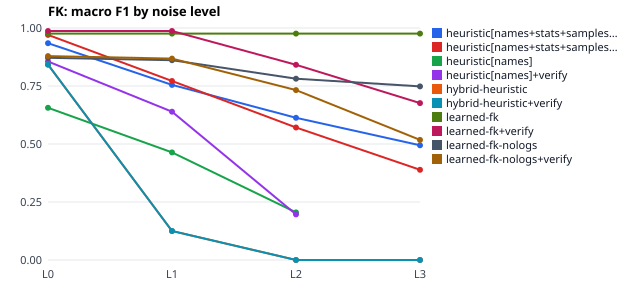
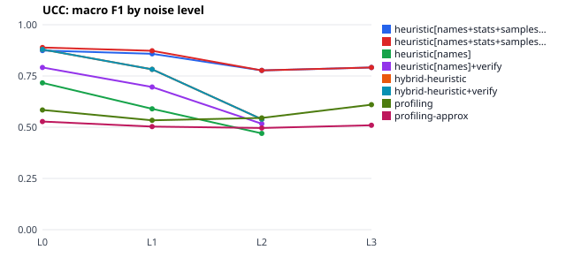
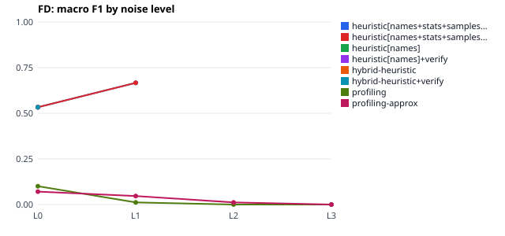

# Run report: 20261031T121627Z_benchmark-seed3

- srev 0.1.0, git `5b04b05c3c77` (dirty tree)
- started 2026-10-31T12:16:27.425750+00:00, finished 2026-10-31T12:17:27.177498+00:00
- config sha256 `c05c0d71d07c7d94`, seed 3
- hardware: Linux-6.18.44-fc-v185-x86_64-with-glibc2.39, 4 CPUs, 16.9 GB RAM, GPUs: none

Numbers below are produced by this run only; read them together with the threats to validity in docs/RESEARCH.md.

## Databases

| database | noise | tables | rows | gold | perturbations |
|---|---|---|---|---|---|
| tpch_mini_L0 | L0 | 8 | 4230 | FK 10, UCC 8, FD 0 | – |
| tpch_mini_L1 | L1 | 8 | 4230 | FK 10, UCC 8, FD 0 | orphans 129, nulls 938, typos 177, rename_columns 11 |
| tpch_mini_L2 | L2 | 8 | 4230 | FK 10, UCC 8, FD 0 | orphans 367, nulls 2168, typos 489, rename_columns 28, rename_tables 2 |
| tpch_mini_L3 | L3 | 8 | 4230 | FK 10, UCC 8, FD 0 | orphans 593, nulls 4477, typos 784, rename_columns 61, rename_tables 8 |
| tpch_mini_names-abbreviated | names-abbreviated | 8 | 4230 | FK 10, UCC 8, FD 0 | rename_columns 59, rename_tables 8 |
| tpch_mini_names-cryptic | names-cryptic | 8 | 4230 | FK 10, UCC 8, FD 0 | rename_columns 61, rename_tables 8 |
| tpch_mini_names-misleading | names-misleading | 8 | 4230 | FK 10, UCC 8, FD 0 | rename_columns 61, rename_tables 8 |
| university_L0 | L0 | 8 | 1881 | FK 11, UCC 11, FD 4 | – |
| university_L1 | L1 | 8 | 1881 | FK 11, UCC 11, FD 4 | orphans 34, nulls 70, typos 29, rename_columns 12 |
| university_L2 | L2 | 8 | 1881 | FK 11, UCC 11, FD 4 | orphans 94, nulls 183, typos 64, rename_columns 22, rename_tables 7 |
| university_L3 | L3 | 8 | 1881 | FK 11, UCC 11, FD 4 | orphans 149, nulls 355, typos 104, rename_columns 35, rename_tables 8 |
| university_names-abbreviated | names-abbreviated | 8 | 1881 | FK 11, UCC 11, FD 4 | rename_columns 34, rename_tables 8 |
| university_names-cryptic | names-cryptic | 8 | 1881 | FK 11, UCC 11, FD 4 | rename_columns 35, rename_tables 8 |
| university_names-misleading | names-misleading | 8 | 1881 | FK 11, UCC 11, FD 4 | rename_columns 35, rename_tables 8 |
| retail_legacy_L0 | L0 | 6 | 1756 | FK 6, UCC 7, FD 2 | – |
| retail_legacy_L1 | L1 | 6 | 1756 | FK 6, UCC 7, FD 2 | orphans 31, typos 22, nulls 120, rename_columns 3 |
| retail_legacy_L2 | L2 | 6 | 1756 | FK 6, UCC 7, FD 2 | orphans 84, typos 68, nulls 294, rename_columns 15, rename_tables 4 |
| retail_legacy_L3 | L3 | 6 | 1756 | FK 6, UCC 7, FD 2 | orphans 133, nulls 586, typos 101, rename_columns 26, rename_tables 6 |
| retail_legacy_names-abbreviated | names-abbreviated | 6 | 1756 | FK 6, UCC 7, FD 2 | rename_columns 20, rename_tables 5 |
| retail_legacy_names-cryptic | names-cryptic | 6 | 1756 | FK 6, UCC 7, FD 2 | rename_columns 26, rename_tables 6 |
| retail_legacy_names-misleading | names-misleading | 6 | 1756 | FK 6, UCC 7, FD 2 | rename_columns 26, rename_tables 6 |
| airline_L0 | L0 | 6 | 1817 | FK 7, UCC 8, FD 1 | – |
| airline_L1 | L1 | 6 | 1817 | FK 7, UCC 8, FD 1 | orphans 38, nulls 61, typos 14, rename_columns 2 |
| airline_L2 | L2 | 6 | 1817 | FK 7, UCC 8, FD 1 | orphans 100, nulls 160, typos 58, rename_columns 15, rename_tables 2 |
| airline_L3 | L3 | 6 | 1817 | FK 7, UCC 8, FD 1 | orphans 157, nulls 337, typos 74, rename_columns 24, rename_tables 6 |
| airline_names-abbreviated | names-abbreviated | 6 | 1817 | FK 7, UCC 8, FD 1 | rename_columns 24, rename_tables 6 |
| airline_names-cryptic | names-cryptic | 6 | 1817 | FK 7, UCC 8, FD 1 | rename_columns 24, rename_tables 6 |
| airline_names-misleading | names-misleading | 6 | 1817 | FK 7, UCC 8, FD 1 | rename_columns 24, rename_tables 6 |

## Aggregate results (across databases)

Micro = pooled counts; macro = mean per-database F1 with a bootstrap 95% CI; p = paired sign-flip test of per-database F1 against the reference baseline.

### FK · noise L0

| variant | P (micro) | R (micro) | F1 (micro) | F1 (macro) [CI] | p |
|---|---|---|---|---|---|
| profiling | 0.442 | 1.000 | 0.613 | 0.679 [0.53, 0.81] | – |
| profiling-approx | 0.415 | 1.000 | 0.586 | 0.665 [0.51, 0.81] | 0.500 |
| heuristic[names] | 0.587 | 0.794 | 0.675 | 0.656 [0.56, 0.75] | 0.875 |
| heuristic[names]+verify | 0.964 | 0.794 | 0.871 | 0.856 [0.72, 0.94] | 0.375 |
| heuristic[names+stats+samples+logs] | 0.917 | 0.971 | 0.943 | 0.934 [0.89, 0.98] | 0.125 |
| heuristic[names+stats+samples+logs]+verify | 0.971 | 0.971 | 0.971 | 0.970 [0.94, 1.00] | 0.125 |
| hybrid-heuristic | 0.833 | 0.882 | 0.857 | 0.842 [0.73, 0.92] | 0.375 |
| hybrid-heuristic+verify | 0.833 | 0.882 | 0.857 | 0.842 [0.73, 0.92] | 0.375 |
| learned-fk | 0.971 | 0.971 | 0.971 | 0.976 [0.95, 1.00] | 0.125 |
| learned-fk+verify | 1.000 | 0.971 | 0.985 | 0.987 [0.96, 1.00] | 0.125 |
| learned-fk-nologs | 0.816 | 0.912 | 0.861 | 0.872 [0.77, 0.98] | 0.125 |
| learned-fk-nologs+verify | 0.838 | 0.912 | 0.873 | 0.879 [0.79, 0.98] | 0.125 |

### UCC · noise L0

| variant | P (micro) | R (micro) | F1 (micro) | F1 (macro) [CI] | p |
|---|---|---|---|---|---|
| profiling | 0.254 | 0.971 | 0.402 | 0.584 [0.31, 0.75] | – |
| profiling-approx | 0.161 | 0.971 | 0.276 | 0.527 [0.24, 0.74] | 0.500 |
| heuristic[names] | 0.786 | 0.647 | 0.710 | 0.716 [0.66, 0.76] | 0.875 |
| heuristic[names]+verify | 1.000 | 0.647 | 0.786 | 0.791 [0.74, 0.85] | 0.125 |
| heuristic[names+stats+samples+logs] | 0.964 | 0.794 | 0.871 | 0.874 [0.85, 0.90] | 0.125 |
| heuristic[names+stats+samples+logs]+verify | 1.000 | 0.794 | 0.885 | 0.889 [0.85, 0.93] | 0.125 |
| hybrid-heuristic | 0.906 | 0.853 | 0.879 | 0.879 [0.82, 0.96] | 0.125 |
| hybrid-heuristic+verify | 0.906 | 0.853 | 0.879 | 0.879 [0.82, 0.96] | 0.125 |
| learned-fk | – | 0.000 | – | – | – |
| learned-fk+verify | – | 0.000 | – | – | – |
| learned-fk-nologs | – | 0.000 | – | – | – |
| learned-fk-nologs+verify | – | 0.000 | – | – | – |

### FD · noise L0

| variant | P (micro) | R (micro) | F1 (micro) | F1 (macro) [CI] | p |
|---|---|---|---|---|---|
| profiling | 0.013 | 1.000 | 0.027 | 0.101 [0.06, 0.15] | – |
| profiling-approx | 0.008 | 1.000 | 0.017 | 0.071 [0.04, 0.10] | 0.250 |
| heuristic[names] | 1.000 | 0.286 | 0.444 | 0.533 [0.40, 0.67] | 0.500 |
| heuristic[names]+verify | 1.000 | 0.286 | 0.444 | 0.533 [0.40, 0.67] | 0.500 |
| heuristic[names+stats+samples+logs] | 1.000 | 0.286 | 0.444 | 0.533 [0.40, 0.67] | 0.500 |
| heuristic[names+stats+samples+logs]+verify | 1.000 | 0.286 | 0.444 | 0.533 [0.40, 0.67] | 0.500 |
| hybrid-heuristic | 1.000 | 0.286 | 0.444 | 0.533 [0.40, 0.67] | 0.500 |
| hybrid-heuristic+verify | 1.000 | 0.286 | 0.444 | 0.533 [0.40, 0.67] | 0.500 |
| learned-fk | – | 0.000 | – | – | – |
| learned-fk+verify | – | 0.000 | – | – | – |
| learned-fk-nologs | – | 0.000 | – | – | – |
| learned-fk-nologs+verify | – | 0.000 | – | – | – |

### FK · noise L1

| variant | P (micro) | R (micro) | F1 (micro) | F1 (macro) [CI] | p |
|---|---|---|---|---|---|
| profiling | 0.151 | 0.147 | 0.149 | 0.130 [0.05, 0.21] | – |
| profiling-approx | 0.415 | 1.000 | 0.586 | 0.675 [0.51, 0.84] | 0.125 |
| heuristic[names] | 0.460 | 0.500 | 0.479 | 0.464 [0.31, 0.58] | 0.125 |
| heuristic[names]+verify | 0.944 | 0.500 | 0.654 | 0.639 [0.43, 0.81] | 0.125 |
| heuristic[names+stats+samples+logs] | 0.920 | 0.676 | 0.780 | 0.755 [0.68, 0.86] | 0.125 |
| heuristic[names+stats+samples+logs]+verify | 0.958 | 0.676 | 0.793 | 0.771 [0.71, 0.86] | 0.125 |
| hybrid-heuristic | 0.375 | 0.088 | 0.143 | 0.125 [0.00, 0.38] | 0.750 |
| hybrid-heuristic+verify | 0.375 | 0.088 | 0.143 | 0.125 [0.00, 0.38] | 0.750 |
| learned-fk | 0.971 | 0.971 | 0.971 | 0.976 [0.95, 1.00] | 0.125 |
| learned-fk+verify | 1.000 | 0.971 | 0.985 | 0.987 [0.96, 1.00] | 0.125 |
| learned-fk-nologs | 0.775 | 0.912 | 0.838 | 0.861 [0.75, 0.98] | 0.125 |
| learned-fk-nologs+verify | 0.795 | 0.912 | 0.849 | 0.868 [0.76, 0.98] | 0.125 |

### UCC · noise L1

| variant | P (micro) | R (micro) | F1 (micro) | F1 (macro) [CI] | p |
|---|---|---|---|---|---|
| profiling | 0.170 | 0.971 | 0.289 | 0.534 [0.24, 0.71] | – |
| profiling-approx | 0.134 | 0.971 | 0.235 | 0.503 [0.21, 0.72] | 0.375 |
| heuristic[names] | 0.643 | 0.529 | 0.581 | 0.590 [0.47, 0.71] | 1.000 |
| heuristic[names]+verify | 1.000 | 0.529 | 0.692 | 0.696 [0.58, 0.81] | 0.750 |
| heuristic[names+stats+samples+logs] | 0.963 | 0.765 | 0.853 | 0.858 [0.80, 0.90] | 0.125 |
| heuristic[names+stats+samples+logs]+verify | 1.000 | 0.765 | 0.867 | 0.873 [0.81, 0.93] | 0.125 |
| hybrid-heuristic | 0.920 | 0.676 | 0.780 | 0.782 [0.67, 0.90] | 0.250 |
| hybrid-heuristic+verify | 0.920 | 0.676 | 0.780 | 0.782 [0.67, 0.90] | 0.250 |
| learned-fk | – | 0.000 | – | – | – |
| learned-fk+verify | – | 0.000 | – | – | – |
| learned-fk-nologs | – | 0.000 | – | – | – |
| learned-fk-nologs+verify | – | 0.000 | – | – | – |

### FD · noise L1

| variant | P (micro) | R (micro) | F1 (micro) | F1 (macro) [CI] | p |
|---|---|---|---|---|---|
| profiling | 0.002 | 0.143 | 0.004 | 0.012 [0.00, 0.04] | – |
| profiling-approx | 0.006 | 0.714 | 0.012 | 0.047 [0.00, 0.07] | 0.500 |
| heuristic[names] | – | 0.000 | – | – | – |
| heuristic[names]+verify | – | 0.000 | – | – | – |
| heuristic[names+stats+samples+logs] | 1.000 | 0.143 | 0.250 | 0.667 | 1.000 |
| heuristic[names+stats+samples+logs]+verify | 1.000 | 0.143 | 0.250 | 0.667 | 1.000 |
| hybrid-heuristic | – | 0.000 | – | – | – |
| hybrid-heuristic+verify | – | 0.000 | – | – | – |
| learned-fk | – | 0.000 | – | – | – |
| learned-fk+verify | – | 0.000 | – | – | – |
| learned-fk-nologs | – | 0.000 | – | – | – |
| learned-fk-nologs+verify | – | 0.000 | – | – | – |

### FK · noise L2

| variant | P (micro) | R (micro) | F1 (micro) | F1 (macro) [CI] | p |
|---|---|---|---|---|---|
| profiling | 0.071 | 0.059 | 0.065 | 0.046 [0.00, 0.09] | – |
| profiling-approx | 0.405 | 0.941 | 0.566 | 0.661 [0.48, 0.84] | 0.125 |
| heuristic[names] | 0.400 | 0.176 | 0.245 | 0.205 [0.04, 0.37] | 0.250 |
| heuristic[names]+verify | 0.800 | 0.118 | 0.205 | 0.196 [0.04, 0.31] | 0.250 |
| heuristic[names+stats+samples+logs] | 0.941 | 0.471 | 0.627 | 0.613 [0.50, 0.72] | 0.125 |
| heuristic[names+stats+samples+logs]+verify | 0.938 | 0.441 | 0.600 | 0.571 [0.48, 0.71] | 0.125 |
| hybrid-heuristic | 0.000 | 0.000 | 0.000 | 0.000 [0.00, 0.00] | 1.000 |
| hybrid-heuristic+verify | 0.000 | 0.000 | 0.000 | 0.000 [0.00, 0.00] | 1.000 |
| learned-fk | 0.971 | 0.971 | 0.971 | 0.976 [0.95, 1.00] | 0.125 |
| learned-fk+verify | 1.000 | 0.765 | 0.867 | 0.841 [0.73, 0.94] | 0.125 |
| learned-fk-nologs | 0.757 | 0.824 | 0.789 | 0.781 [0.68, 0.88] | 0.125 |
| learned-fk-nologs+verify | 0.774 | 0.706 | 0.739 | 0.732 [0.65, 0.81] | 0.125 |

### UCC · noise L2

| variant | P (micro) | R (micro) | F1 (micro) | F1 (macro) [CI] | p |
|---|---|---|---|---|---|
| profiling | 0.201 | 0.971 | 0.333 | 0.545 [0.27, 0.71] | – |
| profiling-approx | 0.136 | 0.971 | 0.239 | 0.496 [0.22, 0.68] | 0.250 |
| heuristic[names] | 0.706 | 0.353 | 0.471 | 0.470 [0.33, 0.61] | 0.750 |
| heuristic[names]+verify | 1.000 | 0.353 | 0.522 | 0.517 [0.37, 0.69] | 1.000 |
| heuristic[names+stats+samples+logs] | 0.957 | 0.647 | 0.772 | 0.777 [0.73, 0.82] | 0.125 |
| heuristic[names+stats+samples+logs]+verify | 0.957 | 0.647 | 0.772 | 0.777 [0.73, 0.82] | 0.125 |
| hybrid-heuristic | 1.000 | 0.382 | 0.553 | 0.539 [0.37, 0.75] | 1.000 |
| hybrid-heuristic+verify | 1.000 | 0.382 | 0.553 | 0.539 [0.37, 0.75] | 1.000 |
| learned-fk | – | 0.000 | – | – | – |
| learned-fk+verify | – | 0.000 | – | – | – |
| learned-fk-nologs | – | 0.000 | – | – | – |
| learned-fk-nologs+verify | – | 0.000 | – | – | – |

### FD · noise L2

| variant | P (micro) | R (micro) | F1 (micro) | F1 (macro) [CI] | p |
|---|---|---|---|---|---|
| profiling | 0.000 | 0.000 | 0.000 | 0.000 [0.00, 0.00] | – |
| profiling-approx | 0.001 | 0.143 | 0.002 | 0.011 [0.00, 0.03] | 1.000 |
| heuristic[names] | – | 0.000 | – | – | – |
| heuristic[names]+verify | – | 0.000 | – | – | – |
| heuristic[names+stats+samples+logs] | – | 0.000 | – | – | – |
| heuristic[names+stats+samples+logs]+verify | – | 0.000 | – | – | – |
| hybrid-heuristic | – | 0.000 | – | – | – |
| hybrid-heuristic+verify | – | 0.000 | – | – | – |
| learned-fk | – | 0.000 | – | – | – |
| learned-fk+verify | – | 0.000 | – | – | – |
| learned-fk-nologs | – | 0.000 | – | – | – |
| learned-fk-nologs+verify | – | 0.000 | – | – | – |

### FK · noise L3

| variant | P (micro) | R (micro) | F1 (micro) | F1 (macro) [CI] | p |
|---|---|---|---|---|---|
| profiling | 0.000 | 0.000 | 0.000 | 0.000 [0.00, 0.00] | – |
| profiling-approx | 0.413 | 0.912 | 0.569 | 0.647 [0.49, 0.80] | 0.125 |
| heuristic[names] | – | 0.000 | – | – | – |
| heuristic[names]+verify | – | 0.000 | – | – | – |
| heuristic[names+stats+samples+logs] | 1.000 | 0.324 | 0.489 | 0.494 [0.38, 0.61] | 0.125 |
| heuristic[names+stats+samples+logs]+verify | 1.000 | 0.235 | 0.381 | 0.389 [0.25, 0.48] | 0.125 |
| hybrid-heuristic | 0.000 | 0.000 | 0.000 | 0.000 | 1.000 |
| hybrid-heuristic+verify | 0.000 | 0.000 | 0.000 | 0.000 | 1.000 |
| learned-fk | 0.971 | 0.971 | 0.971 | 0.976 [0.95, 1.00] | 0.125 |
| learned-fk+verify | 1.000 | 0.529 | 0.692 | 0.676 [0.55, 0.79] | 0.125 |
| learned-fk-nologs | 0.644 | 0.853 | 0.734 | 0.748 [0.68, 0.80] | 0.125 |
| learned-fk-nologs+verify | 0.552 | 0.471 | 0.508 | 0.517 [0.47, 0.59] | 0.125 |

### UCC · noise L3

| variant | P (micro) | R (micro) | F1 (micro) | F1 (macro) [CI] | p |
|---|---|---|---|---|---|
| profiling | 0.262 | 0.971 | 0.412 | 0.610 [0.32, 0.79] | – |
| profiling-approx | 0.109 | 0.971 | 0.196 | 0.510 [0.20, 0.72] | 0.125 |
| heuristic[names] | – | 0.000 | – | – | – |
| heuristic[names]+verify | – | 0.000 | – | – | – |
| heuristic[names+stats+samples+logs] | 1.000 | 0.647 | 0.786 | 0.791 [0.74, 0.85] | 0.375 |
| heuristic[names+stats+samples+logs]+verify | 1.000 | 0.647 | 0.786 | 0.791 [0.74, 0.85] | 0.375 |
| hybrid-heuristic | – | 0.000 | – | – | – |
| hybrid-heuristic+verify | – | 0.000 | – | – | – |
| learned-fk | – | 0.000 | – | – | – |
| learned-fk+verify | – | 0.000 | – | – | – |
| learned-fk-nologs | – | 0.000 | – | – | – |
| learned-fk-nologs+verify | – | 0.000 | – | – | – |

### FD · noise L3

| variant | P (micro) | R (micro) | F1 (micro) | F1 (macro) [CI] | p |
|---|---|---|---|---|---|
| profiling | 0.000 | 0.000 | 0.000 | 0.000 [0.00, 0.00] | – |
| profiling-approx | 0.000 | 0.000 | 0.000 | 0.000 [0.00, 0.00] | 1.000 |
| heuristic[names] | – | 0.000 | – | – | – |
| heuristic[names]+verify | – | 0.000 | – | – | – |
| heuristic[names+stats+samples+logs] | – | 0.000 | – | – | – |
| heuristic[names+stats+samples+logs]+verify | – | 0.000 | – | – | – |
| hybrid-heuristic | – | 0.000 | – | – | – |
| hybrid-heuristic+verify | – | 0.000 | – | – | – |
| learned-fk | – | 0.000 | – | – | – |
| learned-fk+verify | – | 0.000 | – | – | – |
| learned-fk-nologs | – | 0.000 | – | – | – |
| learned-fk-nologs+verify | – | 0.000 | – | – | – |

### FK · noise names-abbreviated

| variant | P (micro) | R (micro) | F1 (micro) | F1 (macro) [CI] | p |
|---|---|---|---|---|---|
| profiling | 0.442 | 1.000 | 0.613 | 0.679 [0.53, 0.81] | – |
| profiling-approx | 0.415 | 1.000 | 0.586 | 0.665 [0.51, 0.81] | 0.500 |
| heuristic[names] | 0.532 | 0.735 | 0.617 | 0.604 [0.50, 0.72] | 0.625 |
| heuristic[names]+verify | 0.962 | 0.735 | 0.833 | 0.825 [0.72, 0.90] | 0.375 |
| heuristic[names+stats+samples+logs] | 0.868 | 0.971 | 0.917 | 0.909 [0.87, 0.95] | 0.125 |
| heuristic[names+stats+samples+logs]+verify | 0.971 | 0.971 | 0.971 | 0.970 [0.94, 1.00] | 0.125 |
| hybrid-heuristic | 0.879 | 0.853 | 0.866 | 0.852 [0.72, 0.94] | 0.375 |
| hybrid-heuristic+verify | 0.879 | 0.853 | 0.866 | 0.852 [0.72, 0.94] | 0.375 |
| learned-fk | 0.971 | 0.971 | 0.971 | 0.976 [0.95, 1.00] | 0.125 |
| learned-fk+verify | 1.000 | 0.971 | 0.985 | 0.987 [0.96, 1.00] | 0.125 |
| learned-fk-nologs | 0.838 | 0.912 | 0.873 | 0.879 [0.79, 0.98] | 0.125 |
| learned-fk-nologs+verify | 0.838 | 0.912 | 0.873 | 0.879 [0.79, 0.98] | 0.125 |

### UCC · noise names-abbreviated

| variant | P (micro) | R (micro) | F1 (micro) | F1 (macro) [CI] | p |
|---|---|---|---|---|---|
| profiling | 0.254 | 0.971 | 0.402 | 0.584 [0.31, 0.75] | – |
| profiling-approx | 0.161 | 0.971 | 0.276 | 0.527 [0.24, 0.74] | 0.500 |
| heuristic[names] | 0.846 | 0.647 | 0.733 | 0.743 [0.67, 0.82] | 0.875 |
| heuristic[names]+verify | 1.000 | 0.647 | 0.786 | 0.791 [0.74, 0.85] | 0.125 |
| heuristic[names+stats+samples+logs] | 1.000 | 0.765 | 0.867 | 0.870 [0.85, 0.90] | 0.125 |
| heuristic[names+stats+samples+logs]+verify | 1.000 | 0.765 | 0.867 | 0.870 [0.85, 0.90] | 0.125 |
| hybrid-heuristic | 0.875 | 0.618 | 0.724 | 0.839 [0.80, 0.88] | 0.250 |
| hybrid-heuristic+verify | 0.875 | 0.618 | 0.724 | 0.839 [0.80, 0.88] | 0.250 |
| learned-fk | – | 0.000 | – | – | – |
| learned-fk+verify | – | 0.000 | – | – | – |
| learned-fk-nologs | – | 0.000 | – | – | – |
| learned-fk-nologs+verify | – | 0.000 | – | – | – |

### FD · noise names-abbreviated

| variant | P (micro) | R (micro) | F1 (micro) | F1 (macro) [CI] | p |
|---|---|---|---|---|---|
| profiling | 0.013 | 1.000 | 0.027 | 0.101 [0.06, 0.15] | – |
| profiling-approx | 0.008 | 1.000 | 0.017 | 0.071 [0.04, 0.10] | 0.250 |
| heuristic[names] | 1.000 | 0.286 | 0.444 | 0.533 [0.40, 0.67] | 0.500 |
| heuristic[names]+verify | 1.000 | 0.286 | 0.444 | 0.533 [0.40, 0.67] | 0.500 |
| heuristic[names+stats+samples+logs] | 1.000 | 0.286 | 0.444 | 0.533 [0.40, 0.67] | 0.500 |
| heuristic[names+stats+samples+logs]+verify | 1.000 | 0.286 | 0.444 | 0.533 [0.40, 0.67] | 0.500 |
| hybrid-heuristic | 1.000 | 0.286 | 0.444 | 0.533 [0.40, 0.67] | 0.500 |
| hybrid-heuristic+verify | 1.000 | 0.286 | 0.444 | 0.533 [0.40, 0.67] | 0.500 |
| learned-fk | – | 0.000 | – | – | – |
| learned-fk+verify | – | 0.000 | – | – | – |
| learned-fk-nologs | – | 0.000 | – | – | – |
| learned-fk-nologs+verify | – | 0.000 | – | – | – |

### FK · noise names-cryptic

| variant | P (micro) | R (micro) | F1 (micro) | F1 (macro) [CI] | p |
|---|---|---|---|---|---|
| profiling | 0.442 | 1.000 | 0.613 | 0.679 [0.53, 0.81] | – |
| profiling-approx | 0.415 | 1.000 | 0.586 | 0.665 [0.51, 0.81] | 0.500 |
| heuristic[names] | – | 0.000 | – | – | – |
| heuristic[names]+verify | – | 0.000 | – | – | – |
| heuristic[names+stats+samples+logs] | 1.000 | 0.941 | 0.970 | 0.975 [0.95, 1.00] | 0.125 |
| heuristic[names+stats+samples+logs]+verify | 1.000 | 0.941 | 0.970 | 0.975 [0.95, 1.00] | 0.125 |
| hybrid-heuristic | 0.429 | 0.088 | 0.146 | 0.177 [0.15, 0.22] | 0.250 |
| hybrid-heuristic+verify | 0.429 | 0.088 | 0.146 | 0.177 [0.15, 0.22] | 0.250 |
| learned-fk | 0.971 | 0.971 | 0.971 | 0.976 [0.95, 1.00] | 0.125 |
| learned-fk+verify | 1.000 | 0.971 | 0.985 | 0.987 [0.96, 1.00] | 0.125 |
| learned-fk-nologs | 0.811 | 0.882 | 0.845 | 0.858 [0.73, 0.98] | 0.125 |
| learned-fk-nologs+verify | 0.833 | 0.882 | 0.857 | 0.866 [0.75, 0.98] | 0.125 |

### UCC · noise names-cryptic

| variant | P (micro) | R (micro) | F1 (micro) | F1 (macro) [CI] | p |
|---|---|---|---|---|---|
| profiling | 0.254 | 0.971 | 0.402 | 0.584 [0.31, 0.75] | – |
| profiling-approx | 0.161 | 0.971 | 0.276 | 0.527 [0.24, 0.74] | 0.500 |
| heuristic[names] | – | 0.000 | – | – | – |
| heuristic[names]+verify | – | 0.000 | – | – | – |
| heuristic[names+stats+samples+logs] | 1.000 | 0.647 | 0.786 | 0.791 [0.74, 0.85] | 0.125 |
| heuristic[names+stats+samples+logs]+verify | 1.000 | 0.647 | 0.786 | 0.791 [0.74, 0.85] | 0.125 |
| hybrid-heuristic | – | 0.000 | – | – | – |
| hybrid-heuristic+verify | – | 0.000 | – | – | – |
| learned-fk | – | 0.000 | – | – | – |
| learned-fk+verify | – | 0.000 | – | – | – |
| learned-fk-nologs | – | 0.000 | – | – | – |
| learned-fk-nologs+verify | – | 0.000 | – | – | – |

### FD · noise names-cryptic

| variant | P (micro) | R (micro) | F1 (micro) | F1 (macro) [CI] | p |
|---|---|---|---|---|---|
| profiling | 0.013 | 1.000 | 0.027 | 0.101 [0.06, 0.15] | – |
| profiling-approx | 0.008 | 1.000 | 0.017 | 0.071 [0.04, 0.10] | 0.250 |
| heuristic[names] | – | 0.000 | – | – | – |
| heuristic[names]+verify | – | 0.000 | – | – | – |
| heuristic[names+stats+samples+logs] | – | 0.000 | – | – | – |
| heuristic[names+stats+samples+logs]+verify | – | 0.000 | – | – | – |
| hybrid-heuristic | – | 0.000 | – | – | – |
| hybrid-heuristic+verify | – | 0.000 | – | – | – |
| learned-fk | – | 0.000 | – | – | – |
| learned-fk+verify | – | 0.000 | – | – | – |
| learned-fk-nologs | – | 0.000 | – | – | – |
| learned-fk-nologs+verify | – | 0.000 | – | – | – |

### FK · noise names-misleading

| variant | P (micro) | R (micro) | F1 (micro) | F1 (macro) [CI] | p |
|---|---|---|---|---|---|
| profiling | 0.442 | 1.000 | 0.613 | 0.679 [0.53, 0.81] | – |
| profiling-approx | 0.415 | 1.000 | 0.586 | 0.665 [0.51, 0.81] | 0.500 |
| heuristic[names] | 0.000 | 0.000 | 0.000 | 0.000 [0.00, 0.00] | 0.125 |
| heuristic[names]+verify | – | 0.000 | – | – | – |
| heuristic[names+stats+samples+logs] | 0.633 | 0.559 | 0.594 | 0.612 [0.48, 0.78] | 0.500 |
| heuristic[names+stats+samples+logs]+verify | 0.864 | 0.559 | 0.679 | 0.690 [0.59, 0.84] | 1.000 |
| hybrid-heuristic | 0.333 | 0.118 | 0.174 | 0.193 [0.06, 0.27] | 0.125 |
| hybrid-heuristic+verify | 0.333 | 0.118 | 0.174 | 0.193 [0.06, 0.27] | 0.125 |
| learned-fk | 0.971 | 0.971 | 0.971 | 0.976 [0.95, 1.00] | 0.125 |
| learned-fk+verify | 1.000 | 0.971 | 0.985 | 0.987 [0.96, 1.00] | 0.125 |
| learned-fk-nologs | 0.816 | 0.912 | 0.861 | 0.872 [0.77, 0.98] | 0.125 |
| learned-fk-nologs+verify | 0.838 | 0.912 | 0.873 | 0.879 [0.79, 0.98] | 0.125 |

### UCC · noise names-misleading

| variant | P (micro) | R (micro) | F1 (micro) | F1 (macro) [CI] | p |
|---|---|---|---|---|---|
| profiling | 0.254 | 0.971 | 0.402 | 0.584 [0.31, 0.75] | – |
| profiling-approx | 0.161 | 0.971 | 0.276 | 0.527 [0.24, 0.74] | 0.500 |
| heuristic[names] | 0.250 | 0.206 | 0.226 | 0.232 [0.17, 0.30] | 0.125 |
| heuristic[names]+verify | 0.500 | 0.206 | 0.292 | 0.301 [0.21, 0.38] | 0.125 |
| heuristic[names+stats+samples+logs] | 0.571 | 0.471 | 0.516 | 0.517 [0.34, 0.62] | 0.375 |
| heuristic[names+stats+samples+logs]+verify | 0.640 | 0.471 | 0.542 | 0.541 [0.35, 0.65] | 0.500 |
| hybrid-heuristic | 0.429 | 0.353 | 0.387 | 0.388 [0.29, 0.47] | 0.250 |
| hybrid-heuristic+verify | 0.429 | 0.353 | 0.387 | 0.388 [0.29, 0.47] | 0.250 |
| learned-fk | – | 0.000 | – | – | – |
| learned-fk+verify | – | 0.000 | – | – | – |
| learned-fk-nologs | – | 0.000 | – | – | – |
| learned-fk-nologs+verify | – | 0.000 | – | – | – |

### FD · noise names-misleading

| variant | P (micro) | R (micro) | F1 (micro) | F1 (macro) [CI] | p |
|---|---|---|---|---|---|
| profiling | 0.013 | 1.000 | 0.027 | 0.101 [0.06, 0.15] | – |
| profiling-approx | 0.008 | 1.000 | 0.017 | 0.071 [0.04, 0.10] | 0.250 |
| heuristic[names] | 0.000 | 0.000 | 0.000 | 0.000 [0.00, 0.00] | 0.500 |
| heuristic[names]+verify | 0.000 | 0.000 | 0.000 | 0.000 | 1.000 |
| heuristic[names+stats+samples+logs] | 1.000 | 0.143 | 0.250 | 0.667 | 1.000 |
| heuristic[names+stats+samples+logs]+verify | 1.000 | 0.143 | 0.250 | 0.667 | 1.000 |
| hybrid-heuristic | 1.000 | 0.143 | 0.250 | 0.667 | 1.000 |
| hybrid-heuristic+verify | 1.000 | 0.143 | 0.250 | 0.667 | 1.000 |
| learned-fk | – | 0.000 | – | – | – |
| learned-fk+verify | – | 0.000 | – | – | – |
| learned-fk-nologs | – | 0.000 | – | – | – |
| learned-fk-nologs+verify | – | 0.000 | – | – | – |

## Per-database results

Exact match; CI = item-level bootstrap. Top-k cuts each type at ceil(factor × |gold|) proposals by confidence. Overlap = column-set Jaccard ≥ 0.5.

### tpch_mini_L0

| variant | type | proposed | gold | TP/FP/FN | precision | recall | F1 | top-k F1 | overlap F1 |
|---|---|---|---|---|---|---|---|---|---|
| profiling | FK | 35 | 10 | 10/25/0 | 0.286 [0.14, 0.46] | 1.000 [1.00, 1.00] | 0.444 [0.25, 0.63] | 1.000 | 0.444 |
| profiling | UCC | 86 | 8 | 8/78/0 | 0.093 [0.03, 0.16] | 1.000 [1.00, 1.00] | 0.170 [0.07, 0.28] | 1.000 | 0.170 |
| profiling | FD | 395 | 0 | 0/395/0 | 0.000 [0.00, 0.00] | – | – | – | – |
| profiling-approx | FK | 39 | 10 | 10/29/0 | 0.256 [0.13, 0.38] | 1.000 [1.00, 1.00] | 0.408 [0.23, 0.56] | 1.000 | 0.408 |
| profiling-approx | UCC | 156 | 8 | 8/148/0 | 0.051 [0.02, 0.09] | 1.000 [1.00, 1.00] | 0.098 [0.04, 0.16] | 1.000 | 0.098 |
| profiling-approx | FD | 663 | 0 | 0/663/0 | 0.000 [0.00, 0.00] | – | – | – | – |
| heuristic[names] | FK | 15 | 10 | 9/6/1 | 0.600 [0.33, 0.85] | 0.900 [0.67, 1.00] | 0.720 [0.48, 0.90] | 0.700 | 0.720 |
| heuristic[names] | UCC | 8 | 8 | 6/2/2 | 0.750 [0.43, 1.00] | 0.750 [0.43, 1.00] | 0.750 [0.46, 0.95] | 0.750 | 1.000 |
| heuristic[names] | FD | 0 | 0 | 0/0/0 | – | – | – | – | – |
| heuristic[names]+verify | FK | 9 | 10 | 9/0/1 | 1.000 [1.00, 1.00] | 0.900 [0.70, 1.00] | 0.947 [0.82, 1.00] | 0.947 | 0.947 |
| heuristic[names]+verify | UCC | 6 | 8 | 6/0/2 | 1.000 [1.00, 1.00] | 0.750 [0.38, 1.00] | 0.857 [0.55, 1.00] | 0.857 | 0.857 |
| heuristic[names]+verify | FD | 0 | 0 | 0/0/0 | – | – | – | – | – |
| heuristic[names+stats+samples+logs] | FK | 9 | 10 | 9/0/1 | 1.000 [1.00, 1.00] | 0.900 [0.70, 1.00] | 0.947 [0.82, 1.00] | 0.947 | 0.947 |
| heuristic[names+stats+samples+logs] | UCC | 8 | 8 | 7/1/1 | 0.875 [0.57, 1.00] | 0.875 [0.62, 1.00] | 0.875 [0.62, 1.00] | 0.875 | 0.875 |
| heuristic[names+stats+samples+logs] | FD | 0 | 0 | 0/0/0 | – | – | – | – | – |
| heuristic[names+stats+samples+logs]+verify | FK | 9 | 10 | 9/0/1 | 1.000 [1.00, 1.00] | 0.900 [0.70, 1.00] | 0.947 [0.82, 1.00] | 0.947 | 0.947 |
| heuristic[names+stats+samples+logs]+verify | UCC | 7 | 8 | 7/0/1 | 1.000 [1.00, 1.00] | 0.875 [0.62, 1.00] | 0.933 [0.77, 1.00] | 0.933 | 0.933 |
| heuristic[names+stats+samples+logs]+verify | FD | 0 | 0 | 0/0/0 | – | – | – | – | – |
| hybrid-heuristic | FK | 13 | 10 | 10/3/0 | 0.769 [0.46, 1.00] | 1.000 [1.00, 1.00] | 0.870 [0.63, 1.00] | 1.000 | 0.870 |
| hybrid-heuristic | UCC | 8 | 8 | 8/0/0 | 1.000 [1.00, 1.00] | 1.000 [1.00, 1.00] | 1.000 [1.00, 1.00] | 1.000 | 1.000 |
| hybrid-heuristic | FD | 0 | 0 | 0/0/0 | – | – | – | – | – |
| hybrid-heuristic+verify | FK | 13 | 10 | 10/3/0 | 0.769 [0.46, 1.00] | 1.000 [1.00, 1.00] | 0.870 [0.63, 1.00] | 1.000 | 0.870 |
| hybrid-heuristic+verify | UCC | 8 | 8 | 8/0/0 | 1.000 [1.00, 1.00] | 1.000 [1.00, 1.00] | 1.000 [1.00, 1.00] | 1.000 | 1.000 |
| hybrid-heuristic+verify | FD | 0 | 0 | 0/0/0 | – | – | – | – | – |
| learned-fk | FK | 9 | 10 | 9/0/1 | 1.000 [1.00, 1.00] | 0.900 [0.70, 1.00] | 0.947 [0.82, 1.00] | 0.947 | 0.947 |
| learned-fk | UCC | 0 | 8 | 0/0/8 | – | 0.000 [0.00, 0.00] | – | – | – |
| learned-fk | FD | 0 | 0 | 0/0/0 | – | – | – | – | – |
| learned-fk+verify | FK | 9 | 10 | 9/0/1 | 1.000 [1.00, 1.00] | 0.900 [0.70, 1.00] | 0.947 [0.82, 1.00] | 0.947 | 0.947 |
| learned-fk+verify | UCC | 0 | 8 | 0/0/8 | – | 0.000 [0.00, 0.00] | – | – | – |
| learned-fk+verify | FD | 0 | 0 | 0/0/0 | – | – | – | – | – |
| learned-fk-nologs | FK | 15 | 10 | 9/6/1 | 0.600 [0.33, 0.85] | 0.900 [0.67, 1.00] | 0.720 [0.48, 0.90] | 0.800 | 0.720 |
| learned-fk-nologs | UCC | 0 | 8 | 0/0/8 | – | 0.000 [0.00, 0.00] | – | – | – |
| learned-fk-nologs | FD | 0 | 0 | 0/0/0 | – | – | – | – | – |
| learned-fk-nologs+verify | FK | 14 | 10 | 9/5/1 | 0.643 [0.36, 0.87] | 0.900 [0.67, 1.00] | 0.750 [0.50, 0.93] | 0.800 | 0.750 |
| learned-fk-nologs+verify | UCC | 0 | 8 | 0/0/8 | – | 0.000 [0.00, 0.00] | – | – | – |
| learned-fk-nologs+verify | FD | 0 | 0 | 0/0/0 | – | – | – | – | – |

### tpch_mini_L1

| variant | type | proposed | gold | TP/FP/FN | precision | recall | F1 | top-k F1 | overlap F1 |
|---|---|---|---|---|---|---|---|---|---|
| profiling | FK | 21 | 10 | 3/18/7 | 0.143 [0.00, 0.29] | 0.300 [0.00, 0.60] | 0.194 [0.00, 0.35] | 0.300 | 0.194 |
| profiling | UCC | 146 | 8 | 8/138/0 | 0.055 [0.02, 0.10] | 1.000 [1.00, 1.00] | 0.104 [0.04, 0.17] | 0.875 | 0.104 |
| profiling | FD | 348 | 0 | 0/348/0 | 0.000 [0.00, 0.00] | – | – | – | – |
| profiling-approx | FK | 39 | 10 | 10/29/0 | 0.256 [0.13, 0.38] | 1.000 [1.00, 1.00] | 0.408 [0.23, 0.56] | 0.800 | 0.408 |
| profiling-approx | UCC | 194 | 8 | 8/186/0 | 0.041 [0.02, 0.07] | 1.000 [1.00, 1.00] | 0.079 [0.03, 0.13] | 0.875 | 0.079 |
| profiling-approx | FD | 627 | 0 | 0/627/0 | 0.000 [0.00, 0.00] | – | – | – | – |
| heuristic[names] | FK | 12 | 10 | 7/5/3 | 0.583 [0.29, 0.85] | 0.700 [0.40, 1.00] | 0.636 [0.33, 0.85] | 0.600 | 0.636 |
| heuristic[names] | UCC | 8 | 8 | 6/2/2 | 0.750 [0.43, 1.00] | 0.750 [0.43, 1.00] | 0.750 [0.46, 0.95] | 0.750 | 1.000 |
| heuristic[names] | FD | 0 | 0 | 0/0/0 | – | – | – | – | – |
| heuristic[names]+verify | FK | 7 | 10 | 7/0/3 | 1.000 [1.00, 1.00] | 0.700 [0.40, 1.00] | 0.824 [0.57, 1.00] | 0.824 | 0.824 |
| heuristic[names]+verify | UCC | 6 | 8 | 6/0/2 | 1.000 [1.00, 1.00] | 0.750 [0.38, 1.00] | 0.857 [0.55, 1.00] | 0.857 | 0.857 |
| heuristic[names]+verify | FD | 0 | 0 | 0/0/0 | – | – | – | – | – |
| heuristic[names+stats+samples+logs] | FK | 6 | 10 | 6/0/4 | 1.000 [1.00, 1.00] | 0.600 [0.30, 0.90] | 0.750 [0.46, 0.95] | 0.750 | 0.750 |
| heuristic[names+stats+samples+logs] | UCC | 8 | 8 | 7/1/1 | 0.875 [0.57, 1.00] | 0.875 [0.62, 1.00] | 0.875 [0.62, 1.00] | 0.875 | 0.875 |
| heuristic[names+stats+samples+logs] | FD | 0 | 0 | 0/0/0 | – | – | – | – | – |
| heuristic[names+stats+samples+logs]+verify | FK | 6 | 10 | 6/0/4 | 1.000 [1.00, 1.00] | 0.600 [0.30, 0.90] | 0.750 [0.46, 0.95] | 0.750 | 0.750 |
| heuristic[names+stats+samples+logs]+verify | UCC | 7 | 8 | 7/0/1 | 1.000 [1.00, 1.00] | 0.875 [0.62, 1.00] | 0.933 [0.77, 1.00] | 0.933 | 0.933 |
| heuristic[names+stats+samples+logs]+verify | FD | 0 | 0 | 0/0/0 | – | – | – | – | – |
| hybrid-heuristic | FK | 6 | 10 | 3/3/7 | 0.500 [0.11, 1.00] | 0.300 [0.08, 0.58] | 0.375 [0.14, 0.63] | 0.375 | 0.375 |
| hybrid-heuristic | UCC | 7 | 8 | 7/0/1 | 1.000 [1.00, 1.00] | 0.875 [0.62, 1.00] | 0.933 [0.77, 1.00] | 0.933 | 0.933 |
| hybrid-heuristic | FD | 0 | 0 | 0/0/0 | – | – | – | – | – |
| hybrid-heuristic+verify | FK | 6 | 10 | 3/3/7 | 0.500 [0.11, 1.00] | 0.300 [0.08, 0.58] | 0.375 [0.14, 0.63] | 0.375 | 0.375 |
| hybrid-heuristic+verify | UCC | 7 | 8 | 7/0/1 | 1.000 [1.00, 1.00] | 0.875 [0.62, 1.00] | 0.933 [0.77, 1.00] | 0.933 | 0.933 |
| hybrid-heuristic+verify | FD | 0 | 0 | 0/0/0 | – | – | – | – | – |
| learned-fk | FK | 9 | 10 | 9/0/1 | 1.000 [1.00, 1.00] | 0.900 [0.70, 1.00] | 0.947 [0.82, 1.00] | 0.947 | 0.947 |
| learned-fk | UCC | 0 | 8 | 0/0/8 | – | 0.000 [0.00, 0.00] | – | – | – |
| learned-fk | FD | 0 | 0 | 0/0/0 | – | – | – | – | – |
| learned-fk+verify | FK | 9 | 10 | 9/0/1 | 1.000 [1.00, 1.00] | 0.900 [0.70, 1.00] | 0.947 [0.82, 1.00] | 0.947 | 0.947 |
| learned-fk+verify | UCC | 0 | 8 | 0/0/8 | – | 0.000 [0.00, 0.00] | – | – | – |
| learned-fk+verify | FD | 0 | 0 | 0/0/0 | – | – | – | – | – |
| learned-fk-nologs | FK | 16 | 10 | 9/7/1 | 0.562 [0.33, 0.81] | 0.900 [0.67, 1.00] | 0.692 [0.45, 0.87] | 0.800 | 0.692 |
| learned-fk-nologs | UCC | 0 | 8 | 0/0/8 | – | 0.000 [0.00, 0.00] | – | – | – |
| learned-fk-nologs | FD | 0 | 0 | 0/0/0 | – | – | – | – | – |
| learned-fk-nologs+verify | FK | 15 | 10 | 9/6/1 | 0.600 [0.33, 0.85] | 0.900 [0.67, 1.00] | 0.720 [0.48, 0.90] | 0.800 | 0.720 |
| learned-fk-nologs+verify | UCC | 0 | 8 | 0/0/8 | – | 0.000 [0.00, 0.00] | – | – | – |
| learned-fk-nologs+verify | FD | 0 | 0 | 0/0/0 | – | – | – | – | – |

### tpch_mini_L2

| variant | type | proposed | gold | TP/FP/FN | precision | recall | F1 | top-k F1 | overlap F1 |
|---|---|---|---|---|---|---|---|---|---|
| profiling | FK | 18 | 10 | 1/17/9 | 0.056 [0.00, 0.18] | 0.100 [0.00, 0.33] | 0.071 [0.00, 0.20] | 0.100 | 0.071 |
| profiling | UCC | 116 | 8 | 8/108/0 | 0.069 [0.03, 0.12] | 1.000 [1.00, 1.00] | 0.129 [0.05, 0.22] | 0.875 | 0.129 |
| profiling | FD | 237 | 0 | 0/237/0 | 0.000 [0.00, 0.00] | – | – | – | – |
| profiling-approx | FK | 38 | 10 | 9/29/1 | 0.237 [0.13, 0.37] | 0.900 [0.67, 1.00] | 0.375 [0.23, 0.53] | 0.800 | 0.375 |
| profiling-approx | UCC | 189 | 8 | 8/181/0 | 0.042 [0.02, 0.07] | 1.000 [1.00, 1.00] | 0.081 [0.03, 0.14] | 0.875 | 0.081 |
| profiling-approx | FD | 691 | 0 | 0/691/0 | 0.000 [0.00, 0.00] | – | – | – | – |
| heuristic[names] | FK | 8 | 10 | 4/4/6 | 0.500 [0.14, 0.86] | 0.400 [0.10, 0.71] | 0.444 [0.13, 0.73] | 0.444 | 0.444 |
| heuristic[names] | UCC | 7 | 8 | 5/2/3 | 0.714 [0.33, 1.00] | 0.625 [0.29, 1.00] | 0.667 [0.33, 0.89] | 0.667 | 0.800 |
| heuristic[names] | FD | 0 | 0 | 0/0/0 | – | – | – | – | – |
| heuristic[names]+verify | FK | 2 | 10 | 2/0/8 | 1.000 [1.00, 1.00] | 0.200 [0.00, 0.50] | 0.333 [0.18, 0.67] | 0.333 | 0.333 |
| heuristic[names]+verify | UCC | 5 | 8 | 5/0/3 | 1.000 [1.00, 1.00] | 0.625 [0.25, 0.88] | 0.769 [0.40, 0.93] | 0.769 | 0.769 |
| heuristic[names]+verify | FD | 0 | 0 | 0/0/0 | – | – | – | – | – |
| heuristic[names+stats+samples+logs] | FK | 3 | 10 | 3/0/7 | 1.000 [1.00, 1.00] | 0.300 [0.00, 0.60] | 0.462 [0.18, 0.75] | 0.462 | 0.462 |
| heuristic[names+stats+samples+logs] | UCC | 7 | 8 | 6/1/2 | 0.857 [0.57, 1.00] | 0.750 [0.43, 1.00] | 0.800 [0.50, 0.94] | 0.800 | 0.800 |
| heuristic[names+stats+samples+logs] | FD | 0 | 0 | 0/0/0 | – | – | – | – | – |
| heuristic[names+stats+samples+logs]+verify | FK | 3 | 10 | 3/0/7 | 1.000 [1.00, 1.00] | 0.300 [0.00, 0.60] | 0.462 [0.18, 0.75] | 0.462 | 0.462 |
| heuristic[names+stats+samples+logs]+verify | UCC | 7 | 8 | 6/1/2 | 0.857 [0.57, 1.00] | 0.750 [0.43, 1.00] | 0.800 [0.50, 0.94] | 0.800 | 0.800 |
| heuristic[names+stats+samples+logs]+verify | FD | 0 | 0 | 0/0/0 | – | – | – | – | – |
| hybrid-heuristic | FK | 1 | 10 | 0/1/10 | 0.000 [0.00, 0.00] | 0.000 [0.00, 0.00] | 0.000 [0.00, 0.00] | 0.000 | 0.000 |
| hybrid-heuristic | UCC | 6 | 8 | 6/0/2 | 1.000 [1.00, 1.00] | 0.750 [0.38, 1.00] | 0.857 [0.55, 1.00] | 0.857 | 0.857 |
| hybrid-heuristic | FD | 0 | 0 | 0/0/0 | – | – | – | – | – |
| hybrid-heuristic+verify | FK | 1 | 10 | 0/1/10 | 0.000 [0.00, 0.00] | 0.000 [0.00, 0.00] | 0.000 [0.00, 0.00] | 0.000 | 0.000 |
| hybrid-heuristic+verify | UCC | 6 | 8 | 6/0/2 | 1.000 [1.00, 1.00] | 0.750 [0.38, 1.00] | 0.857 [0.55, 1.00] | 0.857 | 0.857 |
| hybrid-heuristic+verify | FD | 0 | 0 | 0/0/0 | – | – | – | – | – |
| learned-fk | FK | 9 | 10 | 9/0/1 | 1.000 [1.00, 1.00] | 0.900 [0.70, 1.00] | 0.947 [0.82, 1.00] | 0.947 | 0.947 |
| learned-fk | UCC | 0 | 8 | 0/0/8 | – | 0.000 [0.00, 0.00] | – | – | – |
| learned-fk | FD | 0 | 0 | 0/0/0 | – | – | – | – | – |
| learned-fk+verify | FK | 7 | 10 | 7/0/3 | 1.000 [1.00, 1.00] | 0.700 [0.40, 1.00] | 0.824 [0.57, 1.00] | 0.824 | 0.824 |
| learned-fk+verify | UCC | 0 | 8 | 0/0/8 | – | 0.000 [0.00, 0.00] | – | – | – |
| learned-fk+verify | FD | 0 | 0 | 0/0/0 | – | – | – | – | – |
| learned-fk-nologs | FK | 16 | 10 | 9/7/1 | 0.562 [0.33, 0.81] | 0.900 [0.67, 1.00] | 0.692 [0.45, 0.87] | 0.700 | 0.692 |
| learned-fk-nologs | UCC | 0 | 8 | 0/0/8 | – | 0.000 [0.00, 0.00] | – | – | – |
| learned-fk-nologs | FD | 0 | 0 | 0/0/0 | – | – | – | – | – |
| learned-fk-nologs+verify | FK | 12 | 10 | 7/5/3 | 0.583 [0.29, 0.85] | 0.700 [0.40, 1.00] | 0.636 [0.33, 0.85] | 0.600 | 0.636 |
| learned-fk-nologs+verify | UCC | 0 | 8 | 0/0/8 | – | 0.000 [0.00, 0.00] | – | – | – |
| learned-fk-nologs+verify | FD | 0 | 0 | 0/0/0 | – | – | – | – | – |

### tpch_mini_L3

| variant | type | proposed | gold | TP/FP/FN | precision | recall | F1 | top-k F1 | overlap F1 |
|---|---|---|---|---|---|---|---|---|---|
| profiling | FK | 15 | 10 | 0/15/10 | 0.000 [0.00, 0.00] | 0.000 [0.00, 0.00] | 0.000 [0.00, 0.00] | 0.000 | 0.000 |
| profiling | UCC | 85 | 8 | 8/77/0 | 0.094 [0.04, 0.16] | 1.000 [1.00, 1.00] | 0.172 [0.07, 0.28] | 0.750 | 0.172 |
| profiling | FD | 162 | 0 | 0/162/0 | 0.000 [0.00, 0.00] | – | – | – | – |
| profiling-approx | FK | 36 | 10 | 9/27/1 | 0.250 [0.11, 0.41] | 0.900 [0.67, 1.00] | 0.391 [0.20, 0.55] | 0.700 | 0.391 |
| profiling-approx | UCC | 251 | 8 | 8/243/0 | 0.032 [0.01, 0.06] | 1.000 [1.00, 1.00] | 0.062 [0.02, 0.11] | 0.750 | 0.062 |
| profiling-approx | FD | 663 | 0 | 0/663/0 | 0.000 [0.00, 0.00] | – | – | – | – |
| heuristic[names] | FK | 0 | 10 | 0/0/10 | – | 0.000 [0.00, 0.00] | – | – | – |
| heuristic[names] | UCC | 0 | 8 | 0/0/8 | – | 0.000 [0.00, 0.00] | – | – | – |
| heuristic[names] | FD | 0 | 0 | 0/0/0 | – | – | – | – | – |
| heuristic[names]+verify | FK | 0 | 10 | 0/0/10 | – | 0.000 [0.00, 0.00] | – | – | – |
| heuristic[names]+verify | UCC | 0 | 8 | 0/0/8 | – | 0.000 [0.00, 0.00] | – | – | – |
| heuristic[names]+verify | FD | 0 | 0 | 0/0/0 | – | – | – | – | – |
| heuristic[names+stats+samples+logs] | FK | 2 | 10 | 2/0/8 | 1.000 [1.00, 1.00] | 0.200 [0.00, 0.50] | 0.333 [0.18, 0.67] | 0.333 | 0.333 |
| heuristic[names+stats+samples+logs] | UCC | 6 | 8 | 6/0/2 | 1.000 [1.00, 1.00] | 0.750 [0.38, 1.00] | 0.857 [0.55, 1.00] | 0.857 | 0.857 |
| heuristic[names+stats+samples+logs] | FD | 0 | 0 | 0/0/0 | – | – | – | – | – |
| heuristic[names+stats+samples+logs]+verify | FK | 1 | 10 | 1/0/9 | 1.000 [1.00, 1.00] | 0.100 [0.00, 0.30] | 0.182 [0.18, 0.46] | 0.182 | 0.182 |
| heuristic[names+stats+samples+logs]+verify | UCC | 6 | 8 | 6/0/2 | 1.000 [1.00, 1.00] | 0.750 [0.38, 1.00] | 0.857 [0.55, 1.00] | 0.857 | 0.857 |
| heuristic[names+stats+samples+logs]+verify | FD | 0 | 0 | 0/0/0 | – | – | – | – | – |
| hybrid-heuristic | FK | 0 | 10 | 0/0/10 | – | 0.000 [0.00, 0.00] | – | – | – |
| hybrid-heuristic | UCC | 0 | 8 | 0/0/8 | – | 0.000 [0.00, 0.00] | – | – | – |
| hybrid-heuristic | FD | 0 | 0 | 0/0/0 | – | – | – | – | – |
| hybrid-heuristic+verify | FK | 0 | 10 | 0/0/10 | – | 0.000 [0.00, 0.00] | – | – | – |
| hybrid-heuristic+verify | UCC | 0 | 8 | 0/0/8 | – | 0.000 [0.00, 0.00] | – | – | – |
| hybrid-heuristic+verify | FD | 0 | 0 | 0/0/0 | – | – | – | – | – |
| learned-fk | FK | 9 | 10 | 9/0/1 | 1.000 [1.00, 1.00] | 0.900 [0.70, 1.00] | 0.947 [0.82, 1.00] | 0.947 | 0.947 |
| learned-fk | UCC | 0 | 8 | 0/0/8 | – | 0.000 [0.00, 0.00] | – | – | – |
| learned-fk | FD | 0 | 0 | 0/0/0 | – | – | – | – | – |
| learned-fk+verify | FK | 5 | 10 | 5/0/5 | 1.000 [1.00, 1.00] | 0.500 [0.20, 0.80] | 0.667 [0.33, 0.89] | 0.667 | 0.667 |
| learned-fk+verify | UCC | 0 | 8 | 0/0/8 | – | 0.000 [0.00, 0.00] | – | – | – |
| learned-fk+verify | FD | 0 | 0 | 0/0/0 | – | – | – | – | – |
| learned-fk-nologs | FK | 18 | 10 | 9/9/1 | 0.500 [0.28, 0.72] | 0.900 [0.70, 1.00] | 0.643 [0.42, 0.81] | 0.700 | 0.643 |
| learned-fk-nologs | UCC | 0 | 8 | 0/0/8 | – | 0.000 [0.00, 0.00] | – | – | – |
| learned-fk-nologs | FD | 0 | 0 | 0/0/0 | – | – | – | – | – |
| learned-fk-nologs+verify | FK | 12 | 10 | 5/7/5 | 0.417 [0.15, 0.70] | 0.500 [0.20, 0.82] | 0.455 [0.21, 0.69] | 0.500 | 0.455 |
| learned-fk-nologs+verify | UCC | 0 | 8 | 0/0/8 | – | 0.000 [0.00, 0.00] | – | – | – |
| learned-fk-nologs+verify | FD | 0 | 0 | 0/0/0 | – | – | – | – | – |

### tpch_mini_names-abbreviated

| variant | type | proposed | gold | TP/FP/FN | precision | recall | F1 | top-k F1 | overlap F1 |
|---|---|---|---|---|---|---|---|---|---|
| profiling | FK | 35 | 10 | 10/25/0 | 0.286 [0.14, 0.46] | 1.000 [1.00, 1.00] | 0.444 [0.25, 0.63] | 1.000 | 0.444 |
| profiling | UCC | 86 | 8 | 8/78/0 | 0.093 [0.03, 0.16] | 1.000 [1.00, 1.00] | 0.170 [0.07, 0.28] | 0.250 | 0.170 |
| profiling | FD | 395 | 0 | 0/395/0 | 0.000 [0.00, 0.00] | – | – | – | – |
| profiling-approx | FK | 39 | 10 | 10/29/0 | 0.256 [0.13, 0.38] | 1.000 [1.00, 1.00] | 0.408 [0.23, 0.56] | 1.000 | 0.408 |
| profiling-approx | UCC | 156 | 8 | 8/148/0 | 0.051 [0.02, 0.09] | 1.000 [1.00, 1.00] | 0.098 [0.04, 0.16] | 0.125 | 0.098 |
| profiling-approx | FD | 663 | 0 | 0/663/0 | 0.000 [0.00, 0.00] | – | – | – | – |
| heuristic[names] | FK | 12 | 10 | 7/5/3 | 0.583 [0.29, 0.85] | 0.700 [0.40, 1.00] | 0.636 [0.33, 0.85] | 0.700 | 0.636 |
| heuristic[names] | UCC | 6 | 8 | 6/0/2 | 1.000 [1.00, 1.00] | 0.750 [0.38, 1.00] | 0.857 [0.55, 1.00] | 0.857 | 0.857 |
| heuristic[names] | FD | 0 | 0 | 0/0/0 | – | – | – | – | – |
| heuristic[names]+verify | FK | 7 | 10 | 7/0/3 | 1.000 [1.00, 1.00] | 0.700 [0.40, 1.00] | 0.824 [0.57, 1.00] | 0.824 | 0.824 |
| heuristic[names]+verify | UCC | 6 | 8 | 6/0/2 | 1.000 [1.00, 1.00] | 0.750 [0.38, 1.00] | 0.857 [0.55, 1.00] | 0.857 | 0.857 |
| heuristic[names]+verify | FD | 0 | 0 | 0/0/0 | – | – | – | – | – |
| heuristic[names+stats+samples+logs] | FK | 9 | 10 | 9/0/1 | 1.000 [1.00, 1.00] | 0.900 [0.70, 1.00] | 0.947 [0.82, 1.00] | 0.947 | 0.947 |
| heuristic[names+stats+samples+logs] | UCC | 6 | 8 | 6/0/2 | 1.000 [1.00, 1.00] | 0.750 [0.38, 1.00] | 0.857 [0.55, 1.00] | 0.857 | 0.857 |
| heuristic[names+stats+samples+logs] | FD | 0 | 0 | 0/0/0 | – | – | – | – | – |
| heuristic[names+stats+samples+logs]+verify | FK | 9 | 10 | 9/0/1 | 1.000 [1.00, 1.00] | 0.900 [0.70, 1.00] | 0.947 [0.82, 1.00] | 0.947 | 0.947 |
| heuristic[names+stats+samples+logs]+verify | UCC | 6 | 8 | 6/0/2 | 1.000 [1.00, 1.00] | 0.750 [0.38, 1.00] | 0.857 [0.55, 1.00] | 0.857 | 0.857 |
| heuristic[names+stats+samples+logs]+verify | FD | 0 | 0 | 0/0/0 | – | – | – | – | – |
| hybrid-heuristic | FK | 9 | 10 | 9/0/1 | 1.000 [1.00, 1.00] | 0.900 [0.70, 1.00] | 0.947 [0.82, 1.00] | 0.947 | 0.947 |
| hybrid-heuristic | UCC | 0 | 8 | 0/0/8 | – | 0.000 [0.00, 0.00] | – | – | – |
| hybrid-heuristic | FD | 0 | 0 | 0/0/0 | – | – | – | – | – |
| hybrid-heuristic+verify | FK | 9 | 10 | 9/0/1 | 1.000 [1.00, 1.00] | 0.900 [0.70, 1.00] | 0.947 [0.82, 1.00] | 0.947 | 0.947 |
| hybrid-heuristic+verify | UCC | 0 | 8 | 0/0/8 | – | 0.000 [0.00, 0.00] | – | – | – |
| hybrid-heuristic+verify | FD | 0 | 0 | 0/0/0 | – | – | – | – | – |
| learned-fk | FK | 9 | 10 | 9/0/1 | 1.000 [1.00, 1.00] | 0.900 [0.70, 1.00] | 0.947 [0.82, 1.00] | 0.947 | 0.947 |
| learned-fk | UCC | 0 | 8 | 0/0/8 | – | 0.000 [0.00, 0.00] | – | – | – |
| learned-fk | FD | 0 | 0 | 0/0/0 | – | – | – | – | – |
| learned-fk+verify | FK | 9 | 10 | 9/0/1 | 1.000 [1.00, 1.00] | 0.900 [0.70, 1.00] | 0.947 [0.82, 1.00] | 0.947 | 0.947 |
| learned-fk+verify | UCC | 0 | 8 | 0/0/8 | – | 0.000 [0.00, 0.00] | – | – | – |
| learned-fk+verify | FD | 0 | 0 | 0/0/0 | – | – | – | – | – |
| learned-fk-nologs | FK | 14 | 10 | 9/5/1 | 0.643 [0.36, 0.87] | 0.900 [0.67, 1.00] | 0.750 [0.50, 0.93] | 0.800 | 0.750 |
| learned-fk-nologs | UCC | 0 | 8 | 0/0/8 | – | 0.000 [0.00, 0.00] | – | – | – |
| learned-fk-nologs | FD | 0 | 0 | 0/0/0 | – | – | – | – | – |
| learned-fk-nologs+verify | FK | 14 | 10 | 9/5/1 | 0.643 [0.36, 0.87] | 0.900 [0.67, 1.00] | 0.750 [0.50, 0.93] | 0.800 | 0.750 |
| learned-fk-nologs+verify | UCC | 0 | 8 | 0/0/8 | – | 0.000 [0.00, 0.00] | – | – | – |
| learned-fk-nologs+verify | FD | 0 | 0 | 0/0/0 | – | – | – | – | – |

### tpch_mini_names-cryptic

| variant | type | proposed | gold | TP/FP/FN | precision | recall | F1 | top-k F1 | overlap F1 |
|---|---|---|---|---|---|---|---|---|---|
| profiling | FK | 35 | 10 | 10/25/0 | 0.286 [0.14, 0.46] | 1.000 [1.00, 1.00] | 0.444 [0.25, 0.63] | 0.600 | 0.444 |
| profiling | UCC | 86 | 8 | 8/78/0 | 0.093 [0.03, 0.16] | 1.000 [1.00, 1.00] | 0.170 [0.07, 0.28] | 0.375 | 0.170 |
| profiling | FD | 395 | 0 | 0/395/0 | 0.000 [0.00, 0.00] | – | – | – | – |
| profiling-approx | FK | 39 | 10 | 10/29/0 | 0.256 [0.13, 0.38] | 1.000 [1.00, 1.00] | 0.408 [0.23, 0.56] | 0.600 | 0.408 |
| profiling-approx | UCC | 156 | 8 | 8/148/0 | 0.051 [0.02, 0.09] | 1.000 [1.00, 1.00] | 0.098 [0.04, 0.16] | 0.375 | 0.098 |
| profiling-approx | FD | 663 | 0 | 0/663/0 | 0.000 [0.00, 0.00] | – | – | – | – |
| heuristic[names] | FK | 0 | 10 | 0/0/10 | – | 0.000 [0.00, 0.00] | – | – | – |
| heuristic[names] | UCC | 0 | 8 | 0/0/8 | – | 0.000 [0.00, 0.00] | – | – | – |
| heuristic[names] | FD | 0 | 0 | 0/0/0 | – | – | – | – | – |
| heuristic[names]+verify | FK | 0 | 10 | 0/0/10 | – | 0.000 [0.00, 0.00] | – | – | – |
| heuristic[names]+verify | UCC | 0 | 8 | 0/0/8 | – | 0.000 [0.00, 0.00] | – | – | – |
| heuristic[names]+verify | FD | 0 | 0 | 0/0/0 | – | – | – | – | – |
| heuristic[names+stats+samples+logs] | FK | 9 | 10 | 9/0/1 | 1.000 [1.00, 1.00] | 0.900 [0.70, 1.00] | 0.947 [0.82, 1.00] | 0.947 | 0.947 |
| heuristic[names+stats+samples+logs] | UCC | 6 | 8 | 6/0/2 | 1.000 [1.00, 1.00] | 0.750 [0.38, 1.00] | 0.857 [0.55, 1.00] | 0.857 | 0.857 |
| heuristic[names+stats+samples+logs] | FD | 0 | 0 | 0/0/0 | – | – | – | – | – |
| heuristic[names+stats+samples+logs]+verify | FK | 9 | 10 | 9/0/1 | 1.000 [1.00, 1.00] | 0.900 [0.70, 1.00] | 0.947 [0.82, 1.00] | 0.947 | 0.947 |
| heuristic[names+stats+samples+logs]+verify | UCC | 6 | 8 | 6/0/2 | 1.000 [1.00, 1.00] | 0.750 [0.38, 1.00] | 0.857 [0.55, 1.00] | 0.857 | 0.857 |
| heuristic[names+stats+samples+logs]+verify | FD | 0 | 0 | 0/0/0 | – | – | – | – | – |
| hybrid-heuristic | FK | 3 | 10 | 1/2/9 | 0.333 [0.00, 1.00] | 0.100 [0.00, 0.33] | 0.154 [0.00, 0.40] | 0.154 | 0.154 |
| hybrid-heuristic | UCC | 0 | 8 | 0/0/8 | – | 0.000 [0.00, 0.00] | – | – | – |
| hybrid-heuristic | FD | 0 | 0 | 0/0/0 | – | – | – | – | – |
| hybrid-heuristic+verify | FK | 3 | 10 | 1/2/9 | 0.333 [0.00, 1.00] | 0.100 [0.00, 0.33] | 0.154 [0.00, 0.40] | 0.154 | 0.154 |
| hybrid-heuristic+verify | UCC | 0 | 8 | 0/0/8 | – | 0.000 [0.00, 0.00] | – | – | – |
| hybrid-heuristic+verify | FD | 0 | 0 | 0/0/0 | – | – | – | – | – |
| learned-fk | FK | 9 | 10 | 9/0/1 | 1.000 [1.00, 1.00] | 0.900 [0.70, 1.00] | 0.947 [0.82, 1.00] | 0.947 | 0.947 |
| learned-fk | UCC | 0 | 8 | 0/0/8 | – | 0.000 [0.00, 0.00] | – | – | – |
| learned-fk | FD | 0 | 0 | 0/0/0 | – | – | – | – | – |
| learned-fk+verify | FK | 9 | 10 | 9/0/1 | 1.000 [1.00, 1.00] | 0.900 [0.70, 1.00] | 0.947 [0.82, 1.00] | 0.947 | 0.947 |
| learned-fk+verify | UCC | 0 | 8 | 0/0/8 | – | 0.000 [0.00, 0.00] | – | – | – |
| learned-fk+verify | FD | 0 | 0 | 0/0/0 | – | – | – | – | – |
| learned-fk-nologs | FK | 14 | 10 | 8/6/2 | 0.571 [0.31, 0.83] | 0.800 [0.50, 1.00] | 0.667 [0.40, 0.86] | 0.800 | 0.667 |
| learned-fk-nologs | UCC | 0 | 8 | 0/0/8 | – | 0.000 [0.00, 0.00] | – | – | – |
| learned-fk-nologs | FD | 0 | 0 | 0/0/0 | – | – | – | – | – |
| learned-fk-nologs+verify | FK | 13 | 10 | 8/5/2 | 0.615 [0.33, 0.92] | 0.800 [0.50, 1.00] | 0.696 [0.42, 0.89] | 0.800 | 0.696 |
| learned-fk-nologs+verify | UCC | 0 | 8 | 0/0/8 | – | 0.000 [0.00, 0.00] | – | – | – |
| learned-fk-nologs+verify | FD | 0 | 0 | 0/0/0 | – | – | – | – | – |

### tpch_mini_names-misleading

| variant | type | proposed | gold | TP/FP/FN | precision | recall | F1 | top-k F1 | overlap F1 |
|---|---|---|---|---|---|---|---|---|---|
| profiling | FK | 35 | 10 | 10/25/0 | 0.286 [0.14, 0.46] | 1.000 [1.00, 1.00] | 0.444 [0.25, 0.63] | 0.800 | 0.444 |
| profiling | UCC | 86 | 8 | 8/78/0 | 0.093 [0.03, 0.16] | 1.000 [1.00, 1.00] | 0.170 [0.07, 0.28] | 0.250 | 0.170 |
| profiling | FD | 395 | 0 | 0/395/0 | 0.000 [0.00, 0.00] | – | – | – | – |
| profiling-approx | FK | 39 | 10 | 10/29/0 | 0.256 [0.13, 0.38] | 1.000 [1.00, 1.00] | 0.408 [0.23, 0.56] | 0.800 | 0.408 |
| profiling-approx | UCC | 156 | 8 | 8/148/0 | 0.051 [0.02, 0.09] | 1.000 [1.00, 1.00] | 0.098 [0.04, 0.16] | 0.250 | 0.098 |
| profiling-approx | FD | 663 | 0 | 0/663/0 | 0.000 [0.00, 0.00] | – | – | – | – |
| heuristic[names] | FK | 13 | 10 | 0/13/10 | 0.000 [0.00, 0.00] | 0.000 [0.00, 0.00] | 0.000 [0.00, 0.00] | 0.000 | 0.000 |
| heuristic[names] | UCC | 8 | 8 | 1/7/7 | 0.125 [0.00, 0.40] | 0.125 [0.00, 0.43] | 0.125 [0.00, 0.33] | 0.125 | 0.375 |
| heuristic[names] | FD | 0 | 0 | 0/0/0 | – | – | – | – | – |
| heuristic[names]+verify | FK | 0 | 10 | 0/0/10 | – | 0.000 [0.00, 0.00] | – | – | – |
| heuristic[names]+verify | UCC | 5 | 8 | 1/4/7 | 0.200 [0.00, 0.67] | 0.125 [0.00, 0.43] | 0.154 [0.00, 0.40] | 0.154 | 0.154 |
| heuristic[names]+verify | FD | 0 | 0 | 0/0/0 | – | – | – | – | – |
| heuristic[names+stats+samples+logs] | FK | 8 | 10 | 4/4/6 | 0.500 [0.14, 0.86] | 0.400 [0.10, 0.71] | 0.444 [0.13, 0.73] | 0.444 | 0.444 |
| heuristic[names+stats+samples+logs] | UCC | 8 | 8 | 2/6/6 | 0.250 [0.00, 0.60] | 0.250 [0.00, 0.60] | 0.250 [0.00, 0.53] | 0.250 | 0.250 |
| heuristic[names+stats+samples+logs] | FD | 0 | 0 | 0/0/0 | – | – | – | – | – |
| heuristic[names+stats+samples+logs]+verify | FK | 4 | 10 | 4/0/6 | 1.000 [1.00, 1.00] | 0.400 [0.10, 0.70] | 0.571 [0.18, 0.82] | 0.571 | 0.571 |
| heuristic[names+stats+samples+logs]+verify | UCC | 7 | 8 | 2/5/6 | 0.286 [0.00, 0.67] | 0.250 [0.00, 0.58] | 0.267 [0.00, 0.56] | 0.267 | 0.267 |
| heuristic[names+stats+samples+logs]+verify | FD | 0 | 0 | 0/0/0 | – | – | – | – | – |
| hybrid-heuristic | FK | 7 | 10 | 2/5/8 | 0.286 [0.00, 0.67] | 0.200 [0.00, 0.50] | 0.235 [0.00, 0.50] | 0.235 | 0.235 |
| hybrid-heuristic | UCC | 8 | 8 | 2/6/6 | 0.250 [0.00, 0.60] | 0.250 [0.00, 0.60] | 0.250 [0.00, 0.53] | 0.250 | 0.250 |
| hybrid-heuristic | FD | 0 | 0 | 0/0/0 | – | – | – | – | – |
| hybrid-heuristic+verify | FK | 7 | 10 | 2/5/8 | 0.286 [0.00, 0.67] | 0.200 [0.00, 0.50] | 0.235 [0.00, 0.50] | 0.235 | 0.235 |
| hybrid-heuristic+verify | UCC | 8 | 8 | 2/6/6 | 0.250 [0.00, 0.60] | 0.250 [0.00, 0.60] | 0.250 [0.00, 0.53] | 0.250 | 0.250 |
| hybrid-heuristic+verify | FD | 0 | 0 | 0/0/0 | – | – | – | – | – |
| learned-fk | FK | 9 | 10 | 9/0/1 | 1.000 [1.00, 1.00] | 0.900 [0.70, 1.00] | 0.947 [0.82, 1.00] | 0.947 | 0.947 |
| learned-fk | UCC | 0 | 8 | 0/0/8 | – | 0.000 [0.00, 0.00] | – | – | – |
| learned-fk | FD | 0 | 0 | 0/0/0 | – | – | – | – | – |
| learned-fk+verify | FK | 9 | 10 | 9/0/1 | 1.000 [1.00, 1.00] | 0.900 [0.70, 1.00] | 0.947 [0.82, 1.00] | 0.947 | 0.947 |
| learned-fk+verify | UCC | 0 | 8 | 0/0/8 | – | 0.000 [0.00, 0.00] | – | – | – |
| learned-fk+verify | FD | 0 | 0 | 0/0/0 | – | – | – | – | – |
| learned-fk-nologs | FK | 15 | 10 | 9/6/1 | 0.600 [0.33, 0.85] | 0.900 [0.67, 1.00] | 0.720 [0.48, 0.90] | 0.800 | 0.720 |
| learned-fk-nologs | UCC | 0 | 8 | 0/0/8 | – | 0.000 [0.00, 0.00] | – | – | – |
| learned-fk-nologs | FD | 0 | 0 | 0/0/0 | – | – | – | – | – |
| learned-fk-nologs+verify | FK | 14 | 10 | 9/5/1 | 0.643 [0.36, 0.87] | 0.900 [0.67, 1.00] | 0.750 [0.50, 0.93] | 0.800 | 0.750 |
| learned-fk-nologs+verify | UCC | 0 | 8 | 0/0/8 | – | 0.000 [0.00, 0.00] | – | – | – |
| learned-fk-nologs+verify | FD | 0 | 0 | 0/0/0 | – | – | – | – | – |

### university_L0

| variant | type | proposed | gold | TP/FP/FN | precision | recall | F1 | top-k F1 | overlap F1 |
|---|---|---|---|---|---|---|---|---|---|
| profiling | FK | 23 | 11 | 11/12/0 | 0.478 [0.26, 0.70] | 1.000 [1.00, 1.00] | 0.647 [0.41, 0.82] | 0.909 | 0.647 |
| profiling | UCC | 19 | 11 | 10/9/1 | 0.526 [0.30, 0.74] | 0.909 [0.70, 1.00] | 0.667 [0.40, 0.82] | 0.818 | 0.667 |
| profiling | FD | 50 | 4 | 4/46/0 | 0.080 [0.02, 0.16] | 1.000 [1.00, 1.00] | 0.148 [0.04, 0.28] | 0.750 | 0.148 |
| profiling-approx | FK | 24 | 11 | 11/13/0 | 0.458 [0.25, 0.67] | 1.000 [1.00, 1.00] | 0.629 [0.40, 0.80] | 0.909 | 0.629 |
| profiling-approx | UCC | 19 | 11 | 10/9/1 | 0.526 [0.30, 0.74] | 0.909 [0.70, 1.00] | 0.667 [0.40, 0.82] | 0.818 | 0.667 |
| profiling-approx | FD | 74 | 4 | 4/70/0 | 0.054 [0.01, 0.11] | 1.000 [1.00, 1.00] | 0.103 [0.03, 0.20] | 0.750 | 0.103 |
| heuristic[names] | FK | 12 | 11 | 9/3/2 | 0.750 [0.46, 1.00] | 0.818 [0.56, 1.00] | 0.783 [0.53, 0.92] | 0.818 | 0.783 |
| heuristic[names] | UCC | 8 | 11 | 6/2/5 | 0.750 [0.43, 1.00] | 0.545 [0.25, 0.83] | 0.632 [0.38, 0.87] | 0.632 | 0.842 |
| heuristic[names] | FD | 1 | 4 | 1/0/3 | 1.000 [1.00, 1.00] | 0.250 [0.00, 0.75] | 0.400 [0.40, 0.86] | 0.400 | 0.400 |
| heuristic[names]+verify | FK | 9 | 11 | 9/0/2 | 1.000 [1.00, 1.00] | 0.818 [0.55, 1.00] | 0.900 [0.71, 1.00] | 0.900 | 0.900 |
| heuristic[names]+verify | UCC | 6 | 11 | 6/0/5 | 1.000 [1.00, 1.00] | 0.545 [0.27, 0.82] | 0.706 [0.43, 0.90] | 0.706 | 0.706 |
| heuristic[names]+verify | FD | 1 | 4 | 1/0/3 | 1.000 [1.00, 1.00] | 0.250 [0.00, 0.75] | 0.400 [0.40, 0.86] | 0.400 | 0.400 |
| heuristic[names+stats+samples+logs] | FK | 11 | 11 | 11/0/0 | 1.000 [1.00, 1.00] | 1.000 [1.00, 1.00] | 1.000 [1.00, 1.00] | 1.000 | 1.000 |
| heuristic[names+stats+samples+logs] | UCC | 8 | 11 | 8/0/3 | 1.000 [1.00, 1.00] | 0.727 [0.45, 1.00] | 0.842 [0.62, 1.00] | 0.842 | 0.842 |
| heuristic[names+stats+samples+logs] | FD | 1 | 4 | 1/0/3 | 1.000 [1.00, 1.00] | 0.250 [0.00, 0.75] | 0.400 [0.40, 0.86] | 0.400 | 0.400 |
| heuristic[names+stats+samples+logs]+verify | FK | 11 | 11 | 11/0/0 | 1.000 [1.00, 1.00] | 1.000 [1.00, 1.00] | 1.000 [1.00, 1.00] | 1.000 | 1.000 |
| heuristic[names+stats+samples+logs]+verify | UCC | 8 | 11 | 8/0/3 | 1.000 [1.00, 1.00] | 0.727 [0.45, 1.00] | 0.842 [0.62, 1.00] | 0.842 | 0.842 |
| heuristic[names+stats+samples+logs]+verify | FD | 1 | 4 | 1/0/3 | 1.000 [1.00, 1.00] | 0.250 [0.00, 0.75] | 0.400 [0.40, 0.86] | 0.400 | 0.400 |
| hybrid-heuristic | FK | 11 | 11 | 10/1/1 | 0.909 [0.70, 1.00] | 0.909 [0.70, 1.00] | 0.909 [0.74, 1.00] | 0.909 | 0.909 |
| hybrid-heuristic | UCC | 8 | 11 | 8/0/3 | 1.000 [1.00, 1.00] | 0.727 [0.45, 1.00] | 0.842 [0.62, 1.00] | 0.842 | 0.842 |
| hybrid-heuristic | FD | 1 | 4 | 1/0/3 | 1.000 [1.00, 1.00] | 0.250 [0.00, 0.75] | 0.400 [0.40, 0.86] | 0.400 | 0.400 |
| hybrid-heuristic+verify | FK | 11 | 11 | 10/1/1 | 0.909 [0.70, 1.00] | 0.909 [0.70, 1.00] | 0.909 [0.74, 1.00] | 0.909 | 0.909 |
| hybrid-heuristic+verify | UCC | 8 | 11 | 8/0/3 | 1.000 [1.00, 1.00] | 0.727 [0.45, 1.00] | 0.842 [0.62, 1.00] | 0.842 | 0.842 |
| hybrid-heuristic+verify | FD | 1 | 4 | 1/0/3 | 1.000 [1.00, 1.00] | 0.250 [0.00, 0.75] | 0.400 [0.40, 0.86] | 0.400 | 0.400 |
| learned-fk | FK | 12 | 11 | 11/1/0 | 0.917 [0.75, 1.00] | 1.000 [1.00, 1.00] | 0.957 [0.86, 1.00] | 1.000 | 0.957 |
| learned-fk | UCC | 0 | 11 | 0/0/11 | – | 0.000 [0.00, 0.00] | – | – | – |
| learned-fk | FD | 0 | 4 | 0/0/4 | – | 0.000 [0.00, 0.00] | – | – | – |
| learned-fk+verify | FK | 11 | 11 | 11/0/0 | 1.000 [1.00, 1.00] | 1.000 [1.00, 1.00] | 1.000 [1.00, 1.00] | 1.000 | 1.000 |
| learned-fk+verify | UCC | 0 | 11 | 0/0/11 | – | 0.000 [0.00, 0.00] | – | – | – |
| learned-fk+verify | FD | 0 | 4 | 0/0/4 | – | 0.000 [0.00, 0.00] | – | – | – |
| learned-fk-nologs | FK | 11 | 11 | 11/0/0 | 1.000 [1.00, 1.00] | 1.000 [1.00, 1.00] | 1.000 [1.00, 1.00] | 1.000 | 1.000 |
| learned-fk-nologs | UCC | 0 | 11 | 0/0/11 | – | 0.000 [0.00, 0.00] | – | – | – |
| learned-fk-nologs | FD | 0 | 4 | 0/0/4 | – | 0.000 [0.00, 0.00] | – | – | – |
| learned-fk-nologs+verify | FK | 11 | 11 | 11/0/0 | 1.000 [1.00, 1.00] | 1.000 [1.00, 1.00] | 1.000 [1.00, 1.00] | 1.000 | 1.000 |
| learned-fk-nologs+verify | UCC | 0 | 11 | 0/0/11 | – | 0.000 [0.00, 0.00] | – | – | – |
| learned-fk-nologs+verify | FD | 0 | 4 | 0/0/4 | – | 0.000 [0.00, 0.00] | – | – | – |

### university_L1

| variant | type | proposed | gold | TP/FP/FN | precision | recall | F1 | top-k F1 | overlap F1 |
|---|---|---|---|---|---|---|---|---|---|
| profiling | FK | 8 | 11 | 1/7/10 | 0.125 [0.00, 0.40] | 0.091 [0.00, 0.29] | 0.105 [0.00, 0.29] | 0.105 | 0.105 |
| profiling | UCC | 19 | 11 | 10/9/1 | 0.526 [0.30, 0.74] | 0.909 [0.70, 1.00] | 0.667 [0.40, 0.82] | 0.909 | 0.667 |
| profiling | FD | 53 | 4 | 1/52/3 | 0.019 [0.00, 0.06] | 0.250 [0.00, 1.00] | 0.035 [0.00, 0.10] | 0.250 | 0.035 |
| profiling-approx | FK | 25 | 11 | 11/14/0 | 0.440 [0.24, 0.64] | 1.000 [1.00, 1.00] | 0.611 [0.39, 0.78] | 0.818 | 0.611 |
| profiling-approx | UCC | 23 | 11 | 10/13/1 | 0.435 [0.25, 0.65] | 0.909 [0.70, 1.00] | 0.588 [0.40, 0.77] | 0.909 | 0.588 |
| profiling-approx | FD | 77 | 4 | 3/74/1 | 0.039 [0.00, 0.08] | 0.750 [0.00, 1.00] | 0.074 [0.00, 0.16] | 0.750 | 0.099 |
| heuristic[names] | FK | 9 | 11 | 4/5/7 | 0.444 [0.11, 0.78] | 0.364 [0.09, 0.64] | 0.400 [0.12, 0.61] | 0.400 | 0.400 |
| heuristic[names] | UCC | 8 | 11 | 4/4/7 | 0.500 [0.14, 0.86] | 0.364 [0.09, 0.67] | 0.421 [0.12, 0.70] | 0.421 | 0.632 |
| heuristic[names] | FD | 0 | 4 | 0/0/4 | – | 0.000 [0.00, 0.00] | – | – | – |
| heuristic[names]+verify | FK | 4 | 11 | 4/0/7 | 1.000 [1.00, 1.00] | 0.364 [0.09, 0.64] | 0.533 [0.17, 0.78] | 0.533 | 0.533 |
| heuristic[names]+verify | UCC | 4 | 11 | 4/0/7 | 1.000 [1.00, 1.00] | 0.364 [0.09, 0.64] | 0.533 [0.17, 0.78] | 0.533 | 0.533 |
| heuristic[names]+verify | FD | 0 | 4 | 0/0/4 | – | 0.000 [0.00, 0.00] | – | – | – |
| heuristic[names+stats+samples+logs] | FK | 9 | 11 | 9/0/2 | 1.000 [1.00, 1.00] | 0.818 [0.55, 1.00] | 0.900 [0.71, 1.00] | 0.900 | 0.900 |
| heuristic[names+stats+samples+logs] | UCC | 7 | 11 | 7/0/4 | 1.000 [1.00, 1.00] | 0.636 [0.36, 0.91] | 0.778 [0.53, 0.95] | 0.778 | 0.778 |
| heuristic[names+stats+samples+logs] | FD | 0 | 4 | 0/0/4 | – | 0.000 [0.00, 0.00] | – | – | – |
| heuristic[names+stats+samples+logs]+verify | FK | 9 | 11 | 9/0/2 | 1.000 [1.00, 1.00] | 0.818 [0.55, 1.00] | 0.900 [0.71, 1.00] | 0.900 | 0.900 |
| heuristic[names+stats+samples+logs]+verify | UCC | 7 | 11 | 7/0/4 | 1.000 [1.00, 1.00] | 0.636 [0.36, 0.91] | 0.778 [0.53, 0.95] | 0.778 | 0.778 |
| heuristic[names+stats+samples+logs]+verify | FD | 0 | 4 | 0/0/4 | – | 0.000 [0.00, 0.00] | – | – | – |
| hybrid-heuristic | FK | 1 | 11 | 0/1/11 | 0.000 [0.00, 0.00] | 0.000 [0.00, 0.00] | 0.000 [0.00, 0.00] | 0.000 | 0.000 |
| hybrid-heuristic | UCC | 5 | 11 | 5/0/6 | 1.000 [1.00, 1.00] | 0.455 [0.18, 0.73] | 0.625 [0.31, 0.84] | 0.625 | 0.625 |
| hybrid-heuristic | FD | 0 | 4 | 0/0/4 | – | 0.000 [0.00, 0.00] | – | – | – |
| hybrid-heuristic+verify | FK | 1 | 11 | 0/1/11 | 0.000 [0.00, 0.00] | 0.000 [0.00, 0.00] | 0.000 [0.00, 0.00] | 0.000 | 0.000 |
| hybrid-heuristic+verify | UCC | 5 | 11 | 5/0/6 | 1.000 [1.00, 1.00] | 0.455 [0.18, 0.73] | 0.625 [0.31, 0.84] | 0.625 | 0.625 |
| hybrid-heuristic+verify | FD | 0 | 4 | 0/0/4 | – | 0.000 [0.00, 0.00] | – | – | – |
| learned-fk | FK | 12 | 11 | 11/1/0 | 0.917 [0.75, 1.00] | 1.000 [1.00, 1.00] | 0.957 [0.86, 1.00] | 1.000 | 0.957 |
| learned-fk | UCC | 0 | 11 | 0/0/11 | – | 0.000 [0.00, 0.00] | – | – | – |
| learned-fk | FD | 0 | 4 | 0/0/4 | – | 0.000 [0.00, 0.00] | – | – | – |
| learned-fk+verify | FK | 11 | 11 | 11/0/0 | 1.000 [1.00, 1.00] | 1.000 [1.00, 1.00] | 1.000 [1.00, 1.00] | 1.000 | 1.000 |
| learned-fk+verify | UCC | 0 | 11 | 0/0/11 | – | 0.000 [0.00, 0.00] | – | – | – |
| learned-fk+verify | FD | 0 | 4 | 0/0/4 | – | 0.000 [0.00, 0.00] | – | – | – |
| learned-fk-nologs | FK | 10 | 11 | 10/0/1 | 1.000 [1.00, 1.00] | 0.909 [0.73, 1.00] | 0.952 [0.84, 1.00] | 0.952 | 0.952 |
| learned-fk-nologs | UCC | 0 | 11 | 0/0/11 | – | 0.000 [0.00, 0.00] | – | – | – |
| learned-fk-nologs | FD | 0 | 4 | 0/0/4 | – | 0.000 [0.00, 0.00] | – | – | – |
| learned-fk-nologs+verify | FK | 10 | 11 | 10/0/1 | 1.000 [1.00, 1.00] | 0.909 [0.73, 1.00] | 0.952 [0.84, 1.00] | 0.952 | 0.952 |
| learned-fk-nologs+verify | UCC | 0 | 11 | 0/0/11 | – | 0.000 [0.00, 0.00] | – | – | – |
| learned-fk-nologs+verify | FD | 0 | 4 | 0/0/4 | – | 0.000 [0.00, 0.00] | – | – | – |

### university_L2

| variant | type | proposed | gold | TP/FP/FN | precision | recall | F1 | top-k F1 | overlap F1 |
|---|---|---|---|---|---|---|---|---|---|
| profiling | FK | 7 | 11 | 1/6/10 | 0.143 [0.00, 0.50] | 0.091 [0.00, 0.29] | 0.111 [0.00, 0.30] | 0.111 | 0.111 |
| profiling | UCC | 21 | 11 | 10/11/1 | 0.476 [0.26, 0.68] | 0.909 [0.71, 1.00] | 0.625 [0.37, 0.81] | 0.818 | 0.625 |
| profiling | FD | 51 | 4 | 0/51/4 | 0.000 [0.00, 0.00] | 0.000 [0.00, 0.00] | 0.000 [0.00, 0.00] | 0.000 | 0.109 |
| profiling-approx | FK | 23 | 11 | 10/13/1 | 0.435 [0.25, 0.65] | 0.909 [0.70, 1.00] | 0.588 [0.40, 0.77] | 0.818 | 0.588 |
| profiling-approx | UCC | 21 | 11 | 10/11/1 | 0.476 [0.26, 0.68] | 0.909 [0.71, 1.00] | 0.625 [0.37, 0.81] | 0.818 | 0.625 |
| profiling-approx | FD | 82 | 4 | 0/82/4 | 0.000 [0.00, 0.00] | 0.000 [0.00, 0.00] | 0.000 [0.00, 0.00] | 0.000 | 0.157 |
| heuristic[names] | FK | 2 | 11 | 1/1/10 | 0.500 [0.00, 1.00] | 0.091 [0.00, 0.27] | 0.154 [0.00, 0.40] | 0.154 | 0.154 |
| heuristic[names] | UCC | 4 | 11 | 2/2/9 | 0.500 [0.00, 1.00] | 0.182 [0.00, 0.42] | 0.267 [0.00, 0.56] | 0.267 | 0.400 |
| heuristic[names] | FD | 0 | 4 | 0/0/4 | – | 0.000 [0.00, 0.00] | – | – | – |
| heuristic[names]+verify | FK | 1 | 11 | 1/0/10 | 1.000 [1.00, 1.00] | 0.091 [0.00, 0.27] | 0.167 [0.17, 0.43] | 0.167 | 0.167 |
| heuristic[names]+verify | UCC | 2 | 11 | 2/0/9 | 1.000 [1.00, 1.00] | 0.182 [0.00, 0.45] | 0.308 [0.17, 0.62] | 0.308 | 0.308 |
| heuristic[names]+verify | FD | 0 | 4 | 0/0/4 | – | 0.000 [0.00, 0.00] | – | – | – |
| heuristic[names+stats+samples+logs] | FK | 7 | 11 | 7/0/4 | 1.000 [1.00, 1.00] | 0.636 [0.36, 0.91] | 0.778 [0.53, 0.95] | 0.778 | 0.778 |
| heuristic[names+stats+samples+logs] | UCC | 6 | 11 | 6/0/5 | 1.000 [1.00, 1.00] | 0.545 [0.27, 0.82] | 0.706 [0.43, 0.90] | 0.706 | 0.706 |
| heuristic[names+stats+samples+logs] | FD | 0 | 4 | 0/0/4 | – | 0.000 [0.00, 0.00] | – | – | – |
| heuristic[names+stats+samples+logs]+verify | FK | 7 | 11 | 7/0/4 | 1.000 [1.00, 1.00] | 0.636 [0.36, 0.91] | 0.778 [0.53, 0.95] | 0.778 | 0.778 |
| heuristic[names+stats+samples+logs]+verify | UCC | 6 | 11 | 6/0/5 | 1.000 [1.00, 1.00] | 0.545 [0.27, 0.82] | 0.706 [0.43, 0.90] | 0.706 | 0.706 |
| heuristic[names+stats+samples+logs]+verify | FD | 0 | 4 | 0/0/4 | – | 0.000 [0.00, 0.00] | – | – | – |
| hybrid-heuristic | FK | 0 | 11 | 0/0/11 | – | 0.000 [0.00, 0.00] | – | – | – |
| hybrid-heuristic | UCC | 2 | 11 | 2/0/9 | 1.000 [1.00, 1.00] | 0.182 [0.00, 0.45] | 0.308 [0.17, 0.62] | 0.308 | 0.308 |
| hybrid-heuristic | FD | 0 | 4 | 0/0/4 | – | 0.000 [0.00, 0.00] | – | – | – |
| hybrid-heuristic+verify | FK | 0 | 11 | 0/0/11 | – | 0.000 [0.00, 0.00] | – | – | – |
| hybrid-heuristic+verify | UCC | 2 | 11 | 2/0/9 | 1.000 [1.00, 1.00] | 0.182 [0.00, 0.45] | 0.308 [0.17, 0.62] | 0.308 | 0.308 |
| hybrid-heuristic+verify | FD | 0 | 4 | 0/0/4 | – | 0.000 [0.00, 0.00] | – | – | – |
| learned-fk | FK | 12 | 11 | 11/1/0 | 0.917 [0.75, 1.00] | 1.000 [1.00, 1.00] | 0.957 [0.86, 1.00] | 1.000 | 0.957 |
| learned-fk | UCC | 0 | 11 | 0/0/11 | – | 0.000 [0.00, 0.00] | – | – | – |
| learned-fk | FD | 0 | 4 | 0/0/4 | – | 0.000 [0.00, 0.00] | – | – | – |
| learned-fk+verify | FK | 10 | 11 | 10/0/1 | 1.000 [1.00, 1.00] | 0.909 [0.73, 1.00] | 0.952 [0.84, 1.00] | 0.952 | 0.952 |
| learned-fk+verify | UCC | 0 | 11 | 0/0/11 | – | 0.000 [0.00, 0.00] | – | – | – |
| learned-fk+verify | FD | 0 | 4 | 0/0/4 | – | 0.000 [0.00, 0.00] | – | – | – |
| learned-fk-nologs | FK | 11 | 11 | 10/1/1 | 0.909 [0.70, 1.00] | 0.909 [0.70, 1.00] | 0.909 [0.74, 1.00] | 0.909 | 0.909 |
| learned-fk-nologs | UCC | 0 | 11 | 0/0/11 | – | 0.000 [0.00, 0.00] | – | – | – |
| learned-fk-nologs | FD | 0 | 4 | 0/0/4 | – | 0.000 [0.00, 0.00] | – | – | – |
| learned-fk-nologs+verify | FK | 10 | 11 | 9/1/2 | 0.900 [0.67, 1.00] | 0.818 [0.55, 1.00] | 0.857 [0.67, 1.00] | 0.857 | 0.857 |
| learned-fk-nologs+verify | UCC | 0 | 11 | 0/0/11 | – | 0.000 [0.00, 0.00] | – | – | – |
| learned-fk-nologs+verify | FD | 0 | 4 | 0/0/4 | – | 0.000 [0.00, 0.00] | – | – | – |

### university_L3

| variant | type | proposed | gold | TP/FP/FN | precision | recall | F1 | top-k F1 | overlap F1 |
|---|---|---|---|---|---|---|---|---|---|
| profiling | FK | 6 | 11 | 0/6/11 | 0.000 [0.00, 0.00] | 0.000 [0.00, 0.00] | 0.000 [0.00, 0.00] | 0.000 | 0.000 |
| profiling | UCC | 18 | 11 | 10/8/1 | 0.556 [0.32, 0.78] | 0.909 [0.70, 1.00] | 0.690 [0.48, 0.85] | 0.909 | 0.690 |
| profiling | FD | 50 | 4 | 0/50/4 | 0.000 [0.00, 0.00] | 0.000 [0.00, 0.00] | 0.000 [0.00, 0.00] | 0.000 | 0.111 |
| profiling-approx | FK | 22 | 11 | 10/12/1 | 0.455 [0.24, 0.65] | 0.909 [0.70, 1.00] | 0.606 [0.36, 0.79] | 0.909 | 0.606 |
| profiling-approx | UCC | 22 | 11 | 10/12/1 | 0.455 [0.24, 0.65] | 0.909 [0.70, 1.00] | 0.606 [0.36, 0.79] | 0.909 | 0.606 |
| profiling-approx | FD | 72 | 4 | 0/72/4 | 0.000 [0.00, 0.00] | 0.000 [0.00, 0.00] | 0.000 [0.00, 0.00] | 0.000 | 0.050 |
| heuristic[names] | FK | 0 | 11 | 0/0/11 | – | 0.000 [0.00, 0.00] | – | – | – |
| heuristic[names] | UCC | 0 | 11 | 0/0/11 | – | 0.000 [0.00, 0.00] | – | – | – |
| heuristic[names] | FD | 0 | 4 | 0/0/4 | – | 0.000 [0.00, 0.00] | – | – | – |
| heuristic[names]+verify | FK | 0 | 11 | 0/0/11 | – | 0.000 [0.00, 0.00] | – | – | – |
| heuristic[names]+verify | UCC | 0 | 11 | 0/0/11 | – | 0.000 [0.00, 0.00] | – | – | – |
| heuristic[names]+verify | FD | 0 | 4 | 0/0/4 | – | 0.000 [0.00, 0.00] | – | – | – |
| heuristic[names+stats+samples+logs] | FK | 4 | 11 | 4/0/7 | 1.000 [1.00, 1.00] | 0.364 [0.09, 0.64] | 0.533 [0.17, 0.78] | 0.533 | 0.533 |
| heuristic[names+stats+samples+logs] | UCC | 6 | 11 | 6/0/5 | 1.000 [1.00, 1.00] | 0.545 [0.27, 0.82] | 0.706 [0.43, 0.90] | 0.706 | 0.706 |
| heuristic[names+stats+samples+logs] | FD | 0 | 4 | 0/0/4 | – | 0.000 [0.00, 0.00] | – | – | – |
| heuristic[names+stats+samples+logs]+verify | FK | 3 | 11 | 3/0/8 | 1.000 [1.00, 1.00] | 0.273 [0.00, 0.55] | 0.429 [0.17, 0.71] | 0.429 | 0.429 |
| heuristic[names+stats+samples+logs]+verify | UCC | 6 | 11 | 6/0/5 | 1.000 [1.00, 1.00] | 0.545 [0.27, 0.82] | 0.706 [0.43, 0.90] | 0.706 | 0.706 |
| heuristic[names+stats+samples+logs]+verify | FD | 0 | 4 | 0/0/4 | – | 0.000 [0.00, 0.00] | – | – | – |
| hybrid-heuristic | FK | 0 | 11 | 0/0/11 | – | 0.000 [0.00, 0.00] | – | – | – |
| hybrid-heuristic | UCC | 0 | 11 | 0/0/11 | – | 0.000 [0.00, 0.00] | – | – | – |
| hybrid-heuristic | FD | 0 | 4 | 0/0/4 | – | 0.000 [0.00, 0.00] | – | – | – |
| hybrid-heuristic+verify | FK | 0 | 11 | 0/0/11 | – | 0.000 [0.00, 0.00] | – | – | – |
| hybrid-heuristic+verify | UCC | 0 | 11 | 0/0/11 | – | 0.000 [0.00, 0.00] | – | – | – |
| hybrid-heuristic+verify | FD | 0 | 4 | 0/0/4 | – | 0.000 [0.00, 0.00] | – | – | – |
| learned-fk | FK | 12 | 11 | 11/1/0 | 0.917 [0.75, 1.00] | 1.000 [1.00, 1.00] | 0.957 [0.86, 1.00] | 1.000 | 0.957 |
| learned-fk | UCC | 0 | 11 | 0/0/11 | – | 0.000 [0.00, 0.00] | – | – | – |
| learned-fk | FD | 0 | 4 | 0/0/4 | – | 0.000 [0.00, 0.00] | – | – | – |
| learned-fk+verify | FK | 6 | 11 | 6/0/5 | 1.000 [1.00, 1.00] | 0.545 [0.27, 0.82] | 0.706 [0.43, 0.90] | 0.706 | 0.706 |
| learned-fk+verify | UCC | 0 | 11 | 0/0/11 | – | 0.000 [0.00, 0.00] | – | – | – |
| learned-fk+verify | FD | 0 | 4 | 0/0/4 | – | 0.000 [0.00, 0.00] | – | – | – |
| learned-fk-nologs | FK | 14 | 11 | 10/4/1 | 0.714 [0.46, 0.93] | 0.909 [0.70, 1.00] | 0.800 [0.57, 0.93] | 0.727 | 0.800 |
| learned-fk-nologs | UCC | 0 | 11 | 0/0/11 | – | 0.000 [0.00, 0.00] | – | – | – |
| learned-fk-nologs | FD | 0 | 4 | 0/0/4 | – | 0.000 [0.00, 0.00] | – | – | – |
| learned-fk-nologs+verify | FK | 9 | 11 | 5/4/6 | 0.556 [0.25, 0.88] | 0.455 [0.17, 0.77] | 0.500 [0.24, 0.70] | 0.500 | 0.500 |
| learned-fk-nologs+verify | UCC | 0 | 11 | 0/0/11 | – | 0.000 [0.00, 0.00] | – | – | – |
| learned-fk-nologs+verify | FD | 0 | 4 | 0/0/4 | – | 0.000 [0.00, 0.00] | – | – | – |

### university_names-abbreviated

| variant | type | proposed | gold | TP/FP/FN | precision | recall | F1 | top-k F1 | overlap F1 |
|---|---|---|---|---|---|---|---|---|---|
| profiling | FK | 23 | 11 | 11/12/0 | 0.478 [0.26, 0.70] | 1.000 [1.00, 1.00] | 0.647 [0.41, 0.82] | 0.909 | 0.647 |
| profiling | UCC | 19 | 11 | 10/9/1 | 0.526 [0.30, 0.74] | 0.909 [0.70, 1.00] | 0.667 [0.40, 0.82] | 0.818 | 0.667 |
| profiling | FD | 50 | 4 | 4/46/0 | 0.080 [0.02, 0.16] | 1.000 [1.00, 1.00] | 0.148 [0.04, 0.28] | 0.750 | 0.148 |
| profiling-approx | FK | 24 | 11 | 11/13/0 | 0.458 [0.25, 0.67] | 1.000 [1.00, 1.00] | 0.629 [0.40, 0.80] | 0.909 | 0.629 |
| profiling-approx | UCC | 19 | 11 | 10/9/1 | 0.526 [0.30, 0.74] | 0.909 [0.70, 1.00] | 0.667 [0.40, 0.82] | 0.818 | 0.667 |
| profiling-approx | FD | 74 | 4 | 4/70/0 | 0.054 [0.01, 0.11] | 1.000 [1.00, 1.00] | 0.103 [0.03, 0.20] | 0.750 | 0.103 |
| heuristic[names] | FK | 12 | 11 | 9/3/2 | 0.750 [0.46, 1.00] | 0.818 [0.56, 1.00] | 0.783 [0.53, 0.92] | 0.818 | 0.783 |
| heuristic[names] | UCC | 8 | 11 | 6/2/5 | 0.750 [0.43, 1.00] | 0.545 [0.25, 0.83] | 0.632 [0.38, 0.87] | 0.632 | 0.842 |
| heuristic[names] | FD | 1 | 4 | 1/0/3 | 1.000 [1.00, 1.00] | 0.250 [0.00, 0.75] | 0.400 [0.40, 0.86] | 0.400 | 0.400 |
| heuristic[names]+verify | FK | 9 | 11 | 9/0/2 | 1.000 [1.00, 1.00] | 0.818 [0.55, 1.00] | 0.900 [0.71, 1.00] | 0.900 | 0.900 |
| heuristic[names]+verify | UCC | 6 | 11 | 6/0/5 | 1.000 [1.00, 1.00] | 0.545 [0.27, 0.82] | 0.706 [0.43, 0.90] | 0.706 | 0.706 |
| heuristic[names]+verify | FD | 1 | 4 | 1/0/3 | 1.000 [1.00, 1.00] | 0.250 [0.00, 0.75] | 0.400 [0.40, 0.86] | 0.400 | 0.400 |
| heuristic[names+stats+samples+logs] | FK | 12 | 11 | 11/1/0 | 0.917 [0.75, 1.00] | 1.000 [1.00, 1.00] | 0.957 [0.86, 1.00] | 1.000 | 0.957 |
| heuristic[names+stats+samples+logs] | UCC | 8 | 11 | 8/0/3 | 1.000 [1.00, 1.00] | 0.727 [0.45, 1.00] | 0.842 [0.62, 1.00] | 0.842 | 0.842 |
| heuristic[names+stats+samples+logs] | FD | 1 | 4 | 1/0/3 | 1.000 [1.00, 1.00] | 0.250 [0.00, 0.75] | 0.400 [0.40, 0.86] | 0.400 | 0.400 |
| heuristic[names+stats+samples+logs]+verify | FK | 11 | 11 | 11/0/0 | 1.000 [1.00, 1.00] | 1.000 [1.00, 1.00] | 1.000 [1.00, 1.00] | 1.000 | 1.000 |
| heuristic[names+stats+samples+logs]+verify | UCC | 8 | 11 | 8/0/3 | 1.000 [1.00, 1.00] | 0.727 [0.45, 1.00] | 0.842 [0.62, 1.00] | 0.842 | 0.842 |
| heuristic[names+stats+samples+logs]+verify | FD | 1 | 4 | 1/0/3 | 1.000 [1.00, 1.00] | 0.250 [0.00, 0.75] | 0.400 [0.40, 0.86] | 0.400 | 0.400 |
| hybrid-heuristic | FK | 12 | 11 | 10/2/1 | 0.833 [0.58, 1.00] | 0.909 [0.69, 1.00] | 0.870 [0.63, 1.00] | 0.909 | 0.870 |
| hybrid-heuristic | UCC | 8 | 11 | 8/0/3 | 1.000 [1.00, 1.00] | 0.727 [0.45, 1.00] | 0.842 [0.62, 1.00] | 0.842 | 0.842 |
| hybrid-heuristic | FD | 1 | 4 | 1/0/3 | 1.000 [1.00, 1.00] | 0.250 [0.00, 0.75] | 0.400 [0.40, 0.86] | 0.400 | 0.400 |
| hybrid-heuristic+verify | FK | 12 | 11 | 10/2/1 | 0.833 [0.58, 1.00] | 0.909 [0.69, 1.00] | 0.870 [0.63, 1.00] | 0.909 | 0.870 |
| hybrid-heuristic+verify | UCC | 8 | 11 | 8/0/3 | 1.000 [1.00, 1.00] | 0.727 [0.45, 1.00] | 0.842 [0.62, 1.00] | 0.842 | 0.842 |
| hybrid-heuristic+verify | FD | 1 | 4 | 1/0/3 | 1.000 [1.00, 1.00] | 0.250 [0.00, 0.75] | 0.400 [0.40, 0.86] | 0.400 | 0.400 |
| learned-fk | FK | 12 | 11 | 11/1/0 | 0.917 [0.75, 1.00] | 1.000 [1.00, 1.00] | 0.957 [0.86, 1.00] | 1.000 | 0.957 |
| learned-fk | UCC | 0 | 11 | 0/0/11 | – | 0.000 [0.00, 0.00] | – | – | – |
| learned-fk | FD | 0 | 4 | 0/0/4 | – | 0.000 [0.00, 0.00] | – | – | – |
| learned-fk+verify | FK | 11 | 11 | 11/0/0 | 1.000 [1.00, 1.00] | 1.000 [1.00, 1.00] | 1.000 [1.00, 1.00] | 1.000 | 1.000 |
| learned-fk+verify | UCC | 0 | 11 | 0/0/11 | – | 0.000 [0.00, 0.00] | – | – | – |
| learned-fk+verify | FD | 0 | 4 | 0/0/4 | – | 0.000 [0.00, 0.00] | – | – | – |
| learned-fk-nologs | FK | 11 | 11 | 11/0/0 | 1.000 [1.00, 1.00] | 1.000 [1.00, 1.00] | 1.000 [1.00, 1.00] | 1.000 | 1.000 |
| learned-fk-nologs | UCC | 0 | 11 | 0/0/11 | – | 0.000 [0.00, 0.00] | – | – | – |
| learned-fk-nologs | FD | 0 | 4 | 0/0/4 | – | 0.000 [0.00, 0.00] | – | – | – |
| learned-fk-nologs+verify | FK | 11 | 11 | 11/0/0 | 1.000 [1.00, 1.00] | 1.000 [1.00, 1.00] | 1.000 [1.00, 1.00] | 1.000 | 1.000 |
| learned-fk-nologs+verify | UCC | 0 | 11 | 0/0/11 | – | 0.000 [0.00, 0.00] | – | – | – |
| learned-fk-nologs+verify | FD | 0 | 4 | 0/0/4 | – | 0.000 [0.00, 0.00] | – | – | – |

### university_names-cryptic

| variant | type | proposed | gold | TP/FP/FN | precision | recall | F1 | top-k F1 | overlap F1 |
|---|---|---|---|---|---|---|---|---|---|
| profiling | FK | 23 | 11 | 11/12/0 | 0.478 [0.26, 0.70] | 1.000 [1.00, 1.00] | 0.647 [0.41, 0.82] | 0.909 | 0.647 |
| profiling | UCC | 19 | 11 | 10/9/1 | 0.526 [0.30, 0.74] | 0.909 [0.70, 1.00] | 0.667 [0.40, 0.82] | 0.727 | 0.667 |
| profiling | FD | 50 | 4 | 4/46/0 | 0.080 [0.02, 0.16] | 1.000 [1.00, 1.00] | 0.148 [0.04, 0.28] | 0.750 | 0.148 |
| profiling-approx | FK | 24 | 11 | 11/13/0 | 0.458 [0.25, 0.67] | 1.000 [1.00, 1.00] | 0.629 [0.40, 0.80] | 0.909 | 0.629 |
| profiling-approx | UCC | 19 | 11 | 10/9/1 | 0.526 [0.30, 0.74] | 0.909 [0.70, 1.00] | 0.667 [0.40, 0.82] | 0.727 | 0.667 |
| profiling-approx | FD | 74 | 4 | 4/70/0 | 0.054 [0.01, 0.11] | 1.000 [1.00, 1.00] | 0.103 [0.03, 0.20] | 0.750 | 0.103 |
| heuristic[names] | FK | 0 | 11 | 0/0/11 | – | 0.000 [0.00, 0.00] | – | – | – |
| heuristic[names] | UCC | 0 | 11 | 0/0/11 | – | 0.000 [0.00, 0.00] | – | – | – |
| heuristic[names] | FD | 0 | 4 | 0/0/4 | – | 0.000 [0.00, 0.00] | – | – | – |
| heuristic[names]+verify | FK | 0 | 11 | 0/0/11 | – | 0.000 [0.00, 0.00] | – | – | – |
| heuristic[names]+verify | UCC | 0 | 11 | 0/0/11 | – | 0.000 [0.00, 0.00] | – | – | – |
| heuristic[names]+verify | FD | 0 | 4 | 0/0/4 | – | 0.000 [0.00, 0.00] | – | – | – |
| heuristic[names+stats+samples+logs] | FK | 10 | 11 | 10/0/1 | 1.000 [1.00, 1.00] | 0.909 [0.73, 1.00] | 0.952 [0.84, 1.00] | 0.952 | 0.952 |
| heuristic[names+stats+samples+logs] | UCC | 6 | 11 | 6/0/5 | 1.000 [1.00, 1.00] | 0.545 [0.27, 0.82] | 0.706 [0.43, 0.90] | 0.706 | 0.706 |
| heuristic[names+stats+samples+logs] | FD | 0 | 4 | 0/0/4 | – | 0.000 [0.00, 0.00] | – | – | – |
| heuristic[names+stats+samples+logs]+verify | FK | 10 | 11 | 10/0/1 | 1.000 [1.00, 1.00] | 0.909 [0.73, 1.00] | 0.952 [0.84, 1.00] | 0.952 | 0.952 |
| heuristic[names+stats+samples+logs]+verify | UCC | 6 | 11 | 6/0/5 | 1.000 [1.00, 1.00] | 0.545 [0.27, 0.82] | 0.706 [0.43, 0.90] | 0.706 | 0.706 |
| heuristic[names+stats+samples+logs]+verify | FD | 0 | 4 | 0/0/4 | – | 0.000 [0.00, 0.00] | – | – | – |
| hybrid-heuristic | FK | 2 | 11 | 1/1/10 | 0.500 [0.00, 1.00] | 0.091 [0.00, 0.27] | 0.154 [0.00, 0.40] | 0.154 | 0.154 |
| hybrid-heuristic | UCC | 0 | 11 | 0/0/11 | – | 0.000 [0.00, 0.00] | – | – | – |
| hybrid-heuristic | FD | 0 | 4 | 0/0/4 | – | 0.000 [0.00, 0.00] | – | – | – |
| hybrid-heuristic+verify | FK | 2 | 11 | 1/1/10 | 0.500 [0.00, 1.00] | 0.091 [0.00, 0.27] | 0.154 [0.00, 0.40] | 0.154 | 0.154 |
| hybrid-heuristic+verify | UCC | 0 | 11 | 0/0/11 | – | 0.000 [0.00, 0.00] | – | – | – |
| hybrid-heuristic+verify | FD | 0 | 4 | 0/0/4 | – | 0.000 [0.00, 0.00] | – | – | – |
| learned-fk | FK | 12 | 11 | 11/1/0 | 0.917 [0.75, 1.00] | 1.000 [1.00, 1.00] | 0.957 [0.86, 1.00] | 1.000 | 0.957 |
| learned-fk | UCC | 0 | 11 | 0/0/11 | – | 0.000 [0.00, 0.00] | – | – | – |
| learned-fk | FD | 0 | 4 | 0/0/4 | – | 0.000 [0.00, 0.00] | – | – | – |
| learned-fk+verify | FK | 11 | 11 | 11/0/0 | 1.000 [1.00, 1.00] | 1.000 [1.00, 1.00] | 1.000 [1.00, 1.00] | 1.000 | 1.000 |
| learned-fk+verify | UCC | 0 | 11 | 0/0/11 | – | 0.000 [0.00, 0.00] | – | – | – |
| learned-fk+verify | FD | 0 | 4 | 0/0/4 | – | 0.000 [0.00, 0.00] | – | – | – |
| learned-fk-nologs | FK | 11 | 11 | 11/0/0 | 1.000 [1.00, 1.00] | 1.000 [1.00, 1.00] | 1.000 [1.00, 1.00] | 1.000 | 1.000 |
| learned-fk-nologs | UCC | 0 | 11 | 0/0/11 | – | 0.000 [0.00, 0.00] | – | – | – |
| learned-fk-nologs | FD | 0 | 4 | 0/0/4 | – | 0.000 [0.00, 0.00] | – | – | – |
| learned-fk-nologs+verify | FK | 11 | 11 | 11/0/0 | 1.000 [1.00, 1.00] | 1.000 [1.00, 1.00] | 1.000 [1.00, 1.00] | 1.000 | 1.000 |
| learned-fk-nologs+verify | UCC | 0 | 11 | 0/0/11 | – | 0.000 [0.00, 0.00] | – | – | – |
| learned-fk-nologs+verify | FD | 0 | 4 | 0/0/4 | – | 0.000 [0.00, 0.00] | – | – | – |

### university_names-misleading

| variant | type | proposed | gold | TP/FP/FN | precision | recall | F1 | top-k F1 | overlap F1 |
|---|---|---|---|---|---|---|---|---|---|
| profiling | FK | 23 | 11 | 11/12/0 | 0.478 [0.26, 0.70] | 1.000 [1.00, 1.00] | 0.647 [0.41, 0.82] | 0.818 | 0.647 |
| profiling | UCC | 19 | 11 | 10/9/1 | 0.526 [0.30, 0.74] | 0.909 [0.70, 1.00] | 0.667 [0.40, 0.82] | 0.818 | 0.667 |
| profiling | FD | 50 | 4 | 4/46/0 | 0.080 [0.02, 0.16] | 1.000 [1.00, 1.00] | 0.148 [0.04, 0.28] | 0.750 | 0.148 |
| profiling-approx | FK | 24 | 11 | 11/13/0 | 0.458 [0.25, 0.67] | 1.000 [1.00, 1.00] | 0.629 [0.40, 0.80] | 0.818 | 0.629 |
| profiling-approx | UCC | 19 | 11 | 10/9/1 | 0.526 [0.30, 0.74] | 0.909 [0.70, 1.00] | 0.667 [0.40, 0.82] | 0.818 | 0.667 |
| profiling-approx | FD | 74 | 4 | 4/70/0 | 0.054 [0.01, 0.11] | 1.000 [1.00, 1.00] | 0.103 [0.03, 0.20] | 0.750 | 0.103 |
| heuristic[names] | FK | 16 | 11 | 0/16/11 | 0.000 [0.00, 0.00] | 0.000 [0.00, 0.00] | 0.000 [0.00, 0.00] | 0.000 | 0.000 |
| heuristic[names] | UCC | 8 | 11 | 2/6/9 | 0.250 [0.00, 0.57] | 0.182 [0.00, 0.42] | 0.210 [0.00, 0.45] | 0.210 | 0.421 |
| heuristic[names] | FD | 0 | 4 | 0/0/4 | – | 0.000 [0.00, 0.00] | – | – | – |
| heuristic[names]+verify | FK | 0 | 11 | 0/0/11 | – | 0.000 [0.00, 0.00] | – | – | – |
| heuristic[names]+verify | UCC | 3 | 11 | 2/1/9 | 0.667 [0.00, 1.00] | 0.182 [0.00, 0.44] | 0.286 [0.00, 0.59] | 0.286 | 0.286 |
| heuristic[names]+verify | FD | 0 | 4 | 0/0/4 | – | 0.000 [0.00, 0.00] | – | – | – |
| heuristic[names+stats+samples+logs] | FK | 11 | 11 | 6/5/5 | 0.545 [0.23, 0.83] | 0.545 [0.25, 0.83] | 0.545 [0.22, 0.77] | 0.545 | 0.545 |
| heuristic[names+stats+samples+logs] | UCC | 8 | 11 | 6/2/5 | 0.750 [0.43, 1.00] | 0.545 [0.25, 0.83] | 0.632 [0.38, 0.87] | 0.632 | 0.632 |
| heuristic[names+stats+samples+logs] | FD | 0 | 4 | 0/0/4 | – | 0.000 [0.00, 0.00] | – | – | – |
| heuristic[names+stats+samples+logs]+verify | FK | 9 | 11 | 6/3/5 | 0.667 [0.33, 1.00] | 0.545 [0.25, 0.83] | 0.600 [0.35, 0.83] | 0.600 | 0.600 |
| heuristic[names+stats+samples+logs]+verify | UCC | 7 | 11 | 6/1/5 | 0.857 [0.57, 1.00] | 0.545 [0.27, 0.83] | 0.667 [0.40, 0.86] | 0.667 | 0.667 |
| heuristic[names+stats+samples+logs]+verify | FD | 0 | 4 | 0/0/4 | – | 0.000 [0.00, 0.00] | – | – | – |
| hybrid-heuristic | FK | 3 | 11 | 0/3/11 | 0.000 [0.00, 0.00] | 0.000 [0.00, 0.00] | 0.000 [0.00, 0.00] | 0.000 | 0.000 |
| hybrid-heuristic | UCC | 5 | 11 | 4/1/7 | 0.800 [0.33, 1.00] | 0.364 [0.09, 0.67] | 0.500 [0.15, 0.74] | 0.500 | 0.500 |
| hybrid-heuristic | FD | 0 | 4 | 0/0/4 | – | 0.000 [0.00, 0.00] | – | – | – |
| hybrid-heuristic+verify | FK | 3 | 11 | 0/3/11 | 0.000 [0.00, 0.00] | 0.000 [0.00, 0.00] | 0.000 [0.00, 0.00] | 0.000 | 0.000 |
| hybrid-heuristic+verify | UCC | 5 | 11 | 4/1/7 | 0.800 [0.33, 1.00] | 0.364 [0.09, 0.67] | 0.500 [0.15, 0.74] | 0.500 | 0.500 |
| hybrid-heuristic+verify | FD | 0 | 4 | 0/0/4 | – | 0.000 [0.00, 0.00] | – | – | – |
| learned-fk | FK | 12 | 11 | 11/1/0 | 0.917 [0.75, 1.00] | 1.000 [1.00, 1.00] | 0.957 [0.86, 1.00] | 1.000 | 0.957 |
| learned-fk | UCC | 0 | 11 | 0/0/11 | – | 0.000 [0.00, 0.00] | – | – | – |
| learned-fk | FD | 0 | 4 | 0/0/4 | – | 0.000 [0.00, 0.00] | – | – | – |
| learned-fk+verify | FK | 11 | 11 | 11/0/0 | 1.000 [1.00, 1.00] | 1.000 [1.00, 1.00] | 1.000 [1.00, 1.00] | 1.000 | 1.000 |
| learned-fk+verify | UCC | 0 | 11 | 0/0/11 | – | 0.000 [0.00, 0.00] | – | – | – |
| learned-fk+verify | FD | 0 | 4 | 0/0/4 | – | 0.000 [0.00, 0.00] | – | – | – |
| learned-fk-nologs | FK | 11 | 11 | 11/0/0 | 1.000 [1.00, 1.00] | 1.000 [1.00, 1.00] | 1.000 [1.00, 1.00] | 1.000 | 1.000 |
| learned-fk-nologs | UCC | 0 | 11 | 0/0/11 | – | 0.000 [0.00, 0.00] | – | – | – |
| learned-fk-nologs | FD | 0 | 4 | 0/0/4 | – | 0.000 [0.00, 0.00] | – | – | – |
| learned-fk-nologs+verify | FK | 11 | 11 | 11/0/0 | 1.000 [1.00, 1.00] | 1.000 [1.00, 1.00] | 1.000 [1.00, 1.00] | 1.000 | 1.000 |
| learned-fk-nologs+verify | UCC | 0 | 11 | 0/0/11 | – | 0.000 [0.00, 0.00] | – | – | – |
| learned-fk-nologs+verify | FD | 0 | 4 | 0/0/4 | – | 0.000 [0.00, 0.00] | – | – | – |

### retail_legacy_L0

| variant | type | proposed | gold | TP/FP/FN | precision | recall | F1 | top-k F1 | overlap F1 |
|---|---|---|---|---|---|---|---|---|---|
| profiling | FK | 9 | 6 | 6/3/0 | 0.667 [0.33, 0.89] | 1.000 [1.00, 1.00] | 0.800 [0.50, 0.94] | 0.833 | 0.800 |
| profiling | UCC | 12 | 7 | 7/5/0 | 0.583 [0.33, 0.83] | 1.000 [1.00, 1.00] | 0.737 [0.50, 0.91] | 0.714 | 0.737 |
| profiling | FD | 41 | 2 | 2/39/0 | 0.049 [0.00, 0.12] | 1.000 [1.00, 1.00] | 0.093 [0.05, 0.22] | 1.000 | 0.093 |
| profiling-approx | FK | 9 | 6 | 6/3/0 | 0.667 [0.33, 0.89] | 1.000 [1.00, 1.00] | 0.800 [0.50, 0.94] | 0.833 | 0.800 |
| profiling-approx | UCC | 17 | 7 | 7/10/0 | 0.412 [0.18, 0.65] | 1.000 [1.00, 1.00] | 0.583 [0.30, 0.79] | 0.714 | 0.583 |
| profiling-approx | FD | 59 | 2 | 2/57/0 | 0.034 [0.00, 0.08] | 1.000 [1.00, 1.00] | 0.066 [0.03, 0.16] | 1.000 | 0.066 |
| heuristic[names] | FK | 11 | 6 | 5/6/1 | 0.455 [0.18, 0.75] | 0.833 [0.50, 1.00] | 0.588 [0.29, 0.86] | 0.667 | 0.588 |
| heuristic[names] | UCC | 6 | 7 | 5/1/2 | 0.833 [0.50, 1.00] | 0.714 [0.33, 1.00] | 0.769 [0.40, 0.93] | 0.769 | 0.923 |
| heuristic[names] | FD | 1 | 2 | 1/0/1 | 1.000 [1.00, 1.00] | 0.500 [0.00, 1.00] | 0.667 [0.67, 1.00] | 0.667 | 0.667 |
| heuristic[names]+verify | FK | 5 | 6 | 5/0/1 | 1.000 [1.00, 1.00] | 0.833 [0.50, 1.00] | 0.909 [0.67, 1.00] | 0.909 | 0.909 |
| heuristic[names]+verify | UCC | 5 | 7 | 5/0/2 | 1.000 [1.00, 1.00] | 0.714 [0.43, 1.00] | 0.833 [0.60, 1.00] | 0.833 | 0.833 |
| heuristic[names]+verify | FD | 1 | 2 | 1/0/1 | 1.000 [1.00, 1.00] | 0.500 [0.00, 1.00] | 0.667 [0.67, 1.00] | 0.667 | 0.667 |
| heuristic[names+stats+samples+logs] | FK | 8 | 6 | 6/2/0 | 0.750 [0.38, 1.00] | 1.000 [1.00, 1.00] | 0.857 [0.55, 1.00] | 0.833 | 0.857 |
| heuristic[names+stats+samples+logs] | UCC | 6 | 7 | 6/0/1 | 1.000 [1.00, 1.00] | 0.857 [0.57, 1.00] | 0.923 [0.73, 1.00] | 0.923 | 0.923 |
| heuristic[names+stats+samples+logs] | FD | 1 | 2 | 1/0/1 | 1.000 [1.00, 1.00] | 0.500 [0.00, 1.00] | 0.667 [0.67, 1.00] | 0.667 | 0.667 |
| heuristic[names+stats+samples+logs]+verify | FK | 6 | 6 | 6/0/0 | 1.000 [1.00, 1.00] | 1.000 [1.00, 1.00] | 1.000 [1.00, 1.00] | 1.000 | 1.000 |
| heuristic[names+stats+samples+logs]+verify | UCC | 6 | 7 | 6/0/1 | 1.000 [1.00, 1.00] | 0.857 [0.57, 1.00] | 0.923 [0.73, 1.00] | 0.923 | 0.923 |
| heuristic[names+stats+samples+logs]+verify | FD | 1 | 2 | 1/0/1 | 1.000 [1.00, 1.00] | 0.500 [0.00, 1.00] | 0.667 [0.67, 1.00] | 0.667 | 0.667 |
| hybrid-heuristic | FK | 7 | 6 | 6/1/0 | 0.857 [0.57, 1.00] | 1.000 [1.00, 1.00] | 0.923 [0.73, 1.00] | 1.000 | 0.923 |
| hybrid-heuristic | UCC | 8 | 7 | 6/2/1 | 0.750 [0.43, 1.00] | 0.857 [0.56, 1.00] | 0.800 [0.50, 0.94] | 0.857 | 0.800 |
| hybrid-heuristic | FD | 1 | 2 | 1/0/1 | 1.000 [1.00, 1.00] | 0.500 [0.00, 1.00] | 0.667 [0.67, 1.00] | 0.667 | 0.667 |
| hybrid-heuristic+verify | FK | 7 | 6 | 6/1/0 | 0.857 [0.57, 1.00] | 1.000 [1.00, 1.00] | 0.923 [0.73, 1.00] | 1.000 | 0.923 |
| hybrid-heuristic+verify | UCC | 8 | 7 | 6/2/1 | 0.750 [0.43, 1.00] | 0.857 [0.56, 1.00] | 0.800 [0.50, 0.94] | 0.857 | 0.800 |
| hybrid-heuristic+verify | FD | 1 | 2 | 1/0/1 | 1.000 [1.00, 1.00] | 0.500 [0.00, 1.00] | 0.667 [0.67, 1.00] | 0.667 | 0.667 |
| learned-fk | FK | 6 | 6 | 6/0/0 | 1.000 [1.00, 1.00] | 1.000 [1.00, 1.00] | 1.000 [1.00, 1.00] | 1.000 | 1.000 |
| learned-fk | UCC | 0 | 7 | 0/0/7 | – | 0.000 [0.00, 0.00] | – | – | – |
| learned-fk | FD | 0 | 2 | 0/0/2 | – | 0.000 [0.00, 0.00] | – | – | – |
| learned-fk+verify | FK | 6 | 6 | 6/0/0 | 1.000 [1.00, 1.00] | 1.000 [1.00, 1.00] | 1.000 [1.00, 1.00] | 1.000 | 1.000 |
| learned-fk+verify | UCC | 0 | 7 | 0/0/7 | – | 0.000 [0.00, 0.00] | – | – | – |
| learned-fk+verify | FD | 0 | 2 | 0/0/2 | – | 0.000 [0.00, 0.00] | – | – | – |
| learned-fk-nologs | FK | 5 | 6 | 5/0/1 | 1.000 [1.00, 1.00] | 0.833 [0.50, 1.00] | 0.909 [0.67, 1.00] | 0.909 | 0.909 |
| learned-fk-nologs | UCC | 0 | 7 | 0/0/7 | – | 0.000 [0.00, 0.00] | – | – | – |
| learned-fk-nologs | FD | 0 | 2 | 0/0/2 | – | 0.000 [0.00, 0.00] | – | – | – |
| learned-fk-nologs+verify | FK | 5 | 6 | 5/0/1 | 1.000 [1.00, 1.00] | 0.833 [0.50, 1.00] | 0.909 [0.67, 1.00] | 0.909 | 0.909 |
| learned-fk-nologs+verify | UCC | 0 | 7 | 0/0/7 | – | 0.000 [0.00, 0.00] | – | – | – |
| learned-fk-nologs+verify | FD | 0 | 2 | 0/0/2 | – | 0.000 [0.00, 0.00] | – | – | – |

### retail_legacy_L1

| variant | type | proposed | gold | TP/FP/FN | precision | recall | F1 | top-k F1 | overlap F1 |
|---|---|---|---|---|---|---|---|---|---|
| profiling | FK | 2 | 6 | 0/2/6 | 0.000 [0.00, 0.00] | 0.000 [0.00, 0.00] | 0.000 [0.00, 0.00] | 0.000 | 0.000 |
| profiling | UCC | 15 | 7 | 7/8/0 | 0.467 [0.20, 0.73] | 1.000 [1.00, 1.00] | 0.636 [0.33, 0.85] | 0.714 | 0.636 |
| profiling | FD | 44 | 2 | 0/44/2 | 0.000 [0.00, 0.00] | 0.000 [0.00, 0.00] | 0.000 [0.00, 0.00] | 0.000 | 0.167 |
| profiling-approx | FK | 8 | 6 | 6/2/0 | 0.750 [0.38, 1.00] | 1.000 [1.00, 1.00] | 0.857 [0.55, 1.00] | 1.000 | 0.857 |
| profiling-approx | UCC | 17 | 7 | 7/10/0 | 0.412 [0.18, 0.65] | 1.000 [1.00, 1.00] | 0.583 [0.30, 0.79] | 0.714 | 0.583 |
| profiling-approx | FD | 59 | 2 | 2/57/0 | 0.034 [0.00, 0.08] | 1.000 [1.00, 1.00] | 0.066 [0.03, 0.16] | 0.500 | 0.066 |
| heuristic[names] | FK | 9 | 6 | 4/5/2 | 0.444 [0.12, 0.78] | 0.667 [0.25, 1.00] | 0.533 [0.17, 0.78] | 0.667 | 0.533 |
| heuristic[names] | UCC | 6 | 7 | 4/2/3 | 0.667 [0.25, 1.00] | 0.571 [0.20, 0.89] | 0.615 [0.20, 0.88] | 0.615 | 0.769 |
| heuristic[names] | FD | 0 | 2 | 0/0/2 | – | 0.000 [0.00, 0.00] | – | – | – |
| heuristic[names]+verify | FK | 4 | 6 | 4/0/2 | 1.000 [1.00, 1.00] | 0.667 [0.33, 1.00] | 0.800 [0.50, 1.00] | 0.800 | 0.800 |
| heuristic[names]+verify | UCC | 4 | 7 | 4/0/3 | 1.000 [1.00, 1.00] | 0.571 [0.29, 0.86] | 0.727 [0.44, 0.92] | 0.727 | 0.727 |
| heuristic[names]+verify | FD | 0 | 2 | 0/0/2 | – | 0.000 [0.00, 0.00] | – | – | – |
| heuristic[names+stats+samples+logs] | FK | 4 | 6 | 3/1/3 | 0.750 [0.25, 1.00] | 0.500 [0.14, 0.86] | 0.600 [0.25, 0.92] | 0.600 | 0.600 |
| heuristic[names+stats+samples+logs] | UCC | 6 | 7 | 6/0/1 | 1.000 [1.00, 1.00] | 0.857 [0.57, 1.00] | 0.923 [0.73, 1.00] | 0.923 | 0.923 |
| heuristic[names+stats+samples+logs] | FD | 1 | 2 | 1/0/1 | 1.000 [1.00, 1.00] | 0.500 [0.00, 1.00] | 0.667 [0.67, 1.00] | 0.667 | 0.667 |
| heuristic[names+stats+samples+logs]+verify | FK | 3 | 6 | 3/0/3 | 1.000 [1.00, 1.00] | 0.500 [0.17, 0.83] | 0.667 [0.29, 0.91] | 0.667 | 0.667 |
| heuristic[names+stats+samples+logs]+verify | UCC | 6 | 7 | 6/0/1 | 1.000 [1.00, 1.00] | 0.857 [0.57, 1.00] | 0.923 [0.73, 1.00] | 0.923 | 0.923 |
| heuristic[names+stats+samples+logs]+verify | FD | 1 | 2 | 1/0/1 | 1.000 [1.00, 1.00] | 0.500 [0.00, 1.00] | 0.667 [0.67, 1.00] | 0.667 | 0.667 |
| hybrid-heuristic | FK | 0 | 6 | 0/0/6 | – | 0.000 [0.00, 0.00] | – | – | – |
| hybrid-heuristic | UCC | 7 | 7 | 5/2/2 | 0.714 [0.38, 1.00] | 0.714 [0.33, 1.00] | 0.714 [0.36, 0.94] | 0.714 | 0.714 |
| hybrid-heuristic | FD | 0 | 2 | 0/0/2 | – | 0.000 [0.00, 0.00] | – | – | – |
| hybrid-heuristic+verify | FK | 0 | 6 | 0/0/6 | – | 0.000 [0.00, 0.00] | – | – | – |
| hybrid-heuristic+verify | UCC | 7 | 7 | 5/2/2 | 0.714 [0.38, 1.00] | 0.714 [0.33, 1.00] | 0.714 [0.36, 0.94] | 0.714 | 0.714 |
| hybrid-heuristic+verify | FD | 0 | 2 | 0/0/2 | – | 0.000 [0.00, 0.00] | – | – | – |
| learned-fk | FK | 6 | 6 | 6/0/0 | 1.000 [1.00, 1.00] | 1.000 [1.00, 1.00] | 1.000 [1.00, 1.00] | 1.000 | 1.000 |
| learned-fk | UCC | 0 | 7 | 0/0/7 | – | 0.000 [0.00, 0.00] | – | – | – |
| learned-fk | FD | 0 | 2 | 0/0/2 | – | 0.000 [0.00, 0.00] | – | – | – |
| learned-fk+verify | FK | 6 | 6 | 6/0/0 | 1.000 [1.00, 1.00] | 1.000 [1.00, 1.00] | 1.000 [1.00, 1.00] | 1.000 | 1.000 |
| learned-fk+verify | UCC | 0 | 7 | 0/0/7 | – | 0.000 [0.00, 0.00] | – | – | – |
| learned-fk+verify | FD | 0 | 2 | 0/0/2 | – | 0.000 [0.00, 0.00] | – | – | – |
| learned-fk-nologs | FK | 6 | 6 | 6/0/0 | 1.000 [1.00, 1.00] | 1.000 [1.00, 1.00] | 1.000 [1.00, 1.00] | 1.000 | 1.000 |
| learned-fk-nologs | UCC | 0 | 7 | 0/0/7 | – | 0.000 [0.00, 0.00] | – | – | – |
| learned-fk-nologs | FD | 0 | 2 | 0/0/2 | – | 0.000 [0.00, 0.00] | – | – | – |
| learned-fk-nologs+verify | FK | 6 | 6 | 6/0/0 | 1.000 [1.00, 1.00] | 1.000 [1.00, 1.00] | 1.000 [1.00, 1.00] | 1.000 | 1.000 |
| learned-fk-nologs+verify | UCC | 0 | 7 | 0/0/7 | – | 0.000 [0.00, 0.00] | – | – | – |
| learned-fk-nologs+verify | FD | 0 | 2 | 0/0/2 | – | 0.000 [0.00, 0.00] | – | – | – |

### retail_legacy_L2

| variant | type | proposed | gold | TP/FP/FN | precision | recall | F1 | top-k F1 | overlap F1 |
|---|---|---|---|---|---|---|---|---|---|
| profiling | FK | 2 | 6 | 0/2/6 | 0.000 [0.00, 0.00] | 0.000 [0.00, 0.00] | 0.000 [0.00, 0.00] | 0.000 | 0.000 |
| profiling | UCC | 13 | 7 | 7/6/0 | 0.538 [0.23, 0.77] | 1.000 [1.00, 1.00] | 0.700 [0.38, 0.87] | 0.857 | 0.700 |
| profiling | FD | 40 | 2 | 0/40/2 | 0.000 [0.00, 0.00] | 0.000 [0.00, 0.00] | 0.000 [0.00, 0.00] | 0.000 | 0.140 |
| profiling-approx | FK | 8 | 6 | 6/2/0 | 0.750 [0.38, 1.00] | 1.000 [1.00, 1.00] | 0.857 [0.55, 1.00] | 1.000 | 0.857 |
| profiling-approx | UCC | 17 | 7 | 7/10/0 | 0.412 [0.18, 0.65] | 1.000 [1.00, 1.00] | 0.583 [0.30, 0.79] | 0.857 | 0.583 |
| profiling-approx | FD | 56 | 2 | 1/55/1 | 0.018 [0.00, 0.05] | 0.500 [0.00, 1.00] | 0.035 [0.00, 0.10] | 0.500 | 0.069 |
| heuristic[names] | FK | 3 | 6 | 1/2/5 | 0.333 [0.00, 1.00] | 0.167 [0.00, 0.50] | 0.222 [0.00, 0.55] | 0.222 | 0.222 |
| heuristic[names] | UCC | 3 | 7 | 2/1/5 | 0.667 [0.00, 1.00] | 0.286 [0.00, 0.67] | 0.400 [0.00, 0.77] | 0.400 | 0.400 |
| heuristic[names] | FD | 0 | 2 | 0/0/2 | – | 0.000 [0.00, 0.00] | – | – | – |
| heuristic[names]+verify | FK | 1 | 6 | 1/0/5 | 1.000 [1.00, 1.00] | 0.167 [0.00, 0.50] | 0.286 [0.29, 0.67] | 0.286 | 0.286 |
| heuristic[names]+verify | UCC | 2 | 7 | 2/0/5 | 1.000 [1.00, 1.00] | 0.286 [0.00, 0.57] | 0.444 [0.25, 0.73] | 0.444 | 0.444 |
| heuristic[names]+verify | FD | 0 | 2 | 0/0/2 | – | 0.000 [0.00, 0.00] | – | – | – |
| heuristic[names+stats+samples+logs] | FK | 3 | 6 | 3/0/3 | 1.000 [1.00, 1.00] | 0.500 [0.17, 0.83] | 0.667 [0.29, 0.91] | 0.667 | 0.667 |
| heuristic[names+stats+samples+logs] | UCC | 5 | 7 | 5/0/2 | 1.000 [1.00, 1.00] | 0.714 [0.43, 1.00] | 0.833 [0.60, 1.00] | 0.833 | 0.833 |
| heuristic[names+stats+samples+logs] | FD | 0 | 2 | 0/0/2 | – | 0.000 [0.00, 0.00] | – | – | – |
| heuristic[names+stats+samples+logs]+verify | FK | 2 | 6 | 2/0/4 | 1.000 [1.00, 1.00] | 0.333 [0.00, 0.67] | 0.500 [0.29, 0.80] | 0.500 | 0.500 |
| heuristic[names+stats+samples+logs]+verify | UCC | 5 | 7 | 5/0/2 | 1.000 [1.00, 1.00] | 0.714 [0.43, 1.00] | 0.833 [0.60, 1.00] | 0.833 | 0.833 |
| heuristic[names+stats+samples+logs]+verify | FD | 0 | 2 | 0/0/2 | – | 0.000 [0.00, 0.00] | – | – | – |
| hybrid-heuristic | FK | 0 | 6 | 0/0/6 | – | 0.000 [0.00, 0.00] | – | – | – |
| hybrid-heuristic | UCC | 2 | 7 | 2/0/5 | 1.000 [1.00, 1.00] | 0.286 [0.00, 0.57] | 0.444 [0.25, 0.73] | 0.444 | 0.444 |
| hybrid-heuristic | FD | 0 | 2 | 0/0/2 | – | 0.000 [0.00, 0.00] | – | – | – |
| hybrid-heuristic+verify | FK | 0 | 6 | 0/0/6 | – | 0.000 [0.00, 0.00] | – | – | – |
| hybrid-heuristic+verify | UCC | 2 | 7 | 2/0/5 | 1.000 [1.00, 1.00] | 0.286 [0.00, 0.57] | 0.444 [0.25, 0.73] | 0.444 | 0.444 |
| hybrid-heuristic+verify | FD | 0 | 2 | 0/0/2 | – | 0.000 [0.00, 0.00] | – | – | – |
| learned-fk | FK | 6 | 6 | 6/0/0 | 1.000 [1.00, 1.00] | 1.000 [1.00, 1.00] | 1.000 [1.00, 1.00] | 1.000 | 1.000 |
| learned-fk | UCC | 0 | 7 | 0/0/7 | – | 0.000 [0.00, 0.00] | – | – | – |
| learned-fk | FD | 0 | 2 | 0/0/2 | – | 0.000 [0.00, 0.00] | – | – | – |
| learned-fk+verify | FK | 3 | 6 | 3/0/3 | 1.000 [1.00, 1.00] | 0.500 [0.17, 0.83] | 0.667 [0.29, 0.91] | 0.667 | 0.667 |
| learned-fk+verify | UCC | 0 | 7 | 0/0/7 | – | 0.000 [0.00, 0.00] | – | – | – |
| learned-fk+verify | FD | 0 | 2 | 0/0/2 | – | 0.000 [0.00, 0.00] | – | – | – |
| learned-fk-nologs | FK | 3 | 6 | 3/0/3 | 1.000 [1.00, 1.00] | 0.500 [0.17, 0.83] | 0.667 [0.29, 0.91] | 0.667 | 0.667 |
| learned-fk-nologs | UCC | 0 | 7 | 0/0/7 | – | 0.000 [0.00, 0.00] | – | – | – |
| learned-fk-nologs | FD | 0 | 2 | 0/0/2 | – | 0.000 [0.00, 0.00] | – | – | – |
| learned-fk-nologs+verify | FK | 3 | 6 | 3/0/3 | 1.000 [1.00, 1.00] | 0.500 [0.17, 0.83] | 0.667 [0.29, 0.91] | 0.667 | 0.667 |
| learned-fk-nologs+verify | UCC | 0 | 7 | 0/0/7 | – | 0.000 [0.00, 0.00] | – | – | – |
| learned-fk-nologs+verify | FD | 0 | 2 | 0/0/2 | – | 0.000 [0.00, 0.00] | – | – | – |

### retail_legacy_L3

| variant | type | proposed | gold | TP/FP/FN | precision | recall | F1 | top-k F1 | overlap F1 |
|---|---|---|---|---|---|---|---|---|---|
| profiling | FK | 2 | 6 | 0/2/6 | 0.000 [0.00, 0.00] | 0.000 [0.00, 0.00] | 0.000 [0.00, 0.00] | 0.000 | 0.000 |
| profiling | UCC | 11 | 7 | 7/4/0 | 0.636 [0.36, 0.91] | 1.000 [1.00, 1.00] | 0.778 [0.53, 0.95] | 1.000 | 0.778 |
| profiling | FD | 24 | 2 | 0/24/2 | 0.000 [0.00, 0.00] | 0.000 [0.00, 0.00] | 0.000 [0.00, 0.00] | 0.000 | 0.077 |
| profiling-approx | FK | 7 | 6 | 5/2/1 | 0.714 [0.33, 1.00] | 0.833 [0.50, 1.00] | 0.769 [0.40, 0.93] | 0.833 | 0.769 |
| profiling-approx | UCC | 16 | 7 | 7/9/0 | 0.438 [0.19, 0.69] | 1.000 [1.00, 1.00] | 0.609 [0.32, 0.81] | 1.000 | 0.609 |
| profiling-approx | FD | 53 | 2 | 0/53/2 | 0.000 [0.00, 0.00] | 0.000 [0.00, 0.00] | 0.000 [0.00, 0.00] | 0.000 | 0.140 |
| heuristic[names] | FK | 0 | 6 | 0/0/6 | – | 0.000 [0.00, 0.00] | – | – | – |
| heuristic[names] | UCC | 0 | 7 | 0/0/7 | – | 0.000 [0.00, 0.00] | – | – | – |
| heuristic[names] | FD | 0 | 2 | 0/0/2 | – | 0.000 [0.00, 0.00] | – | – | – |
| heuristic[names]+verify | FK | 0 | 6 | 0/0/6 | – | 0.000 [0.00, 0.00] | – | – | – |
| heuristic[names]+verify | UCC | 0 | 7 | 0/0/7 | – | 0.000 [0.00, 0.00] | – | – | – |
| heuristic[names]+verify | FD | 0 | 2 | 0/0/2 | – | 0.000 [0.00, 0.00] | – | – | – |
| heuristic[names+stats+samples+logs] | FK | 3 | 6 | 3/0/3 | 1.000 [1.00, 1.00] | 0.500 [0.17, 0.83] | 0.667 [0.29, 0.91] | 0.667 | 0.667 |
| heuristic[names+stats+samples+logs] | UCC | 5 | 7 | 5/0/2 | 1.000 [1.00, 1.00] | 0.714 [0.43, 1.00] | 0.833 [0.60, 1.00] | 0.833 | 0.833 |
| heuristic[names+stats+samples+logs] | FD | 0 | 2 | 0/0/2 | – | 0.000 [0.00, 0.00] | – | – | – |
| heuristic[names+stats+samples+logs]+verify | FK | 2 | 6 | 2/0/4 | 1.000 [1.00, 1.00] | 0.333 [0.00, 0.67] | 0.500 [0.29, 0.80] | 0.500 | 0.500 |
| heuristic[names+stats+samples+logs]+verify | UCC | 5 | 7 | 5/0/2 | 1.000 [1.00, 1.00] | 0.714 [0.43, 1.00] | 0.833 [0.60, 1.00] | 0.833 | 0.833 |
| heuristic[names+stats+samples+logs]+verify | FD | 0 | 2 | 0/0/2 | – | 0.000 [0.00, 0.00] | – | – | – |
| hybrid-heuristic | FK | 0 | 6 | 0/0/6 | – | 0.000 [0.00, 0.00] | – | – | – |
| hybrid-heuristic | UCC | 0 | 7 | 0/0/7 | – | 0.000 [0.00, 0.00] | – | – | – |
| hybrid-heuristic | FD | 0 | 2 | 0/0/2 | – | 0.000 [0.00, 0.00] | – | – | – |
| hybrid-heuristic+verify | FK | 0 | 6 | 0/0/6 | – | 0.000 [0.00, 0.00] | – | – | – |
| hybrid-heuristic+verify | UCC | 0 | 7 | 0/0/7 | – | 0.000 [0.00, 0.00] | – | – | – |
| hybrid-heuristic+verify | FD | 0 | 2 | 0/0/2 | – | 0.000 [0.00, 0.00] | – | – | – |
| learned-fk | FK | 6 | 6 | 6/0/0 | 1.000 [1.00, 1.00] | 1.000 [1.00, 1.00] | 1.000 [1.00, 1.00] | 1.000 | 1.000 |
| learned-fk | UCC | 0 | 7 | 0/0/7 | – | 0.000 [0.00, 0.00] | – | – | – |
| learned-fk | FD | 0 | 2 | 0/0/2 | – | 0.000 [0.00, 0.00] | – | – | – |
| learned-fk+verify | FK | 2 | 6 | 2/0/4 | 1.000 [1.00, 1.00] | 0.333 [0.00, 0.67] | 0.500 [0.29, 0.80] | 0.500 | 0.500 |
| learned-fk+verify | UCC | 0 | 7 | 0/0/7 | – | 0.000 [0.00, 0.00] | – | – | – |
| learned-fk+verify | FD | 0 | 2 | 0/0/2 | – | 0.000 [0.00, 0.00] | – | – | – |
| learned-fk-nologs | FK | 4 | 6 | 4/0/2 | 1.000 [1.00, 1.00] | 0.667 [0.33, 1.00] | 0.800 [0.50, 1.00] | 0.800 | 0.800 |
| learned-fk-nologs | UCC | 0 | 7 | 0/0/7 | – | 0.000 [0.00, 0.00] | – | – | – |
| learned-fk-nologs | FD | 0 | 2 | 0/0/2 | – | 0.000 [0.00, 0.00] | – | – | – |
| learned-fk-nologs+verify | FK | 2 | 6 | 2/0/4 | 1.000 [1.00, 1.00] | 0.333 [0.00, 0.67] | 0.500 [0.29, 0.80] | 0.500 | 0.500 |
| learned-fk-nologs+verify | UCC | 0 | 7 | 0/0/7 | – | 0.000 [0.00, 0.00] | – | – | – |
| learned-fk-nologs+verify | FD | 0 | 2 | 0/0/2 | – | 0.000 [0.00, 0.00] | – | – | – |

### retail_legacy_names-abbreviated

| variant | type | proposed | gold | TP/FP/FN | precision | recall | F1 | top-k F1 | overlap F1 |
|---|---|---|---|---|---|---|---|---|---|
| profiling | FK | 9 | 6 | 6/3/0 | 0.667 [0.33, 0.89] | 1.000 [1.00, 1.00] | 0.800 [0.50, 0.94] | 0.833 | 0.800 |
| profiling | UCC | 12 | 7 | 7/5/0 | 0.583 [0.33, 0.83] | 1.000 [1.00, 1.00] | 0.737 [0.50, 0.91] | 0.714 | 0.737 |
| profiling | FD | 41 | 2 | 2/39/0 | 0.049 [0.00, 0.12] | 1.000 [1.00, 1.00] | 0.093 [0.05, 0.22] | 1.000 | 0.093 |
| profiling-approx | FK | 9 | 6 | 6/3/0 | 0.667 [0.33, 0.89] | 1.000 [1.00, 1.00] | 0.800 [0.50, 0.94] | 0.833 | 0.800 |
| profiling-approx | UCC | 17 | 7 | 7/10/0 | 0.412 [0.18, 0.65] | 1.000 [1.00, 1.00] | 0.583 [0.30, 0.79] | 0.714 | 0.583 |
| profiling-approx | FD | 59 | 2 | 2/57/0 | 0.034 [0.00, 0.08] | 1.000 [1.00, 1.00] | 0.066 [0.03, 0.16] | 1.000 | 0.066 |
| heuristic[names] | FK | 13 | 6 | 5/8/1 | 0.385 [0.14, 0.67] | 0.833 [0.50, 1.00] | 0.526 [0.25, 0.78] | 0.667 | 0.526 |
| heuristic[names] | UCC | 6 | 7 | 5/1/2 | 0.833 [0.50, 1.00] | 0.714 [0.33, 1.00] | 0.769 [0.40, 0.93] | 0.769 | 0.923 |
| heuristic[names] | FD | 1 | 2 | 1/0/1 | 1.000 [1.00, 1.00] | 0.500 [0.00, 1.00] | 0.667 [0.67, 1.00] | 0.667 | 0.667 |
| heuristic[names]+verify | FK | 5 | 6 | 5/0/1 | 1.000 [1.00, 1.00] | 0.833 [0.50, 1.00] | 0.909 [0.67, 1.00] | 0.909 | 0.909 |
| heuristic[names]+verify | UCC | 5 | 7 | 5/0/2 | 1.000 [1.00, 1.00] | 0.714 [0.43, 1.00] | 0.833 [0.60, 1.00] | 0.833 | 0.833 |
| heuristic[names]+verify | FD | 1 | 2 | 1/0/1 | 1.000 [1.00, 1.00] | 0.500 [0.00, 1.00] | 0.667 [0.67, 1.00] | 0.667 | 0.667 |
| heuristic[names+stats+samples+logs] | FK | 8 | 6 | 6/2/0 | 0.750 [0.38, 1.00] | 1.000 [1.00, 1.00] | 0.857 [0.55, 1.00] | 0.833 | 0.857 |
| heuristic[names+stats+samples+logs] | UCC | 6 | 7 | 6/0/1 | 1.000 [1.00, 1.00] | 0.857 [0.57, 1.00] | 0.923 [0.73, 1.00] | 0.923 | 0.923 |
| heuristic[names+stats+samples+logs] | FD | 1 | 2 | 1/0/1 | 1.000 [1.00, 1.00] | 0.500 [0.00, 1.00] | 0.667 [0.67, 1.00] | 0.667 | 0.667 |
| heuristic[names+stats+samples+logs]+verify | FK | 6 | 6 | 6/0/0 | 1.000 [1.00, 1.00] | 1.000 [1.00, 1.00] | 1.000 [1.00, 1.00] | 1.000 | 1.000 |
| heuristic[names+stats+samples+logs]+verify | UCC | 6 | 7 | 6/0/1 | 1.000 [1.00, 1.00] | 0.857 [0.57, 1.00] | 0.923 [0.73, 1.00] | 0.923 | 0.923 |
| heuristic[names+stats+samples+logs]+verify | FD | 1 | 2 | 1/0/1 | 1.000 [1.00, 1.00] | 0.500 [0.00, 1.00] | 0.667 [0.67, 1.00] | 0.667 | 0.667 |
| hybrid-heuristic | FK | 7 | 6 | 6/1/0 | 0.857 [0.57, 1.00] | 1.000 [1.00, 1.00] | 0.923 [0.73, 1.00] | 1.000 | 0.923 |
| hybrid-heuristic | UCC | 8 | 7 | 6/2/1 | 0.750 [0.43, 1.00] | 0.857 [0.56, 1.00] | 0.800 [0.50, 0.94] | 0.857 | 0.800 |
| hybrid-heuristic | FD | 1 | 2 | 1/0/1 | 1.000 [1.00, 1.00] | 0.500 [0.00, 1.00] | 0.667 [0.67, 1.00] | 0.667 | 0.667 |
| hybrid-heuristic+verify | FK | 7 | 6 | 6/1/0 | 0.857 [0.57, 1.00] | 1.000 [1.00, 1.00] | 0.923 [0.73, 1.00] | 1.000 | 0.923 |
| hybrid-heuristic+verify | UCC | 8 | 7 | 6/2/1 | 0.750 [0.43, 1.00] | 0.857 [0.56, 1.00] | 0.800 [0.50, 0.94] | 0.857 | 0.800 |
| hybrid-heuristic+verify | FD | 1 | 2 | 1/0/1 | 1.000 [1.00, 1.00] | 0.500 [0.00, 1.00] | 0.667 [0.67, 1.00] | 0.667 | 0.667 |
| learned-fk | FK | 6 | 6 | 6/0/0 | 1.000 [1.00, 1.00] | 1.000 [1.00, 1.00] | 1.000 [1.00, 1.00] | 1.000 | 1.000 |
| learned-fk | UCC | 0 | 7 | 0/0/7 | – | 0.000 [0.00, 0.00] | – | – | – |
| learned-fk | FD | 0 | 2 | 0/0/2 | – | 0.000 [0.00, 0.00] | – | – | – |
| learned-fk+verify | FK | 6 | 6 | 6/0/0 | 1.000 [1.00, 1.00] | 1.000 [1.00, 1.00] | 1.000 [1.00, 1.00] | 1.000 | 1.000 |
| learned-fk+verify | UCC | 0 | 7 | 0/0/7 | – | 0.000 [0.00, 0.00] | – | – | – |
| learned-fk+verify | FD | 0 | 2 | 0/0/2 | – | 0.000 [0.00, 0.00] | – | – | – |
| learned-fk-nologs | FK | 5 | 6 | 5/0/1 | 1.000 [1.00, 1.00] | 0.833 [0.50, 1.00] | 0.909 [0.67, 1.00] | 0.909 | 0.909 |
| learned-fk-nologs | UCC | 0 | 7 | 0/0/7 | – | 0.000 [0.00, 0.00] | – | – | – |
| learned-fk-nologs | FD | 0 | 2 | 0/0/2 | – | 0.000 [0.00, 0.00] | – | – | – |
| learned-fk-nologs+verify | FK | 5 | 6 | 5/0/1 | 1.000 [1.00, 1.00] | 0.833 [0.50, 1.00] | 0.909 [0.67, 1.00] | 0.909 | 0.909 |
| learned-fk-nologs+verify | UCC | 0 | 7 | 0/0/7 | – | 0.000 [0.00, 0.00] | – | – | – |
| learned-fk-nologs+verify | FD | 0 | 2 | 0/0/2 | – | 0.000 [0.00, 0.00] | – | – | – |

### retail_legacy_names-cryptic

| variant | type | proposed | gold | TP/FP/FN | precision | recall | F1 | top-k F1 | overlap F1 |
|---|---|---|---|---|---|---|---|---|---|
| profiling | FK | 9 | 6 | 6/3/0 | 0.667 [0.33, 0.89] | 1.000 [1.00, 1.00] | 0.800 [0.50, 0.94] | 0.833 | 0.800 |
| profiling | UCC | 12 | 7 | 7/5/0 | 0.583 [0.33, 0.83] | 1.000 [1.00, 1.00] | 0.737 [0.50, 0.91] | 0.714 | 0.737 |
| profiling | FD | 41 | 2 | 2/39/0 | 0.049 [0.00, 0.12] | 1.000 [1.00, 1.00] | 0.093 [0.05, 0.22] | 1.000 | 0.093 |
| profiling-approx | FK | 9 | 6 | 6/3/0 | 0.667 [0.33, 0.89] | 1.000 [1.00, 1.00] | 0.800 [0.50, 0.94] | 0.833 | 0.800 |
| profiling-approx | UCC | 17 | 7 | 7/10/0 | 0.412 [0.18, 0.65] | 1.000 [1.00, 1.00] | 0.583 [0.30, 0.79] | 0.714 | 0.583 |
| profiling-approx | FD | 59 | 2 | 2/57/0 | 0.034 [0.00, 0.08] | 1.000 [1.00, 1.00] | 0.066 [0.03, 0.16] | 1.000 | 0.066 |
| heuristic[names] | FK | 0 | 6 | 0/0/6 | – | 0.000 [0.00, 0.00] | – | – | – |
| heuristic[names] | UCC | 0 | 7 | 0/0/7 | – | 0.000 [0.00, 0.00] | – | – | – |
| heuristic[names] | FD | 0 | 2 | 0/0/2 | – | 0.000 [0.00, 0.00] | – | – | – |
| heuristic[names]+verify | FK | 0 | 6 | 0/0/6 | – | 0.000 [0.00, 0.00] | – | – | – |
| heuristic[names]+verify | UCC | 0 | 7 | 0/0/7 | – | 0.000 [0.00, 0.00] | – | – | – |
| heuristic[names]+verify | FD | 0 | 2 | 0/0/2 | – | 0.000 [0.00, 0.00] | – | – | – |
| heuristic[names+stats+samples+logs] | FK | 6 | 6 | 6/0/0 | 1.000 [1.00, 1.00] | 1.000 [1.00, 1.00] | 1.000 [1.00, 1.00] | 1.000 | 1.000 |
| heuristic[names+stats+samples+logs] | UCC | 5 | 7 | 5/0/2 | 1.000 [1.00, 1.00] | 0.714 [0.43, 1.00] | 0.833 [0.60, 1.00] | 0.833 | 0.833 |
| heuristic[names+stats+samples+logs] | FD | 0 | 2 | 0/0/2 | – | 0.000 [0.00, 0.00] | – | – | – |
| heuristic[names+stats+samples+logs]+verify | FK | 6 | 6 | 6/0/0 | 1.000 [1.00, 1.00] | 1.000 [1.00, 1.00] | 1.000 [1.00, 1.00] | 1.000 | 1.000 |
| heuristic[names+stats+samples+logs]+verify | UCC | 5 | 7 | 5/0/2 | 1.000 [1.00, 1.00] | 0.714 [0.43, 1.00] | 0.833 [0.60, 1.00] | 0.833 | 0.833 |
| heuristic[names+stats+samples+logs]+verify | FD | 0 | 2 | 0/0/2 | – | 0.000 [0.00, 0.00] | – | – | – |
| hybrid-heuristic | FK | 0 | 6 | 0/0/6 | – | 0.000 [0.00, 0.00] | – | – | – |
| hybrid-heuristic | UCC | 0 | 7 | 0/0/7 | – | 0.000 [0.00, 0.00] | – | – | – |
| hybrid-heuristic | FD | 0 | 2 | 0/0/2 | – | 0.000 [0.00, 0.00] | – | – | – |
| hybrid-heuristic+verify | FK | 0 | 6 | 0/0/6 | – | 0.000 [0.00, 0.00] | – | – | – |
| hybrid-heuristic+verify | UCC | 0 | 7 | 0/0/7 | – | 0.000 [0.00, 0.00] | – | – | – |
| hybrid-heuristic+verify | FD | 0 | 2 | 0/0/2 | – | 0.000 [0.00, 0.00] | – | – | – |
| learned-fk | FK | 6 | 6 | 6/0/0 | 1.000 [1.00, 1.00] | 1.000 [1.00, 1.00] | 1.000 [1.00, 1.00] | 1.000 | 1.000 |
| learned-fk | UCC | 0 | 7 | 0/0/7 | – | 0.000 [0.00, 0.00] | – | – | – |
| learned-fk | FD | 0 | 2 | 0/0/2 | – | 0.000 [0.00, 0.00] | – | – | – |
| learned-fk+verify | FK | 6 | 6 | 6/0/0 | 1.000 [1.00, 1.00] | 1.000 [1.00, 1.00] | 1.000 [1.00, 1.00] | 1.000 | 1.000 |
| learned-fk+verify | UCC | 0 | 7 | 0/0/7 | – | 0.000 [0.00, 0.00] | – | – | – |
| learned-fk+verify | FD | 0 | 2 | 0/0/2 | – | 0.000 [0.00, 0.00] | – | – | – |
| learned-fk-nologs | FK | 5 | 6 | 5/0/1 | 1.000 [1.00, 1.00] | 0.833 [0.50, 1.00] | 0.909 [0.67, 1.00] | 0.909 | 0.909 |
| learned-fk-nologs | UCC | 0 | 7 | 0/0/7 | – | 0.000 [0.00, 0.00] | – | – | – |
| learned-fk-nologs | FD | 0 | 2 | 0/0/2 | – | 0.000 [0.00, 0.00] | – | – | – |
| learned-fk-nologs+verify | FK | 5 | 6 | 5/0/1 | 1.000 [1.00, 1.00] | 0.833 [0.50, 1.00] | 0.909 [0.67, 1.00] | 0.909 | 0.909 |
| learned-fk-nologs+verify | UCC | 0 | 7 | 0/0/7 | – | 0.000 [0.00, 0.00] | – | – | – |
| learned-fk-nologs+verify | FD | 0 | 2 | 0/0/2 | – | 0.000 [0.00, 0.00] | – | – | – |

### retail_legacy_names-misleading

| variant | type | proposed | gold | TP/FP/FN | precision | recall | F1 | top-k F1 | overlap F1 |
|---|---|---|---|---|---|---|---|---|---|
| profiling | FK | 9 | 6 | 6/3/0 | 0.667 [0.33, 0.89] | 1.000 [1.00, 1.00] | 0.800 [0.50, 0.94] | 0.833 | 0.800 |
| profiling | UCC | 12 | 7 | 7/5/0 | 0.583 [0.33, 0.83] | 1.000 [1.00, 1.00] | 0.737 [0.50, 0.91] | 0.429 | 0.737 |
| profiling | FD | 41 | 2 | 2/39/0 | 0.049 [0.00, 0.12] | 1.000 [1.00, 1.00] | 0.093 [0.05, 0.22] | 1.000 | 0.093 |
| profiling-approx | FK | 9 | 6 | 6/3/0 | 0.667 [0.33, 0.89] | 1.000 [1.00, 1.00] | 0.800 [0.50, 0.94] | 0.833 | 0.800 |
| profiling-approx | UCC | 17 | 7 | 7/10/0 | 0.412 [0.18, 0.65] | 1.000 [1.00, 1.00] | 0.583 [0.30, 0.79] | 0.286 | 0.583 |
| profiling-approx | FD | 59 | 2 | 2/57/0 | 0.034 [0.00, 0.08] | 1.000 [1.00, 1.00] | 0.066 [0.03, 0.16] | 1.000 | 0.066 |
| heuristic[names] | FK | 16 | 6 | 0/16/6 | 0.000 [0.00, 0.00] | 0.000 [0.00, 0.00] | 0.000 [0.00, 0.00] | 0.000 | 0.000 |
| heuristic[names] | UCC | 6 | 7 | 2/4/5 | 0.333 [0.00, 0.75] | 0.286 [0.00, 0.67] | 0.308 [0.00, 0.62] | 0.308 | 0.462 |
| heuristic[names] | FD | 2 | 2 | 0/2/2 | 0.000 [0.00, 0.00] | 0.000 [0.00, 0.00] | 0.000 [0.00, 0.00] | 0.000 | 0.000 |
| heuristic[names]+verify | FK | 0 | 6 | 0/0/6 | – | 0.000 [0.00, 0.00] | – | – | – |
| heuristic[names]+verify | UCC | 3 | 7 | 2/1/5 | 0.667 [0.00, 1.00] | 0.286 [0.00, 0.67] | 0.400 [0.00, 0.77] | 0.400 | 0.400 |
| heuristic[names]+verify | FD | 1 | 2 | 0/1/2 | 0.000 [0.00, 0.00] | 0.000 [0.00, 0.00] | 0.000 [0.00, 0.00] | 0.000 | 0.000 |
| heuristic[names+stats+samples+logs] | FK | 4 | 6 | 3/1/3 | 0.750 [0.25, 1.00] | 0.500 [0.14, 0.86] | 0.600 [0.25, 0.92] | 0.600 | 0.600 |
| heuristic[names+stats+samples+logs] | UCC | 6 | 7 | 4/2/3 | 0.667 [0.25, 1.00] | 0.571 [0.20, 0.89] | 0.615 [0.20, 0.88] | 0.615 | 0.615 |
| heuristic[names+stats+samples+logs] | FD | 1 | 2 | 1/0/1 | 1.000 [1.00, 1.00] | 0.500 [0.00, 1.00] | 0.667 [0.67, 1.00] | 0.667 | 0.667 |
| heuristic[names+stats+samples+logs]+verify | FK | 3 | 6 | 3/0/3 | 1.000 [1.00, 1.00] | 0.500 [0.17, 0.83] | 0.667 [0.29, 0.91] | 0.667 | 0.667 |
| heuristic[names+stats+samples+logs]+verify | UCC | 6 | 7 | 4/2/3 | 0.667 [0.25, 1.00] | 0.571 [0.20, 0.89] | 0.615 [0.20, 0.88] | 0.615 | 0.615 |
| heuristic[names+stats+samples+logs]+verify | FD | 1 | 2 | 1/0/1 | 1.000 [1.00, 1.00] | 0.500 [0.00, 1.00] | 0.667 [0.67, 1.00] | 0.667 | 0.667 |
| hybrid-heuristic | FK | 1 | 6 | 1/0/5 | 1.000 [1.00, 1.00] | 0.167 [0.00, 0.50] | 0.286 [0.29, 0.67] | 0.286 | 0.286 |
| hybrid-heuristic | UCC | 7 | 7 | 3/4/4 | 0.429 [0.00, 0.80] | 0.429 [0.00, 0.80] | 0.429 [0.00, 0.71] | 0.429 | 0.429 |
| hybrid-heuristic | FD | 1 | 2 | 1/0/1 | 1.000 [1.00, 1.00] | 0.500 [0.00, 1.00] | 0.667 [0.67, 1.00] | 0.667 | 0.667 |
| hybrid-heuristic+verify | FK | 1 | 6 | 1/0/5 | 1.000 [1.00, 1.00] | 0.167 [0.00, 0.50] | 0.286 [0.29, 0.67] | 0.286 | 0.286 |
| hybrid-heuristic+verify | UCC | 7 | 7 | 3/4/4 | 0.429 [0.00, 0.80] | 0.429 [0.00, 0.80] | 0.429 [0.00, 0.71] | 0.429 | 0.429 |
| hybrid-heuristic+verify | FD | 1 | 2 | 1/0/1 | 1.000 [1.00, 1.00] | 0.500 [0.00, 1.00] | 0.667 [0.67, 1.00] | 0.667 | 0.667 |
| learned-fk | FK | 6 | 6 | 6/0/0 | 1.000 [1.00, 1.00] | 1.000 [1.00, 1.00] | 1.000 [1.00, 1.00] | 1.000 | 1.000 |
| learned-fk | UCC | 0 | 7 | 0/0/7 | – | 0.000 [0.00, 0.00] | – | – | – |
| learned-fk | FD | 0 | 2 | 0/0/2 | – | 0.000 [0.00, 0.00] | – | – | – |
| learned-fk+verify | FK | 6 | 6 | 6/0/0 | 1.000 [1.00, 1.00] | 1.000 [1.00, 1.00] | 1.000 [1.00, 1.00] | 1.000 | 1.000 |
| learned-fk+verify | UCC | 0 | 7 | 0/0/7 | – | 0.000 [0.00, 0.00] | – | – | – |
| learned-fk+verify | FD | 0 | 2 | 0/0/2 | – | 0.000 [0.00, 0.00] | – | – | – |
| learned-fk-nologs | FK | 5 | 6 | 5/0/1 | 1.000 [1.00, 1.00] | 0.833 [0.50, 1.00] | 0.909 [0.67, 1.00] | 0.909 | 0.909 |
| learned-fk-nologs | UCC | 0 | 7 | 0/0/7 | – | 0.000 [0.00, 0.00] | – | – | – |
| learned-fk-nologs | FD | 0 | 2 | 0/0/2 | – | 0.000 [0.00, 0.00] | – | – | – |
| learned-fk-nologs+verify | FK | 5 | 6 | 5/0/1 | 1.000 [1.00, 1.00] | 0.833 [0.50, 1.00] | 0.909 [0.67, 1.00] | 0.909 | 0.909 |
| learned-fk-nologs+verify | UCC | 0 | 7 | 0/0/7 | – | 0.000 [0.00, 0.00] | – | – | – |
| learned-fk-nologs+verify | FD | 0 | 2 | 0/0/2 | – | 0.000 [0.00, 0.00] | – | – | – |

### airline_L0

| variant | type | proposed | gold | TP/FP/FN | precision | recall | F1 | top-k F1 | overlap F1 |
|---|---|---|---|---|---|---|---|---|---|
| profiling | FK | 10 | 7 | 7/3/0 | 0.700 [0.40, 1.00] | 1.000 [1.00, 1.00] | 0.824 [0.57, 1.00] | 0.857 | 0.824 |
| profiling | UCC | 13 | 8 | 8/5/0 | 0.615 [0.38, 0.85] | 1.000 [1.00, 1.00] | 0.762 [0.56, 0.92] | 0.875 | 0.762 |
| profiling | FD | 32 | 1 | 1/31/0 | 0.031 [0.00, 0.09] | 1.000 [1.00, 1.00] | 0.061 [0.06, 0.17] | 0.000 | 0.061 |
| profiling-approx | FK | 10 | 7 | 7/3/0 | 0.700 [0.40, 1.00] | 1.000 [1.00, 1.00] | 0.824 [0.57, 1.00] | 0.857 | 0.824 |
| profiling-approx | UCC | 13 | 8 | 8/5/0 | 0.615 [0.38, 0.85] | 1.000 [1.00, 1.00] | 0.762 [0.56, 0.92] | 0.875 | 0.762 |
| profiling-approx | FD | 45 | 1 | 1/44/0 | 0.022 [0.00, 0.07] | 1.000 [1.00, 1.00] | 0.043 [0.04, 0.12] | 0.000 | 0.043 |
| heuristic[names] | FK | 8 | 7 | 4/4/3 | 0.500 [0.14, 0.86] | 0.571 [0.20, 1.00] | 0.533 [0.17, 0.78] | 0.571 | 0.533 |
| heuristic[names] | UCC | 6 | 8 | 5/1/3 | 0.833 [0.50, 1.00] | 0.625 [0.29, 0.89] | 0.714 [0.36, 0.94] | 0.714 | 0.857 |
| heuristic[names] | FD | 0 | 1 | 0/0/1 | – | 0.000 [0.00, 0.00] | – | – | – |
| heuristic[names]+verify | FK | 5 | 7 | 4/1/3 | 0.800 [0.40, 1.00] | 0.571 [0.17, 0.88] | 0.667 [0.22, 0.93] | 0.667 | 0.667 |
| heuristic[names]+verify | UCC | 5 | 8 | 5/0/3 | 1.000 [1.00, 1.00] | 0.625 [0.25, 0.88] | 0.769 [0.40, 0.93] | 0.769 | 0.769 |
| heuristic[names]+verify | FD | 0 | 1 | 0/0/1 | – | 0.000 [0.00, 0.00] | – | – | – |
| heuristic[names+stats+samples+logs] | FK | 8 | 7 | 7/1/0 | 0.875 [0.62, 1.00] | 1.000 [1.00, 1.00] | 0.933 [0.77, 1.00] | 1.000 | 0.933 |
| heuristic[names+stats+samples+logs] | UCC | 6 | 8 | 6/0/2 | 1.000 [1.00, 1.00] | 0.750 [0.38, 1.00] | 0.857 [0.55, 1.00] | 0.857 | 0.857 |
| heuristic[names+stats+samples+logs] | FD | 0 | 1 | 0/0/1 | – | 0.000 [0.00, 0.00] | – | – | – |
| heuristic[names+stats+samples+logs]+verify | FK | 8 | 7 | 7/1/0 | 0.875 [0.62, 1.00] | 1.000 [1.00, 1.00] | 0.933 [0.77, 1.00] | 1.000 | 0.933 |
| heuristic[names+stats+samples+logs]+verify | UCC | 6 | 8 | 6/0/2 | 1.000 [1.00, 1.00] | 0.750 [0.38, 1.00] | 0.857 [0.55, 1.00] | 0.857 | 0.857 |
| heuristic[names+stats+samples+logs]+verify | FD | 0 | 1 | 0/0/1 | – | 0.000 [0.00, 0.00] | – | – | – |
| hybrid-heuristic | FK | 5 | 7 | 4/1/3 | 0.800 [0.40, 1.00] | 0.571 [0.17, 0.88] | 0.667 [0.22, 0.93] | 0.667 | 0.667 |
| hybrid-heuristic | UCC | 8 | 8 | 7/1/1 | 0.875 [0.57, 1.00] | 0.875 [0.62, 1.00] | 0.875 [0.62, 1.00] | 0.875 | 0.875 |
| hybrid-heuristic | FD | 0 | 1 | 0/0/1 | – | 0.000 [0.00, 0.00] | – | – | – |
| hybrid-heuristic+verify | FK | 5 | 7 | 4/1/3 | 0.800 [0.40, 1.00] | 0.571 [0.17, 0.88] | 0.667 [0.22, 0.93] | 0.667 | 0.667 |
| hybrid-heuristic+verify | UCC | 8 | 8 | 7/1/1 | 0.875 [0.57, 1.00] | 0.875 [0.62, 1.00] | 0.875 [0.62, 1.00] | 0.875 | 0.875 |
| hybrid-heuristic+verify | FD | 0 | 1 | 0/0/1 | – | 0.000 [0.00, 0.00] | – | – | – |
| learned-fk | FK | 7 | 7 | 7/0/0 | 1.000 [1.00, 1.00] | 1.000 [1.00, 1.00] | 1.000 [1.00, 1.00] | 1.000 | 1.000 |
| learned-fk | UCC | 0 | 8 | 0/0/8 | – | 0.000 [0.00, 0.00] | – | – | – |
| learned-fk | FD | 0 | 1 | 0/0/1 | – | 0.000 [0.00, 0.00] | – | – | – |
| learned-fk+verify | FK | 7 | 7 | 7/0/0 | 1.000 [1.00, 1.00] | 1.000 [1.00, 1.00] | 1.000 [1.00, 1.00] | 1.000 | 1.000 |
| learned-fk+verify | UCC | 0 | 8 | 0/0/8 | – | 0.000 [0.00, 0.00] | – | – | – |
| learned-fk+verify | FD | 0 | 1 | 0/0/1 | – | 0.000 [0.00, 0.00] | – | – | – |
| learned-fk-nologs | FK | 7 | 7 | 6/1/1 | 0.857 [0.50, 1.00] | 0.857 [0.57, 1.00] | 0.857 [0.55, 1.00] | 0.857 | 0.857 |
| learned-fk-nologs | UCC | 0 | 8 | 0/0/8 | – | 0.000 [0.00, 0.00] | – | – | – |
| learned-fk-nologs | FD | 0 | 1 | 0/0/1 | – | 0.000 [0.00, 0.00] | – | – | – |
| learned-fk-nologs+verify | FK | 7 | 7 | 6/1/1 | 0.857 [0.50, 1.00] | 0.857 [0.57, 1.00] | 0.857 [0.55, 1.00] | 0.857 | 0.857 |
| learned-fk-nologs+verify | UCC | 0 | 8 | 0/0/8 | – | 0.000 [0.00, 0.00] | – | – | – |
| learned-fk-nologs+verify | FD | 0 | 1 | 0/0/1 | – | 0.000 [0.00, 0.00] | – | – | – |

### airline_L1

| variant | type | proposed | gold | TP/FP/FN | precision | recall | F1 | top-k F1 | overlap F1 |
|---|---|---|---|---|---|---|---|---|---|
| profiling | FK | 2 | 7 | 1/1/6 | 0.500 [0.00, 1.00] | 0.143 [0.00, 0.43] | 0.222 [0.00, 0.55] | 0.222 | 0.222 |
| profiling | UCC | 14 | 8 | 8/6/0 | 0.571 [0.29, 0.79] | 1.000 [1.00, 1.00] | 0.727 [0.44, 0.88] | 1.000 | 0.727 |
| profiling | FD | 28 | 1 | 0/28/1 | 0.000 [0.00, 0.00] | 0.000 [0.00, 0.00] | 0.000 [0.00, 0.00] | 0.000 | 0.000 |
| profiling-approx | FK | 10 | 7 | 7/3/0 | 0.700 [0.40, 1.00] | 1.000 [1.00, 1.00] | 0.824 [0.57, 1.00] | 0.857 | 0.824 |
| profiling-approx | UCC | 13 | 8 | 8/5/0 | 0.615 [0.38, 0.85] | 1.000 [1.00, 1.00] | 0.762 [0.56, 0.92] | 1.000 | 0.762 |
| profiling-approx | FD | 44 | 1 | 0/44/1 | 0.000 [0.00, 0.00] | 0.000 [0.00, 0.00] | 0.000 [0.00, 0.00] | 0.000 | 0.000 |
| heuristic[names] | FK | 7 | 7 | 2/5/5 | 0.286 [0.00, 0.62] | 0.286 [0.00, 0.67] | 0.286 [0.00, 0.59] | 0.286 | 0.286 |
| heuristic[names] | UCC | 6 | 8 | 4/2/4 | 0.667 [0.25, 1.00] | 0.500 [0.14, 0.86] | 0.571 [0.18, 0.82] | 0.571 | 0.714 |
| heuristic[names] | FD | 0 | 1 | 0/0/1 | – | 0.000 [0.00, 0.00] | – | – | – |
| heuristic[names]+verify | FK | 3 | 7 | 2/1/5 | 0.667 [0.00, 1.00] | 0.286 [0.00, 0.67] | 0.400 [0.00, 0.77] | 0.400 | 0.400 |
| heuristic[names]+verify | UCC | 4 | 8 | 4/0/4 | 1.000 [1.00, 1.00] | 0.500 [0.12, 0.88] | 0.667 [0.22, 0.93] | 0.667 | 0.667 |
| heuristic[names]+verify | FD | 0 | 1 | 0/0/1 | – | 0.000 [0.00, 0.00] | – | – | – |
| heuristic[names+stats+samples+logs] | FK | 6 | 7 | 5/1/2 | 0.833 [0.50, 1.00] | 0.714 [0.33, 1.00] | 0.769 [0.40, 0.93] | 0.769 | 0.769 |
| heuristic[names+stats+samples+logs] | UCC | 6 | 8 | 6/0/2 | 1.000 [1.00, 1.00] | 0.750 [0.38, 1.00] | 0.857 [0.55, 1.00] | 0.857 | 0.857 |
| heuristic[names+stats+samples+logs] | FD | 0 | 1 | 0/0/1 | – | 0.000 [0.00, 0.00] | – | – | – |
| heuristic[names+stats+samples+logs]+verify | FK | 6 | 7 | 5/1/2 | 0.833 [0.50, 1.00] | 0.714 [0.33, 1.00] | 0.769 [0.40, 0.93] | 0.769 | 0.769 |
| heuristic[names+stats+samples+logs]+verify | UCC | 6 | 8 | 6/0/2 | 1.000 [1.00, 1.00] | 0.750 [0.38, 1.00] | 0.857 [0.55, 1.00] | 0.857 | 0.857 |
| heuristic[names+stats+samples+logs]+verify | FD | 0 | 1 | 0/0/1 | – | 0.000 [0.00, 0.00] | – | – | – |
| hybrid-heuristic | FK | 1 | 7 | 0/1/7 | 0.000 [0.00, 0.00] | 0.000 [0.00, 0.00] | 0.000 [0.00, 0.00] | 0.000 | 0.000 |
| hybrid-heuristic | UCC | 6 | 8 | 6/0/2 | 1.000 [1.00, 1.00] | 0.750 [0.38, 1.00] | 0.857 [0.55, 1.00] | 0.857 | 0.857 |
| hybrid-heuristic | FD | 0 | 1 | 0/0/1 | – | 0.000 [0.00, 0.00] | – | – | – |
| hybrid-heuristic+verify | FK | 1 | 7 | 0/1/7 | 0.000 [0.00, 0.00] | 0.000 [0.00, 0.00] | 0.000 [0.00, 0.00] | 0.000 | 0.000 |
| hybrid-heuristic+verify | UCC | 6 | 8 | 6/0/2 | 1.000 [1.00, 1.00] | 0.750 [0.38, 1.00] | 0.857 [0.55, 1.00] | 0.857 | 0.857 |
| hybrid-heuristic+verify | FD | 0 | 1 | 0/0/1 | – | 0.000 [0.00, 0.00] | – | – | – |
| learned-fk | FK | 7 | 7 | 7/0/0 | 1.000 [1.00, 1.00] | 1.000 [1.00, 1.00] | 1.000 [1.00, 1.00] | 1.000 | 1.000 |
| learned-fk | UCC | 0 | 8 | 0/0/8 | – | 0.000 [0.00, 0.00] | – | – | – |
| learned-fk | FD | 0 | 1 | 0/0/1 | – | 0.000 [0.00, 0.00] | – | – | – |
| learned-fk+verify | FK | 7 | 7 | 7/0/0 | 1.000 [1.00, 1.00] | 1.000 [1.00, 1.00] | 1.000 [1.00, 1.00] | 1.000 | 1.000 |
| learned-fk+verify | UCC | 0 | 8 | 0/0/8 | – | 0.000 [0.00, 0.00] | – | – | – |
| learned-fk+verify | FD | 0 | 1 | 0/0/1 | – | 0.000 [0.00, 0.00] | – | – | – |
| learned-fk-nologs | FK | 8 | 7 | 6/2/1 | 0.750 [0.43, 1.00] | 0.857 [0.56, 1.00] | 0.800 [0.50, 0.94] | 0.857 | 0.800 |
| learned-fk-nologs | UCC | 0 | 8 | 0/0/8 | – | 0.000 [0.00, 0.00] | – | – | – |
| learned-fk-nologs | FD | 0 | 1 | 0/0/1 | – | 0.000 [0.00, 0.00] | – | – | – |
| learned-fk-nologs+verify | FK | 8 | 7 | 6/2/1 | 0.750 [0.43, 1.00] | 0.857 [0.56, 1.00] | 0.800 [0.50, 0.94] | 0.857 | 0.800 |
| learned-fk-nologs+verify | UCC | 0 | 8 | 0/0/8 | – | 0.000 [0.00, 0.00] | – | – | – |
| learned-fk-nologs+verify | FD | 0 | 1 | 0/0/1 | – | 0.000 [0.00, 0.00] | – | – | – |

### airline_L2

| variant | type | proposed | gold | TP/FP/FN | precision | recall | F1 | top-k F1 | overlap F1 |
|---|---|---|---|---|---|---|---|---|---|
| profiling | FK | 1 | 7 | 0/1/7 | 0.000 [0.00, 0.00] | 0.000 [0.00, 0.00] | 0.000 [0.00, 0.00] | 0.000 | 0.000 |
| profiling | UCC | 14 | 8 | 8/6/0 | 0.571 [0.29, 0.79] | 1.000 [1.00, 1.00] | 0.727 [0.44, 0.88] | 0.875 | 0.727 |
| profiling | FD | 29 | 1 | 0/29/1 | 0.000 [0.00, 0.00] | 0.000 [0.00, 0.00] | 0.000 [0.00, 0.00] | 0.000 | 0.000 |
| profiling-approx | FK | 10 | 7 | 7/3/0 | 0.700 [0.40, 1.00] | 1.000 [1.00, 1.00] | 0.824 [0.57, 1.00] | 0.857 | 0.824 |
| profiling-approx | UCC | 15 | 8 | 8/7/0 | 0.533 [0.27, 0.80] | 1.000 [1.00, 1.00] | 0.696 [0.42, 0.89] | 0.875 | 0.696 |
| profiling-approx | FD | 43 | 1 | 0/43/1 | 0.000 [0.00, 0.00] | 0.000 [0.00, 0.00] | 0.000 [0.00, 0.00] | 0.000 | 0.000 |
| heuristic[names] | FK | 2 | 7 | 0/2/7 | 0.000 [0.00, 0.00] | 0.000 [0.00, 0.00] | 0.000 [0.00, 0.00] | 0.000 | 0.000 |
| heuristic[names] | UCC | 3 | 8 | 3/0/5 | 1.000 [1.00, 1.00] | 0.375 [0.12, 0.75] | 0.545 [0.22, 0.86] | 0.545 | 0.545 |
| heuristic[names] | FD | 0 | 1 | 0/0/1 | – | 0.000 [0.00, 0.00] | – | – | – |
| heuristic[names]+verify | FK | 1 | 7 | 0/1/7 | 0.000 [0.00, 0.00] | 0.000 [0.00, 0.00] | 0.000 [0.00, 0.00] | 0.000 | 0.000 |
| heuristic[names]+verify | UCC | 3 | 8 | 3/0/5 | 1.000 [1.00, 1.00] | 0.375 [0.12, 0.75] | 0.545 [0.22, 0.86] | 0.545 | 0.545 |
| heuristic[names]+verify | FD | 0 | 1 | 0/0/1 | – | 0.000 [0.00, 0.00] | – | – | – |
| heuristic[names+stats+samples+logs] | FK | 4 | 7 | 3/1/4 | 0.750 [0.25, 1.00] | 0.429 [0.12, 0.83] | 0.545 [0.22, 0.86] | 0.545 | 0.545 |
| heuristic[names+stats+samples+logs] | UCC | 5 | 8 | 5/0/3 | 1.000 [1.00, 1.00] | 0.625 [0.25, 0.88] | 0.769 [0.40, 0.93] | 0.769 | 0.769 |
| heuristic[names+stats+samples+logs] | FD | 0 | 1 | 0/0/1 | – | 0.000 [0.00, 0.00] | – | – | – |
| heuristic[names+stats+samples+logs]+verify | FK | 4 | 7 | 3/1/4 | 0.750 [0.25, 1.00] | 0.429 [0.12, 0.83] | 0.545 [0.22, 0.86] | 0.545 | 0.545 |
| heuristic[names+stats+samples+logs]+verify | UCC | 5 | 8 | 5/0/3 | 1.000 [1.00, 1.00] | 0.625 [0.25, 0.88] | 0.769 [0.40, 0.93] | 0.769 | 0.769 |
| heuristic[names+stats+samples+logs]+verify | FD | 0 | 1 | 0/0/1 | – | 0.000 [0.00, 0.00] | – | – | – |
| hybrid-heuristic | FK | 1 | 7 | 0/1/7 | 0.000 [0.00, 0.00] | 0.000 [0.00, 0.00] | 0.000 [0.00, 0.00] | 0.000 | 0.000 |
| hybrid-heuristic | UCC | 3 | 8 | 3/0/5 | 1.000 [1.00, 1.00] | 0.375 [0.12, 0.75] | 0.545 [0.22, 0.86] | 0.545 | 0.545 |
| hybrid-heuristic | FD | 0 | 1 | 0/0/1 | – | 0.000 [0.00, 0.00] | – | – | – |
| hybrid-heuristic+verify | FK | 1 | 7 | 0/1/7 | 0.000 [0.00, 0.00] | 0.000 [0.00, 0.00] | 0.000 [0.00, 0.00] | 0.000 | 0.000 |
| hybrid-heuristic+verify | UCC | 3 | 8 | 3/0/5 | 1.000 [1.00, 1.00] | 0.375 [0.12, 0.75] | 0.545 [0.22, 0.86] | 0.545 | 0.545 |
| hybrid-heuristic+verify | FD | 0 | 1 | 0/0/1 | – | 0.000 [0.00, 0.00] | – | – | – |
| learned-fk | FK | 7 | 7 | 7/0/0 | 1.000 [1.00, 1.00] | 1.000 [1.00, 1.00] | 1.000 [1.00, 1.00] | 1.000 | 1.000 |
| learned-fk | UCC | 0 | 8 | 0/0/8 | – | 0.000 [0.00, 0.00] | – | – | – |
| learned-fk | FD | 0 | 1 | 0/0/1 | – | 0.000 [0.00, 0.00] | – | – | – |
| learned-fk+verify | FK | 6 | 7 | 6/0/1 | 1.000 [1.00, 1.00] | 0.857 [0.57, 1.00] | 0.923 [0.73, 1.00] | 0.923 | 0.923 |
| learned-fk+verify | UCC | 0 | 8 | 0/0/8 | – | 0.000 [0.00, 0.00] | – | – | – |
| learned-fk+verify | FD | 0 | 1 | 0/0/1 | – | 0.000 [0.00, 0.00] | – | – | – |
| learned-fk-nologs | FK | 7 | 7 | 6/1/1 | 0.857 [0.50, 1.00] | 0.857 [0.57, 1.00] | 0.857 [0.55, 1.00] | 0.857 | 0.857 |
| learned-fk-nologs | UCC | 0 | 8 | 0/0/8 | – | 0.000 [0.00, 0.00] | – | – | – |
| learned-fk-nologs | FD | 0 | 1 | 0/0/1 | – | 0.000 [0.00, 0.00] | – | – | – |
| learned-fk-nologs+verify | FK | 6 | 7 | 5/1/2 | 0.833 [0.50, 1.00] | 0.714 [0.33, 1.00] | 0.769 [0.40, 0.93] | 0.769 | 0.769 |
| learned-fk-nologs+verify | UCC | 0 | 8 | 0/0/8 | – | 0.000 [0.00, 0.00] | – | – | – |
| learned-fk-nologs+verify | FD | 0 | 1 | 0/0/1 | – | 0.000 [0.00, 0.00] | – | – | – |

### airline_L3

| variant | type | proposed | gold | TP/FP/FN | precision | recall | F1 | top-k F1 | overlap F1 |
|---|---|---|---|---|---|---|---|---|---|
| profiling | FK | 1 | 7 | 0/1/7 | 0.000 [0.00, 0.00] | 0.000 [0.00, 0.00] | 0.000 [0.00, 0.00] | 0.000 | 0.000 |
| profiling | UCC | 12 | 8 | 8/4/0 | 0.667 [0.42, 0.92] | 1.000 [1.00, 1.00] | 0.800 [0.59, 0.96] | 1.000 | 0.800 |
| profiling | FD | 24 | 1 | 0/24/1 | 0.000 [0.00, 0.00] | 0.000 [0.00, 0.00] | 0.000 [0.00, 0.00] | 0.000 | 0.000 |
| profiling-approx | FK | 10 | 7 | 7/3/0 | 0.700 [0.40, 1.00] | 1.000 [1.00, 1.00] | 0.824 [0.57, 1.00] | 0.714 | 0.824 |
| profiling-approx | UCC | 13 | 8 | 8/5/0 | 0.615 [0.38, 0.85] | 1.000 [1.00, 1.00] | 0.762 [0.56, 0.92] | 1.000 | 0.762 |
| profiling-approx | FD | 36 | 1 | 0/36/1 | 0.000 [0.00, 0.00] | 0.000 [0.00, 0.00] | 0.000 [0.00, 0.00] | 0.000 | 0.000 |
| heuristic[names] | FK | 0 | 7 | 0/0/7 | – | 0.000 [0.00, 0.00] | – | – | – |
| heuristic[names] | UCC | 0 | 8 | 0/0/8 | – | 0.000 [0.00, 0.00] | – | – | – |
| heuristic[names] | FD | 0 | 1 | 0/0/1 | – | 0.000 [0.00, 0.00] | – | – | – |
| heuristic[names]+verify | FK | 0 | 7 | 0/0/7 | – | 0.000 [0.00, 0.00] | – | – | – |
| heuristic[names]+verify | UCC | 0 | 8 | 0/0/8 | – | 0.000 [0.00, 0.00] | – | – | – |
| heuristic[names]+verify | FD | 0 | 1 | 0/0/1 | – | 0.000 [0.00, 0.00] | – | – | – |
| heuristic[names+stats+samples+logs] | FK | 2 | 7 | 2/0/5 | 1.000 [1.00, 1.00] | 0.286 [0.00, 0.57] | 0.444 [0.25, 0.73] | 0.444 | 0.444 |
| heuristic[names+stats+samples+logs] | UCC | 5 | 8 | 5/0/3 | 1.000 [1.00, 1.00] | 0.625 [0.25, 0.88] | 0.769 [0.40, 0.93] | 0.769 | 0.769 |
| heuristic[names+stats+samples+logs] | FD | 0 | 1 | 0/0/1 | – | 0.000 [0.00, 0.00] | – | – | – |
| heuristic[names+stats+samples+logs]+verify | FK | 2 | 7 | 2/0/5 | 1.000 [1.00, 1.00] | 0.286 [0.00, 0.57] | 0.444 [0.25, 0.73] | 0.444 | 0.444 |
| heuristic[names+stats+samples+logs]+verify | UCC | 5 | 8 | 5/0/3 | 1.000 [1.00, 1.00] | 0.625 [0.25, 0.88] | 0.769 [0.40, 0.93] | 0.769 | 0.769 |
| heuristic[names+stats+samples+logs]+verify | FD | 0 | 1 | 0/0/1 | – | 0.000 [0.00, 0.00] | – | – | – |
| hybrid-heuristic | FK | 1 | 7 | 0/1/7 | 0.000 [0.00, 0.00] | 0.000 [0.00, 0.00] | 0.000 [0.00, 0.00] | 0.000 | 0.000 |
| hybrid-heuristic | UCC | 0 | 8 | 0/0/8 | – | 0.000 [0.00, 0.00] | – | – | – |
| hybrid-heuristic | FD | 0 | 1 | 0/0/1 | – | 0.000 [0.00, 0.00] | – | – | – |
| hybrid-heuristic+verify | FK | 1 | 7 | 0/1/7 | 0.000 [0.00, 0.00] | 0.000 [0.00, 0.00] | 0.000 [0.00, 0.00] | 0.000 | 0.000 |
| hybrid-heuristic+verify | UCC | 0 | 8 | 0/0/8 | – | 0.000 [0.00, 0.00] | – | – | – |
| hybrid-heuristic+verify | FD | 0 | 1 | 0/0/1 | – | 0.000 [0.00, 0.00] | – | – | – |
| learned-fk | FK | 7 | 7 | 7/0/0 | 1.000 [1.00, 1.00] | 1.000 [1.00, 1.00] | 1.000 [1.00, 1.00] | 1.000 | 1.000 |
| learned-fk | UCC | 0 | 8 | 0/0/8 | – | 0.000 [0.00, 0.00] | – | – | – |
| learned-fk | FD | 0 | 1 | 0/0/1 | – | 0.000 [0.00, 0.00] | – | – | – |
| learned-fk+verify | FK | 5 | 7 | 5/0/2 | 1.000 [1.00, 1.00] | 0.714 [0.43, 1.00] | 0.833 [0.60, 1.00] | 0.833 | 0.833 |
| learned-fk+verify | UCC | 0 | 8 | 0/0/8 | – | 0.000 [0.00, 0.00] | – | – | – |
| learned-fk+verify | FD | 0 | 1 | 0/0/1 | – | 0.000 [0.00, 0.00] | – | – | – |
| learned-fk-nologs | FK | 9 | 7 | 6/3/1 | 0.667 [0.33, 1.00] | 0.857 [0.56, 1.00] | 0.750 [0.46, 0.95] | 0.857 | 0.750 |
| learned-fk-nologs | UCC | 0 | 8 | 0/0/8 | – | 0.000 [0.00, 0.00] | – | – | – |
| learned-fk-nologs | FD | 0 | 1 | 0/0/1 | – | 0.000 [0.00, 0.00] | – | – | – |
| learned-fk-nologs+verify | FK | 6 | 7 | 4/2/3 | 0.667 [0.25, 1.00] | 0.571 [0.20, 0.89] | 0.615 [0.20, 0.88] | 0.615 | 0.615 |
| learned-fk-nologs+verify | UCC | 0 | 8 | 0/0/8 | – | 0.000 [0.00, 0.00] | – | – | – |
| learned-fk-nologs+verify | FD | 0 | 1 | 0/0/1 | – | 0.000 [0.00, 0.00] | – | – | – |

### airline_names-abbreviated

| variant | type | proposed | gold | TP/FP/FN | precision | recall | F1 | top-k F1 | overlap F1 |
|---|---|---|---|---|---|---|---|---|---|
| profiling | FK | 10 | 7 | 7/3/0 | 0.700 [0.40, 1.00] | 1.000 [1.00, 1.00] | 0.824 [0.57, 1.00] | 0.857 | 0.824 |
| profiling | UCC | 13 | 8 | 8/5/0 | 0.615 [0.38, 0.85] | 1.000 [1.00, 1.00] | 0.762 [0.56, 0.92] | 0.875 | 0.762 |
| profiling | FD | 32 | 1 | 1/31/0 | 0.031 [0.00, 0.09] | 1.000 [1.00, 1.00] | 0.061 [0.06, 0.17] | 0.000 | 0.061 |
| profiling-approx | FK | 10 | 7 | 7/3/0 | 0.700 [0.40, 1.00] | 1.000 [1.00, 1.00] | 0.824 [0.57, 1.00] | 0.857 | 0.824 |
| profiling-approx | UCC | 13 | 8 | 8/5/0 | 0.615 [0.38, 0.85] | 1.000 [1.00, 1.00] | 0.762 [0.56, 0.92] | 0.875 | 0.762 |
| profiling-approx | FD | 45 | 1 | 1/44/0 | 0.022 [0.00, 0.07] | 1.000 [1.00, 1.00] | 0.043 [0.04, 0.12] | 0.000 | 0.043 |
| heuristic[names] | FK | 10 | 7 | 4/6/3 | 0.400 [0.11, 0.70] | 0.571 [0.20, 1.00] | 0.471 [0.14, 0.70] | 0.571 | 0.471 |
| heuristic[names] | UCC | 6 | 8 | 5/1/3 | 0.833 [0.50, 1.00] | 0.625 [0.29, 0.89] | 0.714 [0.36, 0.94] | 0.714 | 0.857 |
| heuristic[names] | FD | 0 | 1 | 0/0/1 | – | 0.000 [0.00, 0.00] | – | – | – |
| heuristic[names]+verify | FK | 5 | 7 | 4/1/3 | 0.800 [0.40, 1.00] | 0.571 [0.17, 0.88] | 0.667 [0.22, 0.93] | 0.667 | 0.667 |
| heuristic[names]+verify | UCC | 5 | 8 | 5/0/3 | 1.000 [1.00, 1.00] | 0.625 [0.25, 0.88] | 0.769 [0.40, 0.93] | 0.769 | 0.769 |
| heuristic[names]+verify | FD | 0 | 1 | 0/0/1 | – | 0.000 [0.00, 0.00] | – | – | – |
| heuristic[names+stats+samples+logs] | FK | 9 | 7 | 7/2/0 | 0.778 [0.44, 1.00] | 1.000 [1.00, 1.00] | 0.875 [0.62, 1.00] | 1.000 | 0.875 |
| heuristic[names+stats+samples+logs] | UCC | 6 | 8 | 6/0/2 | 1.000 [1.00, 1.00] | 0.750 [0.38, 1.00] | 0.857 [0.55, 1.00] | 0.857 | 0.857 |
| heuristic[names+stats+samples+logs] | FD | 0 | 1 | 0/0/1 | – | 0.000 [0.00, 0.00] | – | – | – |
| heuristic[names+stats+samples+logs]+verify | FK | 8 | 7 | 7/1/0 | 0.875 [0.62, 1.00] | 1.000 [1.00, 1.00] | 0.933 [0.77, 1.00] | 1.000 | 0.933 |
| heuristic[names+stats+samples+logs]+verify | UCC | 6 | 8 | 6/0/2 | 1.000 [1.00, 1.00] | 0.750 [0.38, 1.00] | 0.857 [0.55, 1.00] | 0.857 | 0.857 |
| heuristic[names+stats+samples+logs]+verify | FD | 0 | 1 | 0/0/1 | – | 0.000 [0.00, 0.00] | – | – | – |
| hybrid-heuristic | FK | 5 | 7 | 4/1/3 | 0.800 [0.40, 1.00] | 0.571 [0.17, 0.88] | 0.667 [0.22, 0.93] | 0.667 | 0.667 |
| hybrid-heuristic | UCC | 8 | 8 | 7/1/1 | 0.875 [0.57, 1.00] | 0.875 [0.62, 1.00] | 0.875 [0.62, 1.00] | 0.875 | 0.875 |
| hybrid-heuristic | FD | 0 | 1 | 0/0/1 | – | 0.000 [0.00, 0.00] | – | – | – |
| hybrid-heuristic+verify | FK | 5 | 7 | 4/1/3 | 0.800 [0.40, 1.00] | 0.571 [0.17, 0.88] | 0.667 [0.22, 0.93] | 0.667 | 0.667 |
| hybrid-heuristic+verify | UCC | 8 | 8 | 7/1/1 | 0.875 [0.57, 1.00] | 0.875 [0.62, 1.00] | 0.875 [0.62, 1.00] | 0.875 | 0.875 |
| hybrid-heuristic+verify | FD | 0 | 1 | 0/0/1 | – | 0.000 [0.00, 0.00] | – | – | – |
| learned-fk | FK | 7 | 7 | 7/0/0 | 1.000 [1.00, 1.00] | 1.000 [1.00, 1.00] | 1.000 [1.00, 1.00] | 1.000 | 1.000 |
| learned-fk | UCC | 0 | 8 | 0/0/8 | – | 0.000 [0.00, 0.00] | – | – | – |
| learned-fk | FD | 0 | 1 | 0/0/1 | – | 0.000 [0.00, 0.00] | – | – | – |
| learned-fk+verify | FK | 7 | 7 | 7/0/0 | 1.000 [1.00, 1.00] | 1.000 [1.00, 1.00] | 1.000 [1.00, 1.00] | 1.000 | 1.000 |
| learned-fk+verify | UCC | 0 | 8 | 0/0/8 | – | 0.000 [0.00, 0.00] | – | – | – |
| learned-fk+verify | FD | 0 | 1 | 0/0/1 | – | 0.000 [0.00, 0.00] | – | – | – |
| learned-fk-nologs | FK | 7 | 7 | 6/1/1 | 0.857 [0.50, 1.00] | 0.857 [0.57, 1.00] | 0.857 [0.55, 1.00] | 0.857 | 0.857 |
| learned-fk-nologs | UCC | 0 | 8 | 0/0/8 | – | 0.000 [0.00, 0.00] | – | – | – |
| learned-fk-nologs | FD | 0 | 1 | 0/0/1 | – | 0.000 [0.00, 0.00] | – | – | – |
| learned-fk-nologs+verify | FK | 7 | 7 | 6/1/1 | 0.857 [0.50, 1.00] | 0.857 [0.57, 1.00] | 0.857 [0.55, 1.00] | 0.857 | 0.857 |
| learned-fk-nologs+verify | UCC | 0 | 8 | 0/0/8 | – | 0.000 [0.00, 0.00] | – | – | – |
| learned-fk-nologs+verify | FD | 0 | 1 | 0/0/1 | – | 0.000 [0.00, 0.00] | – | – | – |

### airline_names-cryptic

| variant | type | proposed | gold | TP/FP/FN | precision | recall | F1 | top-k F1 | overlap F1 |
|---|---|---|---|---|---|---|---|---|---|
| profiling | FK | 10 | 7 | 7/3/0 | 0.700 [0.40, 1.00] | 1.000 [1.00, 1.00] | 0.824 [0.57, 1.00] | 0.857 | 0.824 |
| profiling | UCC | 13 | 8 | 8/5/0 | 0.615 [0.38, 0.85] | 1.000 [1.00, 1.00] | 0.762 [0.56, 0.92] | 0.750 | 0.762 |
| profiling | FD | 32 | 1 | 1/31/0 | 0.031 [0.00, 0.09] | 1.000 [1.00, 1.00] | 0.061 [0.06, 0.17] | 0.000 | 0.061 |
| profiling-approx | FK | 10 | 7 | 7/3/0 | 0.700 [0.40, 1.00] | 1.000 [1.00, 1.00] | 0.824 [0.57, 1.00] | 0.857 | 0.824 |
| profiling-approx | UCC | 13 | 8 | 8/5/0 | 0.615 [0.38, 0.85] | 1.000 [1.00, 1.00] | 0.762 [0.56, 0.92] | 0.750 | 0.762 |
| profiling-approx | FD | 45 | 1 | 1/44/0 | 0.022 [0.00, 0.07] | 1.000 [1.00, 1.00] | 0.043 [0.04, 0.12] | 0.000 | 0.043 |
| heuristic[names] | FK | 0 | 7 | 0/0/7 | – | 0.000 [0.00, 0.00] | – | – | – |
| heuristic[names] | UCC | 0 | 8 | 0/0/8 | – | 0.000 [0.00, 0.00] | – | – | – |
| heuristic[names] | FD | 0 | 1 | 0/0/1 | – | 0.000 [0.00, 0.00] | – | – | – |
| heuristic[names]+verify | FK | 0 | 7 | 0/0/7 | – | 0.000 [0.00, 0.00] | – | – | – |
| heuristic[names]+verify | UCC | 0 | 8 | 0/0/8 | – | 0.000 [0.00, 0.00] | – | – | – |
| heuristic[names]+verify | FD | 0 | 1 | 0/0/1 | – | 0.000 [0.00, 0.00] | – | – | – |
| heuristic[names+stats+samples+logs] | FK | 7 | 7 | 7/0/0 | 1.000 [1.00, 1.00] | 1.000 [1.00, 1.00] | 1.000 [1.00, 1.00] | 1.000 | 1.000 |
| heuristic[names+stats+samples+logs] | UCC | 5 | 8 | 5/0/3 | 1.000 [1.00, 1.00] | 0.625 [0.25, 0.88] | 0.769 [0.40, 0.93] | 0.769 | 0.769 |
| heuristic[names+stats+samples+logs] | FD | 0 | 1 | 0/0/1 | – | 0.000 [0.00, 0.00] | – | – | – |
| heuristic[names+stats+samples+logs]+verify | FK | 7 | 7 | 7/0/0 | 1.000 [1.00, 1.00] | 1.000 [1.00, 1.00] | 1.000 [1.00, 1.00] | 1.000 | 1.000 |
| heuristic[names+stats+samples+logs]+verify | UCC | 5 | 8 | 5/0/3 | 1.000 [1.00, 1.00] | 0.625 [0.25, 0.88] | 0.769 [0.40, 0.93] | 0.769 | 0.769 |
| heuristic[names+stats+samples+logs]+verify | FD | 0 | 1 | 0/0/1 | – | 0.000 [0.00, 0.00] | – | – | – |
| hybrid-heuristic | FK | 2 | 7 | 1/1/6 | 0.500 [0.00, 1.00] | 0.143 [0.00, 0.43] | 0.222 [0.00, 0.55] | 0.222 | 0.222 |
| hybrid-heuristic | UCC | 0 | 8 | 0/0/8 | – | 0.000 [0.00, 0.00] | – | – | – |
| hybrid-heuristic | FD | 0 | 1 | 0/0/1 | – | 0.000 [0.00, 0.00] | – | – | – |
| hybrid-heuristic+verify | FK | 2 | 7 | 1/1/6 | 0.500 [0.00, 1.00] | 0.143 [0.00, 0.43] | 0.222 [0.00, 0.55] | 0.222 | 0.222 |
| hybrid-heuristic+verify | UCC | 0 | 8 | 0/0/8 | – | 0.000 [0.00, 0.00] | – | – | – |
| hybrid-heuristic+verify | FD | 0 | 1 | 0/0/1 | – | 0.000 [0.00, 0.00] | – | – | – |
| learned-fk | FK | 7 | 7 | 7/0/0 | 1.000 [1.00, 1.00] | 1.000 [1.00, 1.00] | 1.000 [1.00, 1.00] | 1.000 | 1.000 |
| learned-fk | UCC | 0 | 8 | 0/0/8 | – | 0.000 [0.00, 0.00] | – | – | – |
| learned-fk | FD | 0 | 1 | 0/0/1 | – | 0.000 [0.00, 0.00] | – | – | – |
| learned-fk+verify | FK | 7 | 7 | 7/0/0 | 1.000 [1.00, 1.00] | 1.000 [1.00, 1.00] | 1.000 [1.00, 1.00] | 1.000 | 1.000 |
| learned-fk+verify | UCC | 0 | 8 | 0/0/8 | – | 0.000 [0.00, 0.00] | – | – | – |
| learned-fk+verify | FD | 0 | 1 | 0/0/1 | – | 0.000 [0.00, 0.00] | – | – | – |
| learned-fk-nologs | FK | 7 | 7 | 6/1/1 | 0.857 [0.50, 1.00] | 0.857 [0.57, 1.00] | 0.857 [0.55, 1.00] | 0.857 | 0.857 |
| learned-fk-nologs | UCC | 0 | 8 | 0/0/8 | – | 0.000 [0.00, 0.00] | – | – | – |
| learned-fk-nologs | FD | 0 | 1 | 0/0/1 | – | 0.000 [0.00, 0.00] | – | – | – |
| learned-fk-nologs+verify | FK | 7 | 7 | 6/1/1 | 0.857 [0.50, 1.00] | 0.857 [0.57, 1.00] | 0.857 [0.55, 1.00] | 0.857 | 0.857 |
| learned-fk-nologs+verify | UCC | 0 | 8 | 0/0/8 | – | 0.000 [0.00, 0.00] | – | – | – |
| learned-fk-nologs+verify | FD | 0 | 1 | 0/0/1 | – | 0.000 [0.00, 0.00] | – | – | – |

### airline_names-misleading

| variant | type | proposed | gold | TP/FP/FN | precision | recall | F1 | top-k F1 | overlap F1 |
|---|---|---|---|---|---|---|---|---|---|
| profiling | FK | 10 | 7 | 7/3/0 | 0.700 [0.40, 1.00] | 1.000 [1.00, 1.00] | 0.824 [0.57, 1.00] | 0.857 | 0.824 |
| profiling | UCC | 13 | 8 | 8/5/0 | 0.615 [0.38, 0.85] | 1.000 [1.00, 1.00] | 0.762 [0.56, 0.92] | 0.750 | 0.762 |
| profiling | FD | 32 | 1 | 1/31/0 | 0.031 [0.00, 0.09] | 1.000 [1.00, 1.00] | 0.061 [0.06, 0.17] | 0.000 | 0.061 |
| profiling-approx | FK | 10 | 7 | 7/3/0 | 0.700 [0.40, 1.00] | 1.000 [1.00, 1.00] | 0.824 [0.57, 1.00] | 0.857 | 0.824 |
| profiling-approx | UCC | 13 | 8 | 8/5/0 | 0.615 [0.38, 0.85] | 1.000 [1.00, 1.00] | 0.762 [0.56, 0.92] | 0.500 | 0.762 |
| profiling-approx | FD | 45 | 1 | 1/44/0 | 0.022 [0.00, 0.07] | 1.000 [1.00, 1.00] | 0.043 [0.04, 0.12] | 0.000 | 0.043 |
| heuristic[names] | FK | 9 | 7 | 0/9/7 | 0.000 [0.00, 0.00] | 0.000 [0.00, 0.00] | 0.000 [0.00, 0.00] | 0.000 | 0.000 |
| heuristic[names] | UCC | 6 | 8 | 2/4/6 | 0.333 [0.00, 0.71] | 0.250 [0.00, 0.60] | 0.286 [0.00, 0.59] | 0.286 | 0.429 |
| heuristic[names] | FD | 1 | 1 | 0/1/1 | 0.000 [0.00, 0.00] | 0.000 [0.00, 0.00] | 0.000 [0.00, 0.00] | 0.000 | 0.000 |
| heuristic[names]+verify | FK | 0 | 7 | 0/0/7 | – | 0.000 [0.00, 0.00] | – | – | – |
| heuristic[names]+verify | UCC | 3 | 8 | 2/1/6 | 0.667 [0.00, 1.00] | 0.250 [0.00, 0.57] | 0.364 [0.00, 0.71] | 0.364 | 0.364 |
| heuristic[names]+verify | FD | 0 | 1 | 0/0/1 | – | 0.000 [0.00, 0.00] | – | – | – |
| heuristic[names+stats+samples+logs] | FK | 7 | 7 | 6/1/1 | 0.857 [0.50, 1.00] | 0.857 [0.57, 1.00] | 0.857 [0.55, 1.00] | 0.857 | 0.857 |
| heuristic[names+stats+samples+logs] | UCC | 6 | 8 | 4/2/4 | 0.667 [0.25, 1.00] | 0.500 [0.14, 0.86] | 0.571 [0.18, 0.82] | 0.571 | 0.571 |
| heuristic[names+stats+samples+logs] | FD | 0 | 1 | 0/0/1 | – | 0.000 [0.00, 0.00] | – | – | – |
| heuristic[names+stats+samples+logs]+verify | FK | 6 | 7 | 6/0/1 | 1.000 [1.00, 1.00] | 0.857 [0.57, 1.00] | 0.923 [0.73, 1.00] | 0.923 | 0.923 |
| heuristic[names+stats+samples+logs]+verify | UCC | 5 | 8 | 4/1/4 | 0.800 [0.40, 1.00] | 0.500 [0.14, 0.86] | 0.615 [0.20, 0.88] | 0.615 | 0.615 |
| heuristic[names+stats+samples+logs]+verify | FD | 0 | 1 | 0/0/1 | – | 0.000 [0.00, 0.00] | – | – | – |
| hybrid-heuristic | FK | 1 | 7 | 1/0/6 | 1.000 [1.00, 1.00] | 0.143 [0.00, 0.43] | 0.250 [0.25, 0.60] | 0.250 | 0.250 |
| hybrid-heuristic | UCC | 8 | 8 | 3/5/5 | 0.375 [0.08, 0.71] | 0.375 [0.09, 0.73] | 0.375 [0.14, 0.63] | 0.375 | 0.375 |
| hybrid-heuristic | FD | 0 | 1 | 0/0/1 | – | 0.000 [0.00, 0.00] | – | – | – |
| hybrid-heuristic+verify | FK | 1 | 7 | 1/0/6 | 1.000 [1.00, 1.00] | 0.143 [0.00, 0.43] | 0.250 [0.25, 0.60] | 0.250 | 0.250 |
| hybrid-heuristic+verify | UCC | 8 | 8 | 3/5/5 | 0.375 [0.08, 0.71] | 0.375 [0.09, 0.73] | 0.375 [0.14, 0.63] | 0.375 | 0.375 |
| hybrid-heuristic+verify | FD | 0 | 1 | 0/0/1 | – | 0.000 [0.00, 0.00] | – | – | – |
| learned-fk | FK | 7 | 7 | 7/0/0 | 1.000 [1.00, 1.00] | 1.000 [1.00, 1.00] | 1.000 [1.00, 1.00] | 1.000 | 1.000 |
| learned-fk | UCC | 0 | 8 | 0/0/8 | – | 0.000 [0.00, 0.00] | – | – | – |
| learned-fk | FD | 0 | 1 | 0/0/1 | – | 0.000 [0.00, 0.00] | – | – | – |
| learned-fk+verify | FK | 7 | 7 | 7/0/0 | 1.000 [1.00, 1.00] | 1.000 [1.00, 1.00] | 1.000 [1.00, 1.00] | 1.000 | 1.000 |
| learned-fk+verify | UCC | 0 | 8 | 0/0/8 | – | 0.000 [0.00, 0.00] | – | – | – |
| learned-fk+verify | FD | 0 | 1 | 0/0/1 | – | 0.000 [0.00, 0.00] | – | – | – |
| learned-fk-nologs | FK | 7 | 7 | 6/1/1 | 0.857 [0.50, 1.00] | 0.857 [0.57, 1.00] | 0.857 [0.55, 1.00] | 0.857 | 0.857 |
| learned-fk-nologs | UCC | 0 | 8 | 0/0/8 | – | 0.000 [0.00, 0.00] | – | – | – |
| learned-fk-nologs | FD | 0 | 1 | 0/0/1 | – | 0.000 [0.00, 0.00] | – | – | – |
| learned-fk-nologs+verify | FK | 7 | 7 | 6/1/1 | 0.857 [0.50, 1.00] | 0.857 [0.57, 1.00] | 0.857 [0.55, 1.00] | 0.857 | 0.857 |
| learned-fk-nologs+verify | UCC | 0 | 8 | 0/0/8 | – | 0.000 [0.00, 0.00] | – | – | – |
| learned-fk-nologs+verify | FD | 0 | 1 | 0/0/1 | – | 0.000 [0.00, 0.00] | – | – | – |

## Hallucinations and false positives

Rate = proposals with non-existent columns or contradicted by data ÷ all proposals. Each false positive has exactly one category.

| database | variant | proposals | rate | non_existent_column | wrong_direction | wrong_arity | contradicted_by_data | plausible_not_in_gold |
|---|---|---|---|---|---|---|---|---|
| tpch_mini_L0 | profiling | 516 | 0.000 | 0 | 0 | 10 | 0 | 488 |
| tpch_mini_L0 | profiling-approx | 858 | 0.002 | 0 | 0 | 45 | 2 | 793 |
| tpch_mini_L0 | heuristic[names] | 23 | 0.348 | 0 | 1 | 2 | 5 | 0 |
| tpch_mini_L0 | heuristic[names]+verify | 15 | 0.000 | 0 | 0 | 0 | 0 | 0 |
| tpch_mini_L0 | heuristic[names+stats+samples+logs] | 17 | 0.059 | 0 | 0 | 0 | 1 | 0 |
| tpch_mini_L0 | heuristic[names+stats+samples+logs]+verify | 16 | 0.000 | 0 | 0 | 0 | 0 | 0 |
| tpch_mini_L0 | hybrid-heuristic | 21 | 0.000 | 0 | 0 | 0 | 0 | 3 |
| tpch_mini_L0 | hybrid-heuristic+verify | 21 | 0.000 | 0 | 0 | 0 | 0 | 3 |
| tpch_mini_L1 | profiling | 515 | 0.000 | 0 | 0 | 19 | 0 | 485 |
| tpch_mini_L1 | profiling-approx | 860 | 0.006 | 0 | 0 | 49 | 4 | 789 |
| tpch_mini_L1 | heuristic[names] | 20 | 0.350 | 0 | 1 | 2 | 4 | 0 |
| tpch_mini_L1 | heuristic[names]+verify | 13 | 0.000 | 0 | 0 | 0 | 0 | 0 |
| tpch_mini_L1 | heuristic[names+stats+samples+logs] | 14 | 0.071 | 0 | 0 | 0 | 1 | 0 |
| tpch_mini_L1 | heuristic[names+stats+samples+logs]+verify | 13 | 0.000 | 0 | 0 | 0 | 0 | 0 |
| tpch_mini_L1 | hybrid-heuristic | 13 | 0.000 | 0 | 0 | 0 | 0 | 3 |
| tpch_mini_L1 | hybrid-heuristic+verify | 13 | 0.000 | 0 | 0 | 0 | 0 | 3 |
| tpch_mini_L2 | profiling | 371 | 0.000 | 0 | 0 | 20 | 0 | 342 |
| tpch_mini_L2 | profiling-approx | 918 | 0.008 | 0 | 0 | 47 | 5 | 849 |
| tpch_mini_L2 | heuristic[names] | 15 | 0.533 | 0 | 1 | 1 | 4 | 0 |
| tpch_mini_L2 | heuristic[names]+verify | 7 | 0.000 | 0 | 0 | 0 | 0 | 0 |
| tpch_mini_L2 | heuristic[names+stats+samples+logs] | 10 | 0.000 | 0 | 0 | 0 | 0 | 1 |
| tpch_mini_L2 | heuristic[names+stats+samples+logs]+verify | 10 | 0.000 | 0 | 0 | 0 | 0 | 1 |
| tpch_mini_L2 | hybrid-heuristic | 7 | 0.000 | 0 | 0 | 0 | 0 | 1 |
| tpch_mini_L2 | hybrid-heuristic+verify | 7 | 0.000 | 0 | 0 | 0 | 0 | 1 |
| tpch_mini_L3 | profiling | 262 | 0.000 | 0 | 0 | 12 | 0 | 242 |
| tpch_mini_L3 | profiling-approx | 950 | 0.007 | 0 | 0 | 68 | 3 | 862 |
| tpch_mini_L3 | heuristic[names] | 0 | – | 0 | 0 | 0 | 0 | 0 |
| tpch_mini_L3 | heuristic[names]+verify | 0 | – | 0 | 0 | 0 | 0 | 0 |
| tpch_mini_L3 | heuristic[names+stats+samples+logs] | 8 | 0.125 | 0 | 0 | 0 | 0 | 0 |
| tpch_mini_L3 | heuristic[names+stats+samples+logs]+verify | 7 | 0.000 | 0 | 0 | 0 | 0 | 0 |
| tpch_mini_L3 | hybrid-heuristic | 0 | – | 0 | 0 | 0 | 0 | 0 |
| tpch_mini_L3 | hybrid-heuristic+verify | 0 | – | 0 | 0 | 0 | 0 | 0 |
| tpch_mini_names-abbreviated | profiling | 516 | 0.000 | 0 | 0 | 10 | 0 | 488 |
| tpch_mini_names-abbreviated | profiling-approx | 858 | 0.002 | 0 | 0 | 45 | 2 | 793 |
| tpch_mini_names-abbreviated | heuristic[names] | 18 | 0.278 | 0 | 0 | 0 | 5 | 0 |
| tpch_mini_names-abbreviated | heuristic[names]+verify | 13 | 0.000 | 0 | 0 | 0 | 0 | 0 |
| tpch_mini_names-abbreviated | heuristic[names+stats+samples+logs] | 15 | 0.000 | 0 | 0 | 0 | 0 | 0 |
| tpch_mini_names-abbreviated | heuristic[names+stats+samples+logs]+verify | 15 | 0.000 | 0 | 0 | 0 | 0 | 0 |
| tpch_mini_names-abbreviated | hybrid-heuristic | 9 | 0.000 | 0 | 0 | 0 | 0 | 0 |
| tpch_mini_names-abbreviated | hybrid-heuristic+verify | 9 | 0.000 | 0 | 0 | 0 | 0 | 0 |
| tpch_mini_names-cryptic | profiling | 516 | 0.000 | 0 | 0 | 10 | 0 | 488 |
| tpch_mini_names-cryptic | profiling-approx | 858 | 0.002 | 0 | 0 | 45 | 2 | 793 |
| tpch_mini_names-cryptic | heuristic[names] | 0 | – | 0 | 0 | 0 | 0 | 0 |
| tpch_mini_names-cryptic | heuristic[names]+verify | 0 | – | 0 | 0 | 0 | 0 | 0 |
| tpch_mini_names-cryptic | heuristic[names+stats+samples+logs] | 15 | 0.000 | 0 | 0 | 0 | 0 | 0 |
| tpch_mini_names-cryptic | heuristic[names+stats+samples+logs]+verify | 15 | 0.000 | 0 | 0 | 0 | 0 | 0 |
| tpch_mini_names-cryptic | hybrid-heuristic | 3 | 0.000 | 0 | 0 | 0 | 0 | 2 |
| tpch_mini_names-cryptic | hybrid-heuristic+verify | 3 | 0.000 | 0 | 0 | 0 | 0 | 2 |
| tpch_mini_names-misleading | profiling | 516 | 0.000 | 0 | 0 | 10 | 0 | 488 |
| tpch_mini_names-misleading | profiling-approx | 858 | 0.002 | 0 | 0 | 45 | 2 | 793 |
| tpch_mini_names-misleading | heuristic[names] | 21 | 0.762 | 0 | 0 | 2 | 14 | 4 |
| tpch_mini_names-misleading | heuristic[names]+verify | 5 | 0.000 | 0 | 0 | 0 | 0 | 4 |
| tpch_mini_names-misleading | heuristic[names+stats+samples+logs] | 16 | 0.312 | 0 | 0 | 0 | 5 | 5 |
| tpch_mini_names-misleading | heuristic[names+stats+samples+logs]+verify | 11 | 0.000 | 0 | 0 | 0 | 0 | 5 |
| tpch_mini_names-misleading | hybrid-heuristic | 15 | 0.000 | 0 | 0 | 0 | 0 | 11 |
| tpch_mini_names-misleading | hybrid-heuristic+verify | 15 | 0.000 | 0 | 0 | 0 | 0 | 11 |
| university_L0 | profiling | 92 | 0.000 | 0 | 0 | 5 | 0 | 62 |
| university_L0 | profiling-approx | 117 | 0.000 | 0 | 0 | 2 | 0 | 90 |
| university_L0 | heuristic[names] | 21 | 0.238 | 0 | 2 | 2 | 1 | 0 |
| university_L0 | heuristic[names]+verify | 16 | 0.000 | 0 | 0 | 0 | 0 | 0 |
| university_L0 | heuristic[names+stats+samples+logs] | 20 | 0.000 | 0 | 0 | 0 | 0 | 0 |
| university_L0 | heuristic[names+stats+samples+logs]+verify | 20 | 0.000 | 0 | 0 | 0 | 0 | 0 |
| university_L0 | hybrid-heuristic | 20 | 0.000 | 0 | 0 | 0 | 0 | 1 |
| university_L0 | hybrid-heuristic+verify | 20 | 0.000 | 0 | 0 | 0 | 0 | 1 |
| university_L1 | profiling | 80 | 0.000 | 0 | 0 | 3 | 0 | 65 |
| university_L1 | profiling-approx | 125 | 0.000 | 0 | 0 | 6 | 0 | 95 |
| university_L1 | heuristic[names] | 17 | 0.529 | 0 | 3 | 3 | 3 | 0 |
| university_L1 | heuristic[names]+verify | 8 | 0.000 | 0 | 0 | 0 | 0 | 0 |
| university_L1 | heuristic[names+stats+samples+logs] | 16 | 0.000 | 0 | 0 | 0 | 0 | 0 |
| university_L1 | heuristic[names+stats+samples+logs]+verify | 16 | 0.000 | 0 | 0 | 0 | 0 | 0 |
| university_L1 | hybrid-heuristic | 6 | 0.000 | 0 | 0 | 0 | 0 | 1 |
| university_L1 | hybrid-heuristic+verify | 6 | 0.000 | 0 | 0 | 0 | 0 | 1 |
| university_L2 | profiling | 79 | 0.000 | 0 | 0 | 8 | 0 | 60 |
| university_L2 | profiling-approx | 126 | 0.008 | 0 | 0 | 12 | 1 | 93 |
| university_L2 | heuristic[names] | 6 | 0.500 | 0 | 1 | 2 | 0 | 0 |
| university_L2 | heuristic[names]+verify | 3 | 0.000 | 0 | 0 | 0 | 0 | 0 |
| university_L2 | heuristic[names+stats+samples+logs] | 13 | 0.000 | 0 | 0 | 0 | 0 | 0 |
| university_L2 | heuristic[names+stats+samples+logs]+verify | 13 | 0.000 | 0 | 0 | 0 | 0 | 0 |
| university_L2 | hybrid-heuristic | 2 | 0.000 | 0 | 0 | 0 | 0 | 0 |
| university_L2 | hybrid-heuristic+verify | 2 | 0.000 | 0 | 0 | 0 | 0 | 0 |
| university_L3 | profiling | 74 | 0.000 | 0 | 0 | 5 | 0 | 59 |
| university_L3 | profiling-approx | 116 | 0.060 | 0 | 0 | 6 | 3 | 87 |
| university_L3 | heuristic[names] | 0 | – | 0 | 0 | 0 | 0 | 0 |
| university_L3 | heuristic[names]+verify | 0 | – | 0 | 0 | 0 | 0 | 0 |
| university_L3 | heuristic[names+stats+samples+logs] | 10 | 0.100 | 0 | 0 | 0 | 0 | 0 |
| university_L3 | heuristic[names+stats+samples+logs]+verify | 9 | 0.000 | 0 | 0 | 0 | 0 | 0 |
| university_L3 | hybrid-heuristic | 0 | – | 0 | 0 | 0 | 0 | 0 |
| university_L3 | hybrid-heuristic+verify | 0 | – | 0 | 0 | 0 | 0 | 0 |
| university_names-abbreviated | profiling | 92 | 0.000 | 0 | 0 | 5 | 0 | 62 |
| university_names-abbreviated | profiling-approx | 117 | 0.000 | 0 | 0 | 2 | 0 | 90 |
| university_names-abbreviated | heuristic[names] | 21 | 0.238 | 0 | 1 | 2 | 2 | 0 |
| university_names-abbreviated | heuristic[names]+verify | 16 | 0.000 | 0 | 0 | 0 | 0 | 0 |
| university_names-abbreviated | heuristic[names+stats+samples+logs] | 21 | 0.048 | 0 | 0 | 0 | 1 | 0 |
| university_names-abbreviated | heuristic[names+stats+samples+logs]+verify | 20 | 0.000 | 0 | 0 | 0 | 0 | 0 |
| university_names-abbreviated | hybrid-heuristic | 21 | 0.000 | 0 | 0 | 0 | 0 | 2 |
| university_names-abbreviated | hybrid-heuristic+verify | 21 | 0.000 | 0 | 0 | 0 | 0 | 2 |
| university_names-cryptic | profiling | 92 | 0.000 | 0 | 0 | 5 | 0 | 62 |
| university_names-cryptic | profiling-approx | 117 | 0.000 | 0 | 0 | 2 | 0 | 90 |
| university_names-cryptic | heuristic[names] | 0 | – | 0 | 0 | 0 | 0 | 0 |
| university_names-cryptic | heuristic[names]+verify | 0 | – | 0 | 0 | 0 | 0 | 0 |
| university_names-cryptic | heuristic[names+stats+samples+logs] | 16 | 0.000 | 0 | 0 | 0 | 0 | 0 |
| university_names-cryptic | heuristic[names+stats+samples+logs]+verify | 16 | 0.000 | 0 | 0 | 0 | 0 | 0 |
| university_names-cryptic | hybrid-heuristic | 2 | 0.000 | 0 | 0 | 0 | 0 | 1 |
| university_names-cryptic | hybrid-heuristic+verify | 2 | 0.000 | 0 | 0 | 0 | 0 | 1 |
| university_names-misleading | profiling | 92 | 0.000 | 0 | 0 | 5 | 0 | 62 |
| university_names-misleading | profiling-approx | 117 | 0.000 | 0 | 0 | 2 | 0 | 90 |
| university_names-misleading | heuristic[names] | 24 | 0.875 | 0 | 0 | 2 | 19 | 1 |
| university_names-misleading | heuristic[names]+verify | 3 | 0.000 | 0 | 0 | 0 | 0 | 1 |
| university_names-misleading | heuristic[names+stats+samples+logs] | 19 | 0.158 | 0 | 0 | 0 | 3 | 4 |
| university_names-misleading | heuristic[names+stats+samples+logs]+verify | 16 | 0.000 | 0 | 0 | 0 | 0 | 4 |
| university_names-misleading | hybrid-heuristic | 8 | 0.000 | 0 | 0 | 0 | 0 | 4 |
| university_names-misleading | hybrid-heuristic+verify | 8 | 0.000 | 0 | 0 | 0 | 0 | 4 |
| retail_legacy_L0 | profiling | 62 | 0.000 | 0 | 0 | 0 | 0 | 47 |
| retail_legacy_L0 | profiling-approx | 85 | 0.000 | 0 | 0 | 0 | 0 | 70 |
| retail_legacy_L0 | heuristic[names] | 18 | 0.389 | 0 | 0 | 1 | 6 | 0 |
| retail_legacy_L0 | heuristic[names]+verify | 11 | 0.000 | 0 | 0 | 0 | 0 | 0 |
| retail_legacy_L0 | heuristic[names+stats+samples+logs] | 15 | 0.133 | 0 | 0 | 0 | 2 | 0 |
| retail_legacy_L0 | heuristic[names+stats+samples+logs]+verify | 13 | 0.000 | 0 | 0 | 0 | 0 | 0 |
| retail_legacy_L0 | hybrid-heuristic | 16 | 0.000 | 0 | 0 | 0 | 0 | 3 |
| retail_legacy_L0 | hybrid-heuristic+verify | 16 | 0.000 | 0 | 0 | 0 | 0 | 3 |
| retail_legacy_L1 | profiling | 61 | 0.000 | 0 | 0 | 4 | 0 | 50 |
| retail_legacy_L1 | profiling-approx | 84 | 0.000 | 0 | 0 | 0 | 0 | 69 |
| retail_legacy_L1 | heuristic[names] | 15 | 0.467 | 0 | 0 | 1 | 6 | 0 |
| retail_legacy_L1 | heuristic[names]+verify | 8 | 0.000 | 0 | 0 | 0 | 0 | 0 |
| retail_legacy_L1 | heuristic[names+stats+samples+logs] | 11 | 0.091 | 0 | 0 | 0 | 1 | 0 |
| retail_legacy_L1 | heuristic[names+stats+samples+logs]+verify | 10 | 0.000 | 0 | 0 | 0 | 0 | 0 |
| retail_legacy_L1 | hybrid-heuristic | 7 | 0.000 | 0 | 0 | 0 | 0 | 2 |
| retail_legacy_L1 | hybrid-heuristic+verify | 7 | 0.000 | 0 | 0 | 0 | 0 | 2 |
| retail_legacy_L2 | profiling | 55 | 0.000 | 0 | 0 | 3 | 0 | 45 |
| retail_legacy_L2 | profiling-approx | 81 | 0.037 | 0 | 0 | 2 | 0 | 65 |
| retail_legacy_L2 | heuristic[names] | 6 | 0.500 | 0 | 1 | 0 | 2 | 0 |
| retail_legacy_L2 | heuristic[names]+verify | 3 | 0.000 | 0 | 0 | 0 | 0 | 0 |
| retail_legacy_L2 | heuristic[names+stats+samples+logs] | 8 | 0.125 | 0 | 0 | 0 | 0 | 0 |
| retail_legacy_L2 | heuristic[names+stats+samples+logs]+verify | 7 | 0.000 | 0 | 0 | 0 | 0 | 0 |
| retail_legacy_L2 | hybrid-heuristic | 2 | 0.000 | 0 | 0 | 0 | 0 | 0 |
| retail_legacy_L2 | hybrid-heuristic+verify | 2 | 0.000 | 0 | 0 | 0 | 0 | 0 |
| retail_legacy_L3 | profiling | 37 | 0.000 | 0 | 0 | 1 | 0 | 29 |
| retail_legacy_L3 | profiling-approx | 76 | 0.040 | 0 | 0 | 7 | 0 | 57 |
| retail_legacy_L3 | heuristic[names] | 0 | – | 0 | 0 | 0 | 0 | 0 |
| retail_legacy_L3 | heuristic[names]+verify | 0 | – | 0 | 0 | 0 | 0 | 0 |
| retail_legacy_L3 | heuristic[names+stats+samples+logs] | 8 | 0.125 | 0 | 0 | 0 | 0 | 0 |
| retail_legacy_L3 | heuristic[names+stats+samples+logs]+verify | 7 | 0.000 | 0 | 0 | 0 | 0 | 0 |
| retail_legacy_L3 | hybrid-heuristic | 0 | – | 0 | 0 | 0 | 0 | 0 |
| retail_legacy_L3 | hybrid-heuristic+verify | 0 | – | 0 | 0 | 0 | 0 | 0 |
| retail_legacy_names-abbreviated | profiling | 62 | 0.000 | 0 | 0 | 0 | 0 | 47 |
| retail_legacy_names-abbreviated | profiling-approx | 85 | 0.000 | 0 | 0 | 0 | 0 | 70 |
| retail_legacy_names-abbreviated | heuristic[names] | 20 | 0.450 | 0 | 1 | 1 | 7 | 0 |
| retail_legacy_names-abbreviated | heuristic[names]+verify | 11 | 0.000 | 0 | 0 | 0 | 0 | 0 |
| retail_legacy_names-abbreviated | heuristic[names+stats+samples+logs] | 15 | 0.133 | 0 | 0 | 0 | 2 | 0 |
| retail_legacy_names-abbreviated | heuristic[names+stats+samples+logs]+verify | 13 | 0.000 | 0 | 0 | 0 | 0 | 0 |
| retail_legacy_names-abbreviated | hybrid-heuristic | 16 | 0.000 | 0 | 0 | 0 | 0 | 3 |
| retail_legacy_names-abbreviated | hybrid-heuristic+verify | 16 | 0.000 | 0 | 0 | 0 | 0 | 3 |
| retail_legacy_names-cryptic | profiling | 62 | 0.000 | 0 | 0 | 0 | 0 | 47 |
| retail_legacy_names-cryptic | profiling-approx | 85 | 0.000 | 0 | 0 | 0 | 0 | 70 |
| retail_legacy_names-cryptic | heuristic[names] | 0 | – | 0 | 0 | 0 | 0 | 0 |
| retail_legacy_names-cryptic | heuristic[names]+verify | 0 | – | 0 | 0 | 0 | 0 | 0 |
| retail_legacy_names-cryptic | heuristic[names+stats+samples+logs] | 11 | 0.000 | 0 | 0 | 0 | 0 | 0 |
| retail_legacy_names-cryptic | heuristic[names+stats+samples+logs]+verify | 11 | 0.000 | 0 | 0 | 0 | 0 | 0 |
| retail_legacy_names-cryptic | hybrid-heuristic | 0 | – | 0 | 0 | 0 | 0 | 0 |
| retail_legacy_names-cryptic | hybrid-heuristic+verify | 0 | – | 0 | 0 | 0 | 0 | 0 |
| retail_legacy_names-misleading | profiling | 62 | 0.000 | 0 | 0 | 0 | 0 | 47 |
| retail_legacy_names-misleading | profiling-approx | 85 | 0.000 | 0 | 0 | 0 | 0 | 70 |
| retail_legacy_names-misleading | heuristic[names] | 24 | 0.833 | 0 | 0 | 1 | 19 | 2 |
| retail_legacy_names-misleading | heuristic[names]+verify | 4 | 0.000 | 0 | 0 | 0 | 0 | 2 |
| retail_legacy_names-misleading | heuristic[names+stats+samples+logs] | 11 | 0.091 | 0 | 0 | 0 | 1 | 2 |
| retail_legacy_names-misleading | heuristic[names+stats+samples+logs]+verify | 10 | 0.000 | 0 | 0 | 0 | 0 | 2 |
| retail_legacy_names-misleading | hybrid-heuristic | 9 | 0.000 | 0 | 0 | 0 | 0 | 4 |
| retail_legacy_names-misleading | hybrid-heuristic+verify | 9 | 0.000 | 0 | 0 | 0 | 0 | 4 |
| airline_L0 | profiling | 55 | 0.000 | 0 | 0 | 0 | 0 | 39 |
| airline_L0 | profiling-approx | 68 | 0.000 | 0 | 0 | 0 | 0 | 52 |
| airline_L0 | heuristic[names] | 14 | 0.286 | 0 | 1 | 1 | 2 | 1 |
| airline_L0 | heuristic[names]+verify | 10 | 0.000 | 0 | 0 | 0 | 0 | 1 |
| airline_L0 | heuristic[names+stats+samples+logs] | 14 | 0.000 | 0 | 0 | 0 | 0 | 1 |
| airline_L0 | heuristic[names+stats+samples+logs]+verify | 14 | 0.000 | 0 | 0 | 0 | 0 | 1 |
| airline_L0 | hybrid-heuristic | 13 | 0.000 | 0 | 0 | 0 | 0 | 2 |
| airline_L0 | hybrid-heuristic+verify | 13 | 0.000 | 0 | 0 | 0 | 0 | 2 |
| airline_L1 | profiling | 44 | 0.000 | 0 | 0 | 0 | 0 | 35 |
| airline_L1 | profiling-approx | 67 | 0.000 | 0 | 0 | 0 | 0 | 52 |
| airline_L1 | heuristic[names] | 13 | 0.462 | 0 | 1 | 1 | 4 | 1 |
| airline_L1 | heuristic[names]+verify | 7 | 0.000 | 0 | 0 | 0 | 0 | 1 |
| airline_L1 | heuristic[names+stats+samples+logs] | 12 | 0.000 | 0 | 0 | 0 | 0 | 1 |
| airline_L1 | heuristic[names+stats+samples+logs]+verify | 12 | 0.000 | 0 | 0 | 0 | 0 | 1 |
| airline_L1 | hybrid-heuristic | 7 | 0.000 | 0 | 0 | 0 | 0 | 1 |
| airline_L1 | hybrid-heuristic+verify | 7 | 0.000 | 0 | 0 | 0 | 0 | 1 |
| airline_L2 | profiling | 44 | 0.000 | 0 | 0 | 0 | 0 | 36 |
| airline_L2 | profiling-approx | 68 | 0.029 | 0 | 0 | 0 | 1 | 52 |
| airline_L2 | heuristic[names] | 5 | 0.200 | 0 | 0 | 0 | 1 | 1 |
| airline_L2 | heuristic[names]+verify | 4 | 0.000 | 0 | 0 | 0 | 0 | 1 |
| airline_L2 | heuristic[names+stats+samples+logs] | 9 | 0.000 | 0 | 0 | 0 | 0 | 1 |
| airline_L2 | heuristic[names+stats+samples+logs]+verify | 9 | 0.000 | 0 | 0 | 0 | 0 | 1 |
| airline_L2 | hybrid-heuristic | 4 | 0.000 | 0 | 0 | 0 | 0 | 1 |
| airline_L2 | hybrid-heuristic+verify | 4 | 0.000 | 0 | 0 | 0 | 0 | 1 |
| airline_L3 | profiling | 37 | 0.000 | 0 | 0 | 0 | 0 | 29 |
| airline_L3 | profiling-approx | 59 | 0.051 | 0 | 0 | 0 | 1 | 43 |
| airline_L3 | heuristic[names] | 0 | – | 0 | 0 | 0 | 0 | 0 |
| airline_L3 | heuristic[names]+verify | 0 | – | 0 | 0 | 0 | 0 | 0 |
| airline_L3 | heuristic[names+stats+samples+logs] | 7 | 0.000 | 0 | 0 | 0 | 0 | 0 |
| airline_L3 | heuristic[names+stats+samples+logs]+verify | 7 | 0.000 | 0 | 0 | 0 | 0 | 0 |
| airline_L3 | hybrid-heuristic | 1 | 0.000 | 0 | 0 | 0 | 0 | 1 |
| airline_L3 | hybrid-heuristic+verify | 1 | 0.000 | 0 | 0 | 0 | 0 | 1 |
| airline_names-abbreviated | profiling | 55 | 0.000 | 0 | 0 | 0 | 0 | 39 |
| airline_names-abbreviated | profiling-approx | 68 | 0.000 | 0 | 0 | 0 | 0 | 52 |
| airline_names-abbreviated | heuristic[names] | 16 | 0.375 | 0 | 1 | 1 | 4 | 1 |
| airline_names-abbreviated | heuristic[names]+verify | 10 | 0.000 | 0 | 0 | 0 | 0 | 1 |
| airline_names-abbreviated | heuristic[names+stats+samples+logs] | 15 | 0.067 | 0 | 0 | 0 | 1 | 1 |
| airline_names-abbreviated | heuristic[names+stats+samples+logs]+verify | 14 | 0.000 | 0 | 0 | 0 | 0 | 1 |
| airline_names-abbreviated | hybrid-heuristic | 13 | 0.000 | 0 | 0 | 0 | 0 | 2 |
| airline_names-abbreviated | hybrid-heuristic+verify | 13 | 0.000 | 0 | 0 | 0 | 0 | 2 |
| airline_names-cryptic | profiling | 55 | 0.000 | 0 | 0 | 0 | 0 | 39 |
| airline_names-cryptic | profiling-approx | 68 | 0.000 | 0 | 0 | 0 | 0 | 52 |
| airline_names-cryptic | heuristic[names] | 0 | – | 0 | 0 | 0 | 0 | 0 |
| airline_names-cryptic | heuristic[names]+verify | 0 | – | 0 | 0 | 0 | 0 | 0 |
| airline_names-cryptic | heuristic[names+stats+samples+logs] | 12 | 0.000 | 0 | 0 | 0 | 0 | 0 |
| airline_names-cryptic | heuristic[names+stats+samples+logs]+verify | 12 | 0.000 | 0 | 0 | 0 | 0 | 0 |
| airline_names-cryptic | hybrid-heuristic | 2 | 0.000 | 0 | 0 | 0 | 0 | 1 |
| airline_names-cryptic | hybrid-heuristic+verify | 2 | 0.000 | 0 | 0 | 0 | 0 | 1 |
| airline_names-misleading | profiling | 55 | 0.000 | 0 | 0 | 0 | 0 | 39 |
| airline_names-misleading | profiling-approx | 68 | 0.000 | 0 | 0 | 0 | 0 | 52 |
| airline_names-misleading | heuristic[names] | 16 | 0.812 | 0 | 0 | 1 | 12 | 1 |
| airline_names-misleading | heuristic[names]+verify | 3 | 0.000 | 0 | 0 | 0 | 0 | 1 |
| airline_names-misleading | heuristic[names+stats+samples+logs] | 13 | 0.154 | 0 | 0 | 0 | 2 | 1 |
| airline_names-misleading | heuristic[names+stats+samples+logs]+verify | 11 | 0.000 | 0 | 0 | 0 | 0 | 1 |
| airline_names-misleading | hybrid-heuristic | 9 | 0.000 | 0 | 0 | 0 | 0 | 5 |
| airline_names-misleading | hybrid-heuristic+verify | 9 | 0.000 | 0 | 0 | 0 | 0 | 5 |
| airline_L0 | learned-fk | 7 | 0.000 | 0 | 0 | 0 | 0 | 0 |
| airline_L0 | learned-fk+verify | 7 | 0.000 | 0 | 0 | 0 | 0 | 0 |
| airline_L1 | learned-fk | 7 | 0.000 | 0 | 0 | 0 | 0 | 0 |
| airline_L1 | learned-fk+verify | 7 | 0.000 | 0 | 0 | 0 | 0 | 0 |
| airline_L2 | learned-fk | 7 | 0.143 | 0 | 0 | 0 | 0 | 0 |
| airline_L2 | learned-fk+verify | 6 | 0.000 | 0 | 0 | 0 | 0 | 0 |
| airline_L3 | learned-fk | 7 | 0.286 | 0 | 0 | 0 | 0 | 0 |
| airline_L3 | learned-fk+verify | 5 | 0.000 | 0 | 0 | 0 | 0 | 0 |
| airline_names-abbreviated | learned-fk | 7 | 0.000 | 0 | 0 | 0 | 0 | 0 |
| airline_names-abbreviated | learned-fk+verify | 7 | 0.000 | 0 | 0 | 0 | 0 | 0 |
| airline_names-cryptic | learned-fk | 7 | 0.000 | 0 | 0 | 0 | 0 | 0 |
| airline_names-cryptic | learned-fk+verify | 7 | 0.000 | 0 | 0 | 0 | 0 | 0 |
| airline_names-misleading | learned-fk | 7 | 0.000 | 0 | 0 | 0 | 0 | 0 |
| airline_names-misleading | learned-fk+verify | 7 | 0.000 | 0 | 0 | 0 | 0 | 0 |
| retail_legacy_L0 | learned-fk | 6 | 0.000 | 0 | 0 | 0 | 0 | 0 |
| retail_legacy_L0 | learned-fk+verify | 6 | 0.000 | 0 | 0 | 0 | 0 | 0 |
| retail_legacy_L1 | learned-fk | 6 | 0.000 | 0 | 0 | 0 | 0 | 0 |
| retail_legacy_L1 | learned-fk+verify | 6 | 0.000 | 0 | 0 | 0 | 0 | 0 |
| retail_legacy_L2 | learned-fk | 6 | 0.500 | 0 | 0 | 0 | 0 | 0 |
| retail_legacy_L2 | learned-fk+verify | 3 | 0.000 | 0 | 0 | 0 | 0 | 0 |
| retail_legacy_L3 | learned-fk | 6 | 0.667 | 0 | 0 | 0 | 0 | 0 |
| retail_legacy_L3 | learned-fk+verify | 2 | 0.000 | 0 | 0 | 0 | 0 | 0 |
| retail_legacy_names-abbreviated | learned-fk | 6 | 0.000 | 0 | 0 | 0 | 0 | 0 |
| retail_legacy_names-abbreviated | learned-fk+verify | 6 | 0.000 | 0 | 0 | 0 | 0 | 0 |
| retail_legacy_names-cryptic | learned-fk | 6 | 0.000 | 0 | 0 | 0 | 0 | 0 |
| retail_legacy_names-cryptic | learned-fk+verify | 6 | 0.000 | 0 | 0 | 0 | 0 | 0 |
| retail_legacy_names-misleading | learned-fk | 6 | 0.000 | 0 | 0 | 0 | 0 | 0 |
| retail_legacy_names-misleading | learned-fk+verify | 6 | 0.000 | 0 | 0 | 0 | 0 | 0 |
| tpch_mini_L0 | learned-fk | 9 | 0.000 | 0 | 0 | 0 | 0 | 0 |
| tpch_mini_L0 | learned-fk+verify | 9 | 0.000 | 0 | 0 | 0 | 0 | 0 |
| tpch_mini_L1 | learned-fk | 9 | 0.000 | 0 | 0 | 0 | 0 | 0 |
| tpch_mini_L1 | learned-fk+verify | 9 | 0.000 | 0 | 0 | 0 | 0 | 0 |
| tpch_mini_L2 | learned-fk | 9 | 0.222 | 0 | 0 | 0 | 0 | 0 |
| tpch_mini_L2 | learned-fk+verify | 7 | 0.000 | 0 | 0 | 0 | 0 | 0 |
| tpch_mini_L3 | learned-fk | 9 | 0.444 | 0 | 0 | 0 | 0 | 0 |
| tpch_mini_L3 | learned-fk+verify | 5 | 0.000 | 0 | 0 | 0 | 0 | 0 |
| tpch_mini_names-abbreviated | learned-fk | 9 | 0.000 | 0 | 0 | 0 | 0 | 0 |
| tpch_mini_names-abbreviated | learned-fk+verify | 9 | 0.000 | 0 | 0 | 0 | 0 | 0 |
| tpch_mini_names-cryptic | learned-fk | 9 | 0.000 | 0 | 0 | 0 | 0 | 0 |
| tpch_mini_names-cryptic | learned-fk+verify | 9 | 0.000 | 0 | 0 | 0 | 0 | 0 |
| tpch_mini_names-misleading | learned-fk | 9 | 0.000 | 0 | 0 | 0 | 0 | 0 |
| tpch_mini_names-misleading | learned-fk+verify | 9 | 0.000 | 0 | 0 | 0 | 0 | 0 |
| university_L0 | learned-fk | 12 | 0.083 | 0 | 1 | 0 | 0 | 0 |
| university_L0 | learned-fk+verify | 11 | 0.000 | 0 | 0 | 0 | 0 | 0 |
| university_L1 | learned-fk | 12 | 0.083 | 0 | 1 | 0 | 0 | 0 |
| university_L1 | learned-fk+verify | 11 | 0.000 | 0 | 0 | 0 | 0 | 0 |
| university_L2 | learned-fk | 12 | 0.167 | 0 | 1 | 0 | 0 | 0 |
| university_L2 | learned-fk+verify | 10 | 0.000 | 0 | 0 | 0 | 0 | 0 |
| university_L3 | learned-fk | 12 | 0.500 | 0 | 1 | 0 | 0 | 0 |
| university_L3 | learned-fk+verify | 6 | 0.000 | 0 | 0 | 0 | 0 | 0 |
| university_names-abbreviated | learned-fk | 12 | 0.083 | 0 | 1 | 0 | 0 | 0 |
| university_names-abbreviated | learned-fk+verify | 11 | 0.000 | 0 | 0 | 0 | 0 | 0 |
| university_names-cryptic | learned-fk | 12 | 0.083 | 0 | 1 | 0 | 0 | 0 |
| university_names-cryptic | learned-fk+verify | 11 | 0.000 | 0 | 0 | 0 | 0 | 0 |
| university_names-misleading | learned-fk | 12 | 0.083 | 0 | 1 | 0 | 0 | 0 |
| university_names-misleading | learned-fk+verify | 11 | 0.000 | 0 | 0 | 0 | 0 | 0 |
| airline_L0 | learned-fk-nologs | 7 | 0.000 | 0 | 0 | 0 | 0 | 1 |
| airline_L0 | learned-fk-nologs+verify | 7 | 0.000 | 0 | 0 | 0 | 0 | 1 |
| airline_L1 | learned-fk-nologs | 8 | 0.000 | 0 | 0 | 0 | 0 | 2 |
| airline_L1 | learned-fk-nologs+verify | 8 | 0.000 | 0 | 0 | 0 | 0 | 2 |
| airline_L2 | learned-fk-nologs | 7 | 0.143 | 0 | 0 | 0 | 0 | 1 |
| airline_L2 | learned-fk-nologs+verify | 6 | 0.000 | 0 | 0 | 0 | 0 | 1 |
| airline_L3 | learned-fk-nologs | 9 | 0.333 | 0 | 0 | 0 | 1 | 2 |
| airline_L3 | learned-fk-nologs+verify | 6 | 0.000 | 0 | 0 | 0 | 0 | 2 |
| airline_names-abbreviated | learned-fk-nologs | 7 | 0.000 | 0 | 0 | 0 | 0 | 1 |
| airline_names-abbreviated | learned-fk-nologs+verify | 7 | 0.000 | 0 | 0 | 0 | 0 | 1 |
| airline_names-cryptic | learned-fk-nologs | 7 | 0.000 | 0 | 0 | 0 | 0 | 1 |
| airline_names-cryptic | learned-fk-nologs+verify | 7 | 0.000 | 0 | 0 | 0 | 0 | 1 |
| airline_names-misleading | learned-fk-nologs | 7 | 0.000 | 0 | 0 | 0 | 0 | 1 |
| airline_names-misleading | learned-fk-nologs+verify | 7 | 0.000 | 0 | 0 | 0 | 0 | 1 |
| retail_legacy_L0 | learned-fk-nologs | 5 | 0.000 | 0 | 0 | 0 | 0 | 0 |
| retail_legacy_L0 | learned-fk-nologs+verify | 5 | 0.000 | 0 | 0 | 0 | 0 | 0 |
| retail_legacy_L1 | learned-fk-nologs | 6 | 0.000 | 0 | 0 | 0 | 0 | 0 |
| retail_legacy_L1 | learned-fk-nologs+verify | 6 | 0.000 | 0 | 0 | 0 | 0 | 0 |
| retail_legacy_L2 | learned-fk-nologs | 3 | 0.000 | 0 | 0 | 0 | 0 | 0 |
| retail_legacy_L2 | learned-fk-nologs+verify | 3 | 0.000 | 0 | 0 | 0 | 0 | 0 |
| retail_legacy_L3 | learned-fk-nologs | 4 | 0.500 | 0 | 0 | 0 | 0 | 0 |
| retail_legacy_L3 | learned-fk-nologs+verify | 2 | 0.000 | 0 | 0 | 0 | 0 | 0 |
| retail_legacy_names-abbreviated | learned-fk-nologs | 5 | 0.000 | 0 | 0 | 0 | 0 | 0 |
| retail_legacy_names-abbreviated | learned-fk-nologs+verify | 5 | 0.000 | 0 | 0 | 0 | 0 | 0 |
| retail_legacy_names-cryptic | learned-fk-nologs | 5 | 0.000 | 0 | 0 | 0 | 0 | 0 |
| retail_legacy_names-cryptic | learned-fk-nologs+verify | 5 | 0.000 | 0 | 0 | 0 | 0 | 0 |
| retail_legacy_names-misleading | learned-fk-nologs | 5 | 0.000 | 0 | 0 | 0 | 0 | 0 |
| retail_legacy_names-misleading | learned-fk-nologs+verify | 5 | 0.000 | 0 | 0 | 0 | 0 | 0 |
| tpch_mini_L0 | learned-fk-nologs | 15 | 0.067 | 0 | 0 | 0 | 1 | 5 |
| tpch_mini_L0 | learned-fk-nologs+verify | 14 | 0.000 | 0 | 0 | 0 | 0 | 5 |
| tpch_mini_L1 | learned-fk-nologs | 16 | 0.062 | 0 | 0 | 0 | 1 | 6 |
| tpch_mini_L1 | learned-fk-nologs+verify | 15 | 0.000 | 0 | 0 | 0 | 0 | 6 |
| tpch_mini_L2 | learned-fk-nologs | 16 | 0.250 | 0 | 0 | 0 | 2 | 5 |
| tpch_mini_L2 | learned-fk-nologs+verify | 12 | 0.000 | 0 | 0 | 0 | 0 | 5 |
| tpch_mini_L3 | learned-fk-nologs | 18 | 0.333 | 0 | 0 | 0 | 2 | 7 |
| tpch_mini_L3 | learned-fk-nologs+verify | 12 | 0.000 | 0 | 0 | 0 | 0 | 7 |
| tpch_mini_names-abbreviated | learned-fk-nologs | 14 | 0.000 | 0 | 0 | 0 | 0 | 5 |
| tpch_mini_names-abbreviated | learned-fk-nologs+verify | 14 | 0.000 | 0 | 0 | 0 | 0 | 5 |
| tpch_mini_names-cryptic | learned-fk-nologs | 14 | 0.071 | 0 | 0 | 0 | 1 | 5 |
| tpch_mini_names-cryptic | learned-fk-nologs+verify | 13 | 0.000 | 0 | 0 | 0 | 0 | 5 |
| tpch_mini_names-misleading | learned-fk-nologs | 15 | 0.067 | 0 | 0 | 0 | 1 | 5 |
| tpch_mini_names-misleading | learned-fk-nologs+verify | 14 | 0.000 | 0 | 0 | 0 | 0 | 5 |
| university_L0 | learned-fk-nologs | 11 | 0.000 | 0 | 0 | 0 | 0 | 0 |
| university_L0 | learned-fk-nologs+verify | 11 | 0.000 | 0 | 0 | 0 | 0 | 0 |
| university_L1 | learned-fk-nologs | 10 | 0.000 | 0 | 0 | 0 | 0 | 0 |
| university_L1 | learned-fk-nologs+verify | 10 | 0.000 | 0 | 0 | 0 | 0 | 0 |
| university_L2 | learned-fk-nologs | 11 | 0.091 | 0 | 0 | 0 | 0 | 1 |
| university_L2 | learned-fk-nologs+verify | 10 | 0.000 | 0 | 0 | 0 | 0 | 1 |
| university_L3 | learned-fk-nologs | 14 | 0.357 | 0 | 0 | 0 | 0 | 4 |
| university_L3 | learned-fk-nologs+verify | 9 | 0.000 | 0 | 0 | 0 | 0 | 4 |
| university_names-abbreviated | learned-fk-nologs | 11 | 0.000 | 0 | 0 | 0 | 0 | 0 |
| university_names-abbreviated | learned-fk-nologs+verify | 11 | 0.000 | 0 | 0 | 0 | 0 | 0 |
| university_names-cryptic | learned-fk-nologs | 11 | 0.000 | 0 | 0 | 0 | 0 | 0 |
| university_names-cryptic | learned-fk-nologs+verify | 11 | 0.000 | 0 | 0 | 0 | 0 | 0 |
| university_names-misleading | learned-fk-nologs | 11 | 0.000 | 0 | 0 | 0 | 0 | 0 |
| university_names-misleading | learned-fk-nologs+verify | 11 | 0.000 | 0 | 0 | 0 | 0 | 0 |

## Cost and structured-output quality

| database | variant | seconds | tokens | bad responses | bad items | fences stripped | prompt trimming |
|---|---|---|---|---|---|---|---|
| tpch_mini_L0 | profiling | 0.296 | 0 | 0/0 | 0/0 | 0 |  |
| tpch_mini_L0 | profiling-approx | 1.133 | 0 | 0/0 | 0/0 | 0 |  |
| tpch_mini_L0 | heuristic[names] | 0.018 | 0 | 0/0 | 0/0 | 0 |  |
| tpch_mini_L0 | heuristic[names]+verify | 0.442 | 0 | 0/0 | 0/0 | 0 |  |
| tpch_mini_L0 | heuristic[names+stats+samples+logs] | 0.014 | 0 | 0/0 | 0/0 | 0 |  |
| tpch_mini_L0 | heuristic[names+stats+samples+logs]+verify | 0.015 | 0 | 0/0 | 0/0 | 0 |  |
| tpch_mini_L0 | hybrid-heuristic | 0.300 | 0 | 0/0 | 0/0 | 0 |  |
| tpch_mini_L0 | hybrid-heuristic+verify | 0.300 | 0 | 0/0 | 0/0 | 0 |  |
| tpch_mini_L1 | profiling | 0.277 | 0 | 0/0 | 0/0 | 0 |  |
| tpch_mini_L1 | profiling-approx | 1.186 | 0 | 0/0 | 0/0 | 0 |  |
| tpch_mini_L1 | heuristic[names] | 0.014 | 0 | 0/0 | 0/0 | 0 |  |
| tpch_mini_L1 | heuristic[names]+verify | 0.335 | 0 | 0/0 | 0/0 | 0 |  |
| tpch_mini_L1 | heuristic[names+stats+samples+logs] | 0.010 | 0 | 0/0 | 0/0 | 0 |  |
| tpch_mini_L1 | heuristic[names+stats+samples+logs]+verify | 0.011 | 0 | 0/0 | 0/0 | 0 |  |
| tpch_mini_L1 | hybrid-heuristic | 0.280 | 0 | 0/0 | 0/0 | 0 |  |
| tpch_mini_L1 | hybrid-heuristic+verify | 0.280 | 0 | 0/0 | 0/0 | 0 |  |
| tpch_mini_L2 | profiling | 0.305 | 0 | 0/0 | 0/0 | 0 |  |
| tpch_mini_L2 | profiling-approx | 1.438 | 0 | 0/0 | 0/0 | 0 |  |
| tpch_mini_L2 | heuristic[names] | 0.024 | 0 | 0/0 | 0/0 | 0 |  |
| tpch_mini_L2 | heuristic[names]+verify | 0.176 | 0 | 0/0 | 0/0 | 0 |  |
| tpch_mini_L2 | heuristic[names+stats+samples+logs] | 0.018 | 0 | 0/0 | 0/0 | 0 |  |
| tpch_mini_L2 | heuristic[names+stats+samples+logs]+verify | 0.020 | 0 | 0/0 | 0/0 | 0 |  |
| tpch_mini_L2 | hybrid-heuristic | 0.310 | 0 | 0/0 | 0/0 | 0 |  |
| tpch_mini_L2 | hybrid-heuristic+verify | 0.310 | 0 | 0/0 | 0/0 | 0 |  |
| tpch_mini_L3 | profiling | 0.276 | 0 | 0/0 | 0/0 | 0 |  |
| tpch_mini_L3 | profiling-approx | 1.419 | 0 | 0/0 | 0/0 | 0 |  |
| tpch_mini_L3 | heuristic[names] | 0.001 | 0 | 0/0 | 0/0 | 0 |  |
| tpch_mini_L3 | heuristic[names]+verify | 0.001 | 0 | 0/0 | 0/0 | 0 |  |
| tpch_mini_L3 | heuristic[names+stats+samples+logs] | 0.008 | 0 | 0/0 | 0/0 | 0 |  |
| tpch_mini_L3 | heuristic[names+stats+samples+logs]+verify | 0.008 | 0 | 0/0 | 0/0 | 0 |  |
| tpch_mini_L3 | hybrid-heuristic | 0.278 | 0 | 0/0 | 0/0 | 0 |  |
| tpch_mini_L3 | hybrid-heuristic+verify | 0.278 | 0 | 0/0 | 0/0 | 0 |  |
| tpch_mini_names-abbreviated | profiling | 0.251 | 0 | 0/0 | 0/0 | 0 |  |
| tpch_mini_names-abbreviated | profiling-approx | 1.051 | 0 | 0/0 | 0/0 | 0 |  |
| tpch_mini_names-abbreviated | heuristic[names] | 0.014 | 0 | 0/0 | 0/0 | 0 |  |
| tpch_mini_names-abbreviated | heuristic[names]+verify | 0.127 | 0 | 0/0 | 0/0 | 0 |  |
| tpch_mini_names-abbreviated | heuristic[names+stats+samples+logs] | 0.013 | 0 | 0/0 | 0/0 | 0 |  |
| tpch_mini_names-abbreviated | heuristic[names+stats+samples+logs]+verify | 0.013 | 0 | 0/0 | 0/0 | 0 |  |
| tpch_mini_names-abbreviated | hybrid-heuristic | 0.255 | 0 | 0/0 | 0/0 | 0 |  |
| tpch_mini_names-abbreviated | hybrid-heuristic+verify | 0.255 | 0 | 0/0 | 0/0 | 0 |  |
| tpch_mini_names-cryptic | profiling | 0.295 | 0 | 0/0 | 0/0 | 0 |  |
| tpch_mini_names-cryptic | profiling-approx | 1.071 | 0 | 0/0 | 0/0 | 0 |  |
| tpch_mini_names-cryptic | heuristic[names] | 0.002 | 0 | 0/0 | 0/0 | 0 |  |
| tpch_mini_names-cryptic | heuristic[names]+verify | 0.002 | 0 | 0/0 | 0/0 | 0 |  |
| tpch_mini_names-cryptic | heuristic[names+stats+samples+logs] | 0.012 | 0 | 0/0 | 0/0 | 0 |  |
| tpch_mini_names-cryptic | heuristic[names+stats+samples+logs]+verify | 0.012 | 0 | 0/0 | 0/0 | 0 |  |
| tpch_mini_names-cryptic | hybrid-heuristic | 0.298 | 0 | 0/0 | 0/0 | 0 |  |
| tpch_mini_names-cryptic | hybrid-heuristic+verify | 0.298 | 0 | 0/0 | 0/0 | 0 |  |
| tpch_mini_names-misleading | profiling | 0.261 | 0 | 0/0 | 0/0 | 0 |  |
| tpch_mini_names-misleading | profiling-approx | 1.159 | 0 | 0/0 | 0/0 | 0 |  |
| tpch_mini_names-misleading | heuristic[names] | 0.023 | 0 | 0/0 | 0/0 | 0 |  |
| tpch_mini_names-misleading | heuristic[names]+verify | 0.241 | 0 | 0/0 | 0/0 | 0 |  |
| tpch_mini_names-misleading | heuristic[names+stats+samples+logs] | 0.017 | 0 | 0/0 | 0/0 | 0 |  |
| tpch_mini_names-misleading | heuristic[names+stats+samples+logs]+verify | 0.021 | 0 | 0/0 | 0/0 | 0 |  |
| tpch_mini_names-misleading | hybrid-heuristic | 0.270 | 0 | 0/0 | 0/0 | 0 |  |
| tpch_mini_names-misleading | hybrid-heuristic+verify | 0.270 | 0 | 0/0 | 0/0 | 0 |  |
| university_L0 | profiling | 0.014 | 0 | 0/0 | 0/0 | 0 |  |
| university_L0 | profiling-approx | 0.032 | 0 | 0/0 | 0/0 | 0 |  |
| university_L0 | heuristic[names] | 0.027 | 0 | 0/0 | 0/0 | 0 |  |
| university_L0 | heuristic[names]+verify | 0.028 | 0 | 0/0 | 0/0 | 0 |  |
| university_L0 | heuristic[names+stats+samples+logs] | 0.011 | 0 | 0/0 | 0/0 | 0 |  |
| university_L0 | heuristic[names+stats+samples+logs]+verify | 0.011 | 0 | 0/0 | 0/0 | 0 |  |
| university_L0 | hybrid-heuristic | 0.017 | 0 | 0/0 | 0/0 | 0 |  |
| university_L0 | hybrid-heuristic+verify | 0.017 | 0 | 0/0 | 0/0 | 0 |  |
| university_L1 | profiling | 0.010 | 0 | 0/0 | 0/0 | 0 |  |
| university_L1 | profiling-approx | 0.017 | 0 | 0/0 | 0/0 | 0 |  |
| university_L1 | heuristic[names] | 0.007 | 0 | 0/0 | 0/0 | 0 |  |
| university_L1 | heuristic[names]+verify | 0.027 | 0 | 0/0 | 0/0 | 0 |  |
| university_L1 | heuristic[names+stats+samples+logs] | 0.005 | 0 | 0/0 | 0/0 | 0 |  |
| university_L1 | heuristic[names+stats+samples+logs]+verify | 0.005 | 0 | 0/0 | 0/0 | 0 |  |
| university_L1 | hybrid-heuristic | 0.011 | 0 | 0/0 | 0/0 | 0 |  |
| university_L1 | hybrid-heuristic+verify | 0.011 | 0 | 0/0 | 0/0 | 0 |  |
| university_L2 | profiling | 0.012 | 0 | 0/0 | 0/0 | 0 |  |
| university_L2 | profiling-approx | 0.030 | 0 | 0/0 | 0/0 | 0 |  |
| university_L2 | heuristic[names] | 0.004 | 0 | 0/0 | 0/0 | 0 |  |
| university_L2 | heuristic[names]+verify | 0.006 | 0 | 0/0 | 0/0 | 0 |  |
| university_L2 | heuristic[names+stats+samples+logs] | 0.008 | 0 | 0/0 | 0/0 | 0 |  |
| university_L2 | heuristic[names+stats+samples+logs]+verify | 0.008 | 0 | 0/0 | 0/0 | 0 |  |
| university_L2 | hybrid-heuristic | 0.013 | 0 | 0/0 | 0/0 | 0 |  |
| university_L2 | hybrid-heuristic+verify | 0.013 | 0 | 0/0 | 0/0 | 0 |  |
| university_L3 | profiling | 0.009 | 0 | 0/0 | 0/0 | 0 |  |
| university_L3 | profiling-approx | 0.024 | 0 | 0/0 | 0/0 | 0 |  |
| university_L3 | heuristic[names] | 0.001 | 0 | 0/0 | 0/0 | 0 |  |
| university_L3 | heuristic[names]+verify | 0.001 | 0 | 0/0 | 0/0 | 0 |  |
| university_L3 | heuristic[names+stats+samples+logs] | 0.006 | 0 | 0/0 | 0/0 | 0 |  |
| university_L3 | heuristic[names+stats+samples+logs]+verify | 0.006 | 0 | 0/0 | 0/0 | 0 |  |
| university_L3 | hybrid-heuristic | 0.010 | 0 | 0/0 | 0/0 | 0 |  |
| university_L3 | hybrid-heuristic+verify | 0.010 | 0 | 0/0 | 0/0 | 0 |  |
| university_names-abbreviated | profiling | 0.016 | 0 | 0/0 | 0/0 | 0 |  |
| university_names-abbreviated | profiling-approx | 0.022 | 0 | 0/0 | 0/0 | 0 |  |
| university_names-abbreviated | heuristic[names] | 0.009 | 0 | 0/0 | 0/0 | 0 |  |
| university_names-abbreviated | heuristic[names]+verify | 0.016 | 0 | 0/0 | 0/0 | 0 |  |
| university_names-abbreviated | heuristic[names+stats+samples+logs] | 0.007 | 0 | 0/0 | 0/0 | 0 |  |
| university_names-abbreviated | heuristic[names+stats+samples+logs]+verify | 0.016 | 0 | 0/0 | 0/0 | 0 |  |
| university_names-abbreviated | hybrid-heuristic | 0.018 | 0 | 0/0 | 0/0 | 0 |  |
| university_names-abbreviated | hybrid-heuristic+verify | 0.018 | 0 | 0/0 | 0/0 | 0 |  |
| university_names-cryptic | profiling | 0.011 | 0 | 0/0 | 0/0 | 0 |  |
| university_names-cryptic | profiling-approx | 0.022 | 0 | 0/0 | 0/0 | 0 |  |
| university_names-cryptic | heuristic[names] | 0.001 | 0 | 0/0 | 0/0 | 0 |  |
| university_names-cryptic | heuristic[names]+verify | 0.001 | 0 | 0/0 | 0/0 | 0 |  |
| university_names-cryptic | heuristic[names+stats+samples+logs] | 0.006 | 0 | 0/0 | 0/0 | 0 |  |
| university_names-cryptic | heuristic[names+stats+samples+logs]+verify | 0.006 | 0 | 0/0 | 0/0 | 0 |  |
| university_names-cryptic | hybrid-heuristic | 0.013 | 0 | 0/0 | 0/0 | 0 |  |
| university_names-cryptic | hybrid-heuristic+verify | 0.013 | 0 | 0/0 | 0/0 | 0 |  |
| university_names-misleading | profiling | 0.013 | 0 | 0/0 | 0/0 | 0 |  |
| university_names-misleading | profiling-approx | 0.023 | 0 | 0/0 | 0/0 | 0 |  |
| university_names-misleading | heuristic[names] | 0.011 | 0 | 0/0 | 0/0 | 0 |  |
| university_names-misleading | heuristic[names]+verify | 0.068 | 0 | 0/0 | 0/0 | 0 |  |
| university_names-misleading | heuristic[names+stats+samples+logs] | 0.007 | 0 | 0/0 | 0/0 | 0 |  |
| university_names-misleading | heuristic[names+stats+samples+logs]+verify | 0.011 | 0 | 0/0 | 0/0 | 0 |  |
| university_names-misleading | hybrid-heuristic | 0.015 | 0 | 0/0 | 0/0 | 0 |  |
| university_names-misleading | hybrid-heuristic+verify | 0.015 | 0 | 0/0 | 0/0 | 0 |  |
| retail_legacy_L0 | profiling | 0.014 | 0 | 0/0 | 0/0 | 0 |  |
| retail_legacy_L0 | profiling-approx | 0.033 | 0 | 0/0 | 0/0 | 0 |  |
| retail_legacy_L0 | heuristic[names] | 0.005 | 0 | 0/0 | 0/0 | 0 |  |
| retail_legacy_L0 | heuristic[names]+verify | 0.060 | 0 | 0/0 | 0/0 | 0 |  |
| retail_legacy_L0 | heuristic[names+stats+samples+logs] | 0.004 | 0 | 0/0 | 0/0 | 0 |  |
| retail_legacy_L0 | heuristic[names+stats+samples+logs]+verify | 0.004 | 0 | 0/0 | 0/0 | 0 |  |
| retail_legacy_L0 | hybrid-heuristic | 0.015 | 0 | 0/0 | 0/0 | 0 |  |
| retail_legacy_L0 | hybrid-heuristic+verify | 0.015 | 0 | 0/0 | 0/0 | 0 |  |
| retail_legacy_L1 | profiling | 0.013 | 0 | 0/0 | 0/0 | 0 |  |
| retail_legacy_L1 | profiling-approx | 0.029 | 0 | 0/0 | 0/0 | 0 |  |
| retail_legacy_L1 | heuristic[names] | 0.005 | 0 | 0/0 | 0/0 | 0 |  |
| retail_legacy_L1 | heuristic[names]+verify | 0.055 | 0 | 0/0 | 0/0 | 0 |  |
| retail_legacy_L1 | heuristic[names+stats+samples+logs] | 0.004 | 0 | 0/0 | 0/0 | 0 |  |
| retail_legacy_L1 | heuristic[names+stats+samples+logs]+verify | 0.005 | 0 | 0/0 | 0/0 | 0 |  |
| retail_legacy_L1 | hybrid-heuristic | 0.014 | 0 | 0/0 | 0/0 | 0 |  |
| retail_legacy_L1 | hybrid-heuristic+verify | 0.014 | 0 | 0/0 | 0/0 | 0 |  |
| retail_legacy_L2 | profiling | 0.008 | 0 | 0/0 | 0/0 | 0 |  |
| retail_legacy_L2 | profiling-approx | 0.020 | 0 | 0/0 | 0/0 | 0 |  |
| retail_legacy_L2 | heuristic[names] | 0.002 | 0 | 0/0 | 0/0 | 0 |  |
| retail_legacy_L2 | heuristic[names]+verify | 0.005 | 0 | 0/0 | 0/0 | 0 |  |
| retail_legacy_L2 | heuristic[names+stats+samples+logs] | 0.003 | 0 | 0/0 | 0/0 | 0 |  |
| retail_legacy_L2 | heuristic[names+stats+samples+logs]+verify | 0.003 | 0 | 0/0 | 0/0 | 0 |  |
| retail_legacy_L2 | hybrid-heuristic | 0.009 | 0 | 0/0 | 0/0 | 0 |  |
| retail_legacy_L2 | hybrid-heuristic+verify | 0.009 | 0 | 0/0 | 0/0 | 0 |  |
| retail_legacy_L3 | profiling | 0.008 | 0 | 0/0 | 0/0 | 0 |  |
| retail_legacy_L3 | profiling-approx | 0.021 | 0 | 0/0 | 0/0 | 0 |  |
| retail_legacy_L3 | heuristic[names] | 0.000 | 0 | 0/0 | 0/0 | 0 |  |
| retail_legacy_L3 | heuristic[names]+verify | 0.000 | 0 | 0/0 | 0/0 | 0 |  |
| retail_legacy_L3 | heuristic[names+stats+samples+logs] | 0.003 | 0 | 0/0 | 0/0 | 0 |  |
| retail_legacy_L3 | heuristic[names+stats+samples+logs]+verify | 0.003 | 0 | 0/0 | 0/0 | 0 |  |
| retail_legacy_L3 | hybrid-heuristic | 0.008 | 0 | 0/0 | 0/0 | 0 |  |
| retail_legacy_L3 | hybrid-heuristic+verify | 0.008 | 0 | 0/0 | 0/0 | 0 |  |
| retail_legacy_names-abbreviated | profiling | 0.008 | 0 | 0/0 | 0/0 | 0 |  |
| retail_legacy_names-abbreviated | profiling-approx | 0.019 | 0 | 0/0 | 0/0 | 0 |  |
| retail_legacy_names-abbreviated | heuristic[names] | 0.005 | 0 | 0/0 | 0/0 | 0 |  |
| retail_legacy_names-abbreviated | heuristic[names]+verify | 0.039 | 0 | 0/0 | 0/0 | 0 |  |
| retail_legacy_names-abbreviated | heuristic[names+stats+samples+logs] | 0.004 | 0 | 0/0 | 0/0 | 0 |  |
| retail_legacy_names-abbreviated | heuristic[names+stats+samples+logs]+verify | 0.004 | 0 | 0/0 | 0/0 | 0 |  |
| retail_legacy_names-abbreviated | hybrid-heuristic | 0.009 | 0 | 0/0 | 0/0 | 0 |  |
| retail_legacy_names-abbreviated | hybrid-heuristic+verify | 0.009 | 0 | 0/0 | 0/0 | 0 |  |
| retail_legacy_names-cryptic | profiling | 0.008 | 0 | 0/0 | 0/0 | 0 |  |
| retail_legacy_names-cryptic | profiling-approx | 0.019 | 0 | 0/0 | 0/0 | 0 |  |
| retail_legacy_names-cryptic | heuristic[names] | 0.000 | 0 | 0/0 | 0/0 | 0 |  |
| retail_legacy_names-cryptic | heuristic[names]+verify | 0.000 | 0 | 0/0 | 0/0 | 0 |  |
| retail_legacy_names-cryptic | heuristic[names+stats+samples+logs] | 0.003 | 0 | 0/0 | 0/0 | 0 |  |
| retail_legacy_names-cryptic | heuristic[names+stats+samples+logs]+verify | 0.003 | 0 | 0/0 | 0/0 | 0 |  |
| retail_legacy_names-cryptic | hybrid-heuristic | 0.009 | 0 | 0/0 | 0/0 | 0 |  |
| retail_legacy_names-cryptic | hybrid-heuristic+verify | 0.009 | 0 | 0/0 | 0/0 | 0 |  |
| retail_legacy_names-misleading | profiling | 0.009 | 0 | 0/0 | 0/0 | 0 |  |
| retail_legacy_names-misleading | profiling-approx | 0.019 | 0 | 0/0 | 0/0 | 0 |  |
| retail_legacy_names-misleading | heuristic[names] | 0.005 | 0 | 0/0 | 0/0 | 0 |  |
| retail_legacy_names-misleading | heuristic[names]+verify | 0.050 | 0 | 0/0 | 0/0 | 0 |  |
| retail_legacy_names-misleading | heuristic[names+stats+samples+logs] | 0.004 | 0 | 0/0 | 0/0 | 0 |  |
| retail_legacy_names-misleading | heuristic[names+stats+samples+logs]+verify | 0.010 | 0 | 0/0 | 0/0 | 0 |  |
| retail_legacy_names-misleading | hybrid-heuristic | 0.010 | 0 | 0/0 | 0/0 | 0 |  |
| retail_legacy_names-misleading | hybrid-heuristic+verify | 0.010 | 0 | 0/0 | 0/0 | 0 |  |
| airline_L0 | profiling | 0.009 | 0 | 0/0 | 0/0 | 0 |  |
| airline_L0 | profiling-approx | 0.011 | 0 | 0/0 | 0/0 | 0 |  |
| airline_L0 | heuristic[names] | 0.005 | 0 | 0/0 | 0/0 | 0 |  |
| airline_L0 | heuristic[names]+verify | 0.032 | 0 | 0/0 | 0/0 | 0 |  |
| airline_L0 | heuristic[names+stats+samples+logs] | 0.004 | 0 | 0/0 | 0/0 | 0 |  |
| airline_L0 | heuristic[names+stats+samples+logs]+verify | 0.004 | 0 | 0/0 | 0/0 | 0 |  |
| airline_L0 | hybrid-heuristic | 0.010 | 0 | 0/0 | 0/0 | 0 |  |
| airline_L0 | hybrid-heuristic+verify | 0.010 | 0 | 0/0 | 0/0 | 0 |  |
| airline_L1 | profiling | 0.005 | 0 | 0/0 | 0/0 | 0 |  |
| airline_L1 | profiling-approx | 0.011 | 0 | 0/0 | 0/0 | 0 |  |
| airline_L1 | heuristic[names] | 0.005 | 0 | 0/0 | 0/0 | 0 |  |
| airline_L1 | heuristic[names]+verify | 0.038 | 0 | 0/0 | 0/0 | 0 |  |
| airline_L1 | heuristic[names+stats+samples+logs] | 0.004 | 0 | 0/0 | 0/0 | 0 |  |
| airline_L1 | heuristic[names+stats+samples+logs]+verify | 0.004 | 0 | 0/0 | 0/0 | 0 |  |
| airline_L1 | hybrid-heuristic | 0.006 | 0 | 0/0 | 0/0 | 0 |  |
| airline_L1 | hybrid-heuristic+verify | 0.006 | 0 | 0/0 | 0/0 | 0 |  |
| airline_L2 | profiling | 0.005 | 0 | 0/0 | 0/0 | 0 |  |
| airline_L2 | profiling-approx | 0.011 | 0 | 0/0 | 0/0 | 0 |  |
| airline_L2 | heuristic[names] | 0.003 | 0 | 0/0 | 0/0 | 0 |  |
| airline_L2 | heuristic[names]+verify | 0.003 | 0 | 0/0 | 0/0 | 0 |  |
| airline_L2 | heuristic[names+stats+samples+logs] | 0.003 | 0 | 0/0 | 0/0 | 0 |  |
| airline_L2 | heuristic[names+stats+samples+logs]+verify | 0.003 | 0 | 0/0 | 0/0 | 0 |  |
| airline_L2 | hybrid-heuristic | 0.006 | 0 | 0/0 | 0/0 | 0 |  |
| airline_L2 | hybrid-heuristic+verify | 0.006 | 0 | 0/0 | 0/0 | 0 |  |
| airline_L3 | profiling | 0.006 | 0 | 0/0 | 0/0 | 0 |  |
| airline_L3 | profiling-approx | 0.011 | 0 | 0/0 | 0/0 | 0 |  |
| airline_L3 | heuristic[names] | 0.001 | 0 | 0/0 | 0/0 | 0 |  |
| airline_L3 | heuristic[names]+verify | 0.001 | 0 | 0/0 | 0/0 | 0 |  |
| airline_L3 | heuristic[names+stats+samples+logs] | 0.003 | 0 | 0/0 | 0/0 | 0 |  |
| airline_L3 | heuristic[names+stats+samples+logs]+verify | 0.003 | 0 | 0/0 | 0/0 | 0 |  |
| airline_L3 | hybrid-heuristic | 0.007 | 0 | 0/0 | 0/0 | 0 |  |
| airline_L3 | hybrid-heuristic+verify | 0.007 | 0 | 0/0 | 0/0 | 0 |  |
| airline_names-abbreviated | profiling | 0.006 | 0 | 0/0 | 0/0 | 0 |  |
| airline_names-abbreviated | profiling-approx | 0.012 | 0 | 0/0 | 0/0 | 0 |  |
| airline_names-abbreviated | heuristic[names] | 0.004 | 0 | 0/0 | 0/0 | 0 |  |
| airline_names-abbreviated | heuristic[names]+verify | 0.034 | 0 | 0/0 | 0/0 | 0 |  |
| airline_names-abbreviated | heuristic[names+stats+samples+logs] | 0.003 | 0 | 0/0 | 0/0 | 0 |  |
| airline_names-abbreviated | heuristic[names+stats+samples+logs]+verify | 0.003 | 0 | 0/0 | 0/0 | 0 |  |
| airline_names-abbreviated | hybrid-heuristic | 0.007 | 0 | 0/0 | 0/0 | 0 |  |
| airline_names-abbreviated | hybrid-heuristic+verify | 0.007 | 0 | 0/0 | 0/0 | 0 |  |
| airline_names-cryptic | profiling | 0.006 | 0 | 0/0 | 0/0 | 0 |  |
| airline_names-cryptic | profiling-approx | 0.012 | 0 | 0/0 | 0/0 | 0 |  |
| airline_names-cryptic | heuristic[names] | 0.001 | 0 | 0/0 | 0/0 | 0 |  |
| airline_names-cryptic | heuristic[names]+verify | 0.001 | 0 | 0/0 | 0/0 | 0 |  |
| airline_names-cryptic | heuristic[names+stats+samples+logs] | 0.005 | 0 | 0/0 | 0/0 | 0 |  |
| airline_names-cryptic | heuristic[names+stats+samples+logs]+verify | 0.005 | 0 | 0/0 | 0/0 | 0 |  |
| airline_names-cryptic | hybrid-heuristic | 0.007 | 0 | 0/0 | 0/0 | 0 |  |
| airline_names-cryptic | hybrid-heuristic+verify | 0.007 | 0 | 0/0 | 0/0 | 0 |  |
| airline_names-misleading | profiling | 0.006 | 0 | 0/0 | 0/0 | 0 |  |
| airline_names-misleading | profiling-approx | 0.012 | 0 | 0/0 | 0/0 | 0 |  |
| airline_names-misleading | heuristic[names] | 0.005 | 0 | 0/0 | 0/0 | 0 |  |
| airline_names-misleading | heuristic[names]+verify | 0.017 | 0 | 0/0 | 0/0 | 0 |  |
| airline_names-misleading | heuristic[names+stats+samples+logs] | 0.004 | 0 | 0/0 | 0/0 | 0 |  |
| airline_names-misleading | heuristic[names+stats+samples+logs]+verify | 0.005 | 0 | 0/0 | 0/0 | 0 |  |
| airline_names-misleading | hybrid-heuristic | 0.007 | 0 | 0/0 | 0/0 | 0 |  |
| airline_names-misleading | hybrid-heuristic+verify | 0.007 | 0 | 0/0 | 0/0 | 0 |  |
| airline_L0 | learned-fk | 0.550 | 0 | 0/0 | 0/0 | 0 |  |
| airline_L0 | learned-fk+verify | 0.550 | 0 | 0/0 | 0/0 | 0 |  |
| airline_L1 | learned-fk | 0.491 | 0 | 0/0 | 0/0 | 0 |  |
| airline_L1 | learned-fk+verify | 0.491 | 0 | 0/0 | 0/0 | 0 |  |
| airline_L2 | learned-fk | 0.601 | 0 | 0/0 | 0/0 | 0 |  |
| airline_L2 | learned-fk+verify | 0.601 | 0 | 0/0 | 0/0 | 0 |  |
| airline_L3 | learned-fk | 0.666 | 0 | 0/0 | 0/0 | 0 |  |
| airline_L3 | learned-fk+verify | 0.666 | 0 | 0/0 | 0/0 | 0 |  |
| airline_names-abbreviated | learned-fk | 0.544 | 0 | 0/0 | 0/0 | 0 |  |
| airline_names-abbreviated | learned-fk+verify | 0.544 | 0 | 0/0 | 0/0 | 0 |  |
| airline_names-cryptic | learned-fk | 0.521 | 0 | 0/0 | 0/0 | 0 |  |
| airline_names-cryptic | learned-fk+verify | 0.521 | 0 | 0/0 | 0/0 | 0 |  |
| airline_names-misleading | learned-fk | 0.568 | 0 | 0/0 | 0/0 | 0 |  |
| airline_names-misleading | learned-fk+verify | 0.568 | 0 | 0/0 | 0/0 | 0 |  |
| retail_legacy_L0 | learned-fk | 0.657 | 0 | 0/0 | 0/0 | 0 |  |
| retail_legacy_L0 | learned-fk+verify | 0.657 | 0 | 0/0 | 0/0 | 0 |  |
| retail_legacy_L1 | learned-fk | 0.688 | 0 | 0/0 | 0/0 | 0 |  |
| retail_legacy_L1 | learned-fk+verify | 0.688 | 0 | 0/0 | 0/0 | 0 |  |
| retail_legacy_L2 | learned-fk | 0.600 | 0 | 0/0 | 0/0 | 0 |  |
| retail_legacy_L2 | learned-fk+verify | 0.600 | 0 | 0/0 | 0/0 | 0 |  |
| retail_legacy_L3 | learned-fk | 0.567 | 0 | 0/0 | 0/0 | 0 |  |
| retail_legacy_L3 | learned-fk+verify | 0.567 | 0 | 0/0 | 0/0 | 0 |  |
| retail_legacy_names-abbreviated | learned-fk | 0.571 | 0 | 0/0 | 0/0 | 0 |  |
| retail_legacy_names-abbreviated | learned-fk+verify | 0.571 | 0 | 0/0 | 0/0 | 0 |  |
| retail_legacy_names-cryptic | learned-fk | 0.569 | 0 | 0/0 | 0/0 | 0 |  |
| retail_legacy_names-cryptic | learned-fk+verify | 0.569 | 0 | 0/0 | 0/0 | 0 |  |
| retail_legacy_names-misleading | learned-fk | 0.702 | 0 | 0/0 | 0/0 | 0 |  |
| retail_legacy_names-misleading | learned-fk+verify | 0.702 | 0 | 0/0 | 0/0 | 0 |  |
| tpch_mini_L0 | learned-fk | 0.350 | 0 | 0/0 | 0/0 | 0 |  |
| tpch_mini_L0 | learned-fk+verify | 0.350 | 0 | 0/0 | 0/0 | 0 |  |
| tpch_mini_L1 | learned-fk | 0.302 | 0 | 0/0 | 0/0 | 0 |  |
| tpch_mini_L1 | learned-fk+verify | 0.302 | 0 | 0/0 | 0/0 | 0 |  |
| tpch_mini_L2 | learned-fk | 0.269 | 0 | 0/0 | 0/0 | 0 |  |
| tpch_mini_L2 | learned-fk+verify | 0.269 | 0 | 0/0 | 0/0 | 0 |  |
| tpch_mini_L3 | learned-fk | 0.339 | 0 | 0/0 | 0/0 | 0 |  |
| tpch_mini_L3 | learned-fk+verify | 0.339 | 0 | 0/0 | 0/0 | 0 |  |
| tpch_mini_names-abbreviated | learned-fk | 0.279 | 0 | 0/0 | 0/0 | 0 |  |
| tpch_mini_names-abbreviated | learned-fk+verify | 0.279 | 0 | 0/0 | 0/0 | 0 |  |
| tpch_mini_names-cryptic | learned-fk | 0.326 | 0 | 0/0 | 0/0 | 0 |  |
| tpch_mini_names-cryptic | learned-fk+verify | 0.326 | 0 | 0/0 | 0/0 | 0 |  |
| tpch_mini_names-misleading | learned-fk | 0.270 | 0 | 0/0 | 0/0 | 0 |  |
| tpch_mini_names-misleading | learned-fk+verify | 0.270 | 0 | 0/0 | 0/0 | 0 |  |
| university_L0 | learned-fk | 0.360 | 0 | 0/0 | 0/0 | 0 |  |
| university_L0 | learned-fk+verify | 0.360 | 0 | 0/0 | 0/0 | 0 |  |
| university_L1 | learned-fk | 0.455 | 0 | 0/0 | 0/0 | 0 |  |
| university_L1 | learned-fk+verify | 0.455 | 0 | 0/0 | 0/0 | 0 |  |
| university_L2 | learned-fk | 0.504 | 0 | 0/0 | 0/0 | 0 |  |
| university_L2 | learned-fk+verify | 0.504 | 0 | 0/0 | 0/0 | 0 |  |
| university_L3 | learned-fk | 0.414 | 0 | 0/0 | 0/0 | 0 |  |
| university_L3 | learned-fk+verify | 0.414 | 0 | 0/0 | 0/0 | 0 |  |
| university_names-abbreviated | learned-fk | 0.526 | 0 | 0/0 | 0/0 | 0 |  |
| university_names-abbreviated | learned-fk+verify | 0.526 | 0 | 0/0 | 0/0 | 0 |  |
| university_names-cryptic | learned-fk | 0.360 | 0 | 0/0 | 0/0 | 0 |  |
| university_names-cryptic | learned-fk+verify | 0.360 | 0 | 0/0 | 0/0 | 0 |  |
| university_names-misleading | learned-fk | 0.351 | 0 | 0/0 | 0/0 | 0 |  |
| university_names-misleading | learned-fk+verify | 0.351 | 0 | 0/0 | 0/0 | 0 |  |
| airline_L0 | learned-fk-nologs | 0.543 | 0 | 0/0 | 0/0 | 0 |  |
| airline_L0 | learned-fk-nologs+verify | 0.543 | 0 | 0/0 | 0/0 | 0 |  |
| airline_L1 | learned-fk-nologs | 0.486 | 0 | 0/0 | 0/0 | 0 |  |
| airline_L1 | learned-fk-nologs+verify | 0.486 | 0 | 0/0 | 0/0 | 0 |  |
| airline_L2 | learned-fk-nologs | 0.561 | 0 | 0/0 | 0/0 | 0 |  |
| airline_L2 | learned-fk-nologs+verify | 0.561 | 0 | 0/0 | 0/0 | 0 |  |
| airline_L3 | learned-fk-nologs | 0.527 | 0 | 0/0 | 0/0 | 0 |  |
| airline_L3 | learned-fk-nologs+verify | 0.527 | 0 | 0/0 | 0/0 | 0 |  |
| airline_names-abbreviated | learned-fk-nologs | 0.525 | 0 | 0/0 | 0/0 | 0 |  |
| airline_names-abbreviated | learned-fk-nologs+verify | 0.525 | 0 | 0/0 | 0/0 | 0 |  |
| airline_names-cryptic | learned-fk-nologs | 0.611 | 0 | 0/0 | 0/0 | 0 |  |
| airline_names-cryptic | learned-fk-nologs+verify | 0.611 | 0 | 0/0 | 0/0 | 0 |  |
| airline_names-misleading | learned-fk-nologs | 0.521 | 0 | 0/0 | 0/0 | 0 |  |
| airline_names-misleading | learned-fk-nologs+verify | 0.521 | 0 | 0/0 | 0/0 | 0 |  |
| retail_legacy_L0 | learned-fk-nologs | 0.613 | 0 | 0/0 | 0/0 | 0 |  |
| retail_legacy_L0 | learned-fk-nologs+verify | 0.613 | 0 | 0/0 | 0/0 | 0 |  |
| retail_legacy_L1 | learned-fk-nologs | 0.496 | 0 | 0/0 | 0/0 | 0 |  |
| retail_legacy_L1 | learned-fk-nologs+verify | 0.496 | 0 | 0/0 | 0/0 | 0 |  |
| retail_legacy_L2 | learned-fk-nologs | 0.510 | 0 | 0/0 | 0/0 | 0 |  |
| retail_legacy_L2 | learned-fk-nologs+verify | 0.510 | 0 | 0/0 | 0/0 | 0 |  |
| retail_legacy_L3 | learned-fk-nologs | 0.517 | 0 | 0/0 | 0/0 | 0 |  |
| retail_legacy_L3 | learned-fk-nologs+verify | 0.517 | 0 | 0/0 | 0/0 | 0 |  |
| retail_legacy_names-abbreviated | learned-fk-nologs | 0.569 | 0 | 0/0 | 0/0 | 0 |  |
| retail_legacy_names-abbreviated | learned-fk-nologs+verify | 0.569 | 0 | 0/0 | 0/0 | 0 |  |
| retail_legacy_names-cryptic | learned-fk-nologs | 0.561 | 0 | 0/0 | 0/0 | 0 |  |
| retail_legacy_names-cryptic | learned-fk-nologs+verify | 0.561 | 0 | 0/0 | 0/0 | 0 |  |
| retail_legacy_names-misleading | learned-fk-nologs | 0.578 | 0 | 0/0 | 0/0 | 0 |  |
| retail_legacy_names-misleading | learned-fk-nologs+verify | 0.578 | 0 | 0/0 | 0/0 | 0 |  |
| tpch_mini_L0 | learned-fk-nologs | 0.437 | 0 | 0/0 | 0/0 | 0 |  |
| tpch_mini_L0 | learned-fk-nologs+verify | 0.437 | 0 | 0/0 | 0/0 | 0 |  |
| tpch_mini_L1 | learned-fk-nologs | 0.291 | 0 | 0/0 | 0/0 | 0 |  |
| tpch_mini_L1 | learned-fk-nologs+verify | 0.291 | 0 | 0/0 | 0/0 | 0 |  |
| tpch_mini_L2 | learned-fk-nologs | 0.277 | 0 | 0/0 | 0/0 | 0 |  |
| tpch_mini_L2 | learned-fk-nologs+verify | 0.277 | 0 | 0/0 | 0/0 | 0 |  |
| tpch_mini_L3 | learned-fk-nologs | 0.270 | 0 | 0/0 | 0/0 | 0 |  |
| tpch_mini_L3 | learned-fk-nologs+verify | 0.270 | 0 | 0/0 | 0/0 | 0 |  |
| tpch_mini_names-abbreviated | learned-fk-nologs | 0.348 | 0 | 0/0 | 0/0 | 0 |  |
| tpch_mini_names-abbreviated | learned-fk-nologs+verify | 0.348 | 0 | 0/0 | 0/0 | 0 |  |
| tpch_mini_names-cryptic | learned-fk-nologs | 0.297 | 0 | 0/0 | 0/0 | 0 |  |
| tpch_mini_names-cryptic | learned-fk-nologs+verify | 0.297 | 0 | 0/0 | 0/0 | 0 |  |
| tpch_mini_names-misleading | learned-fk-nologs | 0.280 | 0 | 0/0 | 0/0 | 0 |  |
| tpch_mini_names-misleading | learned-fk-nologs+verify | 0.280 | 0 | 0/0 | 0/0 | 0 |  |
| university_L0 | learned-fk-nologs | 0.391 | 0 | 0/0 | 0/0 | 0 |  |
| university_L0 | learned-fk-nologs+verify | 0.391 | 0 | 0/0 | 0/0 | 0 |  |
| university_L1 | learned-fk-nologs | 0.500 | 0 | 0/0 | 0/0 | 0 |  |
| university_L1 | learned-fk-nologs+verify | 0.500 | 0 | 0/0 | 0/0 | 0 |  |
| university_L2 | learned-fk-nologs | 0.412 | 0 | 0/0 | 0/0 | 0 |  |
| university_L2 | learned-fk-nologs+verify | 0.412 | 0 | 0/0 | 0/0 | 0 |  |
| university_L3 | learned-fk-nologs | 0.467 | 0 | 0/0 | 0/0 | 0 |  |
| university_L3 | learned-fk-nologs+verify | 0.467 | 0 | 0/0 | 0/0 | 0 |  |
| university_names-abbreviated | learned-fk-nologs | 0.407 | 0 | 0/0 | 0/0 | 0 |  |
| university_names-abbreviated | learned-fk-nologs+verify | 0.407 | 0 | 0/0 | 0/0 | 0 |  |
| university_names-cryptic | learned-fk-nologs | 0.324 | 0 | 0/0 | 0/0 | 0 |  |
| university_names-cryptic | learned-fk-nologs+verify | 0.324 | 0 | 0/0 | 0/0 | 0 |  |
| university_names-misleading | learned-fk-nologs | 0.341 | 0 | 0/0 | 0/0 | 0 |  |
| university_names-misleading | learned-fk-nologs+verify | 0.341 | 0 | 0/0 | 0/0 | 0 |  |

## Name-reliance probes

Same data, only names changed (abbreviated, cryptic, or permuted so they mislead). Macro F1 per variant; a large drop from the clean column means the method leans on names or on a memorised schema.

### FK

| variant | L0 | names-abbreviated | names-cryptic | names-misleading |
|---|---|---|---|---|
| profiling | 0.679 | 0.679 | 0.679 | 0.679 |
| profiling-approx | 0.665 | 0.665 | 0.665 | 0.665 |
| heuristic[names] | 0.656 | 0.604 | – | 0.000 |
| heuristic[names]+verify | 0.856 | 0.825 | – | – |
| heuristic[names+stats+samples+logs] | 0.934 | 0.909 | 0.975 | 0.612 |
| heuristic[names+stats+samples+logs]+verify | 0.970 | 0.970 | 0.975 | 0.690 |
| hybrid-heuristic | 0.842 | 0.852 | 0.177 | 0.193 |
| hybrid-heuristic+verify | 0.842 | 0.852 | 0.177 | 0.193 |
| learned-fk | 0.976 | 0.976 | 0.976 | 0.976 |
| learned-fk+verify | 0.987 | 0.987 | 0.987 | 0.987 |
| learned-fk-nologs | 0.872 | 0.879 | 0.858 | 0.872 |
| learned-fk-nologs+verify | 0.879 | 0.879 | 0.866 | 0.879 |

### UCC

| variant | L0 | names-abbreviated | names-cryptic | names-misleading |
|---|---|---|---|---|
| profiling | 0.584 | 0.584 | 0.584 | 0.584 |
| profiling-approx | 0.527 | 0.527 | 0.527 | 0.527 |
| heuristic[names] | 0.716 | 0.743 | – | 0.232 |
| heuristic[names]+verify | 0.791 | 0.791 | – | 0.301 |
| heuristic[names+stats+samples+logs] | 0.874 | 0.870 | 0.791 | 0.517 |
| heuristic[names+stats+samples+logs]+verify | 0.889 | 0.870 | 0.791 | 0.541 |
| hybrid-heuristic | 0.879 | 0.839 | – | 0.388 |
| hybrid-heuristic+verify | 0.879 | 0.839 | – | 0.388 |
| learned-fk | – | – | – | – |
| learned-fk+verify | – | – | – | – |
| learned-fk-nologs | – | – | – | – |
| learned-fk-nologs+verify | – | – | – | – |

### FD

| variant | L0 | names-abbreviated | names-cryptic | names-misleading |
|---|---|---|---|---|
| profiling | 0.101 | 0.101 | 0.101 | 0.101 |
| profiling-approx | 0.071 | 0.071 | 0.071 | 0.071 |
| heuristic[names] | 0.533 | 0.533 | – | 0.000 |
| heuristic[names]+verify | 0.533 | 0.533 | – | 0.000 |
| heuristic[names+stats+samples+logs] | 0.533 | 0.533 | – | 0.667 |
| heuristic[names+stats+samples+logs]+verify | 0.533 | 0.533 | – | 0.667 |
| hybrid-heuristic | 0.533 | 0.533 | – | 0.667 |
| hybrid-heuristic+verify | 0.533 | 0.533 | – | 0.667 |
| learned-fk | – | – | – | – |
| learned-fk+verify | – | – | – | – |
| learned-fk-nologs | – | – | – | – |
| learned-fk-nologs+verify | – | – | – | – |

## Robustness to noise

## Learned FK model

Standardised logistic-regression weights per leave-one-dataset-out fold (positive = evidence for a genuine FK). Mean over folds, sorted by magnitude.

### learned-fk (4 folds: airline, retail_legacy, tpch_mini, university)

| feature | mean weight | range over folds |
|---|---|---|
| join_log | +3.557 | +3.310 … +3.813 |
| row_coverage | +1.324 | +0.770 … +1.716 |
| distinct_ratio | +1.208 | +1.133 … +1.277 |
| ref_first_column | +0.463 | +0.322 … +0.662 |
| value_coverage | +0.390 | +0.332 … +0.532 |
| dep_null_ratio | +0.372 | +0.282 … +0.430 |
| name_score | +0.227 | +0.101 … +0.306 |
| range_inside | -0.198 | -0.249 … -0.131 |
| dep_uniqueness | -0.135 | -0.327 … -0.013 |
| ref_rows_ratio | -0.084 | -0.209 … -0.013 |
| same_table | +0.036 | -0.173 … +0.127 |
| ref_keyish | -0.024 | -0.049 … +0.012 |
| dep_keyish | -0.011 | -0.041 … +0.021 |
| ref_uniqueness | +0.000 | +0.000 … +0.000 |

### learned-fk-nologs (4 folds: airline, retail_legacy, tpch_mini, university)

| feature | mean weight | range over folds |
|---|---|---|
| distinct_ratio | +3.140 | +2.849 … +3.329 |
| row_coverage | +2.184 | +2.075 … +2.267 |
| ref_first_column | +1.066 | +0.748 … +1.503 |
| dep_null_ratio | +0.762 | +0.448 … +0.988 |
| value_coverage | +0.526 | +0.221 … +0.804 |
| range_inside | -0.514 | -0.655 … -0.328 |
| name_score | +0.478 | +0.140 … +0.602 |
| same_table | +0.216 | -0.410 … +0.684 |
| ref_rows_ratio | +0.208 | -0.135 … +0.468 |
| dep_uniqueness | +0.122 | -0.314 … +0.624 |
| dep_keyish | -0.109 | -0.217 … -0.002 |
| ref_keyish | +0.067 | +0.013 … +0.149 |
| ref_uniqueness | +0.000 | +0.000 … +0.000 |

## Synthesised models

| database | from variant | accepted constraints | files |
|---|---|---|---|
| tpch_mini_L0 | hybrid-heuristic+verify | 21 | [DDL](synth/tpch_mini_L0.sql) · [ER](synth/tpch_mini_L0.mmd) · [migration](synth/tpch_mini_L0.migration.sql) |
| tpch_mini_L1 | hybrid-heuristic+verify | 13 | [DDL](synth/tpch_mini_L1.sql) · [ER](synth/tpch_mini_L1.mmd) · [migration](synth/tpch_mini_L1.migration.sql) |
| tpch_mini_L2 | hybrid-heuristic+verify | 7 | [DDL](synth/tpch_mini_L2.sql) · [ER](synth/tpch_mini_L2.mmd) · [migration](synth/tpch_mini_L2.migration.sql) |
| tpch_mini_L3 | hybrid-heuristic+verify | 0 | [DDL](synth/tpch_mini_L3.sql) · [ER](synth/tpch_mini_L3.mmd) · [migration](synth/tpch_mini_L3.migration.sql) |
| tpch_mini_names-abbreviated | hybrid-heuristic+verify | 9 | [DDL](synth/tpch_mini_names-abbreviated.sql) · [ER](synth/tpch_mini_names-abbreviated.mmd) · [migration](synth/tpch_mini_names-abbreviated.migration.sql) |
| tpch_mini_names-cryptic | hybrid-heuristic+verify | 3 | [DDL](synth/tpch_mini_names-cryptic.sql) · [ER](synth/tpch_mini_names-cryptic.mmd) · [migration](synth/tpch_mini_names-cryptic.migration.sql) |
| tpch_mini_names-misleading | hybrid-heuristic+verify | 15 | [DDL](synth/tpch_mini_names-misleading.sql) · [ER](synth/tpch_mini_names-misleading.mmd) · [migration](synth/tpch_mini_names-misleading.migration.sql) |
| university_L0 | hybrid-heuristic+verify | 20 | [DDL](synth/university_L0.sql) · [ER](synth/university_L0.mmd) · [migration](synth/university_L0.migration.sql) |
| university_L1 | hybrid-heuristic+verify | 6 | [DDL](synth/university_L1.sql) · [ER](synth/university_L1.mmd) · [migration](synth/university_L1.migration.sql) |
| university_L2 | hybrid-heuristic+verify | 2 | [DDL](synth/university_L2.sql) · [ER](synth/university_L2.mmd) · [migration](synth/university_L2.migration.sql) |
| university_L3 | hybrid-heuristic+verify | 0 | [DDL](synth/university_L3.sql) · [ER](synth/university_L3.mmd) · [migration](synth/university_L3.migration.sql) |
| university_names-abbreviated | hybrid-heuristic+verify | 21 | [DDL](synth/university_names-abbreviated.sql) · [ER](synth/university_names-abbreviated.mmd) · [migration](synth/university_names-abbreviated.migration.sql) |
| university_names-cryptic | hybrid-heuristic+verify | 2 | [DDL](synth/university_names-cryptic.sql) · [ER](synth/university_names-cryptic.mmd) · [migration](synth/university_names-cryptic.migration.sql) |
| university_names-misleading | hybrid-heuristic+verify | 8 | [DDL](synth/university_names-misleading.sql) · [ER](synth/university_names-misleading.mmd) · [migration](synth/university_names-misleading.migration.sql) |
| retail_legacy_L0 | hybrid-heuristic+verify | 16 | [DDL](synth/retail_legacy_L0.sql) · [ER](synth/retail_legacy_L0.mmd) · [migration](synth/retail_legacy_L0.migration.sql) |
| retail_legacy_L1 | hybrid-heuristic+verify | 7 | [DDL](synth/retail_legacy_L1.sql) · [ER](synth/retail_legacy_L1.mmd) · [migration](synth/retail_legacy_L1.migration.sql) |
| retail_legacy_L2 | hybrid-heuristic+verify | 2 | [DDL](synth/retail_legacy_L2.sql) · [ER](synth/retail_legacy_L2.mmd) · [migration](synth/retail_legacy_L2.migration.sql) |
| retail_legacy_L3 | hybrid-heuristic+verify | 0 | [DDL](synth/retail_legacy_L3.sql) · [ER](synth/retail_legacy_L3.mmd) · [migration](synth/retail_legacy_L3.migration.sql) |
| retail_legacy_names-abbreviated | hybrid-heuristic+verify | 16 | [DDL](synth/retail_legacy_names-abbreviated.sql) · [ER](synth/retail_legacy_names-abbreviated.mmd) · [migration](synth/retail_legacy_names-abbreviated.migration.sql) |
| retail_legacy_names-cryptic | hybrid-heuristic+verify | 0 | [DDL](synth/retail_legacy_names-cryptic.sql) · [ER](synth/retail_legacy_names-cryptic.mmd) · [migration](synth/retail_legacy_names-cryptic.migration.sql) |
| retail_legacy_names-misleading | hybrid-heuristic+verify | 9 | [DDL](synth/retail_legacy_names-misleading.sql) · [ER](synth/retail_legacy_names-misleading.mmd) · [migration](synth/retail_legacy_names-misleading.migration.sql) |
| airline_L0 | hybrid-heuristic+verify | 13 | [DDL](synth/airline_L0.sql) · [ER](synth/airline_L0.mmd) · [migration](synth/airline_L0.migration.sql) |
| airline_L1 | hybrid-heuristic+verify | 7 | [DDL](synth/airline_L1.sql) · [ER](synth/airline_L1.mmd) · [migration](synth/airline_L1.migration.sql) |
| airline_L2 | hybrid-heuristic+verify | 4 | [DDL](synth/airline_L2.sql) · [ER](synth/airline_L2.mmd) · [migration](synth/airline_L2.migration.sql) |
| airline_L3 | hybrid-heuristic+verify | 1 | [DDL](synth/airline_L3.sql) · [ER](synth/airline_L3.mmd) · [migration](synth/airline_L3.migration.sql) |
| airline_names-abbreviated | hybrid-heuristic+verify | 13 | [DDL](synth/airline_names-abbreviated.sql) · [ER](synth/airline_names-abbreviated.mmd) · [migration](synth/airline_names-abbreviated.migration.sql) |
| airline_names-cryptic | hybrid-heuristic+verify | 2 | [DDL](synth/airline_names-cryptic.sql) · [ER](synth/airline_names-cryptic.mmd) · [migration](synth/airline_names-cryptic.migration.sql) |
| airline_names-misleading | hybrid-heuristic+verify | 9 | [DDL](synth/airline_names-misleading.sql) · [ER](synth/airline_names-misleading.mmd) · [migration](synth/airline_names-misleading.migration.sql) |
